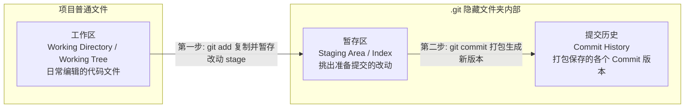
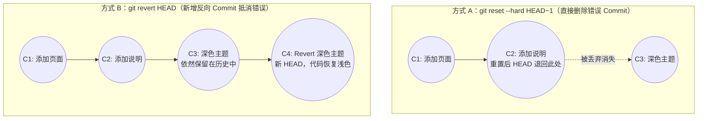
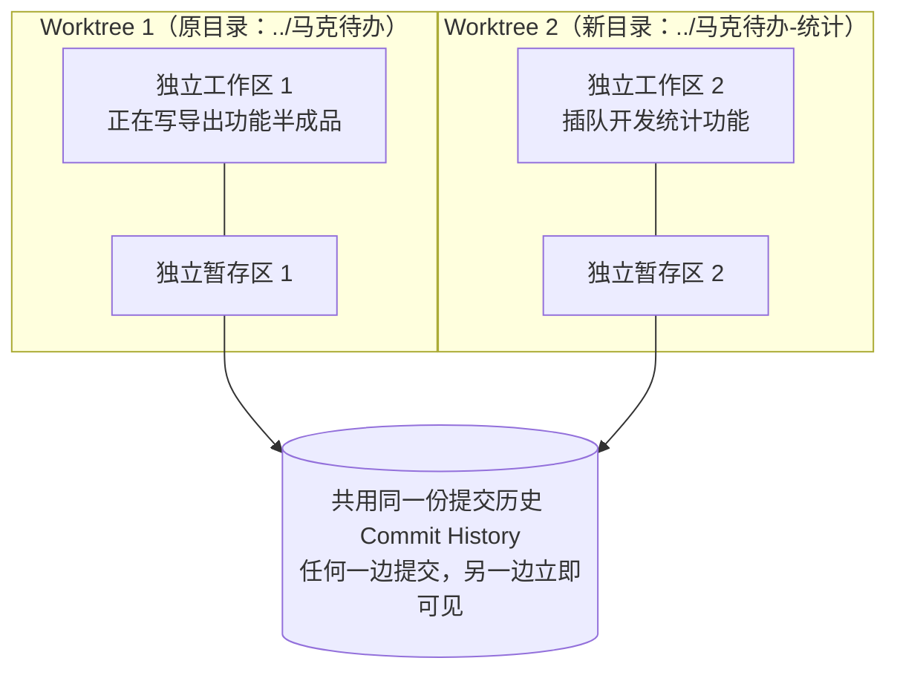
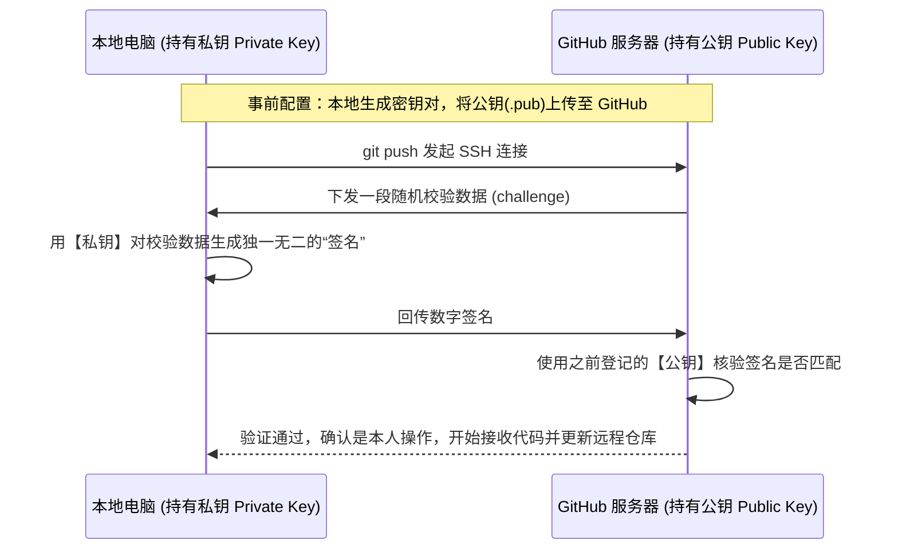

# Git + GitHub

### **模块一：Git 与 GitHub 的核心定位及环境搭建**

#### **1. 核心概念与底层原理**

在传统开发与 AI 编程（如使用 Codex、Claude Code 等编程 Agent）中，代码版本管理都是必不可少的基础能力。尤其是在 AI 编程时代，AI 往往一次修改几十个文件，如果没有版本存档，一旦把项目改坏就很难退回。

* **Git（本地版本控制软件）**：安装在你**自己电脑上的软件**。它的核心作用是记录代码版本（存档与回滚）。当项目完成一个阶段时，用 Git 把当时的代码状态保存下来；后续即使把代码改坏甚至误删，也随时能退回到之前保存过的正常版本。所有操作均在本地完成，无需联网。
* **GitHub（远程代码托管网站）**：一个**在线网站**。它的核心作用是在云端**备份**你的代码和 Git 版本历史。把本地的代码及所有版本记录同步存一份在 GitHub 上，即便哪天电脑损坏或本地文件夹被彻底误删，数据也不会丢失。此外，GitHub 还支持多人协作开发以及将源码公开分享给他人。

#### **2. 安装方法与验证步骤**

视频介绍了三种安装 Git 的路径，可根据你的系统和使用习惯选择：

1. **借助 AI 编程工具安装（最省心）**
   如果你已经在使用 Codex、Claude Code 等编程 Agent，最简单的方式是直接在终端用自然语言告诉 AI：“帮我安装 Git”。如果电脑尚未安装，AI 会自动帮你执行整个安装流程；如果电脑已经装过，AI 检测到后会自动跳过，不会重复安装。
2. **Windows 系统手动安装**
   * **第一步**：打开 [Git 官网](https://git-scm.com)，点击页面中的 `Install for Windows`，再点击 `Click here to download` 下载安装包。
   * **第二步**：双击运行下载好的安装包，安装方式与普通软件一致，保持默认配置一路点击 `Next`。
   * **第三步**：在最后一步取消勾选 `View Release Notes`（该选项仅用于展示版本发布说明，无实际价值），点击 `Finish` 完成安装。
   * **第四步（验证安装）**：点击 Windows 开始菜单，搜索并打开 **`Git Bash`**，输入命令 `git --version` 并回车。若正常显示出 Git 版本号（如 `git version 2.x.x`），即说明安装成功。
3. **macOS 系统手动安装**
   * **第一步**：打开 macOS 自带的“终端（Terminal）”，直接输入 `git --version` 并回车。
   * **第二步（情况 A：已自带）**：如果直接显示出了版本号，说明你的电脑此前在安装其他软件时已经顺带把 Git 安装好了，无需任何额外操作。
   * **第二步（情况 B：弹窗安装开发者工具）**：如果未安装，终端会提示需要先安装 **Xcode 命令行开发者工具（Command Line Tools）** 才能使用 Git，同时系统 Dock 栏会弹出一个安装对话框。这是苹果官方提供的一整套开发工具全家桶（除 Git 外还包含编译器、调试工具等开发必备组件），直接点击“安装”并同意协议。
   * **第三步（验证安装）**：等待安装完成后关闭对话框，再次在终端执行 `git --version`，正常显示版本号即告完成。

---

### **模块二：本地仓库初始化与存档核心原理（三大区域）**

#### **1. 核心概念与底层原理**

* **仓库初始化与 `.git` 隐藏文件夹**：
  执行 `git init` 命令的本质，是在当前项目文件夹下自动创建一个名为 **`.git`** 的隐藏文件夹。从此以后，所有与 Git 相关的版本数据、历史记录都存放在这个 `.git` 文件夹内部。
* **Git 的三大核心区域**：
  一个被 Git 管理的项目文件夹，在逻辑上被划分为两类文件、**三个区域**：
  1. **工作区（Working Directory / Working Tree）**：即我们自己的项目文件（如 `index.html`、`README.md`），是我们日常在 VS Code 等编辑器里直接打开和修改的区域。
  2. **暂存区（Staging Area / Index）**：位于 `.git` 隐藏文件夹内部。用于临时存放我们挑出来的、准备放入下一次版本提交中的改动。在 Git 术语中，把改动放入暂存区的操作叫 **`stage`**，已放入暂存区的改动叫 **`staged`**，还在工作区未放入暂存区的叫 **`unstaged`**（或 `not staged`）。
  3. **提交历史（Commit History）**：位于 `.git` 隐藏文件夹内部。用于永久保存每一次打包生成的版本。在 Git 中，大家一般不把版本叫“版本”，而是直接称之为 **`commit`（提交）**，提交历史也常被称为 **commit 历史**。



* **底层原理思考：为什么不能直接把工作区存成一个版本，非要先复制到“暂存区”？**
  暂存区存在的核心意义在于：**允许我们“一点一点挑选”下一次要提交的内容**。
  如果只改了一个文件，暂存区的作用还不明显；但假设我们对项目做了一次代码重构，改了十几个文件，同时还有些文件（比如说明文档）只写了一半。有了暂存区，我们就可以分批次用 `git add` 慢慢挑出已经写好、属于同一个功能改动的文件（比如先挑 `index.html`，再挑对应的 `.js` 和 `.css` 文件），把半成品留在工作区不挑进去。等确认暂存区里的所有内容都准备妥当后，再执行一次 `git commit` 统一打包成一个干净的 commit。

#### **2. 方法与操作步骤**

1. **进入项目目录并初始化仓库**：
   ```bash
   # 进入项目文件夹（cd 不是 Git 命令，但使用频率极高，用于切换目录）
   cd 你的项目路径/马克待办

   # 将当前目录初始化为 Git 仓库
   git init
   ```
2. **首次提交前的准备：配置提交人姓名与邮箱**：
   Git 每生成一次 commit，都会在记录里写下是谁提交的。因此首次使用前需告诉 Git 你的名字和邮箱：
   ```bash
   git config --global user.name "你的名字"
   git config --global user.email "你的邮箱"
   ```
3. **查看仓库当前状态（`git status`）**：
   ```bash
   git status
   ```
   * 若文件显示在 **`Untracked files`（未跟踪文件）** 下：说明 Git 发现了该文件，但尚未开始跟踪它的改动，也没存过版本。
   * 若文件显示在 **`Changes to be committed`** 下：说明该文件的改动已经进入**暂存区**，正等待被提交为 commit。
4. **第一步存档：将工作区改动加入暂存区（`git add`）**：
   ```bash
   # 添加单个文件到暂存区
   git add index.html

   # 也可以一次性添加多个文件到暂存区
   git add index.html main.js style.css
   ```
5. **第二步存档：将暂存区内容打包提交为 Commit（`git commit`）**：
   ```bash
   git commit -m "添加待办页面"
   ```
   其中 `-m` 是 `message` 的缩写，后面引号内是对本次提交的说明。因为一个项目往往有几十上百个 commit，写清楚说明才能在日后查看历史时迅速知道每个 commit 改了什么。
6. **查看提交历史（`git log`）**：
   ```bash
   git log
   ```
   输出结果按时间倒序排列（最新提交在最上面）。每条记录包含四个部分：
   * **Commit 编号（Commit ID）**：`commit` 后面跟着的一长串字母和数字（SHA-1 哈希值），每个 commit 独一无二，相当于它的身份证号。
   * **Author**：提交人的名字和邮箱（即刚才用 `git config` 设置的信息）。
   * **Date**：提交的具体时间。
   * **提交说明**：最下方缩进显示的一行文字（即 `git commit -m` 后面写的内容）。
   * 查看完毕后，按键盘上的 **`q`** 键即可退出 `git log` 界面（若想清理终端屏幕，可执行 `clear` 命令）。

#### **3. 视频关键案例**

在视频的**“马克待办”**项目中，初始有两个文件：`index.html`（100 多行的待办页面代码，已可正常运行）和 `README.md`（项目说明文档，最后的“后续计划”写着“具体内容待补充”，属于半成品）。
* **第一次提交**：为了防止后续改坏 `index.html`，先只对 `index.html` 执行 `git add index.html` 和 `git commit -m "添加待办页面"`，此时暂存区只打包了 `index.html`，半成品 `README.md` 依然留在 `Untracked files` 中。
* **第二次提交**：随后打开 `README.md`，把“具体内容待补充”修改为接下来打算开发的两个功能并保存；接着执行 `git add README.md` 和 `git commit -m "添加项目说明"`。此时运行 `git log` 就能看到上下两条完整的 commit 记录。

#### **4. 高频易错点**

* **易错点 1：误以为“空的 Git 仓库”代表 `.git` 文件夹是空的**
  执行 `git init` 时提示 `Initialized empty Git repository`，意思是**目前还没有保存任何 commit（版本）**，但 `.git` 隐藏文件夹内部其实已经自动生成了许多 Git 所需的基础文件。平时不需要打开或修改 `.git` 文件夹，保持隐藏即可。
* **易错点 2：误以为配置 `user.name` 和 `user.email` 是在登录账号**
  这两行命令**不是在登录或注册任何账号**，Git 也不会对邮箱做任何验证，它仅仅是你在本地给 commit 贴上的作者署名标签。而且加上 `--global` 后，**在一台电脑上只需要设置一次**，后续在这台电脑上继续操作该项目或新建任何其他项目，都无需重新设置。
* **易错点 3：提交完成后运行 `git status` 看不到刚才的文件，误以为文件丢了**
  当 `index.html` 提交为 commit 后，再次运行 `git status` 会发现列表里不再显示 `index.html`。这是因为 `git status` 只会列出“有未提交改动或未跟踪”的文件；文件内容与最新 commit 完全一致时属于正常干净状态，无需提示。

---

### **模块三：查看差异与三种状态的回滚机制**

#### **1. 核心概念与底层原理**

当我们写代码把项目改坏了想要回退时，具体的回滚方法取决于**这份修改目前走到了哪一步**（只在工作区、已进暂存区、还是已经提交成了 commit）。

* **行级差异对比（`git diff`）**：
  `git status` 只能告诉我们**哪几个文件**被修改了（标为 `modified`），但看不到具体改了什么内容。执行 `git diff` 则能看到工作区与暂存区之间的具体代码行差异（若改动尚未暂存，暂存区内容就等于上次提交，效果上等同于与上次提交比较）：前面带 **`-`（减号，红色）** 的行代表被删掉的代码，前面带 **`+`（加号，绿色）** 的行代表新增加的代码。
* **`HEAD` 指针与相对位置表示法**：
  在 Git 中，**`HEAD`** 代表当前分支提交历史里**最新的那一个 commit**。而 `HEAD` 之前的历史版本则用波浪号加数字表示：
  * **`HEAD`** ：最新的第 1 个 commit（倒数第一）
  * **`HEAD~1`**：`HEAD` 之前的那个 commit（倒数第二）
  * **`HEAD~2`**：再往前一个 commit（倒数第三），以此类推。
  注意：`HEAD` 指向的位置不是固定的，每当你提交一个新的 commit，`HEAD`、`HEAD~1`、`HEAD~2` 就会自动整体往前移动一步。
* **已提交 Commit 的两种回滚哲学（`git reset` vs `git revert`）**：
  * **`git reset`（重置/删记录回滚）**：通过把 `HEAD` 指针直接往回挪到 `HEAD~1` 的位置，原本最新的那个错误 commit 因为没有指针指向它（“没人管了”），就会直接从 `git log` 历史中被丢弃删除。
  * **`git revert`（反做/留记录回滚）**：不删除原来的错误 commit，而是让 Git 自动在工作区把代码“反着改回来”（之前增加了一行，现在就删掉那一行；之前把 `ABC` 改成 `XYZ`，现在就改回 `ABC`），然后把这份反向修改打包提交为一个**全新的 commit**，用来抵消掉前一个错误 commit。好处是**历史记录完整保留**，万一哪天后悔了想找回之前写过的代码，还能从历史里翻出来。



* **`git reset` 的三种模式原理对比**：
  `git reset` 共有三种模式，核心区别在于**回滚时所影响的区域范围不同**：

| Reset 模式 | 是否回滚【提交历史】 | 是否回滚【暂存区】 | 是否回滚【工作区】 | 适用场景与特点 |
| :--- | :---: | :---: | :---: | :--- |
| **`--hard`** | 是 | 是 | 是 | **最彻底**：三个区域一起回滚，代码完全恢复到目标 commit 的样子，错误改动彻底消失。 |
| **`--mixed`**（默认） | 是 | 是 | **否（保留改动）** | 不写参数执行 `git reset HEAD~1` 时的默认模式。撤回 commit 和暂存区，但代码改动留在工作区里。 |
| **`--soft`** | 是 | **否（保留改动）** | **否（保留改动）** | 只撤回 commit，代码改动原封不动留在暂存区和工作区。适合刚提交完发现有小瑕疵，改两行再重新提交。 |

#### **2. 方法与操作步骤**

* **查看具体修改内容（`git diff` 操作按键）**：
  执行 `git diff` 进入差异界面后：按 **`j`** 往下一行行移动，按 **`k`** 往上一行行移动；若嫌慢，按 **`f`** 往下翻一整页，按 **`b`** 往上翻一整页；查看完毕按 **`q`** 退出。

* **场景一：改动只在工作区（改完文件尚未执行 `git add`）**
  此时运行 `git status` 会看到 `Changes not staged for commit`，直接使用 `git restore` 撤销工作区改动：
  ```bash
  # 回滚单个指定文件
  git restore index.html

  # 同时回滚多个指定文件
  git restore index.html README.md

  # 一键回滚当前目录下的所有文件改动（ `.` 代表当前目录，AI 编程最常用）
  git restore .
  ```
  执行后运行 `git status`，显示 `nothing to commit, working tree clean`（工作区干净，回滚生效）。

* **场景二：改动已进入暂存区（已执行 `git add`，尚未执行 `git commit`）**
  此时运行 `git status` 会看到 `Changes to be committed`。需要分两步走：先把改动从暂存区撤回工作区（unstage），再从工作区抹除改动：
  ```bash
  # 第一步：将当前目录所有改动从暂存区撤出（退回到仅在工作区的状态）
  git restore --staged .

  # 第二步：将工作区的改动彻底丢弃
  git restore .
  ```

* **场景三：改动已提交为 Commit（已执行 `git add` 和 `git commit`）**
  * **做法 1（彻底删掉最新 Commit）**：
    ```bash
    # 先看一眼 git status 确保工作区没有其他未提交的重要代码，然后执行：
    git reset --hard HEAD~1
    ```
  * **做法 2（新增一个反向 Commit 抵消最新 Commit）**：
    ```bash
    git revert HEAD
    ```
    执行后会弹出 **Vim 编辑器**界面，展示自动生成的回滚提交说明（第一行为 `Revert "xxx"`，空一行后以 `This reverts commit <哈希>.` 写明被回滚的 Commit ID，下方以 `#` 开头的行全是注释，会被忽略）。无需修改内容，直接按键盘输入英文冒号加 `wq`：
    ```text
    :wq
    ```
    回车保存退出，回滚 commit 即创建完成。

#### **3. 视频关键案例**

视频中为了演示三种回滚，将“马克待办”的 `index.html` 修改了 5 行样式代码，把浅色背景改成了效果很差的**深色主题**：
1. 第一次只保存文件不敲 Git 命令，用 `git restore .` 一键退回浅色主题；
2. 第二次改完深色主题后执行了 `git add index.html`，先用 `git restore --staged .` 撤下暂存区（此时刷新网页发现依然是深色主题），接着再执行 `git restore .`，网页才真正变回浅色；
3. 第三次把深色主题提交成了第 3 个 commit，先演示用 `git reset --hard HEAD~1` 把总 commit 数从 3 个删回 2 个；随后再次提交深色主题，演示用 `git revert HEAD` 将总 commit 数变成 4 个（第 4 个 commit 的修改内容与第 3 个完全相反），同样使页面恢复了浅色。

#### **4. 高频易错点**

* **易错点 1：纠结 `working directory` 和 `working tree` 的区别**
  在 `git status` 的不同提示里，有时写 `working directory`，有时写 `working tree`。它们在英文里只是工作区的两种不同叫法，意思完全一样，不必纠结。
* **易错点 2：对暂存区文件只执行了 `git restore --staged .`，以为文件内容已经回滚了**
  `git restore --staged .` **只修改了 Git 暂存区的记录**，把文件从暂存区撤回到了工作区，但工作区里的代码文件本身**一行都没变**！必须紧接着再执行一次 `git restore .`，文件内容才会真正恢复原状。
* **易错点 3：盲目执行 `git reset --hard` 导致未提交的心血丢失**
  `--hard` 干得极其彻底，它会把工作区、暂存区和提交历史一并重置。如果你在提交完那个想回滚的 commit 之后，又在工作区里写了一些新的未提交代码，直接运行 `git reset --hard HEAD~1` 会导致你新写的未提交代码也跟着灰飞烟灭。因此，**执行 `--hard` 前务必先用 `git status` 确认工作区是干净的**。

---

### **模块四：使用 `.gitignore` 忽略无关文件**

#### **1. 核心概念与原理**

项目目录里有些文件我们希望保留在电脑上（比如个人学习笔记、系统自动生成的隐藏视图配置文件、临时文件等），但它们与项目本身的功能毫无关系，既不打算提交进历史记录，也不希望每次敲 `git status` 时它们都出现在 `Untracked files` 里刷屏干扰视线。

为此，Git 提供了 **`.gitignore`** 机制：在项目根目录下创建一个名为 `.gitignore` 的文本文件，把不想让 Git 跟踪的文件名写进去，Git 就会自动无视它们的存在。

#### **2. 方法与配置步骤**

1. **创建并编辑 `.gitignore` 文件**：
   在项目根目录下用编辑器（VS Code 或终端 `vim .gitignore`）新建 `.gitignore` 文件，将需要忽略的文件名一行一个写入：
   ```text
   notes.txt
   .DS_Store
   ```
2. **验证忽略效果**：
   保存后运行 `git status`，原本未跟踪的 `notes.txt` 不再显示，取而代之的是新创建的 `.gitignore` 文件。
3. **将 `.gitignore` 提交到仓库**：
   ```bash
   git add .gitignore
   git commit -m "添加 .gitignore 忽略规则"
   ```

#### **3. 视频关键案例**

视频中在“马克待办”目录下新建了一个个人学习笔记 `notes.txt`，并预判 macOS 的访达（Finder）在调整文件夹显示视图或拖动图标时会悄悄生成隐藏文件 `.DS_Store`。将这两行写入 `.gitignore` 后，`notes.txt` 依然完好地保存在访达文件夹里可以继续编辑，但 `git status` 已经彻底不再提示它了。

#### **4. 高频易错点**

* **易错点 1：误以为被 `.gitignore` 忽略的文件会被删除**
  `.gitignore` 只是让 Git 不再检测和提示该文件，电脑硬盘上的原文件不会受到任何影响。
* **易错点 2：忘记把 `.gitignore` 文件本身提交到 Git 仓库**
  很多人配好 `.gitignore` 后就不管了。注意：**`.gitignore` 本身是项目配置的一部分，必须通过 `git add` 和 `git commit` 提交上去**！这样忽略规则才会跟着项目历史一起保存，日后换电脑或与人协作时无需重新编写规则。

---

### **模块五：分支（Branch）、合并（Merge）与冲突解决**

#### **1. 核心概念与底层原理**

* **分支（Branch）的本质**：
  运行 `git log` 时，最新 commit 旁边的括号里除了 `HEAD`，还会显示 `master`（或 `main`）。**分支在底层本质上就是一个贴在某个 commit 上的标签**。当你在该分支上提交新 commit 时，这个标签就会自动跟着往前挪一步，永远贴在最新的 commit 上。从分支标签出发往回追溯的一整串 commit，就是这条分支的提交历史。
* **为什么开发新功能要建分支？（主分支稳定原则）**：
  `master`（或 `main`）是整个项目的**主分支**，团队通常要求主分支上的代码**随时处于稳定、可正常使用的状态**。
  如果一个新功能需要拆成 3 个 commit 才能做完（比如先做界面、再写保存逻辑、最后加提醒），若直接在 `master` 上提交，那么提交完第 1 个 commit 时，`master` 上就只有按钮没有逻辑，用户一点就会报错。
  **正确做法（一个功能一个分支）**：基于稳定的 `master` 拉出一条专门的功能分支（习惯命名为 `feature/功能名`），把开发过程中的多个 commit 都提交到这条新分支上。开发期间 `master` 完全不受影响，始终保持稳定；等新功能在新分支上全部开发完并测试通过后，再一次性把新分支**合并（merge）**回 `master`，最后删掉用完的功能分支。
* **两种合并策略的底层原理（为什么有时合并很干脆，有时却要多产生一个 Commit？）**：
  1. **快进合并（Fast-forward）**：
     假设你从 `master` 拉出了分支 A 并提交了 3 个 commit，在此期间 **`master` 原地不动，没有任何新提交**。此时分支 A 包含了 `master` 的所有历史，只是顺着往后多走了 3 步。合并时，Git 只需要把 `master` 标签直接往前“快进”挪到分支 A 的位置即可，**不会产生任何新的 commit**。
  2. **三方合并（生成专门的合并 Commit）**：
     假设你同时从 `master` 的同一个旧节点拉出了分支 A 和分支 B。当你先把分支 A 快进合入 `master` 后，`master` 已经走到了分支 A 的末端；此时再去合并分支 B，因为分支 B 是从老位置叉出去的，它里面根本没有分支 A 的那 3 个 commit。如果直接把 `master` 挪去分支 B，分支 A 的功能就丢了！因此，Git 必须在后面**新造一个专门用于合并的 commit**，同时连接两边的最新 commit，把两边的代码融合在一起，再把 `master` 挪到这个新 commit 上。
* **合并冲突（Merge Conflict）的产生原因**：
  在进行三方合并时，如果两条分支修改的是不同文件或同一文件的不同位置，Git 会自动合并并自动提交那个合并 commit；但如果**两条分支在同一个文件的同一个位置修改了不同的内容**（比如都想在“添加”按钮正下方插入各自的新按钮），Git 无法替你决定该留哪一个、还是两个都留、谁前谁后，就会报出 **`CONFLICT`** 并暂停合并，等待人类手动裁决。

#### **2. 方法与操作步骤**

* **分支的日常操作命令**：
  ```bash
  # 1. 查看当前仓库所有分支（前面带 * 星号的代表当前所在的分支）
  git branch

  # 2. 分步写法：先创建分支，再切换到该分支
  git branch feature/due-date
  git switch feature/due-date

  # 3. 【推荐】一步到位写法：创建新分支并立刻切换过去（-c 即 create）
  git switch -c feature/due-date
  # 注：老教程常用 git checkout -b feature/due-date，效果完全一致，但 switch -c 语义更清晰

  # 4. 简洁模式查看提交历史（每个 commit 只占一行，仅显示前几位编号和说明）
  git log --oneline

  # 5. 合并分支（切记：必须先切回目标分支 master，再把功能分支合并进来！）
  git switch master
  git merge feature/due-date

  # 6. 删除已经合并完成、不再需要的分支（-d 即 delete）
  git branch -d feature/due-date
  ```

* **解决合并冲突（Conflict）的标准四步法**：
  当执行 `git merge` 提示 `CONFLICT` 且 `Automatic merge failed` 时：
  1. **查看状态确认冲突文件**：
     运行 `git status`，在 `Unmerged paths`（未合并完的路径）下会看到标注为 **`both modified`**（两边都修改过）的文件，如 `index.html`。（注：如果此时不想合并了，可执行 **`git merge --abort`** 放弃合并恢复原状）。
  2. **用编辑器打开冲突文件，识别三行冲突标记**：
     打开 `index.html`，找到 Git 自动插入的三行特殊标记符号：
     ```html
     <<<<<<< HEAD
     <button>排序</button>
     =======
     <button>全部完成</button>
     >>>>>>> feature/complete-all
     ```
     * `<<<<<<< HEAD` 到 `=======` 之间的**上半部分**：是你当前所在分支（即 `HEAD` 指向的 `master` 分支）的内容。
     * `=======` 到 `>>>>>>> feature/complete-all` 之间的**下半部分**：是正准备合并进来的那条分支的内容。
  3. **手动修改并删除标记符号**：
     将 `<<<<<<< HEAD`、`=======`、`>>>>>>> feature/complete-all` 这三行标记符号彻底删掉，并把中间的代码调整为你最终想要保留的样子（例如把两个按钮都留下来并排好顺序），保存文件。
  4. **暂存并提交合并结果**：
     ```bash
     git add index.html
     git commit -m "合并全部完成功能并解决按钮冲突"
     ```
     执行完毕后运行 `git status` 显示 `working tree clean`，合并彻底完成。

#### **3. 视频关键案例**

1. **无冲突快进合并案例**：为“马克待办”开发**“截止时间（`feature/due-date`）”**功能，在新分支分 3 个 commit 完成了界面、保存逻辑、过期标红提醒。开发途中切回 `master` 演示了 `master` 页面完全不受影响；完成后切回 `master` 执行 `git merge feature/due-date` 顺利合入，并用 `git branch -d` 删掉了该分支。
2. **双分支冲突案例**：先后基于同一个 `master` 节点创建了**“按截止时间排序（`feature/sort`）”**和**“全部完成（`feature/complete-all`）”**两条分支，各自提交了 3 个 commit。切回 `master` 后，先合并 `feature/sort` 触发了 `Fast-forward` 一步成功；紧接着合并 `feature/complete-all` 时，因为两个分支都在 `index.html` 的“添加”按钮下方插入了各自的按钮，触发冲突。最后通过删掉三行冲突标记、同时保留“排序”和“全部完成”两个按钮，并执行 `git add` 与 `git commit` 完成了三方合并。

#### **4. 高频易错点**

* **易错点 1：只执行了 `git branch 新分支名`，没切换分支就开始写代码**
  `git branch <分支名>` **只负责把分支创建出来，并不会自动把你带过去**！创建后你依然停留在原来的 `master` 上。因此日常强烈建议直接用 **`git switch -c <分支名>`** 创建并立即切换，或者养成用 `git branch` 看一眼星号 `*` 在哪里的习惯。
* **易错点 2：刚建完新分支发现项目文件没变，以为建分支失败了**
  刚从 `master` 创建并切换到新分支时，两条分支指向的是同一个 commit，所以工作区里的代码文件一模一样。只有当你在新分支上提交了新的 commit 之后，两条分支的差异才会显现出来。
* **易错点 3：合并分支时站错了位置（搞反合并方向）**
  `git merge` 的规则永远是**“把别的分支合入当前所在的分支”**。如果你想把 `feature` 合进 `master`，必须先 `git switch master` 站在 `master` 上，再敲 `git merge feature`。

---

### **模块六：Git 进阶工具三剑客（Rebase、Stash、Worktree）**

#### **1. Rebase（变基 / 给分支换地基）**

* **核心概念与痛点原理**：
  在真实开发中，一个复杂功能往往要在 `feature` 分支上写一两周（几十个 commit），这期间 `master` 分支也在不断合入别人的新代码。如果等到最后一刻才合并，不仅会一次性爆发海量冲突，甚至可能发现自己的实现方式跟最新的 `master` 根本不兼容而返工。
  **解决之道就是 `rebase`（`re` 重新 + `base` 地基，即重新更换分支叉出去的那个起点 commit）**：在开发过程中，时不时地用 `git rebase master` 把自己的功能分支挪到 `master` 最新提交的后面。这样既能随时拿到 `master` 的最新代码、把冲突趁少当场解决，等最后功能写完合回 `master` 时，还能直接触发干净利落的 **Fast-forward（快进合并）**，让提交历史保持为一条直线。
* **底层运行机制（重放 Commit）**：
  `rebase` 并不是把整条分支一次性平移过去，而是**把你分支上的每一个 commit 拆下来，挨个在新的地基（最新 `master`）后面一个一个重新做一遍**！
* **方法与操作步骤**：
  ```bash
  # 1. 先切换到你的功能分支上
  git switch feature/complete-all

  # 2. 执行变基，将当前分支的地基换到最新的 master 上
  git rebase master

  # 3. 若搬运某个 commit 时报冲突：打开冲突文件删掉 <<<< ==== >>>> 标记并改好代码后，先加入暂存区：
  git add index.html

  # 4. 【核心关键】继续变基（千万不要敲 git commit！）
  git rebase --continue
  # （此时若弹出 Vim 编辑器展示该 commit 原有的提交说明，直接输入 :wq 回车保存退出，Git 会继续搬运后续剩余的 commit）

  # 5. 变基完成后，若功能已开发完毕，切回 master 即可快进合并：
  git switch master
  git merge feature/complete-all
  ```
* **高频易错点**：
  在 `rebase` 过程中遇到冲突并执行 `git add` 之后，**千万不要习惯性地去敲 `git commit`**！因为此时并不是在创建合并节点，而是在恢复中断的搬运过程，必须执行 **`git rebase --continue`**。

---

#### **2. Stash（暂存未写完的半成品代码）**

* **核心概念与底层原理**：
  当你正在功能分支上写代码，一个函数刚写了一半（还不能提交半成品 commit），突然需要紧急切回 `master` 修一个线上 Bug。此时直接执行 `git switch master` 会被 Git 报错拦下（提示本地对文件的修改会被覆盖，让你 `commit your changes or stash them`）。
  在 `.git` 文件夹内部，除了暂存区和提交历史，还有一个专门用来临时收东西的区域叫 **`stash`（藏起来/存起来）**。执行 `git stash` 后，Git 会把当前**工作区和暂存区（Index）**里所有还没提交成 commit 的改动（统称为 **`WIP`，即 Work In Progress 正在做的活**）一股脑收进 Stash 区域，让工作区瞬间恢复到上一次提交时的干净状态。忙完别的事情切回来后，再用 `git stash pop` 把半成品代码原样取回工作区接着写。


* **方法与操作步骤（结合视频紧急修 Bug 案例）**：
  视频中正在 `feature/clear-completed` 分支编写“清空已完成”功能的 `clearCompleted` 函数（刚写了一半），突然收到用户反馈：带截止时间的待办勾选完成后，日期也被误划上了删除线。处理全流程如下：
  ```bash
  # 1. 将当前工作区和暂存区写了一半的改动收进 Stash
  git stash

  # 2. 此时工作区已干净（working tree clean），顺利切回 master
  git switch master

  # 3. 基于 master 拉出一条专门修 Bug 的 hotfix 分支（不要直接在 master 上改代码）
  git switch -c hotfix/due-date-strikethrough

  # 4. 修复代码并验证无误后，提交并合入 master，随后删掉 hotfix 分支
  git add index.html
  git commit -m "修复完成待办时截止时间被划掉的问题"
  git switch master
  git merge hotfix/due-date-strikethrough
  git branch -d hotfix/due-date-strikethrough

  # 5. 切回原来的功能分支，将 Stash 里的半成品代码弹出取回工作区
  git switch feature/clear-completed
  git stash pop
  # （此时写了一半的 clearCompleted 函数完好如初，继续写完提交并合入 master 即可）
  ```
* **高频易错点**：
  * **误以为 `stash` 只收工作区不管暂存区**：`git stash` 输出信息中的 `WIP on ...` 和 `index` 表明，只要是**还没提交成 commit 的改动（无论是只在工作区，还是已经 `git add` 进了暂存区）**，都会被 `stash` 一并收走。
  * **切回 `master` 后直接在 `master` 上修 Bug**：为了保证主分支稳定，修 Bug 也应遵循分支规范，从 `master` 拉出一条 `hotfix/xxx`（紧急修复）分支修改，测通后再合回 `master`。

---

#### **3. Worktree（多工作树：多目录并行开发）**

* **核心概念与底层原理**：
  `stash` 适合临时被打断一会儿、很快就能回来的场景；但如果需要**同时并行开发多个分支**（这边写一会儿，那边写一会儿），频繁敲 `stash` 和 `stash pop` 就太折腾了。
  **`worktree`（工作树）** 的解决思路是：在电脑上再开一个文件夹。在 Git 中，**“一个工作区 + 一份自己独有的暂存区”就构成一个 `worktree`**（我们原本的项目目录本身就是第一个 worktree）。
  **核心黄金法则**：**每一个 Worktree 都有自己独立的工作区（文件夹）和独立的暂存区，互不干扰；但是所有的 Worktree 都共用同一个底层 Git 仓库，共享同一份提交历史！**



* **方法与操作步骤（结合视频插队开发“统计功能”案例）**：
  视频中正在原目录 `feature/export` 分支写“导出功能”（导出逻辑刚写了一半），产品经理突然要求插队开发下周就要上线的“统计功能”：
  ```bash
  # 1. 新建一个 Worktree（指定两件事：基于 master 新建 feature/stats 分支，代码放在父级目录 ../马克待办-统计 文件夹中）
  git worktree add -b feature/stats ../马克待办-统计 master

  # 2. 解决终端中文路径显示为八进制乱码（历史遗留问题，设置不转义中文即可）：
  git config --global core.quotepath false

  # 3. 查看当前共有几个 Worktree 及其对应的路径和分支
  git worktree list

  # 4. 进入新目录开发统计功能、提交代码
  cd ../马克待办-统计
  # （修改代码后执行 git add 和 git commit）

  # 5. 在新目录中将统计功能合入 master，并删掉 feature/stats 分支
  git switch master
  git merge feature/stats
  git branch -d feature/stats

  # 6. 【清理步骤】先用 cd 退回原来的主目录，再用专用命令删掉新 Worktree
  cd ../马克待办
  git worktree remove ../马克待办-统计
  ```
* **高频易错点**：
  * **易错点 1：认为 Worktree 和“直接在访达里复制一份项目文件夹”是一回事**
    如果在系统访达/资源管理器里直接复制粘贴项目文件夹，得到的是**两个完全独立的 Git 仓库**，在一边提交的代码另一边根本不知道；而新增的 Worktree 与原目录**共用同一个仓库**，哪怕把新目录删掉了，刚才在新目录里提交并合入 `master` 的统计功能代码，在原目录的 `git log` 里依然完好无损。
  * **易错点 2：看不懂 `git branch` 输出列表前面的加号 `+`**
    使用多 Worktree 时运行 `git branch`：前面带星号 **`*`** 的代表当前目录所在的分支；前面带加号 **`+`** 的（如 `+ feature/export`），代表该分支**正在另一个 Worktree 目录中被打开使用**。
  * **易错点 3：用完新目录后直接拖进系统废纸篓/回收站删除，或者终端还在新目录里就执行删除**
    直接把文件夹拖进废纸篓只会删掉物理文件，Git 内部还残留着该 Worktree 的登记信息，会导致后续报错。正确做法是**先用 `cd` 回到原项目目录**，再执行 **`git worktree remove <路径>`** 将文件夹和 Git 记录一并清理。

---

### **模块七：GitHub 远程认证、代码推送与克隆恢复**

#### **1. 核心概念与底层原理**

* **SSH Key（公钥与私钥）的身份验证原理**：
  当你从电脑往 GitHub 推送代码时，GitHub 必须确认操作者是你本人而非他人冒充。目前 GitHub 已不再支持直接输入账号密码验证，主流方式是配置 **SSH Key**。
  SSH Key 不是一串需要背诵的字符密码，而是生成在本地电脑上的**两个文件**：
  1. **私钥（Private Key，如 `id_ed25519`）**：留在你自己的电脑上，**绝对不能公开或发给任何人**。每次你往 GitHub 推代码建立 SSH 连接时，GitHub 会先发来一段校验数据，电脑用私钥对它生成一个独一无二、别人无法伪造的**“签名”**回传给 GitHub；GitHub 用登记的公钥核验通过后，才开始正式接收代码。
  2. **公钥（Public Key，如 `id_ed25519.pub`，`pub` 即 `public`）**：可以公开，发给 GitHub 保管一份。GitHub 收到你的代码和签名后，会拿你之前交上去的公钥去检查这个签名。只要公钥能认出这是它配对的那把私钥做出来的签名，身份验证即通过。



* **`origin` 与 `-u` 绑定的含义**：
  * **`origin`**：GitHub 仓库的远程地址很长，我们通过 `git remote add origin <地址>` 给这个远程地址起了一个简短的代号叫 `origin`（大家的习惯叫法，代表远程源仓库）。
  * **`-u` 参数**：在首次推送 `git push -u origin master` 时加上 `-u`，会把本地的 `master` 分支与 GitHub 上的 `master` 分支（即 `origin/master`）正式绑定。绑定后，以后在这条分支上推送代码只需输入 **`git push`** 两个单词即可。

#### **2. 方法与操作步骤**

1. **生成并配置 SSH Key（每台电脑只需配置一次）**：
   ```bash
   # 第一步：生成 SSH Key（-t ed25519 为 GitHub 推荐算法类型，-C 后面填邮箱作为备注）
   ssh-keygen -t ed25519 -C "你的邮箱"
   # 注：执行后会连续提问 3 次（保存路径默认 ~/.ssh/id_ed25519、私钥密码、确认密码），个人电脑直接连按 3 次回车全部使用默认/无密码即可。

   # 第二步：打印公钥文件内容并复制整串输出文本
   cat ~/.ssh/id_ed25519.pub
   ```
   * **第三步（上传公钥到 GitHub）**：登录 GitHub 网页 -> 点击右上角头像 -> **`Settings`** -> 左侧菜单点击 **`SSH and GPG keys`** -> 点击 **`New SSH key`** -> 将复制的公钥内容粘贴到文本框 -> 点击 **`Add SSH key`**。
   * **第四步（在终端测试连接）**：
     ```bash
     ssh -T git@github.com
     ```
     首次连接会询问是否继续连接，输入 **`yes`** 并回车。看到 `Hi xxx! You've successfully authenticated...` 即代表配置成功。

2. **在 GitHub 创建空仓库并首次推送本地项目**：
   * **第一步（网页创建仓库）**：点击 GitHub 右上角头像 -> **`Repositories`** -> 点击 **`New`**。填写英文仓库名（`Repository name`，如 `MarkTodo`，不能用中文，中文说明可填在 `Description`）；选择公开（`Public`）或私有（`Private`）；**底部的 `Add a README`、`Add .gitignore`、`Add a license` 三个选项全部不要开启**，点击 **`Create repository`**。
   * **第二步（终端绑定并推送）**：在本地项目目录下执行：
     ```bash
     # 1. 记录远程 GitHub 仓库地址并起名为 origin
     git remote add origin git@github.com:你的用户名/MarkTodo.git

     # 2. 将本地 master 分支推送到 origin，并用 -u 绑定关联
     git push -u origin master
     ```
   * **第三步（日常开发同步流程）**：首次推送完成后，日常只要修改了代码，依次执行以下三步即可同时完成本地存档与云端备份：
     ```bash
     git add .
     git commit -m "补充 README 功能列表说明"
     git push
     ```

3. **当本地项目误删或换新电脑时，从 GitHub 克隆找回（`git clone`）**：
   * **第一步**：打开 GitHub 仓库页面 -> 点击绿色 **`<> Code`** 按钮 -> 确保选中 **`SSH`** 标签 -> 点击复制图标复制仓库地址。
   * **第二步**：打开终端，先 `cd` 到想要存放项目的目录（如桌面 `cd ~/Desktop`），执行克隆命令：
     ```bash
     # 在仓库地址后面加上自定义文件夹名“马克待办”，拉下来后文件夹就会直接叫“马克待办”而非 MarkTodo
     git clone git@github.com:你的用户名/MarkTodo.git 马克待办
     ```

#### **3. 视频关键案例**

视频中先为“马克待办”创建了 GitHub 空仓库 `MarkTodo`，通过 `git remote add` 和 `git push -u origin master` 将本地积攒的 22 个 commits 一次性完整推上云端（GitHub 首页自动渲染展示了 `README.md`）。随后更新了 `README.md` 的功能列表，演示了日常修改后只需 `git add` -> `git commit` -> `git push` 即可同步。最后故意把电脑上的“马克待办”文件夹彻底删除，再用 `git clone <地址> 马克待办` 把全部代码和 23 条提交历史分毫不差地恢复到了桌面上。

#### **4. 高频易错点**

* **易错点 1：首次执行 `ssh -T git@github.com` 时看到警告提示以为报错了**
  第一次连接 GitHub 时提示 `The authenticity of host 'github.com ...' can't be established. Are you sure you want to continue connecting?`，这是 SSH 首次连接陌生主机的正常安全确认，直接输入完整的 **`yes`** 回车即可，以后不会再问。
* **易错点 2：在 GitHub 创建仓库时勾选了自动生成 `README` 或 `.gitignore`**
  如果你是要把**本地已经存在的 Git 仓库**推送上去，创建远程空仓库时**千万不要勾选**添加 README、.gitignore 或 License，否则远程仓库会产生跟本地不相关的初始 commit，导致首次 push 冲突报错。
* **易错点 3：照抄 GitHub 提示的 `git push -u origin main` 导致报错**
  GitHub 页面默认提示的推送命令写的是 `main` 分支。如果你的本地主分支名字叫 `master`，又跳过了第二条改名命令（`git branch -M main`），那么执行第三条推送命令时**必须把末尾的 `main` 改成 `master`**（即 `git push -u origin master`）。
* **易错点 4：如何通过 `git status` 判断本地代码有没有推到 GitHub？**
  当你在本地执行了 `git commit` 但还没执行 `git push` 时，运行 `git status` 会提示 `Your branch is ahead of 'origin/master' by 1 commit`（本地比远程领先 1 个提交）；执行完 `git push` 后，则会提示 `Your branch is up to date with 'origin/master'`（本地与远程已完全同步）。

---

### **模块八：全局开发工作流与高频命令速查手册**

为了方便你在写代码时随时对照复习，下面将整套课程的核心命令按使用场景整理为速查清单：

| 场景分类 | 终端命令 | 作用与核心要点说明 |
| :--- | :--- | :--- |
| **环境与配置** | `git --version` | 检查 Git 是否安装成功及当前版本号 |
| **环境与配置** | `git config --global user.name "名字"` | 设置全局提交人姓名（一台电脑仅需一次） |
| **环境与配置** | `git config --global user.email "邮箱"` | 设置全局提交人邮箱（一台电脑仅需一次） |
| **环境与配置** | `git config --global core.quotepath false` | 解决 Git 终端输出中文路径被转义为八进制编码的问题 |
| **初始化与状态** | `git init` | 将当前目录初始化为 Git 仓库（生成 `.git` 隐藏目录） |
| **初始化与状态** | `git status` | 查看当前工作区、暂存区状态及分支同步情况 |
| **初始化与状态** | `git diff` | 查看工作区具体改了哪几行代码（`j`/`k` 逐行，`f`/`b` 翻页，`q` 退出） |
| **日常存档** | `git add <文件名>` 或 `git add .` | 将指定文件或当前目录所有改动复制到暂存区（stage） |
| **日常存档** | `git commit -m "提交说明"` | 将暂存区里的所有内容打包提交为一个新版本（commit） |
| **历史查看** | `git log` | 查看详细提交历史（含完整编号、作者、时间、说明，按 `q` 退出） |
| **历史查看** | `git log --oneline` | 简洁模式查看提交历史（每个 commit 仅占一行） |
| **三种回滚** | `git restore .` | **改动仅在工作区**：一键丢弃当前目录所有未暂存的修改 |
| **三种回滚** | `git restore --staged .` | **改动已进暂存区**：先将改动从暂存区撤回工作区（再配上一条命令彻底丢弃） |
| **三种回滚** | `git reset --hard HEAD~1` | **改动已 Commit（删记录）**：将三个区域彻底退回到上一个版本 |
| **三种回滚** | `git revert HEAD` | **改动已 Commit（留记录）**：新增一个反向修改的 commit 抵消最新提交 |
| **分支与合并** | `git branch` | 查看所有分支（`*` 代表当前分支，`+` 代表在其他 Worktree 打开） |
| **分支与合并** | `git switch -c <分支名>` | 创建新分支并立刻切换过去（旧写法为 `git checkout -b`） |
| **分支与合并** | `git switch <分支名>` | 切换到已有的指定分支 |
| **分支与合并** | `git merge <分支名>` | 将指定分支合并到**当前所在的分支**上（放弃合并用 `git merge --abort`） |
| **分支与合并** | `git branch -d <分支名>` | 删除已经合并完成、不再需要的分支 |
| **进阶三剑客** | `git rebase master` | 将当前分支的地基换到最新 `master` 后（解冲突 `add` 后用 `git rebase --continue`） |
| **进阶三剑客** | `git stash` / `git stash pop` | 将未写完的半成品改动临时收起藏好 / 忙完后弹出恢复到工作区 |
| **进阶三剑客** | `git worktree add -b <新分支> <新路径> master` | 基于 `master` 创建新分支并挂载到新的独立文件夹中并行开发 |
| **进阶三剑客** | `git worktree list` / `git worktree remove <路径>` | 查看所有 Worktree 列表 / 删除指定 Worktree 文件夹及其 Git 记录 |
| **GitHub 远程** | `ssh-keygen -t ed25519 -C "邮箱"` | 生成 SSH 密钥对（用 `cat ~/.ssh/id_ed25519.pub` 查看公钥并配到 GitHub） |
| **GitHub 远程** | `ssh -T git@github.com` | 测试本地电脑与 GitHub 的 SSH 认证连接是否成功 |
| **GitHub 远程** | `git remote add origin <SSH地址>` | 让本地仓库记住远程 GitHub 仓库地址并起别名为 `origin` |
| **GitHub 远程** | `git push -u origin master` | 首次将本地 `master` 推送到远程 `origin` 并绑定（此后日常只需敲 `git push`） |
| **GitHub 远程** | `git clone <SSH地址> [自定义目录名]` | 将 GitHub 上的远程仓库（含全部文件和历史记录）完整下载到本地 |
