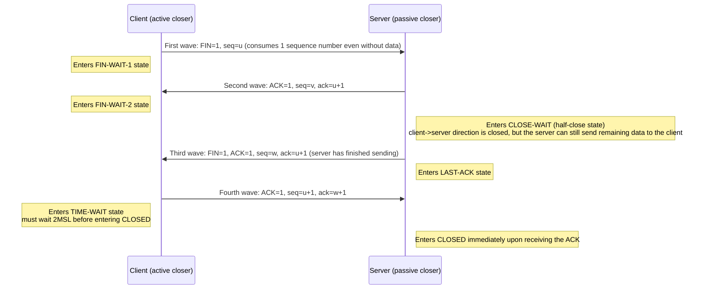

# Computer Networking Crash Course

### **I. Overview of Computer Networks and Switching Technology**

#### **1. Basic Concepts and the Structure of the Internet**
A computer network is a system that uses communication devices and lines to connect multiple functionally independent computers distributed across different locations, thereby achieving **data communication** and **resource sharing** — these two are also the most fundamental functions of computer networks. The Internet we use every day is a "network of networks" (Network of Networks): a globe-spanning large network formed by countless smaller networks interconnected through routers. In terminology, a lowercase `internet` generically refers to any universal network formed by interconnecting multiple computer networks, while the capitalized `Internet` refers specifically to today's largest particular internet, built on the TCP/IP protocol suite.

In terms of how it works, the Internet divides into two parts: the **edge** consists of all the hosts connected to the Internet (phones, computers, servers, and so on), used directly by users for communication and resource sharing; the **core** consists of a vast number of networks and the routers that interconnect them, dedicated to providing connectivity and switching services for the edge.

Hosts at the edge communicate with each other in two main ways. The first is the **client-server model (C/S, Client/Server)**: the client is the service requester and the server is the service provider — the client sends requests and the server responds. The second is **peer-to-peer (P2P)**: the two communicating parties have no fixed client/server roles, and every host is both client and server; a typical application is BitTorrent (BT) downloads.

#### **2. Three Data Switching Methods and Their Principles**
The most critical function of the network core is data switching, which comes mainly in three forms: circuit switching, message switching, and packet switching:
1. **Circuit Switching**: Works like a traditional phone call — before communicating, a dedicated physical path must first be established, and the line is exclusively occupied for the entire duration of the call (it is not released even when neither side is speaking), then torn down after the call ends. It strictly has three phases: **establish the connection $\rightarrow$ talk (communicate) $\rightarrow$ release the connection**. Because computer data is bursty, circuit switching leads to extremely low channel utilization.
2. **Message Switching**: Based on the store-and-forward principle, the entire message to be sent is stored in full, and after a table lookup it is forwarded as a whole to the next node. It does not require establishing a dedicated connection, but a single message is often very large, occupying the link for a long time and producing significant store-and-forward delay at each node.
3. **Packet Switching**: This is the core switching method used by the modern Internet. It cuts a long message into smaller chunks, prepends each chunk with a header containing control information (such as source and destination addresses), and forms a packet. Each packet uses the **store-and-forward** mechanism and picks its route independently — each takes its own path — and after arriving at the destination host the headers are removed and the packets are reassembled into the original message. Packet switching's advantages: it does not monopolize the line, channel utilization is high, and since packets are small, multiple links can transmit them in parallel like an assembly line, significantly cutting the total delay. Its costs: every packet carries extra header overhead, packets may queue at routers, and arrival order may be out of order.

#### **3. Key Example and Calculation: The Packet-Switching Delay Formula**
When there are no errors and propagation delay and header overhead are ignored, if a large message is split into $n$ packets and passes through $k$ links of identical rate (i.e., through $k-1$ routers), and the transmission delay of a single packet on one link is $t$, the total delay is computed as follows:
1. The first packet needs $k \times t$ to traverse all $k$ links end to end;
2. Each of the remaining $n-1$ packets, thanks to pipelined parallel transmission, needs only one additional transmission delay $t$ on the last link;
3. **General formula for the total delay of packet switching**:

$$
T_{\text{total}} = (n + k - 1) \times t
$$

**Worked example from the video**: to transmit a $3\text{ Mb}$ message across $2$ links ($k=2$), each link having a data rate of $1\text{ Mb/s}$, ignoring propagation delay and header overhead.
- **With message switching**: every link must finish sending the complete $3\text{ Mb}$ before forwarding onward; each link takes $3\text{ s}$, so the two links' total delay is $3 + 3 = 6\text{ s}$.
- **With packet switching**: the message is cut into $3$ packets of $1\text{ Mb}$ each ($n=3$), and each packet's transmission delay is $t = 1\text{ s}$. The first packet takes $2\text{ s}$ across the two links to reach the destination; the 2nd and 3rd packets then arrive one every $1\text{ s}$, for a total delay of $(3 + 2 - 1) \times 1\text{ s} = 4\text{ s}$.

#### **4. Classification of Networks**
By coverage, networks fall into four classes: the **wide area network (WAN)** covers a country or even the globe and forms the core backbone of the Internet; the **metropolitan area network (MAN)** covers a city; the **local area network (LAN)** covers a building or a campus; the **personal area network (PAN)** covers an extremely small area around an individual, such as the connection between a phone and a Bluetooth headset. By topology, networks can be bus, star, ring, or mesh.

---

### **II. Performance Metrics of Computer Networks**

#### **1. Rate, Bandwidth, and Throughput**
- **Rate (data rate / bit rate)**: how many bits are transmitted per second; the basic unit is $\text{bit/s}$ (also written $\text{bps}$).
- **Bandwidth**: in analog signal systems it originally meant the frequency width of a signal, measured in hertz ($\text{Hz}$); in computer networks, bandwidth denotes the **maximum data rate** a link can achieve per unit time, and the unit is likewise $\text{bit/s}$.
- **Throughput**: the amount of data actually passing through a network (or a channel, or an interface) per unit time. Throughput is limited by the network's bandwidth or nominal rate, and is often far smaller than the bandwidth.

#### **2. The Four Delay Components and the Bandwidth-Delay Product**
**Delay** is the total time required for data to travel from one end of the network to the other; it is the sum of the following four parts:

$$
\text{total delay} = \text{transmission delay} + \text{propagation delay} + \text{processing delay} + \text{queuing delay}
$$

1. **Transmission delay (send delay)**: the time a host or router needs to push all bits of a packet, from first to last, onto the communication link. Its formula:

$$
\text{transmission delay} = \frac{\text{data frame length (bit)}}{\text{transmission rate (bit/s)}}
$$

2. **Propagation delay**: the time an electromagnetic wave spends propagating a certain distance through the channel medium. Its formula:

$$
\text{propagation delay} = \frac{\text{channel length (m)}}{\text{propagation speed of the electromagnetic wave on the channel (m/s)}}
$$

3. **Processing delay**: the time a host or router spends analyzing the header, extracting data, checking for errors, or looking up the forwarding table after receiving a packet.
4. **Queuing delay**: the time a packet spends after entering a router first queuing in the input queue for processing, and then, once the forwarding interface is determined, queuing in the output queue awaiting transmission.

As a vivid analogy, transmitting data is like a convoy of cars passing through a highway toll station and then driving on to the next city: the time it takes the toll station to wave the entire convoy through, car by car, is the **transmission delay**, and the time the cars spend driving on the highway is the **propagation delay**. **Raising link bandwidth only lets the toll station process cars faster (reducing transmission delay); it does not make the cars drive faster on the highway (it cannot reduce propagation delay).**

- **Bandwidth-delay product**: imagine the link as a cylindrical pipe — the propagation delay is the pipe's length and the bandwidth is its girth (cross-sectional area). The bandwidth-delay product is then the pipe's volume, representing **the maximum number of bits that can be in flight on the link at this moment**:

$$
\text{bandwidth-delay product} = \text{propagation delay} \times \text{bandwidth}
$$

- **Round-trip time (RTT)**: the total time from when the sender starts sending data until the sender receives the acknowledgment message from the receiver.
- **Relationship between utilization and delay**: higher channel utilization is not always better, because the higher the utilization, the more sharply the queuing delay packets experience at routers grows. Let the delay of an idle network be $D_0$ and the current utilization be $U$ ($0 \le U < 1$); the current network delay $D$ satisfies:

$$
D = \frac{D_0}{1 - U}
$$

When the utilization $U$ approaches $1$, the network delay $D$ tends to infinity.

#### **3. Key Examples and Common Pitfalls**
**Worked example from the video (dominant-delay comparison)**: the link is $1000\text{ km}$ long (i.e., $10^6\text{ m}$), and the propagation speed of an electromagnetic wave in optical fiber is $2 \times 10^8\text{ m/s}$.
- **Scenario 1**: send $10^7\text{ bit}$ of data at a link data rate of $100\text{ kb/s}$ (i.e., $10^5\text{ bit/s}$). The transmission delay $= \frac{10^7}{10^5} = 100\text{ s}$; the propagation delay $= \frac{10^6}{2 \times 10^8} = 0.005\text{ s} = 5\text{ ms}$. **Transmission delay dominates**.
- **Scenario 2**: send only $1000\text{ bit}$ of data, with the rate raised to $1\text{ Gb/s}$ (i.e., $10^9\text{ bit/s}$). Now the transmission delay $= \frac{10^3}{10^9} = 1\ \mu\text{s}$, while the propagation delay is still $5\text{ ms}$. **Propagation delay dominates**. So never say in general which delay is larger — you must judge from the specific data size and bandwidth.

**Frequently examined pitfalls**:
- **Unit conversion trap**: for **network rates/bandwidth**, kilo ($\text{k}$), mega ($\text{M}$), and giga ($\text{G}$) are strictly decimal: $1\text{ k} = 10^3$, $1\text{ M} = 10^6$, $1\text{ G} = 10^9$; for **file sizes/storage capacity**, $\text{KB}$, $\text{MB}$, and $\text{GB}$ usually use binary: $1\text{ K} = 2^{10} = 1024$, $1\text{ M} = 2^{20}$, $1\text{ G} = 2^{30}$. Also mind the case: $1\text{ Byte (B)} = 8\text{ bit (b)}$.
- **Fiber propagation fact**: electromagnetic waves travel at $3 \times 10^8\text{ m/s}$ in vacuum/free space but at about $2 \times 10^8\text{ m/s}$ in copper wire or optical fiber (equivalently, about $5\ \mu\text{s}$ per $1\text{ km}$ in fiber).

---

### **III. Architecture of Computer Networks**

#### **1. Layering, Protocols, and Services**
Because network communication is so complex, people use **layering** to break the enormous communication problem into several smaller local problems. Each layer focuses on implementing only part of the functionality: it uses the services provided by the layer below, adds value through its own functions, and then offers higher-level services to the layer above.

- **Network protocol**: the rules, standards, or conventions established for data exchange in the network — the communication rules that both parties **at the same (peer) layer** must jointly observe. A network protocol has three core elements:
  1. **Syntax**: the structure or format of data and control information (e.g., how many bytes the header occupies, how many bits each field takes).
  2. **Semantics**: what control information needs to be sent, what actions to complete, and what responses to make.
  3. **Timing/Synchronization**: a detailed description of the order in which events occur (i.e., what to send first and what to send later).
- **Difference between protocols and services (frequently examined)**: **a protocol is "horizontal"** — it is the set of rules governing communication between two peer entities; **a service is "vertical"** — it is a function the lower layer provides to the upper layer through the interlayer interface, i.e., the **service access point (SAP)**. The lower layer's protocol is completely transparent (invisible) to the upper layer: the upper layer sees only the services the lower layer provides and does not care what protocol implements those services.

#### **2. The Three Layered Architecture Models and Each Layer's Role**
1. **The OSI seven-layer reference model**: proposed by the International Organization for Standardization (ISO). From bottom to top: **physical layer, data link layer, network layer, transport layer, session layer, presentation layer, application layer**. It is theoretically complete but too large and complex, and never caught on commercially (the so-called de jure international standard).
2. **The TCP/IP four-layer architecture**: the de facto international standard in widespread actual use, with only four layers: **network interface layer, internet layer (IP layer), transport layer, application layer**. The TCP/IP architecture has the classic **"hourglass" shape**: the very top can host all kinds of application protocols, the very bottom can accommodate all kinds of physical network technologies, and everything converges through the single **IP protocol** at the waist. The network layer provides upward only simple, flexible, connectionless, best-effort datagram service, leaving complex end-to-end reliability to the transport layer (TCP) of the end systems.
3. **The five-layer teaching model**: combines the strengths of OSI and TCP/IP. The core responsibility of each layer from bottom to top, its protocol data unit (PDU), and the devices that work at it are summarized in the table below:

| Layer | Core responsibility | Protocol data unit (PDU) | Typical protocols | Highest-level device implementing up to this layer |
| :--- | :--- | :--- | :--- | :--- |
| **Application layer** | Directly serves the user's application processes | **Message** | HTTP, DNS, FTP, SMTP | End systems (hosts, servers) |
| **Transport layer** | Provides end-to-end logical communication **between processes** on two hosts | TCP: **segment**; UDP: **user datagram** | TCP, UDP | End systems (hosts, servers) |
| **Network layer** | Delivers packets from the source host across multiple networks and routers to the destination host (**host-to-host**) | **IP datagram** or **packet** | IP, ICMP, ARP, OSPF, BGP | **Router** |
| **Data link layer** | Transfers frames over **one link** between adjacent nodes (provides error detection; reliable transmission is only an optional feature, see the data link layer chapter) | **Frame** | PPP, Ethernet, CSMA/CD | **Switch**, bridge |
| **Physical layer** | Transparently transmits the raw bit stream over the physical transmission medium | **Bit** | Manchester encoding, RJ-45 interface standard | **Hub**, **repeater** |

#### **3. Encapsulation and Decapsulation**
When the sender sends data top-down, each layer it passes through prepends its own control information — the **header**; in particular, **the data link layer not only adds a header but also appends a trailer at the end (the frame check sequence, FCS)**. This envelope-wrapping process is called **encapsulation**. After the receiver gets the bit stream from the physical layer, it strips off the corresponding headers (and trailer) layer by layer from bottom to top, restores the data, and passes it upward — this process is called **decapsulation**.

```mermaid
flowchart LR
    subgraph SenderEncapsulation ["Sender: top-down encapsulation"]
        direction TB
        A1["Application layer: message"] --> A2["Transport layer: [TCP header | data] (segment)"]
        A2 --> A3["Network layer: [IP header | TCP header | data] (IP datagram)"]
        A3 --> A4["Data link layer: [frame header | IP header | TCP header | data | frame trailer] (frame)"]
        A4 --> A5["Physical layer: 010110... (bit stream)"]
    end
    A5 ==>|"through repeaters/switches/routers"| B5
    subgraph ReceiverDecapsulation ["Receiver: bottom-up decapsulation"]
        direction BT
        B5["Physical layer: 010110... (bit stream)"] --> B4["Data link layer: strip the frame header and frame trailer"]
        B4 --> B3["Network layer: strip the IP header"]
        B3 --> B2["Transport layer: strip the TCP header"]
        B2 --> B1["Application layer: restore the application message"]
    end
```



---

### **IV. The Physical Layer**

#### **1. Physical-Layer Characteristics, Transmission Media, and Interaction Modes**
The physical layer's task is to solve how to transmit the raw bit stream over various transmission media and to shield upper layers from the differences among specific media and communication techniques. To this end, the physical layer specifies **four major characteristics** of the interface to the transmission medium:
1. **Mechanical characteristics**: specify the shape and dimensions of the connector used at the interface, the number and arrangement of pins, and the fixing and locking devices.
2. **Electrical characteristics**: specify the voltage range appearing on each line of the interface cable and the definitions of high and low levels.
3. **Functional characteristics**: specify what meaning a particular voltage level appearing on a given line represents.
4. **Procedural characteristics**: specify the order of occurrence of the various possible events for different functions.

**Transmission media** fall into two major categories:
- **Guided media**: electromagnetic waves propagate along solid media, including **twisted pair** (twisted to cancel electromagnetic interference; shielded STP and unshielded UTP), **coaxial cable**, and **optical fiber**. Fiber has the advantages of enormous bandwidth, extremely low loss, and strong immunity to electromagnetic interference; by transmission mode it is further divided into **multimode fiber** (multiple light rays advance by reflection, prone to dispersion, suitable for short distances) and **single-mode fiber** (an extremely thin core, light travels in a straight line without reflection, suitable for long-distance high-speed transmission).
- **Unguided media**: free space, including radio waves, microwaves, infrared, and visible light.

**Interaction modes between the two communicating parties** come in three kinds:
1. **Simplex communication**: communication in only one direction with no reverse interaction, e.g., radio broadcasting and TV broadcasting.
2. **Half-duplex communication**: both sides can send and receive, but neither can send and receive at the same time, e.g., walkie-talkies.
3. **Full-duplex communication**: both sides can send and receive simultaneously, e.g., phone calls and switched full-duplex Ethernet.

#### **2. Symbols, Baud Rate, and the Two Theorems on Maximum Channel Capacity**
- **Symbol**: when a digital signal is represented by waveforms in the time domain, the basic waveform representing a distinct discrete value (a signal waveform of fixed duration) is called a symbol.
- **Baud rate (symbol rate)**: the number of symbols transmitted through the channel per second, measured in **baud**.
- **Relationship between baud rate and bit rate**: if a symbol has $V$ distinct discrete states (level/phase combinations), then each symbol carries $\log_2 V$ bits of information. Given a baud rate of $M$ baud, the bit rate (information transmission rate) is:

$$
\text{bit rate (bit/s)} = M \times \log_2 V
$$

**Two core theorems on a channel's maximum data rate**:
1. **Nyquist theorem (Nyquist criterion, for ideal noiseless channels)**: in an assumed ideal low-pass channel (noiseless, bandwidth-limited), to avoid **inter-symbol interference**, the maximum symbol rate is $2W\text{ baud}$, where $W$ is the channel's frequency bandwidth (in $\text{Hz}$). If each symbol carries $\log_2 V$ bits, the maximum data rate of a noiseless channel is:

$$
C_{\text{Nyquist}} = 2W \log_2 V \quad (\text{unit: bit/s})
$$

2. **Shannon's theorem (for channels with Gaussian white noise)**: in a channel disturbed by random thermal noise, the maximum information transmission rate $C$ of the channel is:

$$
C_{\text{Shannon}} = W \log_2 \left(1 + \frac{S}{N}\right) \quad (\text{unit: bit/s})
$$

where $W$ is the channel bandwidth ($\text{Hz}$) and $\frac{S}{N}$ is the ratio of the average power of the signal transmitted in the channel to the Gaussian noise power — the **signal-to-noise ratio (a dimensionless ratio)**. In practice, problems usually give the SNR in **decibels ($\text{dB}$)**, converted via:

$$
\text{SNR (dB)} = 10 \log_{10}\left(\frac{S}{N}\right)
$$

For example, when a problem gives an SNR of $30\text{ dB}$, you must first restore the dimensionless ratio: $\frac{S}{N} = 10^{30/10} = 10^3 = 1000$, and only then substitute into Shannon's formula.

**Worked example from the video and common pitfalls**:
- **Example**: a telephone channel with bandwidth $W = 3000\text{ Hz}$ and an SNR of $30\text{ dB}$ (i.e., $\frac{S}{N} = 1000$). By Shannon's theorem, its maximum data rate is $C = 3000 \times \log_2(1 + 1000) \approx 3000 \times 10 = 30\text{ kb/s}$. If it were noiseless and each symbol had $V = 16$ states, then by the Nyquist theorem the maximum data rate would be $2 \times 3000 \times \log_2 16 = 6000 \times 4 = 24\text{ kb/s}$.
- **Frequently examined point and pitfall**: if a problem **gives both the number of symbol states $V$ and the SNR in dB** and asks for the channel's maximum actual data rate, you must compute two values separately with the Nyquist theorem and Shannon's theorem, and **the final result is the smaller of the two** ($\min(C_{\text{Nyquist}}, C_{\text{Shannon}})$). The Nyquist theorem caps the symbol rate, which can be pushed higher by multi-level coding so each symbol carries more bits; but Shannon's theorem gives the absolute physical ceiling from information theory — no coding scheme, however sophisticated, can ever break the Shannon limit.

#### **3. Encoding and Modulation Techniques**
Converting digital data into digital signals is called **encoding (baseband transmission)**. Common encoding schemes include:
- **Non-return-to-zero (NRZ)**: a positive level represents $1$ and a negative (or low) level represents $0$. The principle is the simplest, but with no error detection or synchronization mechanism, a long run of consecutive 1s or 0s produces no level transitions, and the receiver cannot extract a synchronization clock signal from it.
- **Manchester encoding**: **every bit period has a level transition at its midpoint**. The mid-bit transition serves both as a clock signal (usable for synchronization) and as a data signal (e.g., by convention, a downward mid-bit transition means $1$ and an upward transition means $0$, or vice versa). **Traditional $10\text{ Mb/s}$ Ethernet uses exactly Manchester encoding.**
- **Differential Manchester encoding**: there is always a transition at the center of every bit, but that center transition serves only to provide clock synchronization; what actually encodes data $0$ or $1$ is **whether there is a transition at the start boundary of each bit**: a transition at the start boundary **means 0, and no transition means 1**.
- **Frequently examined pitfall**: although Manchester and differential Manchester encoding have built-in clock synchronization, because every 1 bit transmitted requires a mid-bit transition (effectively two symbols of opposite levels to represent one bit), their **symbol rate (baud rate) is twice the data bit rate, and the encoding efficiency is only 50%**. For example, in traditional 10 Mb/s Ethernet the bit rate is 10 Mbit/s, while the channel's baud rate is as high as 20 MBaud.

Converting digital data into analog signals is called **modulation (passband transmission)**. The basic modulation methods are:
- **Amplitude shift keying (ASK)**: different carrier amplitudes represent 0 and 1.
- **Frequency shift keying (FSK)**: different carrier frequencies represent 0 and 1.
- **Phase shift keying (PSK)**: different initial carrier phases represent 0 and 1.
- **Quadrature amplitude modulation (QAM)**: combines amplitude (ASK) and phase (PSK) to modulate both simultaneously, forming a constellation diagram. For example, **16-QAM** has $16$ combined amplitude/phase states, so each symbol can carry $\log_2 16 = 4\text{ bit}$ of data.

#### **4. Physical-Layer Devices**
The physical layer has two core devices: the **repeater** regenerates, reshapes, and amplifies attenuated and distorted signals, thereby extending the network's transmission distance; a **hub** is essentially a multi-port repeater. They understand only bit streams, not data frames or MAC addresses — upon receiving a signal, they simply broadcast it amplified out all other ports indiscriminately. Therefore, **all hosts connected via a hub sit in the same collision domain**, and only one host can send data at any given moment, sharing the hub's total bandwidth.

---

### **V. The Data Link Layer: Framing, Error Detection, and Reliable Transmission**

#### **1. Basic Concepts and the Three Fundamental Problems**
- A **link** is a passive point-to-point physical line segment with no other switching nodes in between; a **data link** is the physical link plus the hardware (such as the network adapter/NIC) and software required to implement the communication protocol. The data link layer's protocol data unit is the **frame**.
- The data link layer must solve three most fundamental problems: **framing, transparent transmission, and error detection**.

##### **(1) Framing and Transparent Transmission**
**Framing** means adding a header and a trailer before and after the data handed down by the network layer to form a complete frame; its core purpose is **frame delimitation** (so the receiver can accurately identify where each frame starts and ends within the bit stream). Meanwhile, every link-layer protocol specifies a length limit for the frame's data part — the **maximum transfer unit (MTU)**; for example, standard Ethernet has $\text{MTU} = 1500\text{ bytes}$.

**Transparent transmission** means that no matter what bit combination the data contains, it must be transmittable over the link — the receiver must not mistake a frame as ending early just because the data happens to contain the same binary pattern as the frame delimiter. Depending on the link type, there are two stuffing methods:
1. **Byte stuffing (character stuffing; for byte-oriented asynchronous links, such as asynchronous PPP)**: the control character `SOH` (Start Of Header) marks the start of the frame and `EOT` (End Of Transmission) marks the end. If the data part happens to contain `EOT` or `SOH`, the sender inserts an escape character `ESC` before that control character; if the data already contains an `ESC`, another `ESC` is inserted before it too. The receiver simply deletes the artificially inserted `ESC`s to restore the original data.
2. **Bit stuffing (zero stuffing; for bit-oriented synchronous links, such as HDLC and synchronous PPP)**: the fixed bit pattern `01111110` (hexadecimal `0x7E`, containing six consecutive 1s) serves as the frame's start and end delimiter. To prevent `01111110` from appearing inside the data, **the sender scans the data part and, upon every run of five consecutive 1s, unconditionally inserts a 0 immediately after them**; **the receiver, upon every run of five consecutive 1s in a received frame, deletes the 0 that immediately follows**. This absolutely guarantees the data part never contains six consecutive 1s.

##### **(2) Error Detection: Parity Check, CRC, and the Hamming Code**
Bits may suffer bit errors during transmission (a 1 becomes a 0, or a 0 becomes a 1).
- **Parity check code**: append $1$ parity bit after the data so that the total number of 1s in the whole codeword (data bits plus the parity bit) is odd (odd parity) or even (even parity). **Limitation**: it can only detect errors involving an odd number of bits; if an even number of bits flip at the same time, the parity is unchanged and the error goes undetected.
- **Cyclic redundancy check (CRC)**: the most widely used error-detection technique at the data link layer.
  - **Computation steps**:
    1. The sender and receiver agree in advance on a generator polynomial $P(x)$ (corresponding to the binary divisor $P$); let its **highest power be $r$** (so the corresponding binary divisor has $r+1$ bits).
    2. The sender **appends $r$ zeros** after the $k$ bits of original data to be sent, making it $k+r$ bits.
    3. Divide this zero-padded number by the binary divisor $P$ using **modulo-2 division** (each step is an XOR $\oplus$ operation with no carries or borrows; the quotient is 1 when the leading bit is 1 and 0 when it is 0).
    4. The final **$r$-bit remainder** of the division is the **frame check sequence (FCS)** (note that the remainder must be exactly $r$ bits; leading zeros cannot be omitted).
    5. Replace the $r$ appended zeros with this $r$-bit FCS and transmit it attached after the original data.
    6. The receiver divides the entire received data-with-FCS string by the same generator polynomial $P$ using modulo-2 division: if the **remainder is 0**, the frame is judged error-free and accepted; if the **remainder is not 0**, the frame is judged corrupted and simply discarded.
  - **Worked example from the video**: the data to send is $M = 101001$, and the generator polynomial is $P(x) = x^3 + x^2 + 1$.
    - Step 1: convert the polynomial into a binary string: $x^3 + x^2 + 0 \cdot x^1 + 1 \cdot x^0 \rightarrow P = 1101$, highest power $r = 3$.
    - Step 2: append $3$ zeros after the data $101001$, giving the dividend `101001000`.
    - Step 3: perform modulo-2 division (XOR) of `101001000` by `1101`, yielding the 3-bit remainder (FCS) `001`.
    - Step 4: the frame actually sent is `101001001`.
- **Hamming code**: CRC can detect errors but cannot correct them. For forward error correction (FEC), use a Hamming code. Let the data have $k$ bits and the check bits $r$; to correct a single-bit error, the number of check bits $r$ must satisfy the Hamming inequality:

$$
2^r \ge k + r + 1
$$

For example, plugging $4$ data bits ($k=4$) into the formula gives $2^r \ge 4 + r + 1$, so at least $r = 3$ check bits are required. However, in modern computer networks, media such as fiber have very low bit error rates and error-correcting codes cost too much overhead, so the data link layer usually **performs only CRC error detection and discards corrupted frames outright, relying on upper layers or acknowledgment/retransmission mechanisms for recovery**.

**Frequently examined pitfall**: CRC can only achieve **"error-free acceptance"** (any frame accepted by the data link layer is, with extremely high probability, free of transmission errors), but this is **not the same as "reliable transmission"**, because erroneous frames are simply discarded — CRC itself neither corrects errors nor provides numbering, acknowledgment, or retransmission. Likewise, the **PPP protocol** commonly used on point-to-point links (starts and ends with `0x7E`, byte stuffing on asynchronous links, bit stuffing on synchronous links) also only performs CRC detection — no correction, no sequence numbers, no acknowledgments — and **does not provide reliable transmission**.

---

#### **2. Reliable Transmission Mechanisms and Sliding-Window Protocols (ARQ)**
To keep data from being lost or jumbled even after erroneous frames are discarded, an **acknowledgment (ACK) + timeout retransmission** mechanism must be introduced; such protocols are collectively called **automatic repeat request (ARQ)**.

##### **(1) The Stop-and-Wait Protocol**
- **Working principle**: after sending each frame, the sender immediately stops, starts a timeout timer, and waits for the receiver's acknowledgment frame (ACK); only after receiving the acknowledgment does it send the next frame (sending window $W_T = 1$, receiving window $W_R = 1$).
- **Handling abnormal situations**:
  1. **Data frame corrupted or lost**: the receiver discards the bad frame and sends no acknowledgment; when the sender's timeout timer expires, it automatically retransmits that frame. For this, the sender must keep a copy of every sent frame, and the timeout should be set slightly longer than one round-trip time RTT.
  2. **ACK lost or late**: the sender times out for lack of a timely ACK and retransmits, so the receiver ends up with two identical frames. To recognize duplicates, every frame must carry a **sequence number** (since stop-and-wait sends only one frame at a time, **1 binary digit** alternating between `0` and `1` suffices). When the receiver spots a duplicate frame, **it discards it but must still send the sender another acknowledgment ACK**.
- **Channel utilization calculation**: let the transmission delay of one data frame be $T_D$, the round-trip propagation delay be $\text{RTT}$, and the transmission delay of the acknowledgment frame be $T_A$ (often negligible because ACK frames are extremely short). The channel utilization $U$ of the stop-and-wait protocol is:

$$
U = \frac{T_D}{T_D + \text{RTT} + T_A}
$$

- **Worked example from the video**: frame length $1000\text{ bit}$, link data rate $1\text{ Mb/s}$, one-way propagation delay $10\text{ ms}$; ignore the ACK's transmission time and processing time. Then the transmission delay $T_D = \frac{1000\text{ bit}}{10^6\text{ bit/s}} = 1\text{ ms}$, and the round-trip time $\text{RTT} = 2 \times 10\text{ ms} = 20\text{ ms}$. The channel utilization $U = \frac{1}{1 + 20} = \frac{1}{21} \approx 4.76\% < 5\%$ — the channel sits idle the vast majority of the time.

##### **(2) The Go-Back-N (GBN) Protocol**
To improve channel utilization, pipelined transmission is adopted, allowing the sender to continuously send multiple frames within its sending window before receiving acknowledgments.
- **Core characteristics**: sending window $W_T > 1$, **receiving window $W_R = 1$**. Because the receiving window is only 1, **the receiver can only accept data frames strictly in order**.
- **Cumulative acknowledgment**: the receiver need not acknowledge every frame individually; it may send a cumulative acknowledgment for the last frame that arrived in order. For example, when the receiver replies `ACK 2`, it means **frame 2 and all frames before it have been correctly received in order**. (Note: this is the convention commonly used by link-layer sliding-window protocols; TCP's acknowledgment number means something different — in TCP, `ack = n` means "expecting to receive the byte numbered $n$".)
- **Retransmission policy (why "go back N")**: as soon as some middle frame (say frame 3) is lost or corrupted, even though the subsequently sent frames 4, 5, and 6 all arrive at the receiver intact, since the receiving window is 1 and the receiver currently expects only frame 3, the receiver **discards the out-of-order frames 4, 5, 6 outright**, and repeatedly re-sends the acknowledgment for the last frame received in order (e.g., `ACK 2`). After the sender times out, it must go back to the lost frame 3 and **retransmit all the frames it already sent from frame 3 onward**.
- **Window size limit**: if frames are numbered with $n$ bits (sequence numbers $0 \sim 2^n - 1$), the GBN sending window must satisfy:

$$
1 \le W_T \le 2^n - 1, \quad W_R = 1
$$

For example, with 3-bit numbering (sequence numbers $0 \sim 7$), the sending window can be at most $2^3 - 1 = 7$. If the sending window were set to $8$, then when the acknowledgments for all $8$ sent frames (numbers $0 \sim 7$) are lost in transit, the sender times out and retransmits the old frame 0 — but by then the receiver's receiving window has slid to expect the next round's new frame 0, and the receiver cannot tell whether the frame 0 it received is the retransmitted old frame or a new frame of the next round.

##### **(3) The Selective Repeat (SR) Protocol**
To overcome GBN's waste of retransmitting a whole batch of correct frames after one frame loss, Selective Repeat enlarges the receiving window.
- **Core characteristics**: sending window $W_T > 1$, **receiving window $W_R > 1$**.
- **Per-frame acknowledgment and out-of-order buffering**: when a middle frame is lost, the out-of-order correct frames that arrive later and fall within the receiving window are **not discarded; they are buffered first in the receiver's cache**. The receiver uses **per-frame individual acknowledgments** (acknowledging whichever frame arrives), and after timing out the sender **retransmits only the single frame actually lost**. Once the missing frame is filled in, the receiver delivers the contiguous run of in-order frames up to the upper layer all at once, and slides its receiving window forward.
- **Window size limit**: with $n$-bit frame numbering, to avoid confusion between old and new sequence numbers, the sum of the SR protocol's sending and receiving windows must not exceed the total sequence number space, and the two are usually made equal:

$$
W_T + W_R \le 2^n \quad \text{(usually } W_T = W_R = 2^{n-1} \text{)}
$$

##### **(4) Comparing the Three Sliding-Window Protocols, with Examples**

| Protocol | Sending window $W_T$ ($n$-bit numbering) | Receiving window $W_R$ | Acknowledgment style | Out-of-order frame handling and retransmission policy |
| :--- | :--- | :--- | :--- | :--- |
| **Stop-and-wait (SW)** | $W_T = 1$ | $W_R = 1$ | Per-frame acknowledgment | Send one, wait for one; timeout retransmits the current frame |
| **Go-Back-N (GBN)** | $1 < W_T \le 2^n - 1$ | $W_R = 1$ | **Cumulative acknowledgment** | Discard all out-of-order frames; after timeout, **retransmit everything** starting from the lost frame |
| **Selective Repeat (SR)** | $W_T \le 2^{n-1}$ (and $W_T + W_R \le 2^n$) | $W_R \le 2^{n-1}$ | **Per-frame individual acknowledgment** | **Buffer** out-of-order frames within the window; retransmit only the lost frame |

- **Worked example from the video**: with 4-bit numbering ($0 \sim 15$), the sender sends frames 0 through 6 — 7 frames in all — of which frame 3 is lost and all the others arrive correctly.
  - **With GBN**: the receiver accepts frames 0, 1, 2 in order; when frames 4, 5, 6 arrive they are all discarded as out-of-order, and acknowledgment only reaches frame 2; after timeout the sender must retransmit **4 frames: 3, 4, 5, 6**.
  - **With SR**: the receiver accepts frames 0, 1, 2 and delivers them upward, buffers the out-of-order frames 4, 5, 6 within the receiving window, and sends an individual acknowledgment for each; the sender only needs to retransmit **1 frame: frame 3**.
- **General formula for the channel utilization of pipelined protocols**: if within one sending cycle ($T_D + \text{RTT} + T_A$) the sender can continuously send $N$ frames (limited by the window size $W_T$), the channel utilization is:

$$
U = \frac{N \times T_D}{T_D + \text{RTT} + T_A} \quad (\text{if the result} > 1 \text{, take } U = 100\%)
$$

---

### **VI. Medium Access Control (MAC), Ethernet, and Switches**

#### **1. The Three Major Classes of Medium Access Control Methods**
In broadcast channels such as LANs, many hosts share the same common channel; if two hosts transmit at the same time, their signals superimpose and collide. Medium access control (MAC) solves the problem of "who may use the channel to send data, and when," and falls into three main classes of schemes:

##### **(1) Channel-Partitioning MAC (Static Multiplexing)**
The shared channel's frequency, time, wavelength, or code space is divided in advance among different users, avoiding collisions fundamentally:
- **Frequency-division multiplexing (FDM)**: the channel's total band is divided into multiple non-overlapping sub-bands, and each user exclusively occupies one sub-band all the time.
- **Time-division multiplexing (TDM)**: time is divided into equal-length TDM frames, and each user is fixedly assigned one time slot in every TDM frame. **Drawback**: when a user temporarily has no data to send, its assigned slot sits idle and other users cannot use it either, resulting in low channel utilization. **Statistical time-division multiplexing (STDM)** improves on this by allocating slots on demand instead of in fixed fashion, markedly raising utilization.
- **Wavelength-division multiplexing (WDM)**: essentially frequency-division multiplexing of optical signals (multiple optical carriers of different wavelengths transmitted simultaneously in one fiber).
- **Code division multiple access (CDMA)**: allows all stations to communicate **at the same time over the same frequency band**.
  - **CDMA principle and computation steps (frequently examined, must-know)**:
    1. The system assigns each station a unique **chip sequence** of length $m$ bits (usually 8 bits); each 0 in the chip is rewritten as $-1$ and each 1 as $+1$. The chip sequences of different stations must be **pairwise orthogonal**: the **normalized inner product** of the chip vectors $S$ and $T$ of any two distinct stations (multiply corresponding elements, sum the products, then divide by the number of bits $m$) **equals exactly $0$**; the normalized inner product of any chip vector with itself equals $+1$, and with its own complement equals $-1$.
    2. **Sending rule**: to send bit `1`, a station transmits its own original chip sequence $S$; to send bit `0`, it transmits the complement $-S$ of that sequence (all $+1$s and $-1$s inverted); to send nothing, it transmits no signal (all $0$s).
    3. **Superposition on the channel and decoding at the receiver**: when multiple stations transmit simultaneously, their signals add linearly bit by bit on the common channel, yielding the superimposed signal vector $X$. To determine what bit a given station $S$ sent, the receiver only needs to compute the **normalized inner product of station $S$'s chip sequence with the total superimposed signal $X$**:

$$
S \cdot X = \frac{1}{m} \sum_{i=1}^{m} S_i X_i = \begin{cases} +1, & \text{the station sent bit } 1 \\ -1, & \text{the station sent bit } 0 \\ 0, & \text{the station sent nothing} \end{cases}
$$

##### **(2) Random-Access MAC (Dynamic Contention)**
All stations may send data at will whenever they please; if a collision occurs, it is resolved according to rules:
- **ALOHA protocol**: pure ALOHA is "send whenever you want," with timeout retransmission after a collision (maximum throughput about $18.4\%$); slotted ALOHA divides time into slots and only allows sending at the start of each slot, which halves the vulnerable period and doubles the maximum throughput (about $36.8\%$).
- **CSMA (carrier sense multiple access)**: sense the channel before transmitting; transmit only when the channel is idle.
- **CSMA/CD (CSMA with collision detection, the core protocol of traditional bus Ethernet)**:
  - **16-character core mnemonic**: **listen before sending, listen while sending, stop sending on collision, retransmit after a random wait**.
  - **Why does collision still happen despite "listen before sending"?** Because electromagnetic waves take time to propagate along the channel (propagation delay $\tau$). Suppose host A senses the channel idle and starts sending a frame; during the time before the signal reaches the distant host B, B also senses the channel, mistakenly believes it is idle, and starts sending — the two signals then collide midway.
  - **Contention period (collision window) and derivation of the minimum frame size**: let the one-way end-to-end propagation delay across the LAN be $\tau$. In the extreme case, B starts sending at the very instant before A's signal is about to reach it; the superimposed interference produced by the collision then travels back to A, and A may need as long as **$2\tau$ (twice the one-way end-to-end propagation delay)** to detect that its own transmission collided. This $2\tau$ interval is called the **contention period** or **collision window**. If A's frame is too short — the whole frame finishes transmitting within $2\tau$ — then when the collision signal returns to A at time $2\tau$, A has already stopped sending and stopped listening, and this collision goes undetected. Therefore, to guarantee that the sender can always detect a possible collision before it finishes sending the frame, **the transmission delay of every frame must be greater than or equal to the contention period $2\tau$**, which yields the **minimum frame size formula**:

$$
\text{minimum frame size (bit)} = 2\tau \times \text{data rate (bit/s)} = 2 \times \frac{\text{link length}}{\text{propagation speed}} \times \text{data rate}
$$

  - **Traditional Ethernet rule**: $10\text{ Mb/s}$ Ethernet fixes the contention period $2\tau$ at $51.2\ \mu\text{s}$; plugging into the formula gives a minimum frame size of $51.2\ \mu\text{s} \times 10\text{ Mbit/s} = 512\text{ bit} = 64\text{ bytes}$. Any frame shorter than $64\text{ bytes}$ is an invalid fragment aborted by a collision.
  - **Worked example from the video**: a cable $1000\text{ m}$ ($1\text{ km}$) long, data rate $1\text{ Gb/s}$ ($10^9\text{ bit/s}$), signal propagation speed $2 \times 10^5\text{ km/s}$. Find the minimum frame size.
    - Solution: the one-way propagation delay $\tau = \frac{1\text{ km}}{2 \times 10^5\text{ km/s}} = 5\ \mu\text{s}$; the contention period $2\tau = 10\ \mu\text{s} = 10^{-5}\text{ s}$; the minimum frame size $= 10^{-5}\text{ s} \times 10^9\text{ bit/s} = 10000\text{ bit}$.
  - **Truncated binary exponential backoff**: once a collision is detected, the station stops sending immediately, sends an artificial jamming signal, and then defers retransmission by a random time. Let the current attempt be the $k$-th retransmission, with $k = \min(\text{number of retransmissions}, 10)$ (i.e., $k$ is capped at 10); draw a random integer $r$ from the discrete set $\{0, 1, 2, \dots, 2^k - 1\}$; the station then waits **$r \times 2\tau$ ($r$ contention periods)** before sensing and transmitting again. If **16 consecutive retransmissions** all fail, the frame is simply discarded and an error is reported to the upper layer.
- **CSMA/CA (CSMA with collision avoidance, used in 802.11 wireless LANs / Wi-Fi)**:
  - **Why doesn't wireless use CSMA/CD?** First, wireless signals attenuate extremely fast — the locally transmitted signal is far stronger than the distant collision signal, making "listen-while-sending" collision detection nearly impossible; second, wireless networks suffer from the **hidden station problem** (A and C are both within the AP's coverage but cannot hear each other).
  - **Working principle**: interframe spaces (IFS) and random backoff are used to avoid collisions as much as possible. Even when the channel is sensed idle, the sender must first wait a relatively long **DCF interframe space (DIFS)**, then enter a random backoff countdown, and send the data frame only when the countdown reaches zero. After correctly receiving a data frame, the receiver need only wait an extremely short **short interframe space (SIFS, highest priority)** before it must immediately reply with an **`ACK` acknowledgment frame** (wireless LANs require **per-frame acknowledgment**). In addition, to solve the hidden station problem, the sender may first broadcast an extremely short **`RTS` (request to send) frame**; upon receiving it, the AP broadcasts a **`CTS` (clear to send) frame** to reserve the channel, and other hosts that hear it stay silent for the specified duration (network allocation vector, NAV).

##### **(3) Taking-Turns MAC**
The classic example is the **token ring network**: a special "token" frame circulates around the ring network in turn, and only the station holding the token may send one frame of data, releasing the token to the next station afterward — so no collision ever occurs even under high load.

---

#### **2. Ethernet, MAC Addresses, and Ethernet Switches**

##### **(1) MAC Addresses and the Ethernet V2 Frame Format**
- **MAC address (physical address / hardware address)**: a globally unique identifier burned into each NIC's ROM, **$48$ bits ($6$ bytes)** long, usually written as 6 groups of two hexadecimal digits (e.g., `00-1A-2B-3C-4D-5E`). The first $24$ bits are the IEEE-registered organizationally unique identifier (vendor code, OUI); the last $24$ bits are assigned by the vendor itself. **The all-1s MAC address (`FF-FF-FF-FF-FF-FF`) is the link-layer broadcast address**.
- **Ethernet V2 MAC frame format**:
  1. **Destination address (6 bytes)**: placed first, so that the NIC can decide immediately upon receiving the first 6 bytes whether the frame is addressed to itself; if not, it discards it at once, saving processing overhead.
  2. **Source address (6 bytes)**: the MAC address of the sending NIC.
  3. **Type (2 bytes)**: identifies which protocol the upper layer uses, so the payload can be handed up after the frame header is stripped (e.g., `0x0800` means the upper layer is an IP datagram, `0x0806` means an ARP message).
  4. **Data field (46 \~ 1500 bytes)**: the IP datagram handed down by the network layer.
  5. **Frame check sequence FCS (4 bytes)**: the CRC remainder.
  - *Note: when the physical layer transmits an Ethernet frame, it also prepends an extra $8$ bytes at the very front of the frame (a 7-byte preamble + a 1-byte start-of-frame delimiter) for the receiver's clock synchronization, but these $8$ bytes are not counted in the MAC frame's own length.*
- **Frequently examined point (Ethernet frame length calculation)**: Ethernet specifies a minimum frame length of **$64$ bytes** and a maximum of **$1518$ bytes**. Since the MAC frame header (destination $6$ + source $6$ + type $2$ = 14 bytes) plus the FCS trailer ($4$ bytes) takes a fixed **$18$ bytes** in total, the data field runs from a minimum of $64 - 18 = \mathbf{46\text{ bytes}}$ (if the IP datagram handed down from the upper layer is shorter than $46$ bytes, the data link layer must pad with whole bytes up to $46$ bytes) to a maximum of $1518 - 18 = \mathbf{1500\text{ bytes}}$ (i.e., Ethernet's $\text{MTU} = 1500\text{ bytes}$).

##### **(2) Ethernet Switches and the Self-Learning Algorithm**
Early coaxial-cable bus Ethernet and hub-based star Ethernet were logically shared buses lying in the same collision domain and had to use half-duplex CSMA/CD. Hubs were later replaced by the **Ethernet switch**, which works at the **data link layer** (in essence a multi-port bridge). A switch can recognize the MAC address in a frame and, based on its internal **switch table (MAC address table, recording `MAC address <-> port number` mappings)**, forwards the frame precisely to the port where the destination host sits, supporting many pairs of hosts communicating simultaneously. Under full-duplex operation, switched Ethernet experiences no collisions at all; hence **modern high-speed full-duplex switched Ethernet no longer uses CSMA/CD**.

- **Switch self-learning and forwarding steps (frequently examined)**:
  1. When the switch is first powered on, its internal switch table is empty.
  2. **Register the source address (self-learning)**: when host A sends a frame to host B via interface $1$, the switch, upon receiving the frame, first looks at the frame's **source MAC address (A)** and writes `(A's MAC address, interface 1, current timestamp)` into the switch table.
  3. **Look up the destination address and forward**: the switch then reads the frame's **destination MAC address (B)** and searches the switch table:
     - **If B is not found**: the switch floods the frame out **all other interfaces except the incoming interface $1$** — this operation is called **flooding**.
     - **If B is found (e.g., on interface 2)**: the switch forwards the frame explicitly **only out interface $2$**; other interfaces never receive the frame.
     - **If the destination address is found on the incoming interface 1 itself**: this means A and B are on the same segment and B has already received it directly, so the switch simply discards the frame (filtering).
  4. **Aging mechanism**: every entry in the switch table has a validity lifetime (aging time) and is deleted automatically when it expires, ensuring that the switch table dynamically updates itself when a host changes switch ports or swaps its network card.

##### **(3) Collision Domains, Broadcast Domains, VLANs, and the 802.11 Frame Format**
- **Dividing collision domains and broadcast domains (exam-relevant question type)**:

| Network device | Operating layer | Isolates collision domains? | Isolates broadcast domains? |
| :--- | :--- | :--- | :--- |
| **Repeater / hub** | Physical layer | **No** (all ports belong to 1 collision domain) | **No** (all ports belong to 1 broadcast domain) |
| **Bridge / switch** | Data link layer | **Yes** (**each port is 1 independent collision domain**) | **No** (broadcast frames still flood to all ports — all belong to 1 broadcast domain) |
| **Router** | Network layer | **Yes** (each interface is an independent collision domain) | **Yes** (**each interface is 1 independent broadcast domain**) |

- **Worked example from the video**: a router's left interface connects to a switch (with 3 hosts hanging off it), and its right interface connects to a hub (with 3 hosts hanging off it). How many collision domains and broadcast domains are there in the figure?
  - **Collision domains**: the left switch has $3$ host-connected ports plus $1$ router-connected port — **4 collision domains** in total; the right hub merges the router interface and the 3 hosts into one piece, forming **1 collision domain**. The whole network therefore has $4 + 1 = \mathbf{5\text{ collision domains}}$.
  - **Broadcast domains**: only the router isolates broadcast domains; its left and right interfaces split the network in two, so there are **2 broadcast domains**.
- **Virtual LAN (VLAN, IEEE 802.1Q)**: hosts on one or more physical switches can be partitioned by logical requirements into several mutually isolated logical LANs; **each VLAN is an independent broadcast domain**. The 802.1Q frame inserts a **4-byte VLAN tag** between the source MAC address and the type field of the standard Ethernet frame, containing a **12-bit VLAN identifier (VID)** — up to $4096$ VLANs can be identified (of which $0$ and $4095$ are reserved, leaving $4094$ usable), and the tagged maximum frame length grows from 1518 bytes to 1522 bytes.
- **The four address fields of the 802.11 wireless LAN MAC frame**: Wi-Fi hosts attach to the network through a wireless access point (AP). The 802.11 frame header has $4$ MAC address fields, of which the first three are most commonly used:
  - **Address 1 (RA, receiver address)**: **the MAC address of the device that directly receives this wireless frame on the current hop** (if the host sends to the AP, address 1 is the AP's MAC; if the AP sends to the host, address 1 is the host's MAC).
  - **Address 2 (TA, transmitter address)**: **the MAC address of the device that directly sent this wireless frame on the current hop**.
  - **Address 3**: the final destination MAC address or the original source MAC address of the communication's other end (used to fill in the gateway's or the peer host's MAC address when the wired and wireless networks are bridged through an AP).

---

### **VII. The Network Layer: IP Datagrams, Subnetting, Supporting Protocols, and Routing Algorithms**

#### **1. Network-Layer Design Philosophy and SDN**
The network layer's task is to deliver packets from the source host to the destination host across countless networks and routers. Two sharply opposing views once competed over the design of the network layer's service:
- **Virtual-circuit service (connection-oriented)**: the telecom network's approach — before communicating, a logical virtual-circuit connection is established in the network; all packets travel the same prearranged path and arrive in order, with the network responsible for reliable delivery.
- **Datagram service (connectionless)**: the design ultimately adopted by the Internet (TCP/IP). The network layer provides upward **only a simple, flexible, connectionless, best-effort datagram service**. Each packet independently carries the complete destination address and routes independently; it may be corrupted, lost, duplicated, or arrive out of order. The network core stays minimal, pushing all the complexity of error recovery and in-order reliable delivery onto the transport layer (TCP) of the end systems.

The network layer's core work boils down to two things: **forwarding (data plane)** and **routing (control plane)**. Forwarding is what a single router does when it receives a packet: it looks up its local forwarding table by destination address and sends the packet out the appropriate output port — a microscopic, local, hardware-fast action. Routing, by contrast, is the process by which many routers across the whole network run routing protocols, exchange information with one another, collaboratively compute the best paths, and build routing tables — a macroscopic, network-wide software control process. The core idea of **software-defined networking (SDN)** is to **completely separate the control plane from the data forwarding plane**: route computation is centralized in a remote **SDN centralized controller**, which computes paths uniformly and pushes "flow tables" down to the routers; the routers (forwarding devices) no longer run complex routing protocols internally and simply forward by looking up their flow tables.

#### **2. The IPv4 Datagram Header and Fragmentation Calculations**

##### **(1) IPv4 Header Format and the Three Key Units**
The IPv4 datagram header consists of a **fixed part of $20$ bytes** plus an optional part of up to 40 bytes (total header length $20 \sim 60$ bytes). Core fields include:
- **Version (4 bits)**: fixed at $4$ in IPv4.
- **Header length (4 bits)**: gives the length of the entire IP header, **in units of $4\text{ bytes (32-bit words)}$**. Since the fixed header is 20 bytes, this field's minimum is $5$ ($5 \times 4 = 20\text{ B}$) and its maximum is $15$ (binary `1111`, $15 \times 4 = 60\text{ B}$).
- **Total length (16 bits)**: the length of the whole datagram, header plus data, **in units of $1\text{ byte}$**, so an IP datagram's theoretical maximum length is $2^{16} - 1 = 65535\text{ bytes}$.
- **Identification (16 bits), flags (3 bits), fragment offset (13 bits)**: these three fields exist specifically for IP datagram fragmentation and reassembly. **The fragment offset is counted in units of $8\text{ bytes}$**.
- **Time to live (TTL, 8 bits)**: caps the number of routers a datagram may pass through in the network. **Each time the datagram passes through a router, the router decrements TTL by 1**; when TTL drops to 0, the router must discard the datagram and send an ICMP time-exceeded message to the source host, preventing the datagram from looping forever in a routing loop.
- **Protocol (8 bits)**: indicates which transport-layer protocol the datagram's data part should be delivered to for processing. Memorize the two most frequently examined protocol numbers: **$\text{TCP} = 6$** and **$\text{UDP} = 17$** (plus $\text{ICMP} = 1$ and $\text{OSPF} = 89$).
- **Header checksum (16 bits)**: **checks only the IP datagram's header, not the data part**. Because TTL is decremented by 1 at every router, each router must recompute the header checksum.
- **Source address (32 bits) and destination address (32 bits)**: the IPv4 addresses of the sender and the receiver.

> **Frequently examined memory aid (the three length units are extremely easy to confuse)**: "**total 1, fragments 8, header 4**" — **total length** is counted in units of **$1$ byte**, **fragment offset** in units of **$8$ bytes**, and **header length** in units of **$4$ bytes**.

##### **(2) IP Datagram Fragmentation: Principle and Calculation Steps**
When an IP datagram's total length exceeds the next link's **MTU (maximum transfer unit)**, and the **`DF` (Don't Fragment) bit in the flags field equals $0$** (fragmentation allowed), the source host or an intermediate router cuts the datagram's data part into several smaller fragments.
- **Core fragmentation rules**:
  1. Each cut-out fragment carries its own independent IP header (by default a copy of the original 20-byte header, with total length, flags, and fragment offset modified), so **all fragments split from the same datagram have exactly the same "Identification" field**, allowing the destination host to recognize that they belong to the same original datagram.
  2. **The `MF` (More Fragments) bit in the flags field**: except for **the last fragment, whose $\text{MF} = 0$** (no more fragments follow), **all preceding fragments have $\text{MF} = 1$**.
  3. **The data length must be a multiple of 8**: because the fragment offset field is an integer counted in 8-byte units, **every fragment except the last must carry a data part (excluding the header) whose length is less than or equal to $(\text{MTU} - \text{header length})$ and is a multiple of $8$ bytes**.
  4. **Fragment offset formula**:

$$
\text{fragment offset of a fragment} = \frac{\text{starting byte number of that fragment's data within the original datagram's data}}{8}
$$

  5. **Where fragmentation and reassembly happen**: fragmentation can occur at the source host or at any intermediate router confronted with a small MTU; but **reassembly of all fragments happens only at the final destination host** — intermediate routers never reassemble.

- **Worked example from the video**: an IP datagram with a total length of $4000\text{ bytes}$ (fixed header $20\text{ bytes}$, so the original data part is $3980\text{ bytes}$ long) must traverse an Ethernet link with $\text{MTU} = 1500\text{ bytes}$. Find the fragmentation result.
  - **Solution**: each fragment carries a $20\text{-byte}$ header, so each can hold at most $1500 - 20 = 1480\text{ bytes}$ of data. Check: $1480 \div 8 = 185$ — exactly a multiple of 8! The $3980\text{ bytes}$ of data are therefore cut into $3$ fragments, with each fragment's parameters as follows:

| Fragment | Data byte range (counting from 0) | Data part length | Total fragment length (incl. 20B header) | MF flag | Fragment offset (start byte $\div 8$) |
| :--- | :--- | :--- | :--- | :--- | :--- |
| **Fragment 1** | Bytes $0 \sim 1479$ | $1480\text{ B}$ | $1500\text{ B}$ | $\text{MF} = 1$ | $0 \div 8 = \mathbf{0}$ |
| **Fragment 2** | Bytes $1480 \sim 2959$ | $1480\text{ B}$ | $1500\text{ B}$ | $\text{MF} = 1$ | $1480 \div 8 = \mathbf{185}$ |
| **Fragment 3** | Bytes $2960 \sim 3979$ | $1020\text{ B}$ | $1040\text{ B}$ | $\text{MF} = 0$ | $2960 \div 8 = \mathbf{370}$ |

---

#### **3. IPv4 Addressing, Subnetting, and CIDR Route Aggregation**

##### **(1) Classful Addressing and Special IP Addresses**
An IPv4 address is a $32$-bit binary identifier assigned to **every network interface** of each host (or router) on the Internet, usually written in **dotted decimal** notation (each group of 8 bits converted to decimal, e.g., `192.168.1.10`). Every IP address consists of two parts, **`<network number, host number>`**.
- **Traditional classful addressing**:
  - **Class A addresses**: start with `0`; the network number takes $8$ bits (first byte range $1 \sim 126$) and the host number $24$ bits; default mask `255.0.0.0`.
  - **Class B addresses**: start with `10`; the network number takes $16$ bits (first byte range $128 \sim 191$) and the host number $16$ bits; default mask `255.255.0.0`.
  - **Class C addresses**: start with `110`; the network number takes $24$ bits (first byte range $192 \sim 223$) and the host number $8$ bits; default mask `255.255.255.0`.
  - **Class D addresses**: start with `1110` (first byte range $224 \sim 239$), reserved for **IP multicasting**; no network/host number split.
  - **Class E addresses**: start with `1111` ($240 \sim 255$), reserved for future use.
- **Special IP addresses and private address blocks you must memorize**:
  1. **Addresses with the host number all `0`**: represent **the network itself (the network address)** and cannot be assigned to any specific host.
  2. **Addresses with the host number all `1`**: represent **the network's directed broadcast address**; packets sent to it are received by all hosts on the segment and cannot be assigned to a specific host.
  3. **Usable host count formula (frequently examined)**: if the **host number of a network or subnet has $n$ bits**, since the all-`0` host number (network address) and the all-`1` host number (broadcast address) must both be excluded, the maximum number of addresses actually assignable to hosts is:

$$
\text{maximum usable hosts} = 2^n - 2
$$

  (For example, a standard Class C network has an 8-bit host number and can hold at most $2^8 - 2 = 254$ hosts.)
  4. **`127.x.x.x` (e.g., `127.0.0.1`)**: the local **loopback address**, used for communication between processes on the same machine and for network software testing; data sent to it never flows out onto the external network link.
  5. **`0.0.0.0`**: means the machine does not yet have an IP address (e.g., the source address of a DHCP discover message), or represents the default route in a routing table.
  6. **`255.255.255.255`**: the limited broadcast address of the local network.
  7. **The three private (intranet) IP address blocks**: usable only inside LANs; public routers never forward datagrams whose destination address is a private address:
     - Class A private block: `10.0.0.0` \~ `10.255.255.255` (i.e., `10.0.0.0/8`)
     - Class B private block: `172.16.0.0` \~ `172.31.255.255` (i.e., `172.16.0.0/12`, 16 consecutive Class B networks in total)
     - Class C private block: `192.168.0.0` \~ `192.168.255.255` (i.e., `192.168.0.0/16`, 256 consecutive Class C networks in total)

##### **(2) Subnetting, Classless Inter-Domain Routing (CIDR), and Route Aggregation**
To solve the address-space waste of classful addressing, **subnetting** was introduced — borrowing several high-order bits from the original host number as the **subnet number**, together with a $32$-bit **subnet mask (all `1`s in the network and subnet number positions, all `0`s in the host number positions)**. **Performing a bitwise logical AND between the IP address and the subnet mask yields the network address (subnet address) that the IP belongs to.**

This then evolved further into **classless inter-domain routing (CIDR)**: the fixed boundaries of Class A/B/C addresses and subnets are eliminated entirely; an IP address is divided into **`<network prefix, host number>`**, and **slash notation (`/`)** is used to state the number of prefix bits directly after the IP address (e.g., `192.168.1.0/24` means the first $24$ bits are the network prefix and the remaining $32 - 24 = 8$ bits are the host number).

- **Worked example from the video, 1 (subnetting and membership testing)**: divide the address block `192.168.10.0/24` evenly into $4$ subnets.
  1. **Find the new prefix and subnet mask**: to divide into $4 = 2^2$ subnets, borrow $2$ bits from the host number; the network prefix changes from `/24` to **`/26`**, leaving $n = 32 - 26 = 6$ host bits. The mask's first $26$ bits are all `1` and its last $6$ all `0`; the 4th byte is binary `11000000` (decimal $128 + 64 = 192$), so the subnet mask is **`255.255.255.192`**.
  2. **Find each subnet's address block**: each subnet owns $2^6 = 64$ total addresses and $2^6 - 2 = 62$ usable hosts. The four subnets' 4th bytes start at `.0`, `.64`, `.128`, and `.192` respectively.
  3. **Determine host membership**: which subnet does `192.168.10.150/26` belong to? Convert its 4th byte $150$ to binary `10010110` and AND it bitwise with the mask's 4th byte $192$ (`11000000`), giving `10000000` (decimal $128$). Therefore:
     - **The subnet's network address**: `192.168.10.128` (host bits all `0`)
     - **The subnet's broadcast address**: `192.168.10.191` (host bits all `1`, i.e., `10111111`)
     - **The range of addresses assignable to hosts**: `192.168.10.129` \~ `192.168.10.190`

- **Worked example from the video, 2 (route aggregation / supernetting)**: CIDR allows merging several contiguous small address blocks with the same network prefix into one larger block, so they occupy only a single entry in routers' routing tables and shrink the table. This is called **route aggregation** or **supernetting**.
  - **Method**: expand all the network addresses to be aggregated into binary, find from left to right the **number of bits in their longest common prefix**; that common prefix, plus all-`0` host bits and the common prefix length `/k`, gives the aggregated supernet address.
  - **Example**: aggregate the four blocks `192.168.0.0/24`, `192.168.1.0/24`, `192.168.2.0/24`, `192.168.3.0/24`. Look at the 3rd byte: $0$ (`00000000`), $1$ (`00000001`), $2$ (`00000010`), $3$ (`00000011`) — the first $6$ bits of the 3rd byte are identical (all `000000`), and only the last $2$ bits differ. Hence the first $16 + 6 = 22$ bits are identical, and the aggregated supernet address is **`192.168.0.0/22`**.

- **Longest prefix match principle (frequently examined)**: after adopting CIDR, each routing-table entry consists of a "network prefix" and a "next-hop address." When a router looks up its forwarding table, one destination IP address may successfully match multiple entries at once. In that case you **must pick, from all matching entries, the one with the longest network prefix (i.e., the largest number after the slash, the most 1s in its mask) and forward accordingly**. The longer the network prefix, the smaller the address block it represents, and the more specific and precise the route. Note: **the default route is written `0.0.0.0/0`**; its prefix length is $0$ (the shortest), and it is only used as a last resort when the destination address matches no other specific route.
  - **Worked example from the video**: a router has three routes: (1) `192.168.0.0/16` via interface 1; (2) `192.168.10.0/24` via interface 2; (3) default route `0.0.0.0/0` via interface 3.
    - A packet destined for `192.168.10.5` matches all three of (1), (2), (3); by longest prefix match the `/24` entry (2) is chosen, forwarded via **interface 2**.
    - A packet destined for `10.1.1.1` matches neither (1) nor (2), only the default route `/0`, forwarded via **interface 3**.

---

#### **4. Supporting Network-Layer Protocols: ARP, DHCP, ICMP, NAT, and IPv6**

##### **(1) Address Resolution Protocol (ARP): From a Known IP to Its MAC**
The IP address is a logical network-layer address, but when a data frame is actually transmitted over a LAN physical link, it must rely on the NIC's **MAC address**. The role of **ARP (Address Resolution Protocol)** is to resolve a known IP address into the corresponding MAC address.
- **Working steps**:
  1. Host A wants to send an IP datagram to host B (`192.168.1.20`) on the same LAN; it first checks its own local **ARP cache table** (recording IP-to-MAC mappings for the local segment).
  2. If the cache has no entry, host A assembles an **ARP request packet** (containing its own IP and MAC, plus the IP of the B it is asking about), encapsulates it in an Ethernet frame, and sends it to the LAN **by broadcast (destination MAC `FF-FF-FF-FF-FF-FF`)**.
  3. All hosts on the LAN receive the broadcast frame, but only host B — finding that the queried IP is its own — accepts and processes it and sends host A an **ARP response packet**; note that **the ARP response is a unicast frame** (sent directly to A's MAC address), filled with B's MAC address.
  4. Upon receiving it, host A stores B's `IP <-> MAC` mapping in its ARP cache, then encapsulates an Ethernet frame and sends it out.
- **Frequently examined pitfall (whose MAC does ARP resolve across network segments?)**: **ARP works only within a single LAN (broadcast domain)**. When host A finds that the destination host B's IP address is **not on the same network** as itself, A must never broadcast an ARP to resolve the remote host B's MAC directly; instead it **uses ARP to resolve the MAC of the "default gateway" on its own segment (the router interface connecting this LAN)**, sends the data frame first to the default-gateway router, and lets the router forward it hop by hop on its behalf. Therefore, **across the entire journey through multiple routers, the source and destination IP addresses in the IP datagram header remain unchanged (except through NAT), while the source and destination MAC addresses in the data-link frame header are completely replaced at every single router!**

##### **(2) Dynamic Host Configuration Protocol (DHCP): Automatic Network Configuration for New Hosts**
When a computer first boots and joins a network, it uses the application-layer protocol **DHCP (based on UDP; client port $68$, server port $67$)** to automatically obtain four key pieces of configuration: **its own IP address, the subnet mask, the default gateway address, and the local domain name server (DNS) address**.
- **The four-step DHCP exchange (all broadcast/unicast details are exam-relevant)**:
  1. **DHCP DISCOVER**: the client has just booted, has no IP address yet, and does not know where the DHCP server is, so it **broadcasts** a discover message (**source IP `0.0.0.0`, destination IP the broadcast address `255.255.255.255`**).
  2. **DHCP OFFER**: the DHCP server(s) on the network, upon receiving it, pick an available IP address from the address pool for lease and send an offer message to the client.
  3. **DHCP REQUEST**: if multiple DHCP servers responded simultaneously, the client picks just one of them (usually the first to arrive) and again sends a DHCP request message **by broadcast**, formally requesting to lease that IP (incidentally notifying the other, unselected DHCP servers to withdraw the IPs they offered).
  4. **DHCP ACK**: the selected DHCP server sends back an acknowledgment, and the client formally obtains the right to use the IP address (with a lease period; at half the lease time the client proactively requests renewal from the server).

##### **(3) Internet Control Message Protocol (ICMP) and Ping / Traceroute**
To forward IP datagrams more effectively and improve the odds of successful delivery, hosts and routers use **ICMP** to report errors and abnormal conditions to each other. Note: **ICMP is a network-layer protocol, but its messages are carried as the data part encapsulated inside IP datagrams**.
- **Two classes of ICMP messages**:
  1. **ICMP error-reporting messages**: include **destination unreachable** (delivery impossible), **time exceeded** (TTL dropped to $0$, or fragment reassembly timed out), **parameter problem** (an IP header field is wrong), and **redirect** (telling the host to send directly to another, better router next time).
  2. **ICMP inquiry messages**: the most typical are the **echo request and echo reply messages**.
- **Two classic applications (exam-relevant)**:
  - **The `ping` command**: tests connectivity between two hosts by directly using the network layer's **ICMP echo request and echo reply messages** (note: `ping` uses network-layer ICMP directly — **it does not go through transport-layer TCP or UDP and has no port number**).
  - **The `traceroute` command (`tracert` on Windows)**: traces the complete route a packet takes from source to destination. The source host sends a series of datagrams to the destination, **deliberately setting the 1st datagram's $\text{TTL}$ to 1, the 2nd to 2, the 3rd to 3, and so on**. The 1st datagram reaches the 1st router on the path, where TTL drops by 1 to 0; that router discards the packet and sends back an **ICMP time-exceeded** message; the 2nd datagram drops to 0 at the 2nd router and likewise triggers an ICMP time-exceeded message... and so on, letting the source host extract from these returned ICMP messages the IP address and round-trip time of every hop along the way.

##### **(4) NAT, IPv6, and Multicast**
- **NAT (Network Address Translation)**: to alleviate IPv4 address exhaustion, NAT allows hundreds or thousands of hosts with private IPs inside a private network to share a handful — or even just $1$ — of globally valid public IP addresses to access the Internet. NAT with port translation (called **NAPT**) records **`(private IP : source port) <-> (public IP : new port assigned by NAT)`** in its translation table: outbound packets headed to the public network get their source IP and source port replaced; returning response packets from the public network are looked up and translated back to the internal IP and original port.
- **IPv6's core innovation**: the fundamental fix for address exhaustion is to expand the address length fourfold from IPv4's 32 bits to **$128$ bits ($16$ bytes)**.
  - **Colon hexadecimal notation and zero compression**: written as 8 groups of 4 hexadecimal digits separated by colons. Leading `0`s within a group can be omitted, and one or more consecutive all-zero groups can be compressed with a **double colon `::`**, but **the double colon `::` may be used at most once in a single IPv6 address** (otherwise there is no way to work out how many all-zero groups were compressed).
  - **IPv6 header and fragmentation changes**: the IPv6 base header length is **fixed at $40$ bytes** (IPv4's fixed header is 20 bytes); to speed up router processing, IPv6 **removes the header checksum field entirely**; and **IPv6 fragmentation can only be performed at the source host — intermediate routers never fragment** (if a packet is too large for the MTU, the router simply discards it and sends back an ICMPv6 "packet too big" message to notify the source host).
  - **Two transition techniques from IPv4 to IPv6**: (1) **dual stack**: install both IPv4 and IPv6 protocol stacks on one device; (2) **tunneling**: when an IPv6 datagram must cross an IPv4 network, the entire IPv6 datagram is encapsulated as the data part inside an IPv4 datagram's belly, and unwrapped and restored after traversing the IPv4 segment.
- **IP multicasting and IGMP**: one-to-many multicast uses **Class D IP addresses**. Hosts use the network-layer **IGMP (Internet Group Management Protocol)** to tell their locally connected router "which multicast group they wish to join or leave."

---

#### **5. Routing Algorithms and the Three Major Routing Protocols (RIP, OSPF, BGP)**
The Internet is so enormous that having every router maintain routes to every network worldwide is unrealistic; hence the Internet adopts **hierarchical routing protocols**, dividing it into many smaller **autonomous systems (AS)**, each administered uniformly by a single authority.
- **Interior gateway protocols (IGP)**: routing protocols used inside one autonomous system (AS), mainly **RIP** and **OSPF**.
- **Exterior gateway protocols (EGP)**: routing protocols used between different autonomous systems (ASs); the one in use today is **BGP (Border Gateway Protocol, e.g., BGP-4)**.

##### **(1) The RIP Protocol and the Distance-Vector Algorithm**
- **Basic principle**: RIP is a distributed protocol based on the **distance-vector algorithm**. It uses the **"hop count"** as its distance metric (a directly connected network is at distance 1, and each additional router adds 1). RIP stipulates that a path may contain at most 15 routers, so **the maximum valid distance is 15, and a distance of 16 means unreachable**. This is also why RIP **suits only small internets**.
- **Three characteristics of information exchange**: (1) exchange information **only with neighboring routers**; (2) the information exchanged is everything this router currently knows — **its entire current routing table** ("my minimum distance to every network in this AS and the next hop for each"); (3) exchange **at fixed intervals** (e.g., every 30 seconds).
- **RIP distance-vector routing table update procedure (frequently examined calculation problem)**:
  When router $A$ receives a RIP routing message from neighboring router $X$ (containing $X$'s routing table), it updates its own routing table in exactly two steps:
  1. **Step 1 (first rewrite the received table)**: for every entry in $X$'s table, change **the "next-hop router" field to $X$**, and **add 1 to every "distance" value** (if adding 1 exceeds 16, record 16).
  2. **Step 2 (compare each entry against the original table and update)**: compare each rewritten entry (destination network $N$, distance $d_{\text{new}}$, next hop $X$) against $A$'s original routing table:
     - **Case 1 (the original table has no entry for destination network $N$)**: a new network has been discovered — **unconditionally add this entry to $A$'s routing table**.
     - **Case 2 (the original table has network $N$, and its "next hop" is exactly $X$)**: since this is the latest news from the original path, **regardless of whether the new distance $d_{\text{new}}$ got smaller, larger, or stayed the same, the new entry must unconditionally replace the old one**!
     - **Case 3 (the original table has network $N$, but its "next hop" is not $X$)**: compare the distances — **replace the old entry with the new one only if the new distance $d_{\text{new}}$ is strictly smaller than the original distance**; if $d_{\text{new}}$ is greater than or equal to the original distance, keep the original entry unchanged.
- **Worked example from the video**: router $B$ receives a routing table from neighbor $C$; first add 1 to every distance in $C$'s table and change every next hop to $C$, then compare against $B$'s original table:
  - For network `N2`: in $B$'s original table the next hop is exactly $C$ (distance $2$); after adding 1, $C$'s entry becomes $4+1=5$. Since **the next hop is the same ($C$), it must be updated to distance $5$**.
  - For network `N3`: $B$'s original table has no `N3` — **add the new network directly** (distance $8+1=9$, next hop $C$).
  - For network `N6`: $B$'s original route goes via $F$ at distance $8$; via $C$ it is $4+1=5 < 8$ — **shorter, so update to distance 5 via $C$**.
  - For network `N8` (equal distance) and `N9` (new distance longer): the next hop differs and neither got shorter, so **both keep their original entries**.
- **RIP's fatal flaw**: "**good news travels fast, bad news travels slowly**." When a network fails and goes down, neighboring routers may, because of asynchronous updates, keep mistakenly believing each other can still reach it, so the distance in their routing tables grows by 1 each time, bouncing back and forth, slowly accumulating to 16 before finally being declared unreachable. This phenomenon is called **slow convergence**, or the **"count to infinity"** problem.

##### **(2) The OSPF Protocol and the Link-State Algorithm (Dijkstra's Algorithm)**
- **Basic principle**: OSPF (Open Shortest Path First) was developed to overcome RIP's shortcomings, based on the **link-state algorithm**.
  1. **To whom, what, and when**: each router uses **flooding** to send information to **all routers** in its autonomous system (or area); what is sent is not the whole routing table but the **link states of all routers adjacent to this router** (i.e., "which neighbors am I connected to, and what is each link's metric/cost/bandwidth/delay"); and **only when the link state changes** (plus a periodic refresh, e.g., every 30 minutes) does the router flood link-state updates to the whole network.
  2. **Network-wide topology database and Dijkstra's shortest-path computation**: because routers exchange link states with one another, ultimately **every router can locally build an identical map of the whole network's topology (the link-state database, LSDB)**. Each router then takes itself as the root node, independently runs **Dijkstra's shortest-path algorithm**, and constructs a shortest-path tree to all other networks, from which it computes its routing table.
- **Manual steps of Dijkstra's algorithm**:
  1. Initialize the set $S$ of nodes with determined shortest paths to contain only the source $A$ (distance $0$); compute the initial distances from the source to its directly adjacent nodes; mark non-adjacent ones as $\infty$.
  2. Among the nodes not yet in $S$, **pick the node $u$ currently closest to the source $A$** and add it to the determined set $S$.
  3. Using the newly added node $u$ as a springboard, check and update the distance from every undetermined neighbor $v$ of $u$ to the source $A$: if $\text{dist}[u] + \text{weight}(u, v) < \text{dist}[v]$, update $\text{dist}[v]$ to the smaller new value.
  4. Repeat steps 2 and 3 until all nodes are in $S$.
- **OSPF's advantages**: extremely fast convergence, absolutely no "bad news travels slowly" or routing loops, and suitability for large networks. To scale to even larger networks, OSPF can further divide an autonomous system into multiple **areas**, with a **backbone area** (identifier `0.0.0.0`) connecting all the other areas, limiting the flooding of link states to within a single area.

##### **(3) The BGP Protocol (Border Gateway Protocol)**
- **Basic principle**: exchanges routing information between different autonomous systems (ASs). Because the Internet is so vast, and because different ASs belong to different countries and operators with political, security, or economic policy considerations (e.g., "my traffic must never pass through a certain AS"), **BGP's goal is not to find the geometrically "shortest/optimal" path, but to strive for a "good enough (reachable)" route that reaches the destination network and complies with policy**.
- **Path-vector protocol**: each AS selects at least one **BGP speaker (usually the border router)**, which establishes TCP connections with the BGP speakers of other ASs and exchanges routing information. The routing information BGP exchanges is the complete sequence of autonomous systems a route to some destination network passes through (e.g., `AS1 -> AS2 -> AS5`); hence BGP is called a **path-vector protocol** — loops between autonomous systems are easily avoided simply by checking whether the path list contains one's own AS number.

##### **(4) The Ultimate Comparison Table of the Three Routing Protocols (Frequently Examined)**

| Dimension | RIP (Routing Information Protocol) | OSPF (Open Shortest Path First) | BGP (Border Gateway Protocol) |
| :--- | :--- | :--- | :--- |
| **Category** | Interior gateway protocol (IGP) | Interior gateway protocol (IGP) | Exterior gateway protocol (EGP) |
| **Core algorithm** | **Distance-vector algorithm** (Bellman-Ford) | **Link-state algorithm** (Dijkstra shortest path) | **Path-vector protocol** (policy routing; finds a good route) |
| **Exchange partner** | Only **neighboring routers** | **Floods to all routers** in the area | Border routers of neighboring ASs (BGP speakers) |
| **Content exchanged** | Its **entire current routing table** (distance to each network) | **Link states of all routers adjacent to this router** | The **complete AS path sequence** to the destination network |
| **Timing of exchange** | Periodically timed (e.g., every $30\text{ s}$) | **When the link state changes** (and every $30\text{ min}$) | Full table on initial connection, thereafter **only on change** |
| **Encapsulation (must memorize)** | Carried in **UDP** messages (port **$520$**), application layer | **Encapsulated directly in IP datagrams** (protocol number $89$), network layer | Carried in **TCP** segments (port **$179$**), application layer |
| **Main pros/cons** | Simple; but hop limit of 15, **bad news travels slowly** | Fast convergence, loop-free, supports areas; relatively complex to implement | Supports inter-AS policy control and loop prevention; does not guarantee shortest paths |

---

### **VIII. The Transport Layer: UDP and TCP in Depth**

#### **1. Transport-Layer Overview, Port Numbers, and Sockets**
- **The essential difference between the network layer and the transport layer**: the network layer only delivers packets to the destination **host** (host-to-host logical communication), but a single host simultaneously runs a browser, WeChat, games, and many other processes — after data reaches the host, which process should it be handed to? That is the transport layer's task: **providing "end-to-end (process-to-process)" logical communication between application processes running on different hosts**. To put it vividly, **the IP address is a building's street address, and the port number (Port) is a specific room number inside that building**.
- **Port number classes (16-bit integers, range $0 \sim 65535$)**:
  1. **Well-known ports (system ports, $0 \sim 1023$)**: assigned to the most important, most commonly used standard server programs (e.g., HTTP 80, HTTPS 443, DNS 53, FTP 21/20, SSH 22, Telnet 23, SMTP 25, POP3 110).
  2. **Registered ports ($1024 \sim 49151$)**: for applications without well-known ports; they must be registered with IANA to avoid duplication.
  3. **Ephemeral ports (client temporary ports, $49152 \sim 65535$)**: reserved for client processes, dynamically and temporarily assigned by the OS when initiating communication, and reclaimed immediately when the communication ends.
- **Socket**: concatenating an IP address and a port number forms a socket:

$$
\text{Socket} = (\text{IP address} : \text{port number}) \quad (\text{e.g., } 192.168.1.10:80)
$$

**Every TCP connection is uniquely determined by the two endpoints (i.e., two sockets) at the two ends of the communication** — the 4-tuple `{source IP, source port, destination IP, destination port}`.
- **Multiplexing and demultiplexing**: **multiplexing** means that at the sender, multiple different application processes can all use the same transport-layer protocol to send data; **demultiplexing** means that at the receiver, the transport layer strips off the message header and, based on the destination port number in it, correctly delivers the data to the corresponding destination application process.

---

#### **2. User Datagram Protocol (UDP)**
- **Core characteristics**:
  1. **Connectionless**: no connection needs to be established before sending data — send whenever you like, reducing overhead and delay.
  2. **Best-effort delivery**: no guarantee of reliable delivery, no acknowledgment or retransmission mechanism.
  3. **Message-oriented**: for messages handed down by the application layer, UDP **neither merges nor splits them — it fully preserves their boundaries**, adds a header, and passes each complete message down to the network layer's IP. Applications must therefore choose an appropriate message size (too long and IP-layer fragmentation reduces efficiency; too short and the IP header's proportion is large).
  4. **No congestion control**: even under severe network congestion, a UDP source host will not reduce its sending rate. This makes UDP ideal for **real-time applications** (IP telephony, video conferencing, live streaming, online multiplayer games), which demand extremely low latency — "better to drop a few video packets than to stop and wait for retransmission and stutter."
  5. **Supports one-to-one, one-to-many, many-to-one, and many-to-many interactive communication**.
  6. **Minimal header overhead**: the UDP header is only **$8$ bytes**, consisting of just 4 fields (2 bytes each): **source port (2B), destination port (2B), UDP length (2B, total bytes of header + data), UDP checksum (2B)**.
- **Pseudo-header**: when computing the checksum, UDP (and TCP) temporarily prepends a **$12$-byte pseudo-header** (containing the source IP address 4B, destination IP address 4B, all zeros 1B, protocol number 1B, UDP length 2B). **Note: the pseudo-header is neither passed down to the network layer nor delivered up to the application layer; it is constructed temporarily solely to compute the checksum once** — its purpose is both to check whether the UDP datagram itself is corrupted and, in passing, to check whether the IP layer delivered the datagram to the wrong host or the wrong transport-layer protocol.

---

#### **3. Transmission Control Protocol (TCP): Segment Header and Connection Management**

##### **(1) TCP's Core Characteristics and Header Format**
- **Five major characteristics**: (1) **connection-oriented** (a connection must first be established with a three-way handshake before communicating, and released with a four-way handshake afterward); (2) **each TCP connection has exactly two endpoints (point-to-point)**, with no broadcast or multicast support; (3) **provides reliable delivery** (error-free, no loss, no duplication, and in order); (4) **provides full-duplex communication** (both ends have sending and receiving buffers and can send and receive in both directions simultaneously); (5) **byte-stream oriented**: TCP treats the data handed down by the application merely as a string of **unstructured bytes**; it does not guarantee that the size relationship of the data blocks the receiver's application reads out matches that of the blocks the sender wrote, but it guarantees that the byte stream received is exactly the byte stream sent.
- **TCP header format (fixed part $20$ bytes, up to $60$ bytes with options)**:
  - **Source port (2B) and destination port (2B)**.
  - **Sequence number ($\text{seq}$, 32 bits / 4B)**: **every byte of the byte stream carried over a TCP connection is numbered in order**. The value in the header's **sequence number field refers to the number of the first byte of the data part sent in this segment**.
  - **Acknowledgment number ($\text{ack}$, 32 bits / 4B)**: **the number of the first data byte of the next segment expected from the other party**. TCP uses cumulative acknowledgment by default: if the acknowledgment number $\text{ack} = N$, it means **all data bytes up to and including number $N-1$ have been correctly received in order**.
    - *Worked example from the video*: in a TCP segment sent by host A, the sequence number is $\text{seq} = 301$ and it carries $200\text{ bytes}$ of data, meaning this segment carries bytes number $301 \sim 500$. After host B correctly receives the segment, the acknowledgment number in its reply to A should be **$\text{ack} = 301 + 200 = 501$** (all bytes through number 500 received; start from byte 501 next time).
  - **Data offset (4 bits)**: i.e., **the TCP header length** (how far the data part sits from the start of the segment), likewise **in units of $4\text{ bytes}$**, minimum 5 ($20$ bytes), maximum 15 ($60$ bytes).
  - **Six control flag bits (1 bit each)**:
    1. **`ACK` (acknowledgment bit)**: the acknowledgment number field is valid only when $\text{ACK} = 1$; after a connection is established, all transmitted segments must set $\text{ACK}$ to 1.
    2. **`SYN` (synchronization bit)**: used to synchronize sequence numbers during connection establishment ($\text{SYN}=1, \text{ACK}=0$ means a connection request; $\text{SYN}=1, \text{ACK}=1$ means connection accepted).
    3. **`FIN` (finish bit)**: used to release a connection; when $\text{FIN} = 1$, it indicates that the sender of this segment has finished sending its data and requests to release this one-way connection.
    4. **`RST` (reset bit)**: when $\text{RST} = 1$, it indicates a serious error in the TCP connection and the connection must be forcibly released (or an illegal segment rejected / the opening of a connection refused).
    5. **`PSH` (push bit)**: upon receiving a segment with $\text{PSH} = 1$, the receiving TCP delivers it up to the application process as soon as possible, without waiting for the receive buffer to fill.
    6. **`URG` (urgent bit)**: when $\text{URG} = 1$, used together with the urgent pointer field, it indicates urgent data that should cut in line and be sent with priority.
  - **Window field (16 bits / 2B)**: refers to **the receiver window of the party sending this segment itself** (i.e., starting from the acknowledgment number in this segment's header, the upper limit of bytes the receiver currently permits the other side to keep sending) — the basis for implementing **flow control**.

##### **(2) TCP Connection Establishment: The Three-Way Handshake**

```mermaid
sequenceDiagram
    participant C as Client
    participant S as Server
    Note over C,S: Initial state: C is in CLOSED, S is in LISTEN
    C->>S: First handshake: SYN=1, seq=x (no data, but consumes 1 sequence number)
    Note left of C: Enters SYN-SENT state
    S->>C: Second handshake: SYN=1, ACK=1, seq=y, ack=x+1 (allocates resources, consumes 1 sequence number)
    Note right of S: Enters SYN-RCVD state
    C->>S: Third handshake: ACK=1, seq=x+1, ack=y+1 (may carry data; consumes no sequence number if empty)
    Note over C,S: Both sides enter the ESTABLISHED state and begin transmitting data in both directions
```

- **Detailed three-way handshake steps and field changes**:
  1. **First handshake**: the client sends a connection-request segment to the server with the synchronization bit **`SYN = 1`** in the header and a randomly chosen initial sequence number **`seq = x`**. **Note: by rule a `SYN` segment cannot carry data, but it must consume one sequence number!**
  2. **Second handshake**: upon receiving the connection request, if the server agrees to establish the connection, it sends back an acknowledgment segment to the client. Header: **`SYN = 1, ACK = 1`**, acknowledgment number **`ack = x + 1`**, and the server also randomly chooses its own initial sequence number **`seq = y`**. This segment likewise cannot carry data but must also consume one sequence number.
  3. **Third handshake**: after receiving the server's acknowledgment, the client must also give the server an acknowledgment. Header: **`ACK = 1`** (note that `SYN = 0` at this point), sequence number **`seq = x + 1`**, acknowledgment number **`ack = y + 1`**. **By rule, the third handshake's `ACK` segment may carry data; if it carries none, it consumes no sequence number** (in that case the next data segment's sequence number is still `seq = x + 1`).
- **Frequently asked question: why must connection establishment be a three-way handshake — why not two?**
  - **Core reason**: **to prevent an "already-invalidated historical connection-request segment" from suddenly arriving at the server, causing errors and wasted resources.**
  - **Detailed walkthrough**: suppose the first connection-request segment the client sent was not lost, but lingered at some network node for a long time, arriving at the server only at some point after the connection had already been released. Meanwhile, the client had long since timed out, retransmitted a new connection request, and already completed a normal communication session with the server and released the connection. Now that late "stale connection request" finally arrives at the server, which mistakenly believes the client has initiated another new connection. **With only a two-way handshake**, the new connection is formally established the moment the server sends its acknowledgment; but since the client has no intention of connecting at all, it ignores the server's acknowledgment and sends no data, while the server believes the connection is established and waits forever for data from the client — a serious waste of server resources. **With a three-way handshake**, the client does not send the third handshake's acknowledgment upon receiving the server's acknowledgment for the stale request; the server, receiving no acknowledgment, knows the client did not request a connection and will not mistakenly establish one.
- **Security point (SYN flood attack)**: upon receiving the first handshake and sending the second (`SYN + ACK`), the server must already allocate kernel buffer resources for that half-open connection. An attacker forges a large number of nonexistent source IP addresses and bombards the server with first-handshake `SYN` packets without ever replying to the third handshake, filling the server's half-open connection queue and exhausting its resources so that normal users cannot connect — this is the **SYN flood attack** (defended against with SYN cookies).

##### **(3) TCP Connection Release: The Four-Way Handshake**



- **Detailed four-way handshake steps**:
  1. **First wave**: the client's application process first tells its TCP to release the connection, actively closing it. The client sends a connection-release segment with the finish bit **`FIN = 1`** in the header and sequence number **`seq = u`** (equal to the sequence number of the last byte of previously transmitted data plus $1$). By rule, a `FIN` segment must consume one sequence number even if it carries no data.
  2. **Second wave**: upon receiving it, the server immediately sends an acknowledgment: **`ACK = 1, seq = v, ack = u + 1`**. At this point **the connection in the client-to-server direction has already been released**, and the TCP connection is in a **half-close (half-closed) state** — the client has no more data to send, but if the server still has unsent data, it may keep sending data to the client, and the client must still receive.
  3. **Third wave**: after the server finishes sending all its remaining data, the server's application process tells TCP to release the connection, and the server sends the client **`FIN = 1, ACK = 1`** with sequence number **`seq = w`** (it may have sent more data during the half-close), with the acknowledgment number still **`ack = u + 1`**.
  4. **Fourth wave**: after receiving the server's connection-release segment, the client must send an acknowledgment: **`ACK = 1, seq = u + 1, ack = w + 1`**.
- **Frequently asked question 1: why is connection establishment a three-way handshake, while connection release needs four waves?**
  - Because TCP is **full-duplex communication**, the connection channels in the two directions must each be closed independently. When the passive closer (server) receives the `FIN` from the active closer (client), it only means the client has stopped sending data; **the server may well still have unsent data that needs to keep going to the client**, so it cannot immediately close its own sending channel — it can only **first send back an `ACK` segment** to keep the client from timing out and retransmitting, and **after sending all its remaining data, separately send a `FIN` segment** to close the reverse direction. Since the server's `ACK` and `FIN` are typically sent separately, four exchanges are needed in total.
- **Frequently asked question 2: why does the active closer (client) not close immediately after sending the fourth wave's final `ACK`, but must enter the `TIME-WAIT` state and wait $2\text{MSL}$ (twice the maximum segment lifetime)?**
  - **First, to guarantee that the client's final `ACK` segment reliably reaches the server.** That final `ACK` may be lost in the network, leaving the server in `LAST-ACK` without an acknowledgment, so it times out and retransmits the third wave's `FIN+ACK` segment; within $2\text{MSL}$ the client can still receive that retransmitted `FIN`, resend an `ACK`, and restart the $2\text{MSL}$ timer, ensuring both sides enter `CLOSED` normally.
  - **Second, to prevent "already-invalidated connection-request segments" or leftover segments of the old connection from appearing in a subsequent new connection.** After sending the final `ACK`, waiting another $2\text{MSL}$ is enough to make all segments generated during this connection die out completely and naturally in the network, so no leftover segments of the previous old connection can ever sneak into the next new connection using the same socket.

---

#### **4. TCP Reliable Transmission, Flow Control, and Congestion Control**

##### **(1) The Sliding Window and Computing the Retransmission Timeout (RTO)**
- **Byte-based sliding window**: TCP's reliable transmission is built on a sliding window measured in **bytes**. The sender maintains a sending window; bytes falling within the sending window may be sent continuously without waiting for acknowledgments; the receiver usually uses **cumulative acknowledgment**, acknowledging only the last byte received in order, and upon receiving the acknowledgment the sending window slides forward.
- **Adaptive computation of the retransmission timeout (RTO) and Karn's algorithm**: Internet paths are complex and variable, so TCP uses an adaptive algorithm to dynamically compute the retransmission timeout **$\text{RTO}$ (Retransmission Time-Out)**. It records the round-trip time sample of every segment and computes weighted averages of the **smoothed round-trip time $\text{RTT}_S$** and the **weighted average deviation of the round-trip time $\text{RTT}_D$**, then sets $\text{RTO}$ as:

$$
\text{RTO} = \text{RTT}_S + 4 \times \text{RTT}_D
$$

  **Karn's algorithm**: if a segment was retransmitted after a timeout, then when an acknowledgment arrives, the sender cannot tell whether this acknowledgment is for the original transmission or for the retransmission. Therefore **Karn's algorithm stipulates: once a segment has been retransmitted, its round-trip time sample is not used to update $\text{RTT}_S$**, and each retransmission doubles the retransmission timeout $\text{RTO}$ (exponential backoff).

##### **(2) TCP Flow Control and the Persistence Timer**
- **Concept**: flow control means keeping the sender's rate from being too fast, so that the receiver has time to receive.
- **Implementation**: using the sliding-window mechanism, the receiver explicitly fills the **"window" field** in the header of the acknowledgment segment it sends back with how many bytes its receive buffer can still hold — the **receive window $\text{rwnd}$ (Receiver Window)**. The sender's sending window must not exceed the $\text{rwnd}$ value the receiver advertises.
- **Zero-window deadlock and the persistence timer (exam-relevant detail)**: when the receiver's receive buffer fills up, it sends the sender a **zero-window notification ($\text{rwnd} = 0$)**, and the sender pauses transmission upon receiving it. Some time later the receiver frees up buffer space and sends the sender a message with a nonzero window (e.g., $\text{rwnd} = 400$) — **but what if this window-update message is lost in transit?** The sender keeps waiting for the receiver's nonzero-window notification, and the receiver keeps waiting for the sender to send new data: both sides fall into a permanent mutual-waiting **deadlock**!
  - **Solution**: TCP maintains a **persistence timer** for each connection. As soon as one side of a TCP connection receives a zero-window notification from the other, it starts the persistence timer immediately; when the timer expires, it proactively sends a **zero-window probe segment** carrying just $1$ byte of data, and when acknowledging this probe segment the other side must state its current latest window value (if still $0$, the persistence timer is reset; if nonzero, the deadlock is broken and normal transmission resumes).

##### **(3) The Four Major TCP Congestion-Control Algorithms**
- **The essential difference between flow control and congestion control (frequently examined)**:
  - **Flow control** is a **point-to-point (end-to-end)** local problem: it only cares whether the **receiver's** receive buffer can keep up, throttling the sender's rate to protect the receiver.
  - **Congestion control** is a **global** process involving all the hosts, all the routers, and the forwarding capacity of the links in the network; its purpose is to **prevent too much data from being injected into the network and avoid overloading the network's routers or links into collapse** — it protects the entire public network.
- **The formula that determines the actual sending window (must memorize)**: considering both flow control and congestion control, the sender maintains a dynamically changing **congestion window $\text{cwnd}$ (Congestion Window)**, and its true **sending window limit** takes the **smaller** of the receiver's advertised window $\text{rwnd}$ and the local congestion window $\text{cwnd}$:

$$
\text{sending window limit} = \min(\text{rwnd}, \text{cwnd})
$$

- **The four core TCP congestion-control algorithms** (in problem calculations, the congestion window $\text{cwnd}$ is usually measured in units of the maximum segment size $\text{MSS}$, the transmission round — one $\text{RTT}$ — serves as the time axis unit, and a state variable called the **slow-start threshold $\text{ssthresh}$** is maintained):
  1. **Slow start**: when the connection is newly established and data transmission begins, the network load is unknown, so the congestion window starts at **$\text{cwnd} = 1\text{ MSS}$**. After each transmission round (i.e., after each $\text{RTT}$, when a whole batch of acknowledgments arrives), the congestion window $\text{cwnd}$ **doubles (multiplied by $2$)**, showing **exponential growth $1 \rightarrow 2 \rightarrow 4 \rightarrow 8 \rightarrow \dots$**. Note: the "slow" in "slow start" does not mean $\text{cwnd}$ grows slowly (exponential growth is actually very fast); it means **the starting point of sending is low (starting from $\text{cwnd}=1$)**.
  2. **Congestion avoidance**: when the congestion window $\text{cwnd}$ grows to equal the **slow-start threshold $\text{ssthresh}$** (i.e., $\text{cwnd} = \text{ssthresh}$), slow start stops immediately and congestion avoidance takes over. From then on, **after each round-trip time $\text{RTT}$, the congestion window $\text{cwnd}$ increases by only $1$, following a linear rule** (additive increase, AI), letting the window grow slowly and probe the network's capacity.
     - **Once a "timeout retransmission (Timeout)" occurs**: the sender judges the network to be severely congested and immediately performs two steps: (1) **set the slow-start threshold $\text{ssthresh}$ to half the congestion window $\text{cwnd}$ at the moment of congestion** (multiplicative decrease, MD); (2) **reset the congestion window $\text{cwnd}$ straight back to 1** and re-enter the **slow-start** phase!
  3. **Fast retransmit**: sometimes the network is not severely congested at all — only an individual segment was accidentally lost in transit (all later segments reached the receiver normally). To let the sender learn of the individual loss early instead of waiting for the timeout timer to expire, **fast retransmit requires the receiver not to wait until it has data of its own to piggyback an acknowledgment, but to immediately send a duplicate acknowledgment (Duplicate ACK) for the last byte received in order upon every out-of-order segment**. For example, if $M_3$ is lost, then when the receiver gets the subsequent $M_4, M_5, M_6$, it sends three duplicate acknowledgments for $M_2$ in a row. **As soon as the sender receives 3 duplicate acknowledgments in a row (i.e., 4 identical acknowledgments in total), it knows $M_3$ is lost and retransmits $M_3$ immediately, without waiting for the timeout timer to expire!**
  4. **Fast recovery**: when the sender receives **3 duplicate acknowledgments** triggering fast retransmit, it knows that acknowledgments triggered by three out-of-order packets in a row are still arriving, so the network has not fallen into severe paralysis; it should therefore not reset $\text{cwnd}$ to 1 and restart slow start, but instead perform **fast recovery**: (1) **adjust the slow-start threshold $\text{ssthresh}$ to half the current congestion window $\text{cwnd}$**; (2) **set the congestion window $\text{cwnd}$ directly to this halved new threshold ($\text{cwnd} = \text{ssthresh}_{\text{new}}$)**, then go straight into the **congestion-avoidance** algorithm (linear +1 per $\text{RTT}$)!

| Triggering event | Judgment of network state | Slow-start threshold $\text{ssthresh}$ update | Congestion window $\text{cwnd}$ update | Phase entered next |
| :--- | :--- | :--- | :--- | :--- |
| **Timeout** | Severe network congestion | $\text{ssthresh} = \frac{\text{current }\text{cwnd}}{2}$ | **$\text{cwnd} = 1$** | **Slow start** (exponential doubling to the new threshold, then linear $+1$) |
| **3 duplicate ACKs received** | Only an individual segment lost | $\text{ssthresh} = \frac{\text{current }\text{cwnd}}{2}$ | **$\text{cwnd} = \text{new }\text{ssthresh}$** | **Congestion avoidance** (linear $+1$ directly from the new threshold) |

- **Worked example from the video (complete walkthrough of the congestion window trajectory)**: let the initial slow-start threshold be $\text{ssthresh} = 16$, with the congestion window starting at $\text{cwnd} = 1$:
  1. **Phase 1 (slow start)**: $\text{cwnd}$ doubles exponentially: $1 \rightarrow 2 \rightarrow 4 \rightarrow 8 \rightarrow 16$.
  2. **Phase 2 (congestion avoidance)**: after reaching the threshold $16$, it switches to linear +1 per $\text{RTT}$ ($16 \rightarrow 17 \rightarrow 18 \rightarrow \dots \rightarrow 24$).
  3. **Phase 3 (a timeout occurs at $\text{cwnd} = 24$)**: the threshold halves to $\text{ssthresh} = \frac{24}{2} = 12$, and the congestion window resets to **$\text{cwnd} = 1$**, restarting slow start: $1 \rightarrow 2 \rightarrow 4 \rightarrow 8$; the next doubling would exceed $12$, so it caps at $\text{cwnd} = 12$ and switches to congestion avoidance, growing linearly $12 \rightarrow 13 \rightarrow 14 \rightarrow 15 \rightarrow 16$.
  4. **Phase 4 (3 duplicate ACKs arrive at $\text{cwnd} = 16$)**: fast retransmit and fast recovery run: the threshold halves to $\text{ssthresh} = \frac{16}{2} = 8$, and the congestion window **drops directly to the new threshold $\text{cwnd} = 8$**, then grows linearly by 1 ($8 \rightarrow 9 \rightarrow 10 \rightarrow \dots$).

- **Worked example from the video (TCP maximum throughput under window limits)**: since the sender can send at most one sending window's worth $W$ of data per round-trip time $\text{RTT}$, if the window size is fixed at $W = 65535\text{ bytes}$ and $\text{RTT} = 10\text{ ms} = 0.01\text{ s}$, then the maximum throughput this TCP connection can achieve is:

$$
\text{maximum throughput} = \frac{W}{\text{RTT}} = \frac{65535 \times 8\text{ bit}}{0.01\text{ s}} \approx 52.4\text{ Mb/s}
$$

---

### **IX. Core Application-Layer Protocols and a Full-Process Walkthrough**

#### **1. The Domain Name System (DNS): The Internet's Phone Book**
Humans are used to remembering meaningful string domain names (e.g., `www.example.com`), while routers in the network understand only 32-bit or 128-bit IP addresses. **DNS (Domain Name System)** is an online distributed database system that resolves domain names into the corresponding IP addresses. DNS mainly runs over **UDP**, using the well-known port **$53$**.
- **Hierarchical domain name space**: domain names use a hierarchical tree structure, **with levels descending from right to left**. In the domain name `mail.tsinghua.edu.cn`, the rightmost `cn` is the **top-level domain (TLD, a country-code TLD)**, `edu` is the **second-level domain**, `tsinghua` is the **third-level domain**, and the leftmost `mail` is the concrete fourth-level label (the host name). Top-level domains divide into country-code TLDs (e.g., `.cn`, `.uk`) and generic TLDs (e.g., `.com`, `.org`, `.net`).
- **Four classes of domain name servers**:
  1. **Root name server**: the highest-level name servers. Globally there are **13 logical root name servers with distinct IP addresses** (lettered `a` through `m`, backed by hundreds or thousands of physical mirror servers deployed via anycast); they know the addresses of all top-level domain servers.
  2. **Top-level domain (TLD) server**: manages all the second-level domains registered under that top-level domain server.
  3. **Authoritative name server**: responsible for name resolution within a particular "zone," and can give the final, authoritative IP mapping for the domains it administers.
  4. **Local name server (local DNS / default DNS)**: the one closest to the user's host; when a host issues a DNS query, **that query message is sent first to the local name server**.
- **Two query modes: recursive and iterative queries (frequently examined)**:
  - **Host querying the local name server**: generally a **recursive query**, meaning "I ask you only once; if you don't know, please query down the hierarchy on my behalf and hand me the final IP address result directly."
  - **Local name server querying the root, TLD, and authoritative servers**: usually an **iterative query**, meaning "I ask the root server; the root server does not query further on my behalf but tells me directly: 'I don't know the final IP, but your next step should be to ask the `.com` TLD server (and gives its IP)'; then the local name server goes and asks the TLD server itself, which tells it which authoritative server to ask next, until the local name server gets the final IP from the authoritative server and returns it to the host." (If everything were recursive, all the query burden would fall on the root name servers; hence the real Internet defaults to the combination of "**recursive from host to local, iterative from local to the higher-tier servers**.")
- **Caching and message-count calculation**: to improve DNS resolution efficiency and lighten the root servers' burden, hosts and name servers at every level make extensive use of **caches (with TTL lifetimes)** storing recently queried domain mappings.
  - **Worked example from the video**: suppose the host and all levels of name servers have **no cache at all**. When the host fully resolves a third-level domain name (e.g., `www.example.com`) using "local recursion + subsequent iteration," how many DNS messages are sent in total?
    - **Solution**: (1) host $\leftrightarrow$ local name server (1 query, 1 reply); (2) local name server $\leftrightarrow$ root name server (1 query, 1 reply); (3) local name server $\leftrightarrow$ `.com` TLD server (1 query, 1 reply); (4) local name server $\leftrightarrow$ `example.com` authoritative server (1 query, 1 reply). That is **4 query messages + 4 reply messages = 8 DNS messages in total**. If the local name server's cache already holds the record, only the **1 query + 1 reply between the host and the local name server (2 DNS messages in total)** are needed.

---

#### **2. File Transfer Protocol (FTP) and Electronic Mail**

##### **(1) File Transfer Protocol (FTP)**
FTP transfers files reliably between two computers on heterogeneous networks; it is built on **TCP**.
- **Its signature feature — two parallel TCP connections (out-of-band control)**:
  1. **Control connection (the server's well-known port $21$)**: stays open for the entire session, dedicated to carrying the client's FTP control commands and the server's replies — never file data. Because control information and file data travel over different connections, **FTP's control information is said to be sent "out of band."**
  2. **Data connection (established on demand, closed as soon as the transfer finishes)**: a data connection is set up each time a file (or a directory listing) actually needs to be transferred, and closed immediately once the transfer completes. Data connections have two establishment modes:
     - **Active mode (PORT mode)**: the server uses its well-known port **$20$** to **actively** initiate a TCP connection to the client's temporary data port.
     - **Passive mode (PASV mode)**: the server randomly opens a non-well-known temporary port and passively waits for the client to initiate the connection (to traverse client firewalls, the passive mode is mostly used today).

##### **(2) Electronic Mail (SMTP, POP3, IMAP, and MIME)**
An email system consists of three core components: the **user agent (UA, i.e., mail client software such as Outlook or a browser)**, **mail servers**, and **email protocols**.
- **The complete send/receive flow and the division of labor among protocols (frequently examined)**:
  1. The sender opens the user agent, composes the mail, and uses **SMTP (Simple Mail Transfer Protocol)** to **"push"** it into the outgoing queue of the **sender's mail server**;
  2. The sender's mail server establishes a TCP connection with the recipient's mail server and likewise uses **SMTP** to relay and deliver the mail across the Internet into the recipient's mailbox on the **recipient's mail server**;
  3. The recipient opens their user agent and uses **POP3 (Post Office Protocol version 3)** or **IMAP (Internet Message Access Protocol)** to **"pull"** the mail from the recipient's mail server down to read locally.
- **Core comparisons and pitfalls**:
  - **Push protocol vs. pull protocol**: **SMTP is a "push" protocol** (usable only for sending mail and for relaying between mail servers; port **$25$**); **POP3 (port $110$) and IMAP (port $143$) are "pull" protocols** (usable only for users to read mail from a mail server). All three run **over TCP**.
  - **POP3 vs. IMAP**: POP3 is very simple — by default, when a user reads mail it is downloaded to the local computer and deleted from the server (poor for multi-device synchronization). With **IMAP**, mail always stays on the mail server; users can directly manipulate server-side mailbox folders from their local client, and can download just the headers or partial attachments first, enabling state synchronization across phones, computers, and other devices.
  - **MIME (Multipurpose Internet Mail Extensions)**: traditional SMTP has a serious flaw — it **can transmit only 7-bit ASCII text data** and cannot directly carry Chinese or other non-English text, images, audio, or executable-file attachments. **MIME** neither modifies nor replaces SMTP: it adds new fields to the mail header defining media content types for various non-text data (Content-Type), and encodes binary non-ASCII data into 7-bit ASCII text (e.g., Base64 encoding) for SMTP to carry; the receiver decodes and restores it according to the MIME rules.
  - **Web-based email (Webmail, exam trap)**: when the sender and recipient normally use a **browser** to log into a web mailbox (e.g., the web versions of NetEase Mail or QQ Mail) to send and receive mail, the legs between **the sender's browser $\rightarrow$ the sender's mail server** and between **the recipient's mail server $\rightarrow$ the recipient's browser** all use the **`HTTP` (or `HTTPS`) protocol**! Only the middle leg — **sender's mail server $\rightarrow$ recipient's mail server**, the cross-server delivery — still uses the **`SMTP` protocol**.

---

#### **3. The World Wide Web (WWW), HTTP, and HTTPS**
- **URL (Uniform Resource Locator)**: uniquely identifies every document resource on the Web, in the general form `protocol://hostname-or-IP:port/path` (the protocol scheme and hostname are case-insensitive; the path is usually case-sensitive, e.g., `https://www.example.com:443/index.html`).
- **Basic characteristics of HTTP (HyperText Transfer Protocol)**: based on **TCP**, with the server's default port **$80$**. **HTTP is a stateless protocol** — the server keeps no record of any client's past visits, so when the same client requests the same page a second time, the server's response is identical to the first. This simplifies server design, but to implement features like "remembering the user's login state or shopping cart" over stateless HTTP, websites introduced the **Cookie mechanism**: on a user's first visit, the server generates a unique identifier for them and sends it to the browser in the HTTP response header via `Set-Cookie`; the browser stores it locally, and thereafter automatically includes `Cookie` in the request header of every HTTP request to that server, letting the server identify the user.
- **HTTP/1.0 vs. HTTP/1.1 connection modes and RTT cost calculation (frequently examined)**:
  - Basic time cost of fetching a single web page: first, the client and server establish a TCP connection via the three-way handshake. Since **the third handshake's ACK segment can piggyback the HTTP request message**, establishing the connection costs **$1\text{ RTT}$**, then from sending the HTTP request to receiving the server's response costs another **$1\text{ RTT}$**, plus the transmission time of the web document itself. Thus under a non-persistent connection, **each requested document object costs $2\text{ RTT} + \text{document transmission time}$**.
  - **HTTP/1.0 (defaults to non-persistent connections)**: every web element object requested (the 1 HTML main document, each embedded image) requires a brand-new TCP connection, closed immediately after the transfer; each object costs $2\text{ RTT}$.
  - **HTTP/1.1 (defaults to persistent connections)**: the server keeps the TCP connection open after sending the response, and subsequent requests to the same server keep reusing this connection (saving the repeated three-way handshake overhead). Persistent connections come in two working modes:
    1. **Non-pipelined mode**: the client must receive the previous request's response before issuing the next request (each object costs $1\text{ RTT}$).
    2. **Pipelined mode**: before receiving responses, the client can fire off multiple requests in one go, and the server continuously sends back responses — all the parallel embedded-object requests together cost only **$1\text{ RTT}$**!
  - **Worked example from the video (total RTT for HTTP requests)**: a web page contains **1 base HTML file** and **10 images** referenced in that HTML ($11$ objects in total). Ignoring the transmission time of the documents themselves, find the total number of $\text{RTT}$s needed to fetch the complete page in each of the following three modes:
    1. **Non-persistent connection (serial requests)**: 11 objects in total, each costing "1 RTT to connect + 1 RTT request/response = 2 RTT", so the total is $11 \times 2 = \mathbf{22\text{ RTT}}$.
    2. **Persistent connection (non-pipelined)**: the initial TCP connection setup costs 1 RTT; then the 1 HTML + 10 images — 11 objects — are requested serially, each costing 1 RTT, for a total of $1 + 1 + 10 = \mathbf{12\text{ RTT}}$.
    3. **Persistent connection (pipelined)**: the initial TCP connection costs 1 RTT $\rightarrow$ requesting and receiving the HTML main document costs 1 RTT $\rightarrow$ the browser parses the HTML, finds 10 images, fires all 10 image requests through the pipeline in one go and receives them all in 1 RTT; total $= 1 + 1 + 1 = \mathbf{3\text{ RTT}}$!
- **HTTP message structure and status codes**:
  - **Request message**: the first line is the request line (`method URL version`, e.g., `GET /index.html HTTP/1.1`). Common methods: `GET` (request to read a resource), `POST` (submit form data to the server), `HEAD` (request only the response header, with no entity body returned).
  - **Response message**: the first line is the status line (`version status-code phrase`). The three-digit **status codes fall into five major classes**:
    - **`1xx` (informational)**: the request was received and is being processed.
    - **`2xx` (success)**: e.g., **`200 OK`** (request succeeded).
    - **`3xx` (redirection)**: e.g., **`301 Moved Permanently`**, `302` (temporary redirect), `304` (not modified; use the local cache).
    - **`4xx` (client error)**: e.g., **`404 Not Found`** (the requested resource does not exist), `400` (bad request), `403` (forbidden).
    - **`5xx` (server error)**: e.g., **`500 Internal Server Error`**, `502` (bad gateway).
- **Web caches (Web proxy servers)**: recently requested web objects are cached on a proxy server at the LAN's exit; when other users later request the same resources, the proxy server answers directly, both significantly shortening response delay and greatly reducing traffic on the campus/enterprise network's egress link.
- **HTTPS (secure HTTP)**: a **TLS/SSL security protocol layer** is inserted between HTTP and TCP, with the server's default port **$443$**. Its encrypted communication works in three steps: (1) use a **digital certificate (issued by a CA)** to verify the server's true identity, preventing man-in-the-middle impostors; (2) use **asymmetric encryption (public-key encryption, private-key decryption)** to securely negotiate a one-time symmetric session key; (3) in the subsequent actual web data transfer, both sides switch to extremely fast **symmetric encryption** to encrypt all HTTP messages in transit.

---

#### **4. Summary Table of Common Application-Layer and Network Protocol Ports and Transport-Layer Carriers (Must Memorize)**

| Protocol | Full name and purpose | Well-known port | Underlying transport protocol |
| :--- | :--- | :--- | :--- |
| **FTP** | File Transfer Protocol | **$21$** (control connection), **$20$** (active-mode data connection) | **TCP** |
| **SSH** | Secure Shell (encrypted remote login) | **$22$** | **TCP** |
| **Telnet** | Remote terminal protocol (plaintext remote login) | **$23$** | **TCP** |
| **SMTP** | Simple Mail Transfer Protocol (pushes mail out) | **$25$** | **TCP** |
| **DNS** | Domain Name System (resolves names into IPs) | **$53$** | **UDP** (primary) / TCP (zone transfers or oversized responses) |
| **DHCP** | Dynamic Host Configuration Protocol (assigns IPs automatically) | server **$67$**, client **$68$** | **UDP** |
| **TFTP** | Trivial File Transfer Protocol | **$69$** | **UDP** |
| **HTTP** | HyperText Transfer Protocol (plaintext Web) | **$80$** | **TCP** |
| **POP3** | Post Office Protocol version 3 (pulls mail down) | **$110$** | **TCP** |
| **IMAP** | Internet Message Access Protocol (online sync, pulls mail) | **$143$** | **TCP** |
| **SNMP** | Simple Network Management Protocol | **$161$** (queries/receiving), **$162$** (Trap alerts) | **UDP** |
| **BGP** | Border Gateway Protocol (exchanges routes between ASs) | **$179$** | **TCP** |
| **HTTPS** | Secure HyperText Transfer Protocol (HTTP + TLS) | **$443$** | **TCP** |
| **RIP** | Routing Information Protocol (distance-vector routing) | **$520$** | **UDP** |

---

#### **5. The Final Walkthrough: What Happens Within One Second After You Type a URL and Press Enter in a Browser?**
Suppose a freshly booted computer joins a campus network, and the user types `http://www.example.com` into the browser's address bar and presses Enter. The five-layer protocol stack then works together in the following complete order:

```mermaid
flowchart TD
    S1["1. DHCP dynamically obtains the network configuration<br/>The client broadcasts a DHCP discover message (UDP 68->67, IP 0.0.0.0->255.255.255.255, MAC all-F)<br/>After the four-step exchange it obtains: local IP, subnet mask, default gateway IP, local DNS server IP"] --> S2
    S2["2. ARP resolves the default gateway's MAC address<br/>Using the subnet mask, the computer finds that the local DNS server is not on its own segment (if it were, it would ARP the DNS server directly), so it must first send to the default gateway<br/>The machine broadcasts an ARP request (destination MAC all-F), and the default gateway replies by unicast with its router interface's MAC address"] --> S3
    S3["3. DNS name resolution<br/>The computer encapsulates the DNS query in UDP (destination port 53) -> IP -> Ethernet frame (destination MAC = the gateway)<br/>It is forwarded through the switch and the gateway router to the local DNS server, which then iteratively queries the root/TLD/authoritative servers<br/>It obtains the target server's IP address for www.example.com"] --> S4
    S4["4. TCP three-way handshake establishes the connection<br/>The browser allocates an ephemeral port (e.g., 50000) and starts the three-way handshake toward port 80 of the target server's IP<br/>First: SYN=1, seq=x; second: SYN=1, ACK=1, seq=y, ack=x+1; third: ACK=1, seq=x+1, ack=y+1"] --> S5
    S5["5. Sending the HTTP request and cross-network routing<br/>The browser sends an HTTP GET request, encapsulated layer by layer as TCP segment -> IP datagram -> Ethernet frame<br/>At every router along the way: strip the old frame header -> decrement TTL by 1 -> look up the forwarding table -> reframe with the new link's source/destination MAC<br/>(source/destination IP stay unchanged throughout unless NAT is involved; source/destination MAC change completely at every hop)"] --> S6
    S6["6. Receiving the HTTP response, rendering the page, and the four-way handshake<br/>The server returns an HTTP 200 OK response carrying the HTML; the browser parses it and continues requesting embedded images/CSS/JS over the persistent connection<br/>After the page fully renders and displays, both sides release the TCP connection via the four-way handshake"]
```



---

### **X. Course-Wide Summary and Core Formula Quick Reference**

#### **1. The Three Core Design Ideas Running Through the Whole Course**
1. **Layering and encapsulation**: the enormous, complex task of network communication is decomposed into the physical layer (carrying bits), the data link layer (carrying frames over one link), the network layer (carrying packets across networks to the destination host), the transport layer (carrying data end-to-end to a specific process), and the application layer (directly serving user applications). Each layer does only its own job, provides services to the layer above through interlayer interfaces, and relies on header encapsulation and decapsulation to implement protocol communication between horizontal peer layers.
2. **The end-to-end principle**: the Internet's core design philosophy is "**keep the network core as simple as possible; make the edge end systems intelligent and complex**." The network layer (IP) provides only the simplest connectionless, best-effort datagram service, allowing hundreds of millions of routers worldwide to focus on table-lookup forwarding at extremely high speed (the waist of the hourglass model), while complex error recovery, in-order arrangement, flow control, and congestion control are all handed to the two communicating end hosts (TCP).
3. **Closed-loop feedback control**: whether it is the acknowledgment and timeout retransmission of the data link and transport layers (ARQ), sliding-window flow control (adjusting the sending rate according to the receiver's feedback $\text{rwnd}$), or TCP's congestion control (dynamically adjusting $\text{cwnd}$ to probe network capacity based on whether ACKs arrive on time or 3 duplicate ACKs arrive), all are essentially processes in which the sender makes dynamic closed-loop adjustments according to feedback signals from the receiver and the network environment.

#### **2. Quick-Reference Summary Table of Core Exam Formulas**

| Topic module | Formula name | Standard formula and key parameters |
| :--- | :--- | :--- |
| **Overview and performance** | Total packet-switching delay | $T_{\text{total}} = (n + k - 1) \times \frac{L_{\text{packet}}}{R}$ ($n$ packets through $k$ links of rate $R$; propagation delay ignored) |
| **Overview and performance** | Transmission delay and propagation delay | $\text{transmission delay} = \frac{\text{data length (bit)}}{\text{transmission rate (bit/s)}}$, $\quad \text{propagation delay} = \frac{\text{channel length (m)}}{\text{propagation speed (m/s)}}$ |
| **Overview and performance** | Bandwidth-delay product and utilization | $\text{bandwidth-delay product} = \text{propagation delay} \times \text{bandwidth}$, $\quad \text{current delay } D = \frac{D_0}{1 - U}$ |
| **Physical layer** | Nyquist theorem (noiseless) | $C_{\text{max}} = 2W \log_2 V \text{ (bit/s)}$ (maximum symbol rate is $2W\text{ baud}$; $V$ is the number of symbol states) |
| **Physical layer** | Shannon theorem (noisy) | $C_{\text{max}} = W \log_2\left(1 + \frac{S}{N}\right)\text{ (bit/s)}$, where $\text{SNR (dB)} = 10\log_{10}\left(\frac{S}{N}\right)$ |
| **Physical layer** | Manchester encoding efficiency | $\text{baud rate} = 2 \times \text{bit rate}$; encoding efficiency $= 50\%$ |
| **Data link layer** | Hamming code correction inequality | $2^r \ge k + r + 1$ ($k$ = number of data bits, $r$ = number of check bits) |
| **Data link layer** | Sliding-window size limits | Stop-and-wait: $W_T=1, W_R=1$; GBN: $1 < W_T \le 2^n - 1, W_R=1$; SR: $W_T + W_R \le 2^n$ (usually $2^{n-1}$) |
| **Data link layer** | Protocol channel utilization | $U = \frac{N \times T_D}{T_D + \text{RTT} + T_A}$ ($N$ = frames sent continuously per cycle; $N=1$ for stop-and-wait) |
| **Medium access control** | CDMA normalized inner product | $S \cdot X = \frac{1}{m}\sum_{i=1}^m S_i X_i$ (result $+1$ = sent 1; $-1$ = sent 0; $0$ = sent nothing) |
| **Medium access control** | CSMA/CD minimum frame size | $\text{minimum frame size (bit)} = 2\tau \times \text{data rate}$ ($10\text{ Mb/s}$ Ethernet contention period $2\tau = 51.2\ \mu\text{s}$; minimum frame $64\text{ B}$) |
| **Network layer** | The three IP header units | Total length unit $= 1\text{ B}$, header length unit $= 4\text{ B}$, fragment offset unit $= 8\text{ B}$ ($\text{fragment offset} = \frac{\text{start byte}}{8}$) |
| **Network layer** | Usable hosts per subnet | $\text{usable hosts} = 2^n - 2$ ($n$ = number of host bits; subtract the all-$0$ network address and the all-$1$ broadcast address) |
| **Transport layer** | TCP retransmission timeout and window | $\text{RTO} = \text{RTT}_S + 4 \times \text{RTT}_D$; $\quad \text{sending window limit} = \min(\text{rwnd}, \text{cwnd})$ |
| **Application layer** | RTT for a complete web page over HTTP | With $1$ HTML file and $n$ images: non-persistent $= 2(n+1)$; persistent non-pipelined $= n+2$; persistent pipelined $= 3\text{ RTT}$ |
