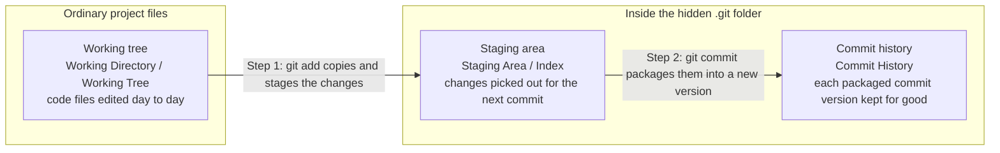
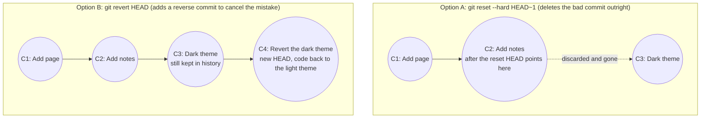
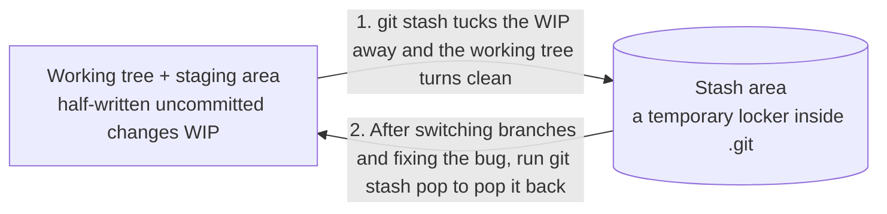
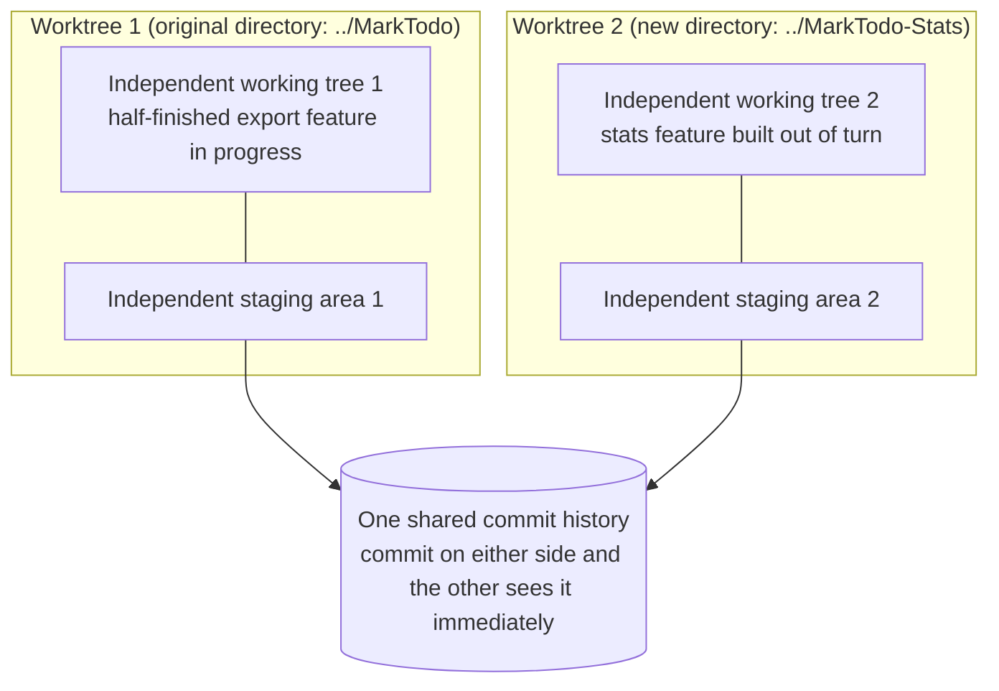
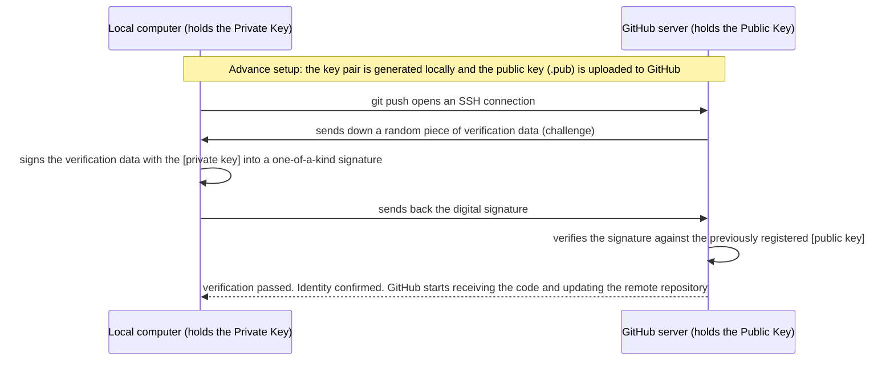

# Git + GitHub

### **Module 1: The Core Roles of Git and GitHub, and Environment Setup**

#### **1. Core Concepts and Underlying Principles**

In both traditional development and AI-assisted coding (using coding agents such as Codex and Claude Code), code version management is an essential foundational capability. Especially in the AI coding era, an AI often modifies dozens of files in one go; without version checkpoints, it becomes very hard to back out once the project has been broken.

* **Git (local version control software)**: A piece of software installed on **your own computer**. Its core job is recording code versions (archiving and rollback). Whenever the project completes a stage, use Git to save the code's state at that moment; afterwards, even if the code gets broken or accidentally deleted, you can always go back to a previously saved working version. Everything runs locally — no internet connection needed.
* **GitHub (remote code hosting website)**: An **online website**. Its core job is **backing up** your code and Git version history in the cloud. By syncing a copy of the local code together with all of its version records to GitHub, the data survives even if the computer breaks or the local folder gets deleted beyond recovery. GitHub also supports multi-person collaboration and publishing your source code for others to see.

#### **2. Installation Methods and Verification Steps**

The video covers three routes to installing Git; pick one based on your system and habits:

1. **Install with an AI coding tool (the least hassle)**
   If you already use coding agents like Codex or Claude Code, the simplest way is to tell the AI in plain language right in the terminal: "Help me install Git." If the computer does not have Git yet, the AI will run the whole installation process for you; if Git is already installed, the AI will detect it and skip automatically instead of installing twice.
2. **Manual installation on Windows**
   * **Step 1**: Open the [official Git website](https://git-scm.com), click `Install for Windows` on the page, then click `Click here to download` to fetch the installer.
   * **Step 2**: Double-click the downloaded installer. The setup is like any ordinary program — keep the default configuration and click `Next` all the way through.
   * **Step 3**: On the final screen, uncheck `View Release Notes` (that option only displays release notes and has no real value), then click `Finish` to complete the installation.
   * **Step 4 (Verify the installation)**: Open the Windows Start menu, search for and launch **`Git Bash`**, type `git --version` and press Enter. If a Git version number prints normally (e.g. `git version 2.x.x`), the installation succeeded.
3. **Manual installation on macOS**
   * **Step 1**: Open the built-in macOS Terminal and type `git --version` directly, then press Enter.
   * **Step 2 (Case A: already bundled)**: If a version number appears right away, Git was already installed as a side effect of installing other software earlier — no further action needed.
   * **Step 2 (Case B: a dialog pops up to install developer tools)**: If Git is not installed, the terminal will say the **Xcode Command Line Tools** must be installed before Git can be used, and an installer dialog pops up from the Dock. This is Apple's official all-in-one developer toolkit (besides Git it bundles compilers, debugging tools, and other must-have dev components). Click "Install" and accept the license.
   * **Step 3 (Verify the installation)**: Once the installation finishes, close the dialog and run `git --version` in the terminal again; a normal version number means you are done.

---

### **Module 2: Initializing a Local Repository and the Core Principles of Archiving (The Three Areas)**

#### **1. Core Concepts and Underlying Principles**

* **Repository initialization and the hidden `.git` folder**:
  Running `git init` essentially creates a hidden folder named **`.git`** inside the current project folder. From then on, all Git-related version data and history records live inside that `.git` folder.
* **Git's three core areas**:
  A project folder managed by Git is logically divided into two kinds of files and **three areas**:
  1. **Working tree (Working Directory / Working Tree)**: our own project files (such as `index.html` and `README.md`) — the area we open and edit directly every day in editors like VS Code.
  2. **Staging area (Staging Area / Index)**: located inside the hidden `.git` folder. It temporarily holds the changes we have picked out to go into the next version commit. In Git terminology, putting changes into the staging area is called **`stage`**; changes already in the staging area are **`staged`**; changes still in the working tree that have not been staged are **`unstaged`** (or `not staged`).
  3. **Commit history (Commit History)**: located inside the hidden `.git` folder. It permanently stores every packaged version. In Git, people generally do not say "version"; they simply call it a **`commit`**, and the commit history is often just called the **commit history**.



* **An under-the-hood question: why can't we just save the working tree as a version directly — why must it first be copied into a "staging area"?**
  The whole point of the staging area is that it **lets us pick, bit by bit, what goes into the next commit**.
  If you changed only one file, the staging area's value is not obvious yet; but suppose a refactoring touched a dozen-plus files while some other files (say, the documentation) are only half written. With a staging area, you can use `git add` in batches to gradually pick out the finished files that belong to the same feature change (for example, pick `index.html` first, then its matching `.js` and `.css` files), leaving the half-finished work in the working tree unpicked. Once everything in the staging area is confirmed ready, run a single `git commit` to package it all into one clean commit.

#### **2. Methods and Operation Steps**

1. **Enter the project directory and initialize the repository**:
   ```bash
   # Enter the project folder (cd is not a Git command, but it is used constantly for changing directories)
   cd path/to/MarkTodo

   # Initialize the current directory as a Git repository
   git init
   ```
2. **Prep before the first commit: configure the committer name and email**:
   Every time Git creates a commit, it records who made it. So before first use you must tell Git your name and email:
   ```bash
   git config --global user.name "Your Name"
   git config --global user.email "your-email"
   ```
3. **Check the repository's current state (`git status`)**:
   ```bash
   git status
   ```
   * If a file appears under **`Untracked files`**: Git has noticed the file, but is not yet tracking its changes, and no version of it has ever been saved.
   * If a file appears under **`Changes to be committed`**: the file's changes are already in the **staging area**, waiting to be committed as a commit.
4. **First archiving step: stage the working-tree changes (`git add`)**:
   ```bash
   # Add a single file to the staging area
   git add index.html

   # Or add several files to the staging area at once
   git add index.html main.js style.css
   ```
5. **Second archiving step: package the staged content into a commit (`git commit`)**:
   ```bash
   git commit -m "Add todo page"
   ```
   Here `-m` is short for `message`; the quoted text after it describes this commit. A project usually accumulates dozens or hundreds of commits, so a clear message is what lets you quickly tell what each commit changed when you read the history later.
6. **View the commit history (`git log`)**:
   ```bash
   git log
   ```
   Output is listed newest-first (the latest commit on top). Each record has four parts:
   * **Commit ID**: the long string of letters and digits after `commit` (a SHA-1 hash). Each commit's is unique — its ID card, in effect.
   * **Author**: the committer's name and email (the info just configured with `git config`).
   * **Date**: exactly when the commit was made.
   * **Commit message**: the indented line of text at the bottom (what you wrote after `git commit -m`).
   * When you finish reading, press **`q`** on the keyboard to exit the `git log` view (run `clear` if you want to wipe the terminal screen).

#### **3. Key Cases from the Video**

In the video's **MarkTodo** project, there are initially two files: `index.html` (100+ lines of todo-page code, already working) and `README.md` (the project's documentation, whose final "Future plans" section says "content to be added" — a half-finished draft).
* **First commit**: to keep `index.html` safe from being broken later, run only `git add index.html` and `git commit -m "Add todo page"` on it; at this point the staging area packages just `index.html`, and the half-finished `README.md` stays under `Untracked files`.
* **Second commit**: then open `README.md`, replace "content to be added" with the two features planned for development next, and save; then run `git add README.md` and `git commit -m "Add project documentation"`. Running `git log` now shows two complete commit records, one on top of the other.

#### **4. Common Pitfalls**

* **Pitfall 1: assuming "empty Git repository" means the `.git` folder is empty**
  When `git init` prints `Initialized empty Git repository`, it means **no commit (version) has been saved yet** — yet the hidden `.git` folder has in fact already been filled with many of the base files Git needs. You never need to open or modify the `.git` folder in daily work; just leave it hidden.
* **Pitfall 2: assuming that configuring `user.name` and `user.email` is logging into an account**
  These two commands are **not logging into or registering any account**, and Git does not validate the email at all — it is merely the author signature label you attach to commits locally. And with `--global`, you **only need to set it once per computer**: working on this project or creating any other project on the same machine afterwards requires no reconfiguration.
* **Pitfall 3: running `git status` after committing, not seeing the file in the list, and assuming it was lost**
  After `index.html` has been committed, running `git status` again shows no `index.html` in the list. That is because `git status` only lists files that "have uncommitted changes or are untracked"; a file whose content matches the latest commit exactly is in a normal clean state and needs no mention.

---

### **Module 3: Viewing Differences and the Rollback Mechanisms for Three States**

#### **1. Core Concepts and Underlying Principles**

When code has broken the project and you want to back out, the right rollback method depends on **how far the change has traveled** (still only in the working tree, already staged, or already committed as a commit).

* **Line-level diffing (`git diff`)**:
  `git status` can only tell you **which files** were modified (marked `modified`), not what exactly changed. Running `git diff` shows the concrete line-by-line differences between the working tree and the staging area (if the changes have not been staged yet, the staging area still equals the last commit, so this is effectively a comparison against the last commit): lines prefixed **`-` (minus, red)** are deleted code, and lines prefixed **`+` (plus, green)** are newly added code.
* **The `HEAD` pointer and relative position notation**:
  In Git, **`HEAD`** stands for the **most recent commit** in the current branch's commit history. Earlier commits are written with a tilde plus a number:
  * **`HEAD`**: the most recent commit (1st from the end)
  * **`HEAD~1`**: the commit before `HEAD` (2nd from the end)
  * **`HEAD~2`**: one further back (3rd from the end), and so on.
  Note: `HEAD`'s position is not fixed. Every time you make a new commit, `HEAD`, `HEAD~1`, and `HEAD~2` automatically slide forward one step together.
* **Two rollback philosophies for an already-made commit (`git reset` vs `git revert`)**:
  * **`git reset` (reset / rollback by deleting the record)**: moves the `HEAD` pointer straight back to `HEAD~1`; the erroneous newest commit, now pointed to by nothing ("orphaned"), is simply discarded and deleted from the `git log` history.
  * **`git revert` (revert / rollback by keeping the record)**: does not delete the original bad commit. Instead, Git automatically "changes the code back" in the working tree (a line that was added gets deleted; `ABC` that was changed to `XYZ` gets changed back to `ABC`), then packages this reverse change as a **brand-new commit** that cancels out the earlier bad one. The benefit: the **history is fully preserved** — if you ever regret it and want code you wrote earlier, you can still dig it out of the history.



* **Comparing the underlying principles of `git reset`'s three modes**:
  `git reset` has three modes; the core difference lies in **which areas the rollback affects**:

| Reset mode | Rolls back [commit history]? | Rolls back [staging area]? | Rolls back [working tree]? | When to use it and its traits |
| :--- | :---: | :---: | :---: | :--- |
| **`--hard`** | Yes | Yes | Yes | **The most thorough**: all three areas roll back together, the code returns exactly to the target commit, and the bad changes vanish completely. |
| **`--mixed`** (default) | Yes | Yes | **No (changes kept)** | The default when running `git reset HEAD~1` with no flag. It undoes the commit and the staging area, but the code changes stay in the working tree. |
| **`--soft`** | Yes | **No (changes kept)** | **No (changes kept)** | Only undoes the commit; the code changes stay untouched in the staging area and the working tree. Fits the case of spotting a small flaw right after committing — fix two lines and commit again. |

#### **2. Methods and Operation Steps**

* **Reading the concrete changes (keys inside `git diff`)**:
  After running `git diff` you enter the diff view: press **`j`** to move down one line, **`k`** to move up one line; if that is too slow, press **`f`** to page down a full screen and **`b`** to page up a full screen; press **`q`** when done.

* **Scenario 1: the changes are only in the working tree (files edited, `git add` not yet run)**
  `git status` will show `Changes not staged for commit`. Use `git restore` to undo the working-tree changes directly:
  ```bash
  # Roll back one specific file
  git restore index.html

  # Roll back several specific files at once
  git restore index.html README.md

  # Roll back every file change in the current directory in one shot ( `.` stands for the current directory; the most common move in AI coding)
  git restore .
  ```
  Afterwards `git status` shows `nothing to commit, working tree clean` (the working tree is clean — the rollback took effect).

* **Scenario 2: the changes have entered the staging area (`git add` run, `git commit` not yet)**
  `git status` will show `Changes to be committed`. This takes two steps: first pull the changes back out of the staging area into the working tree (unstage), then erase them from the working tree:
  ```bash
  # Step 1: unstage all changes in the current directory (back to the working-tree-only state)
  git restore --staged .

  # Step 2: discard the working-tree changes for good
  git restore .
  ```

* **Scenario 3: the changes have been committed (`git add` and `git commit` both run)**
  * **Approach 1 (delete the latest commit outright)**:
    ```bash
    # First glance at git status to make sure the working tree holds no other important uncommitted code, then run:
    git reset --hard HEAD~1
    ```
  * **Approach 2 (add a reverse commit that cancels the latest commit)**:
    ```bash
    git revert HEAD
    ```
    A **Vim editor** window pops up showing the auto-generated rollback commit message (the first line is `Revert "xxx"`; after a blank line, `This reverts commit <hash>.` names the reverted commit's ID; the lines starting with `#` below are all comments and will be ignored). No need to change anything — simply type a colon followed by `wq`:
    ```text
    :wq
    ```
    Press Enter to save and quit, and the revert commit is created.

#### **3. Key Cases from the Video**

To demonstrate the three kinds of rollback, the video edits 5 lines of style code in MarkTodo's `index.html`, changing the light background into a terrible-looking **dark theme**:
1. The first time, only the file is saved with no Git commands typed; `git restore .` returns to the light theme in one shot;
2. The second time, the dark theme is saved and `git add index.html` is run; `git restore --staged .` first pulls the change down out of the staging area (refreshing the page at that point still shows the dark theme), and only after running `git restore .` does the page truly turn light again;
3. The third time, the dark theme is committed as the 3rd commit; `git reset --hard HEAD~1` is demonstrated first, cutting the total commit count from 3 back to 2; the dark theme is then committed again, and `git revert HEAD` is demonstrated, growing the total to 4 commits (the 4th commit's changes are the exact opposite of the 3rd), likewise restoring the light theme.

#### **4. Common Pitfalls**

* **Pitfall 1: agonizing over the difference between `working directory` and `working tree`**
  Different `git status` messages sometimes say `working directory` and sometimes `working tree`. They are just two English names for the same thing — identical in meaning, nothing to agonize over.
* **Pitfall 2: running only `git restore --staged .` on a staged file and assuming its contents have been rolled back**
  `git restore --staged .` **only changes Git's staging-area records** — it pulls the file back from the staging area into the working tree, but the code file in the working tree itself **does not change by a single line**! You must immediately run `git restore .` once more before the file's contents truly return to their original state.
* **Pitfall 3: blindly running `git reset --hard` and losing precious uncommitted work**
  `--hard` is brutally thorough: it resets the working tree, the staging area, and the commit history all at once. If you wrote some new uncommitted code in the working tree after making the commit you want to roll back, running `git reset --hard HEAD~1` will vaporize that newly written uncommitted code too. Therefore, **always run `git status` first to confirm the working tree is clean before executing `--hard`**.

---

### **Module 4: Ignoring Irrelevant Files with `.gitignore`**

#### **1. Core Concepts and Principles**

Some files in the project directory we want to keep on the computer (personal study notes, hidden view-configuration files auto-generated by the system, temporary files, etc.), but they have nothing to do with the project's actual functionality: we neither plan to commit them into the history, nor want them flooding `Untracked files` every time we type `git status`.

For this, Git provides the **`.gitignore`** mechanism: create a text file named `.gitignore` in the project root, write into it the file names you do not want Git to track, and Git will automatically disregard their existence.

#### **2. Method and Configuration Steps**

1. **Create and edit the `.gitignore` file**:
   In the project root, create a `.gitignore` file with an editor (VS Code, or `vim .gitignore` in the terminal) and write the file names to ignore, one per line:
   ```text
   notes.txt
   .DS_Store
   ```
2. **Verify the ignoring works**:
   After saving, run `git status`: the previously untracked `notes.txt` no longer shows up, replaced by the newly created `.gitignore` file.
3. **Commit `.gitignore` to the repository**:
   ```bash
   git add .gitignore
   git commit -m "Add .gitignore ignore rules"
   ```

#### **3. Key Cases from the Video**

In the video, a personal study note `notes.txt` is created inside the MarkTodo directory, and the video anticipates that macOS Finder will quietly generate a hidden `.DS_Store` when you adjust the folder's view or drag icons around. After writing these two lines into `.gitignore`, `notes.txt` remains perfectly intact and editable in the Finder folder, but `git status` has completely stopped mentioning it.

#### **4. Common Pitfalls**

* **Pitfall 1: assuming files ignored by `.gitignore` get deleted**
  `.gitignore` only stops Git from detecting and reporting the file; the original file on the hard drive is completely unaffected.
* **Pitfall 2: forgetting to commit the `.gitignore` file itself to the Git repository**
  Many people set up `.gitignore` and leave it at that. Note: **`.gitignore` itself is part of the project configuration and must be committed via `git add` and `git commit`**! Only then do the ignore rules get saved along with the project history, so you will not have to rewrite them when switching computers or collaborating with others.

---

### **Module 5: Branches, Merges, and Conflict Resolution**

#### **1. Core Concepts and Underlying Principles**

* **What a branch really is**:
  When you run `git log`, the parentheses next to the newest commit show not only `HEAD` but also `master` (or `main`). **At its core, a branch is just a label stuck onto some commit.** When you commit new work on that branch, the label automatically moves one step forward, forever sticking to the newest commit. The entire chain of commits traced back from the branch label is that branch's commit history.
* **Why create a branch for a new feature? (Keep the main branch stable)**:
  `master` (or `main`) is the project's **main branch**, and teams usually require the code on the main branch to **be stable and fully usable at all times**.
  If a new feature takes 3 commits to finish (say, first the UI, then the save logic, then reminders), committing directly onto `master` means that after the 1st commit, `master` has a button but no logic, and users get an error the moment they click it.
  **The right approach (one branch per feature)**: pull a dedicated feature branch off the stable `master` (conventionally named `feature/<feature-name>`), and commit all the development commits onto this new branch. While development is under way, `master` is completely unaffected and stays stable; once the new feature is fully built and tested on the new branch, **merge** the new branch back into `master` in one go, and finally delete the used-up feature branch.
* **How the two merge strategies work under the hood (why is a merge sometimes instant, and sometimes produces an extra commit?)**:
  1. **Fast-forward merge**:
     Suppose you pull branch A off `master` and make 3 commits, while **`master` stays put with no new commits**. At that point branch A contains all of `master`'s history, just 3 steps further along. When merging, Git only needs to "fast-forward" the `master` label straight to branch A's position — **no new commit is created at all**.
  2. **Three-way merge (creates a dedicated merge commit)**:
     Suppose you create branches A and B off the same old point of `master` at the same time. Once branch A is fast-forward merged into `master`, `master` has advanced to the tip of branch A; now merging branch B is another matter: B forked off from the old spot and contains none of branch A's 3 commits. If `master` simply moved to branch B, branch A's feature would be lost! Therefore Git must, afterwards, **create a brand-new commit dedicated to the merge** that connects both sides' latest commits, fuses the code of both sides together, and then moves `master` onto this new commit.
* **Why merge conflicts arise**:
  During a three-way merge, if the two branches modified different files or different spots of the same file, Git merges automatically and even auto-commits that merge commit; but if **both branches changed different content at the same spot of the same file** (for example, both want to insert their own new button directly below the "Add" button), Git cannot decide for you whether to keep one, keep both, or which comes first — it reports **`CONFLICT`** and pauses the merge, waiting for a human to arbitrate.

#### **2. Methods and Operation Steps**

* **Everyday branch commands**:
  ```bash
  # 1. List all branches in the repository (the one with a * asterisk in front is the branch you are currently on)
  git branch

  # 2. Step-by-step style: create the branch first, then switch to it
  git branch feature/due-date
  git switch feature/due-date

  # 3. [Recommended] One-step style: create a new branch and switch to it immediately (-c stands for create)
  git switch -c feature/due-date
  # Note: older tutorials use git checkout -b feature/due-date; the effect is exactly the same, but switch -c reads more clearly

  # 4. Compact commit history (one line per commit, showing only the leading digits of the ID and the message)
  git log --oneline

  # 5. Merge a branch (remember: first switch back to the target branch master, then merge the feature branch into it!)
  git switch master
  git merge feature/due-date

  # 6. Delete a branch that has been fully merged and is no longer needed (-d stands for delete)
  git branch -d feature/due-date
  ```

* **The standard four-step method for resolving a merge conflict**:
  When `git merge` reports `CONFLICT` and `Automatic merge failed`:
  1. **Check the status and identify the conflicted file**:
     Run `git status`; under `Unmerged paths` you will see the file marked **`both modified`** (modified on both sides), such as `index.html`. (Note: if you no longer want to merge at this point, run **`git merge --abort`** to abandon the merge and restore the original state.)
  2. **Open the conflicted file in an editor and recognize the three conflict markers**:
     Open `index.html` and find the three special marker lines Git inserted automatically:
     ```html
     <<<<<<< HEAD
     <button>Sort</button>
     =======
     <button>Complete all</button>
     >>>>>>> feature/complete-all
     ```
     * The **upper part**, between `<<<<<<< HEAD` and `=======`: the content of the branch you are currently on (the `master` branch that `HEAD` points to).
     * The **lower part**, between `=======` and `>>>>>>> feature/complete-all`: the content of the branch about to be merged in.
  3. **Edit manually and delete the marker lines**:
     Delete the three marker lines `<<<<<<< HEAD`, `=======`, and `>>>>>>> feature/complete-all` completely, and adjust the code in between to the shape you ultimately want to keep (for example, keep both buttons and order them), then save the file.
  4. **Stage and commit the merge result**:
     ```bash
     git add index.html
     git commit -m "Merge the complete-all feature and resolve the button conflict"
     ```
     Once done, `git status` shows `working tree clean` — the merge is fully complete.

#### **3. Key Cases from the Video**

1. **A conflict-free fast-forward merge**: the video builds the **"Due date (`feature/due-date`)"** feature for MarkTodo, completing the UI, the save logic, and the overdue-in-red reminder in 3 commits on the new branch. Midway it switches back to `master` to show that the `master` page is completely unaffected; when finished, switching back to `master` and running `git merge feature/due-date` merges cleanly, and `git branch -d` deletes the branch.
2. **A two-branch conflict case**: two branches — **"Sort by due date (`feature/sort`)"** and **"Complete all (`feature/complete-all`)"** — are created one after another off the same `master` point, each with 3 commits. Back on `master`, merging `feature/sort` first succeeds in one step via `Fast-forward`; merging `feature/complete-all` immediately afterwards triggers a conflict, because both branches inserted their own button below the "Add" button in `index.html`. The three-way merge is completed by deleting the three conflict-marker lines, keeping both the "Sort" and "Complete all" buttons, and running `git add` and `git commit`.

#### **4. Common Pitfalls**

* **Pitfall 1: running only `git branch <new-branch-name>` and starting to code without switching branches**
  `git branch <branch-name>` **only creates the branch — it does not take you there**! After creating it you are still on the original `master`. So in daily work, strongly prefer **`git switch -c <branch-name>`** to create and switch in one step, or build the habit of running `git branch` to see where the asterisk `*` sits.
* **Pitfall 2: creating a new branch, noticing the project files have not changed, and assuming the branch creation failed**
  Right after creating and switching to a new branch from `master`, both branches point to the same commit, so the code files in the working tree are identical. Only after you commit new work on the new branch do the differences between the two branches become visible.
* **Pitfall 3: standing on the wrong branch when merging (getting the merge direction backwards)**
  `git merge` always obeys the rule **"merge the other branch into the branch you are currently on"**. To merge `feature` into `master`, you must first `git switch master` to stand on `master`, then type `git merge feature`.

---

### **Module 6: Git's Three Advanced Power Tools (Rebase, Stash, Worktree)**

#### **1. Rebase (Rebasing: Giving a Branch a New Foundation)**

* **Core concept and the pain point**:
  In real development, a complex feature often takes a week or two on the `feature` branch (dozens of commits), and all the while the `master` branch keeps absorbing other people's new code. Merge at the very last moment and you get a mass of conflicts exploding at once — or even discover that your implementation is fundamentally incompatible with the latest `master` and have to redo the work.
  **The solution is `rebase` (`re` = again + `base` = foundation; that is, replacing the starting commit your branch forked from)**: during development, run `git rebase master` from time to time to move your feature branch behind `master`'s latest commit. That way you always have `master`'s newest code and can resolve conflicts on the spot while they are few; and when the feature is finally done and merged back into `master`, it triggers a clean, crisp **fast-forward merge**, keeping the commit history a straight line.
* **How it works under the hood (replaying commits)**:
  `rebase` does not slide the whole branch over in one piece; it **takes every commit on your branch off, one by one, and replays them, one at a time, on top of the new foundation (the latest `master`)**!
* **Methods and operation steps**:
  ```bash
  # 1. First switch to your feature branch
  git switch feature/complete-all

  # 2. Rebase: move the current branch's foundation onto the latest master
  git rebase master

  # 3. If a conflict appears while a commit is being moved over: open the conflicted file, delete the <<<< ==== >>>> markers, fix the code, then stage it:
  git add index.html

  # 4. [The critical step] Continue the rebase (never type git commit!)
  git rebase --continue
  # (If a Vim editor pops up showing the commit's original message, type :wq and press Enter to save and quit; Git will then go on moving the remaining commits)

  # 5. Once the rebase is done and the feature is finished, switch back to master for a fast-forward merge:
  git switch master
  git merge feature/complete-all
  ```
* **Common pitfall**:
  After hitting a conflict during a rebase and running `git add`, **never reflexively type `git commit`**! At that moment you are not creating a merge commit — you are resuming an interrupted moving process, so you must run **`git rebase --continue`**.

---

#### **2. Stash (Parking Half-Finished, Uncommittable Code)**

* **Core concept and underlying principle**:
  You are coding on a feature branch, a function is just half written (too unfinished to commit as a commit), and suddenly you need to rush back to `master` to fix a live bug. Running `git switch master` directly gets blocked by Git with an error (it warns that local changes to files would be overwritten and tells you to `commit your changes or stash them`).
  Inside the `.git` folder, besides the staging area and the commit history, there is a dedicated temporary holding area called **`stash`**. After running `git stash`, Git sweeps every not-yet-committed change in the **working tree and staging area (Index)** — collectively called **`WIP` (Work In Progress, the work currently under way)** — into the stash area in one go, instantly returning the working tree to the clean state of the last commit. Once the other business is done and you switch back, `git stash pop` returns the half-finished code to the working tree exactly as it was, ready to keep writing.



* **Methods and operation steps (based on the video's urgent bug-fix case)**:
  In the video, the `clearCompleted` function of the "Clear completed" feature is being written on the `feature/clear-completed` branch (just half done) when user feedback suddenly arrives: once a todo with a due date is checked off, its date also gets struck through by mistake. The full handling workflow:
  ```bash
  # 1. Sweep the half-written changes in the working tree and staging area into the stash
  git stash

  # 2. The working tree is now clean (working tree clean), so switching back to master goes through smoothly
  git switch master

  # 3. Pull a dedicated bug-fix hotfix branch off master (do not edit code directly on master)
  git switch -c hotfix/due-date-strikethrough

  # 4. Fix the code and verify it, then commit and merge into master, and delete the hotfix branch
  git add index.html
  git commit -m "Fix the due date being struck through when a todo is completed"
  git switch master
  git merge hotfix/due-date-strikethrough
  git branch -d hotfix/due-date-strikethrough

  # 5. Switch back to the original feature branch and pop the stashed half-finished code back into the working tree
  git switch feature/clear-completed
  git stash pop
  # (The half-written clearCompleted function is intact again; finish it, commit, and merge into master)
  ```
* **Common pitfalls**:
  * **Assuming `stash` only collects the working tree and ignores the staging area**: the `WIP on ...` and `index` in `git stash`'s output show that **any changes not yet committed (whether they are only in the working tree or already `git add`ed into the staging area)** are swept into the stash together.
  * **Fixing the bug directly on `master` after switching back**: to keep the main branch stable, bug fixes should follow the branching convention too — pull a `hotfix/xxx` (emergency fix) branch off `master`, fix it there, and merge back into `master` once it is verified.

---

#### **3. Worktree (Multiple Working Trees: Parallel Development in Multiple Folders)**

* **Core concept and underlying principle**:
  `stash` suits short interruptions you will return to quickly; but if you need to **develop several branches in parallel** (writing here for a while, there for a while), constantly typing `stash` and `stash pop` is a hassle.
  **`worktree`**'s solution: open another folder on the computer. In Git, **"one working tree plus its own private staging area" makes up a `worktree`** (the original project directory is itself the first worktree).
  **The golden rule**: **every worktree has its own independent working tree (folder) and its own independent staging area, with no interference between them; but all worktrees share the same underlying Git repository and the same commit history!**



* **Methods and operation steps (based on the video's jump-ahead "stats feature" case)**:
  In the video, the "export feature" is being written on the `feature/export` branch in the original directory (the export logic just half done) when the product manager suddenly demands that the "stats feature", due to launch next week, be built ahead of the queue:
  ```bash
  # 1. Create a new worktree (specifying two things: create the feature/stats branch based on master, and put the code in the sibling folder ../MarkTodo-Stats)
  git worktree add -b feature/stats ../MarkTodo-Stats master

  # 2. Stop the terminal from showing Chinese paths as octal garble (a legacy quirk; just tell Git not to escape them):
  git config --global core.quotepath false

  # 3. List how many worktrees there are, with their paths and branches
  git worktree list

  # 4. Enter the new directory, develop the stats feature, and commit the code
  cd ../MarkTodo-Stats
  # (after editing the code, run git add and git commit)

  # 5. In the new directory, merge the stats feature into master and delete the feature/stats branch
  git switch master
  git merge feature/stats
  git branch -d feature/stats

  # 6. [Cleanup] First cd back to the original main directory, then remove the new worktree with the dedicated command
  cd ../MarkTodo
  git worktree remove ../MarkTodo-Stats
  ```
* **Common pitfalls**:
  * **Pitfall 1: thinking a worktree is the same thing as "copying the project folder in Finder"**
    If you copy-paste the project folder in Finder/File Explorer, you get **two completely independent Git repositories** — code committed on one side is simply unknown to the other. The newly added worktree, by contrast, **shares the same repository** with the original directory: even if you delete the new directory, the stats-feature code just committed there and merged into `master` remains perfectly intact in the original directory's `git log`.
  * **Pitfall 2: not understanding the plus sign `+` in front of entries in the `git branch` output**
    With multiple worktrees, running `git branch` shows: an asterisk **`*`** in front marks the branch of the current directory; a plus sign **`+`** in front (as in `+ feature/export`) means that branch is **currently checked out and in use in another worktree directory**.
  * **Pitfall 3: dragging the finished-with directory straight into the Trash/Recycle Bin, or deleting it while the terminal is still inside it**
    Dragging the folder into the Trash only deletes the physical files; Git still holds the worktree's registration internally, which leads to errors later. The right way is to **first `cd` back to the original project directory**, then run **`git worktree remove <path>`** to clean up both the folder and Git's records in one go.

---

### **Module 7: GitHub Remote Authentication, Pushing Code, and Clone Recovery**

#### **1. Core Concepts and Underlying Principles**

* **How SSH key (public and private) authentication works**:
  When you push code from your computer to GitHub, GitHub must confirm the operator is you and not an impersonator. GitHub no longer supports typing an account password for verification; the mainstream approach is configuring an **SSH key**.
  An SSH key is not a string password to be memorized — it is **two files** generated on the local computer:
  1. **Private key (e.g. `id_ed25519`)**: stays on your own computer and **must absolutely never be made public or sent to anyone**. Every time you push code to GitHub and set up an SSH connection, GitHub first sends over a piece of verification data; the computer uses the private key to produce a unique **"signature"** on it that no one else can forge, and sends it back to GitHub. Only after GitHub verifies it with the registered public key does it formally start receiving the code.
  2. **Public key (e.g. `id_ed25519.pub`; `pub` stands for `public`)**: can be made public — hand a copy to GitHub to keep. When GitHub receives your code and signature, it checks the signature against the public key you previously submitted. As long as the public key recognizes the signature as one produced by its matching private key, authentication passes.



* **What `origin` and the `-u` binding mean**:
  * **`origin`**: a GitHub repository's remote URL is long, so `git remote add origin <url>` gives that remote address a short code name: `origin` (the customary name, standing for the remote source repository).
  * **The `-u` flag**: adding `-u` to the first push, `git push -u origin master`, formally binds the local `master` branch to GitHub's `master` branch (i.e. `origin/master`). Once bound, pushing code on this branch later takes only two words: **`git push`**.

#### **2. Methods and Operation Steps**

1. **Generate and configure the SSH key (configured once per computer)**:
   ```bash
   # Step 1: generate the SSH key (-t ed25519 is the algorithm type recommended by GitHub; -C takes your email as a comment)
   ssh-keygen -t ed25519 -C "your-email"
   # Note: it asks 3 questions in a row (the save path defaulting to ~/.ssh/id_ed25519, a key passphrase, and passphrase confirmation). On a personal computer, simply press Enter 3 times to accept the defaults / no passphrase.

   # Step 2: print the public key file and copy the entire output text
   cat ~/.ssh/id_ed25519.pub
   ```
   * **Step 3 (upload the public key to GitHub)**: log in to the GitHub website -> click the avatar at the top right -> **`Settings`** -> click **`SSH and GPG keys`** in the left menu -> click **`New SSH key`** -> paste the copied public key into the text box -> click **`Add SSH key`**.
   * **Step 4 (test the connection in the terminal)**:
     ```bash
     ssh -T git@github.com
     ```
     On first connection it asks whether to continue; type **`yes`** and press Enter. Seeing `Hi xxx! You've successfully authenticated...` means the configuration succeeded.

2. **Create an empty repository on GitHub and push the local project for the first time**:
   * **Step 1 (create the repository on the web)**: click the avatar at the top right of GitHub -> **`Repositories`** -> click **`New`**. Fill in an English repository name (`Repository name`, e.g. `MarkTodo`; Chinese is not allowed, and Chinese descriptions can go in `Description`); choose public (`Public`) or private (`Private`); **leave all three options at the bottom — `Add a README`, `Add .gitignore`, `Add a license` — unchecked**, then click **`Create repository`**.
   * **Step 2 (bind and push from the terminal)**: in the local project directory, run:
     ```bash
     # 1. Record the remote GitHub repository URL and name it origin
     git remote add origin git@github.com:your-username/MarkTodo.git

     # 2. Push the local master branch to origin and bind it with -u
     git push -u origin master
     ```
   * **Step 3 (the everyday development sync workflow)**: once the first push is done, every time code changes, running the following three commands in order completes the local archive and the cloud backup at the same time:
     ```bash
     git add .
     git commit -m "Fill in the README feature list"
     git push
     ```

3. **When the local project is accidentally deleted or you are on a new computer, clone it back from GitHub (`git clone`)**:
   * **Step 1**: open the GitHub repository page -> click the green **`<> Code`** button -> make sure the **`SSH`** tab is selected -> click the copy icon to copy the repository URL.
   * **Step 2**: open a terminal, first `cd` to the directory where you want the project (e.g. the desktop, `cd ~/Desktop`), and run the clone command:
     ```bash
     # Appending a custom folder name after the repository URL makes the downloaded folder take that name instead of the default MarkTodo
     git clone git@github.com:your-username/MarkTodo.git MarkTodo
     ```

#### **3. Key Cases from the Video**

In the video, an empty GitHub repository `MarkTodo` is first created for MarkTodo; `git remote add` and `git push -u origin master` push all 22 locally accumulated commits up to the cloud in one go (the GitHub front page automatically renders and displays the `README.md`). The feature list in `README.md` is then updated, showing that after everyday changes syncing takes only `git add` -> `git commit` -> `git push`. Finally, the MarkTodo folder on the computer is deliberately deleted entirely, and `git clone <url> MarkTodo` restores all the code and all 23 commits, bit for bit, onto the desktop.

#### **4. Common Pitfalls**

* **Pitfall 1: seeing the warning on the first `ssh -T git@github.com` run and taking it for an error**
  The first time you connect to GitHub it prompts `The authenticity of host 'github.com ...' can't be established. Are you sure you want to continue connecting?` — this is SSH's normal security confirmation when connecting to an unfamiliar host for the first time. Just type the full word **`yes`** and press Enter; it will not ask again afterwards.
* **Pitfall 2: checking the auto-generate `README` or `.gitignore` boxes when creating the repository on GitHub**
  If you intend to push a **Git repository that already exists locally**, **never check** Add README, .gitignore, or License when creating the remote empty repository; otherwise the remote repository gains an initial commit unrelated to your local history, and the first push fails with a conflict error.
* **Pitfall 3: copying GitHub's suggested `git push -u origin main` verbatim and hitting an error**
  The push command suggested by default on GitHub's page names the `main` branch. If your local main branch is named `master` and you skipped the second rename command (`git branch -M main`), then when running the third push command you **must change the trailing `main` to `master`** (that is, `git push -u origin master`).
* **Pitfall 4: how to tell from `git status` whether the local code has been pushed to GitHub?**
  When you have run `git commit` locally but not yet `git push`, `git status` reports `Your branch is ahead of 'origin/master' by 1 commit` (local is 1 commit ahead of the remote); after `git push` finishes, it reports `Your branch is up to date with 'origin/master'` (local and remote are fully in sync).

---

### **Module 8: The Overall Development Workflow and a Quick-Reference Cheat Sheet of High-Frequency Commands**

So you can review at any time while coding, the core commands of the whole course are organized below into a quick-reference list by use case:

| Scenario | Terminal command | What it does and key points |
| :--- | :--- | :--- |
| **Environment & setup** | `git --version` | Check whether Git is installed correctly and its current version |
| **Environment & setup** | `git config --global user.name "Name"` | Set the global committer name (once per computer) |
| **Environment & setup** | `git config --global user.email "email"` | Set the global committer email (once per computer) |
| **Environment & setup** | `git config --global core.quotepath false` | Stop Git from escaping Chinese paths in terminal output as octal codes |
| **Init & status** | `git init` | Initialize the current directory as a Git repository (creates the hidden `.git` directory) |
| **Init & status** | `git status` | View the current working tree and staging area state, and the branch sync status |
| **Init & status** | `git diff` | See exactly which lines changed in the working tree (`j`/`k` line by line, `f`/`b` page by page, `q` to quit) |
| **Everyday archiving** | `git add <file>` or `git add .` | Copy the specified file, or all changes in the current directory, into the staging area (stage) |
| **Everyday archiving** | `git commit -m "message"` | Package everything in the staging area into a new version (commit) |
| **History** | `git log` | View detailed commit history (full ID, author, time, message; `q` to quit) |
| **History** | `git log --oneline` | Compact commit history (one line per commit) |
| **The three rollbacks** | `git restore .` | **Changes only in the working tree**: discard all unstaged changes in the current directory in one shot |
| **The three rollbacks** | `git restore --staged .` | **Changes already staged**: first pull the changes back from the staging area into the working tree (then discard them with the command above) |
| **The three rollbacks** | `git reset --hard HEAD~1` | **Changes already committed (delete the record)**: roll all three areas fully back to the previous version |
| **The three rollbacks** | `git revert HEAD` | **Changes already committed (keep the record)**: add a reverse commit that cancels the latest one |
| **Branches & merging** | `git branch` | List all branches (`*` is the current branch, `+` means opened in another worktree) |
| **Branches & merging** | `git switch -c <branch-name>` | Create a new branch and switch to it immediately (older form: `git checkout -b`) |
| **Branches & merging** | `git switch <branch-name>` | Switch to an existing branch |
| **Branches & merging** | `git merge <branch-name>` | Merge the specified branch into **the branch you are currently on** (abandon a merge with `git merge --abort`) |
| **Branches & merging** | `git branch -d <branch-name>` | Delete a branch that has been fully merged and is no longer needed |
| **The three power tools** | `git rebase master` | Move the current branch's foundation behind the latest `master` (after resolving conflicts and `add`ing, run `git rebase --continue`) |
| **The three power tools** | `git stash` / `git stash pop` | Tuck unfinished WIP changes away safely / pop them back into the working tree when you are done |
| **The three power tools** | `git worktree add -b <new-branch> <new-path> master` | Create a new branch off `master` and mount it in a new independent folder for parallel development |
| **The three power tools** | `git worktree list` / `git worktree remove <path>` | List all worktrees / remove the given worktree folder and its Git records |
| **GitHub remote** | `ssh-keygen -t ed25519 -C "email"` | Generate an SSH key pair (view the public key with `cat ~/.ssh/id_ed25519.pub` and add it on GitHub) |
| **GitHub remote** | `ssh -T git@github.com` | Test whether the SSH authentication connection to GitHub succeeds |
| **GitHub remote** | `git remote add origin <SSH-url>` | Have the local repository remember the remote GitHub URL under the alias `origin` |
| **GitHub remote** | `git push -u origin master` | Push the local `master` to the remote `origin` for the first time and bind them (afterwards, just type `git push`) |
| **GitHub remote** | `git clone <SSH-url> [custom-dir-name]` | Download a remote GitHub repository (all files and all history) completely to local |
