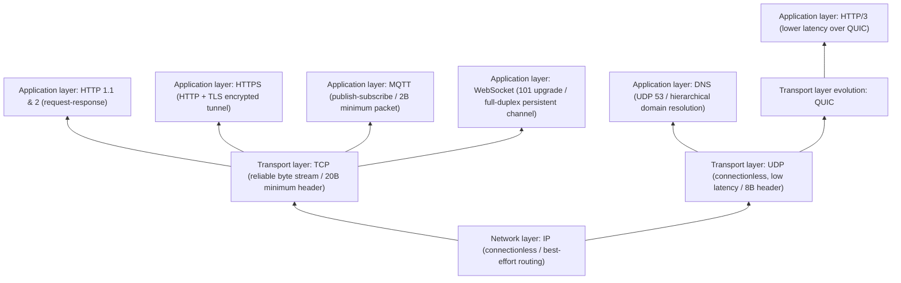

### **Network protocol landscape: the global skeleton**

---

### **I. Cornerstone of the Network Layer: IP (Internet Protocol)**

#### **1. Core Definition**
* **Role**: The most foundational building block of the internet (RFC 791, drafted by DARPA in 1981).
* **IP address**: A unique numeric label that identifies a network device.
* **Packet**: IP splits upper-layer data into small chunks transmitted independently; each packet contains a **header** and a **payload**.

#### **2. Derivation Logic**
* **Decentralized design**: Originally a military communication network built to withstand single points of failure $\rightarrow$ no central control node $\rightarrow$ laid the foundation for the modern internet's decentralized routing architecture.
* **Key header fields**:
  * **Source IP / Destination IP**: Identify the addressing direction of the sender and the receiver.
  * **TTL (Time to Live)**: Caps the maximum number of router hops a packet may traverse; once it reaches zero the packet is discarded, preventing routing-loop deadlocks.
  * **Checksum**: Detects data corruption during transmission.
* **Address exhaustion and capacity evolution**:
  * **IPv4**: 32-bit address length $\rightarrow$ at most about 4.3 billion ($2^{32}$) addresses $\rightarrow$ allocated to near exhaustion by IANA (Internet Assigned Numbers Authority) in 2011.
  * **IPv6**: 128-bit address length $\rightarrow$ roughly $3.4 \times 10^{38}$ (340 undecillion) addresses, thoroughly solving address exhaustion.

#### **3. Key Takeaways**
* **Intrinsic properties**: **Connectionless**, **Unreliable**.
* **Boundary of responsibility**: Only responsible for routing packets from source to destination on a "best-effort" basis; it guarantees neither delivery nor ordering, and does not avoid duplication. All reliability is built by upper-layer protocols (e.g., TCP).

---

### **II. The Transport Layer's Twin Cores: The Design Trade-off Between TCP and UDP**

#### **1. TCP (Transmission Control Protocol)**
* **Core definition**: A **connection-oriented, reliable, ordered byte stream** transport protocol built on top of IP (RFC 793).
* **Derivation logic**:
  * **Problem-driven**: IP suffers from packet loss, disorder, and duplication $\rightarrow$ scenarios such as financial transactions and firmware updates demand zero byte loss $\rightarrow$ reliability control must be introduced on top of IP.
  * **Three core repair mechanisms**:
    1. **Connection handshake**: The two parties establish a connection before data transfer, confirming they are ready.
    2. **Sequencing**: Every byte in the byte stream is numbered, so the receiver can reassemble the correct order and detect gaps.
    3. **ACK & Retransmission**: The receiver acknowledges every segment; if the sender hears nothing back beyond the **retransmission timeout (RTO)**, it retransmits automatically.
  * **Two flow-governance mechanisms**:
    1. **Sliding Window**: Implements **flow control**, preventing a fast sender from overwhelming a slow receiver.
    2. **Congestion Control**: When network packet loss is detected, the sender actively backs off and slows down to relieve network congestion.
* **Key takeaway**: Provides end-to-end, absolutely reliable and ordered byte-stream guarantees, at the cost of heavier header overhead (**20 bytes minimum**) plus handshake and retransmission latency; it is the foundational substrate for zero-tolerance protocols such as HTTP, HTTPS, MQTT, and WebSocket.

#### **2. UDP (User Datagram Protocol)**
* **Core definition**: A **connectionless, minimal, low-overhead** datagram transport protocol built on top of IP (RFC 768, authored by Jon Postel in 1980).
* **Derivation logic**:
  * **Problem-driven**: TCP's handshakes, acknowledgments, and timeout retransmissions introduce significant latency $\rightarrow$ in real-time interactive scenarios, waiting for old data to be retransmitted causes severe video/audio stuttering; real-time performance takes priority over completeness.
  * **Mechanism pruning**: Strips out connection handshakes, sequence numbers, ACK acknowledgments, timeout retransmission, flow control, and congestion control entirely.
  * **Minimal encapsulation**: Wraps data in only an **8-byte header** (containing **source port, destination port, length, checksum**) and sends it directly, with no acknowledgment required.
* **Key takeaway**: Its design philosophy is **"accept imperfection for speed"**; overhead stays extremely low under high concurrency (e.g., a single DNS query takes just 2 packets over UDP versus at least 7 over TCP), and it dominates real-time audio/video, online gaming, and DNS lookups.

#### **3. TCP vs. UDP: Core Parameter Comparison**

| Dimension | TCP (Transmission Control Protocol) | UDP (User Datagram Protocol) |
| :--- | :--- | :--- |
| **Connection mode** | Connection-oriented (requires handshake) | Connectionless (sends directly) |
| **Reliability mechanisms** | Sequence-number ordering, ACK acknowledgment, timeout retransmission | No retransmission, no acknowledgment, no ordering |
| **Flow & congestion control** | Sliding-window flow control + congestion-control backoff | No flow control, no congestion control |
| **Minimum header overhead** | **20 bytes** | **8 bytes** |
| **Core design orientation** | Absolute data integrity first | Ultra-low latency and high throughput first |

---

### **III. Domain Addressing: DNS (Domain Name System)**

#### **1. Core Definition**
* **Role**: A distributed directory system (the internet's phone book) that maps human-readable **domain names** to machine-readable **IP addresses**.

#### **2. Derivation Logic**
* **Hierarchical recursive/iterative resolution chain** (the whole process usually $< 50\text{ ms}$):
  $$\text{Endpoint initiates query} \rightarrow \text{DNS resolver (checks local cache)} \xrightarrow{\text{cache miss}} \text{Root Server} \rightarrow \text{TLD Server} \rightarrow \text{Authoritative Name Server (returns the target IP)}$$
* **Transport protocol choice**: Query messages are small and demand millisecond-level responses $\rightarrow$ DNS runs over **UDP port 53** by default.
* **Security flaw and evolution**: Traditional DNS is **transmitted in plaintext** by default $\rightarrow$ the ISP can sniff every domain the user visits $\rightarrow$ this gave rise to **DoH (DNS over HTTPS)**, which wraps DNS queries inside ordinary encrypted web traffic for privacy protection.

#### **3. Key Takeaways**
* DNS is the gateway entry of internet addressing, achieving ultra-low-latency resolution over UDP port 53, with DoH encryption as the direction of its modern security evolution.

---

### **IV. Application-Layer Communication: From Web Interaction to IoT and Real-Time Full Duplex**

#### **1. HTTP (Hypertext Transfer Protocol)**
* **Core definition**: The standard application-layer language for communication between the browser (client) and the web server (invented by Tim Berners-Lee at CERN in 1989).
* **Derivation logic**:
  * **Request-Response model**: The client sends a request carrying action semantics, and the server returns a three-digit status code plus the resource.
  * **Core request methods**: `GET` (fetch a resource), `POST` (process/submit data), `PUT` (update a resource), `DELETE` (delete a resource).
  * **Core status code classes**: `200` (success), `404` (resource not found), `500` (internal server error).
  * **Performance bottlenecks and generational evolution**:
    * **HTTP/1.1**: A single connection, serial and blocking.
    * **HTTP/2 (2015)**: Introduced **multiplexing**, allowing multiple requests to be transmitted concurrently over a single TCP connection.
    * **HTTP/3 (2022)**: Dropped TCP and moved the underlying transport to the UDP-based **QUIC protocol**, drastically reducing handshake and weak-network retransmission latency (especially optimized for mobile networks).
* **Key takeaway**: A stateless, passively responsive protocol; the core of its generational evolution lies in eliminating head-of-line blocking and reducing transport-layer handshake latency.

#### **2. HTTPS (HTTP Secure)**
* **Core definition**: HTTP running inside an encrypted tunnel built by **TLS (Transport Layer Security)**.
* **Derivation logic**:
  * **Problem-driven**: Native HTTP travels in plaintext end to end $\rightarrow$ passwords, payment information, and the like are easily intercepted and monitored by man-in-the-middle attackers.
  * **The three-step TLS Handshake**:
    1. **Identity authentication**: A digital certificate verifies the server's true identity, preventing impersonation.
    2. **Key agreement**: Without ever sending the key itself over the network, the client and the server securely negotiate a shared session encryption key.
    3. **Symmetric encrypted transmission**: All subsequent communication bytes are encrypted with strong algorithms such as **AES-256**.
* **Key takeaway**: Solves plaintext eavesdropping, tampering, and impersonation; it now covers over 85% of global web traffic and is the mandatory security baseline for handling user data.

#### **3. MQTT (Message Queuing Telemetry Transport)**
* **Core definition**: An ultra-lightweight IoT communication protocol purpose-built for high-latency, low-bandwidth, unstable networks and compute-constrained devices (created by Andy Stanford-Clark and Arlen Nipper in 1999).
* **Derivation logic**:
  * **Problem-driven**: HTTP headers run to hundreds of bytes and demand direct point-to-point connections $\rightarrow$ unfit for extremely weak networks and miniature sensor environments.
  * **Publish-subscribe model**: Fully decouples the two communicating parties — devices **never communicate directly**; everything is relayed through a central **broker**:
    * **Publisher**: Sends messages to a specific topic on the broker.
    * **Subscriber**: Subscribes to the topics it needs on the broker and receives only the messages it cares about.
* **Key takeaway**: Its **minimum packet is just 2 bytes**; with extremely low protocol overhead and a decoupled publish-subscribe architecture, it has become the absolute standard in IoT and industrial telemetry.

#### **4. WebSocket (Full-Duplex Real-Time Communication Protocol)**
* **Core definition**: An application-layer protocol (RFC 6455, standardized in 2011) that provides a **persistent, full-duplex** bidirectional real-time communication channel over a single TCP connection.
* **Derivation logic**:
  * **Problem-driven**: HTTP only supports "the client asks, the server answers" — the server cannot push data proactively $\rightarrow$ the traditional workaround was **polling** (the client fires off an HTTP request on a timer, every second, to ask for updates) $\rightarrow$ producing extremely high latency and massive waste from invalid requests.
  * **Protocol Upgrade mechanism**:
    1. The connection starts out as a standard HTTP request, with the `Upgrade` request header attached.
    2. The server responds with the status code **`101 Switching Protocols`**.
    3. The handshake completes and the underlying connection turns into a persistent full-duplex bidirectional channel; both sides can send and receive data at any time.
* **Key takeaway**: Puts inefficient polling to rest for good and enables **zero-latency server push**; it is the core underlying protocol for real-time chat, market trading, multiplayer online games, and real-time collaborative documents.

---

### **References**
- Techs Explained, *Every Network Protocol Explained in 12 minutes* (YouTube, 2026-03-31): <https://www.youtube.com/watch?v=lCjhvtRngMs>
