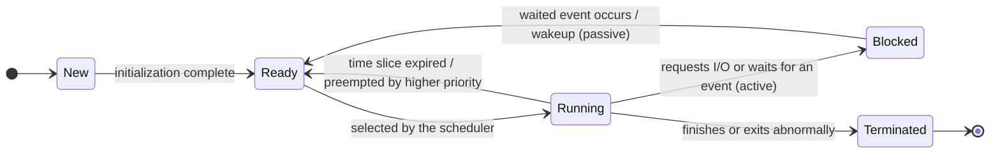

# Operating Systems Crash Course

### **I. Overview and Operating Mechanism of Operating Systems**

#### **1. The Concept, Functions, and Interfaces of an Operating System**
An operating system (OS) is **the most fundamental piece of system software**: it controls and manages a computer's hardware and software resources, organizes and schedules the computer's work rationally, and provides users with convenient interfaces. If the hardware is the restaurant's kitchen and dining tables, and applications are tables of diners, then the operating system is the restaurant manager — managing hardware resources such as the CPU, memory, and disks on the way down, and providing interfaces to users and applications on the way up.

The whole course revolves around the OS's **four core management functions**: **processor management** (processes and scheduling), **memory management** (memory allocation and virtual memory), **file management**, and **device management** (I/O management).

The operating system provides two classes of interfaces to the layers above:
- **Command interface**: allows users to operate directly through commands, e.g., typing instructions in a terminal (command line).
- **Program interface**: consists of a set of **system calls**, used specifically by applications to request services from the operating system kernel.

#### **2. The Four Basic Characteristics of an Operating System**
The four basic characteristics of an operating system are **concurrency, sharing, virtualization, and asynchrony**.
- **Concurrency**: two or more events occur within the **same time interval** (simultaneous at the macro level, alternating at the micro level). Distinguish it strictly from **parallelism**: parallelism means events truly happen **at the same instant**. Programs A and B taking turns on a single-core CPU is concurrency; only when a multi-core CPU runs two programs at the same instant is it parallelism.
- **Sharing**: resources in the system can be used jointly by multiple concurrently executing processes. There are two modes: **mutually exclusive sharing**, where only one process is allowed to access the resource during a period of time (e.g., a printer); and **simultaneous sharing**, where multiple processes are allowed to access the resource "at the same time" over a period (alternating at the micro level) (e.g., files on disk).
- **Virtualization**: turning one physical entity into several logical counterparts. For example, time-sharing the CPU makes every program feel it owns the CPU exclusively — **time-division multiplexing**; virtual memory makes programs believe the memory space is larger than the actual physical memory — **space-division multiplexing**.
- **Asynchrony**: in a multiprogramming environment, multiple programs execute concurrently, but because resources are limited, a process's execution is not carried out in one go — it advances at an unpredictable speed, moving and stopping intermittently.

**Frequently examined points and common pitfalls**: **Concurrency and sharing are the two most fundamental characteristics of an operating system, and each is the precondition for the other's existence.** Without concurrent execution there is no need to share resources; without effective management of resource sharing, concurrency cannot be achieved. Likewise, without concurrency there is no virtualization or asynchrony to speak of.

#### **3. Development and Classification of Operating Systems**
Operating systems evolved from the manual-operation stage, through uniprogramming batch systems, to modern operating systems. In a multiprogramming batch system, when one program is waiting for I/O, the CPU can immediately switch to run other programs, greatly improving resource utilization; the drawback is that users cannot interact with their jobs. The time-sharing systems that followed sliced CPU time into extremely short time slices allocated to users in turn, successfully achieving human–computer interaction; real-time systems instead emphasize completing critical tasks within strict time limits (e.g., missile guidance, industrial control).

| System type | Core operating mechanism | Core goal | Typical traits/weaknesses |
| :--- | :--- | :--- | :--- |
| **Multiprogramming batch system** | Multiple programs reside in memory; parallel at the macro level, serial and alternating at the micro level | **Resource utilization and system throughput** | High resource utilization, but **no interactivity** and long turnaround times |
| **Time-sharing system** | Slices CPU time into very short **time slices** allocated to each user in turn | **Interactivity and response time** | Enables human–computer interaction; each user feels they own the computer |
| **Real-time system** | Responds to and completes external requests within strict time limits | **Timeliness and reliability** | Used in strongly time-constrained scenarios such as missile guidance and industrial control |

#### **4. CPU Running States, Interrupts, and System Calls**
To keep the system secure, the instructions a CPU executes are divided into two classes: **privileged instructions** (e.g., I/O instructions, disabling interrupts, setting memory-protection registers — usable only by the operating system kernel) and **non-privileged instructions** (e.g., ordinary addition and subtraction, usable by any program). Correspondingly, the CPU has two running states:
- **Kernel mode (supervisor mode)**: may execute all instructions, including privileged ones.
- **User mode**: may execute only non-privileged instructions.

The CPU relies on one flag bit in the **Program Status Word register (PSW)** to tell which state it is currently in. Returning from kernel mode to user mode is very easy — executing a single privileged instruction that modifies the PSW suffices; but **the only way to enter kernel mode from user mode is through an interrupt or an exception**.

Interrupts fall into two major classes:
- **External interrupts (interrupts)**: originate outside the CPU and are unrelated to the currently executing instruction, e.g., clock interrupts and I/O completion interrupts.
- **Internal interrupts (exceptions)**: originate inside the CPU and are directly related to the instruction currently being executed. Internal interrupts are further divided into three kinds:
  1. **Trap**: deliberately raised by the program, e.g., executing a system call.
  2. **Fault**: caused by an error condition but possibly repairable by the kernel; after repair the original instruction can be re-executed — e.g., a **page fault**, or a division error (x86 classifies it as a fault; the handler usually cannot repair it, and the default action is to terminate the process).
  3. **Abort**: an unrecoverable fatal error that terminates the process directly, e.g., a hardware failure.

**Execution flow of a system call**: the user program first puts the parameters into registers $\rightarrow$ executes the **trap instruction** $\rightarrow$ raises an internal interrupt $\rightarrow$ the CPU switches to kernel mode $\rightarrow$ the operating system kernel performs the requested service $\rightarrow$ returns to user mode and continues execution.

**Frequently examined points and common pitfalls**:
1. **The trap instruction itself is executed in user mode; it is not a privileged instruction.** Only after the trap instruction has executed does the CPU enter kernel mode.
2. Any operation involving resources (e.g., requesting memory, reading/writing files, creating processes, operating I/O devices) must be carried out by the operating system on the application's behalf via a system call. **System calls are the only way for an application to request kernel services.**

#### **5. Operating System Kernel Architectures**
Kernel organization comes mainly in two forms: the **monolithic kernel** puts all major functions — process management, memory management, the file system, and so on — inside the kernel (e.g., Linux); it is fast, but its internal structure is complex and hard to maintain. A **microkernel** keeps only the most basic functions (interrupt handling, inter-process communication, low-level scheduling) in the kernel and moves the remaining services to user mode; it has a clean structure with good reliability and extensibility, but requires frequent state switches between user mode and kernel mode, resulting in lower performance.

---

### **II. Processor Management: Processes, Threads, and Communication**

#### **1. The Concept, Composition, and Five-State Model of Processes**
To let multiple programs execute concurrently, the operating system introduces the **process**. **A process is one execution of a program.** If the code (program) stored on disk is compared to a static "recipe", then a process is the act of "cooking according to the recipe" — it is dynamic, with a birth and a death. Running the same program twice in a row corresponds to two different processes in the system.

A process consists of three parts: the **program segment**, the **data segment**, and the **Process Control Block (PCB)**. The PCB records key management information such as the process identifier (PID), priority, register values, occupied memory, and open files.

**Frequently examined point and common pitfall**: **The PCB is the sole marker of a process's existence.** The essence of creating a process is creating a PCB; the essence of terminating a process is reclaiming the PCB.

Throughout its life cycle a process passes through different states. The most central five-state model includes:
- **Running**: the process is executing on the CPU.
- **Ready**: the process has every resource needed to run — everything is ready, **except the CPU**.
- **Blocked (waiting state)**: the process is waiting for some event to occur (e.g., waiting for I/O to complete); even if the CPU were handed to it, it could not run.
- **New**: the process is being created and has not yet moved to the ready state.
- **Terminated**: the process has finished running and is waiting for the system to reclaim its resources.

**Frequently examined points and common pitfalls**:
1. **The blocked state cannot transition directly to the running state** (after the event completes, the process is woken up and can only return to the **ready state** to queue up and wait for the scheduler to select it); **the ready state cannot transition directly to the blocked state either** (not running on the CPU, it has no way to issue a wait request in the first place).
2. **Running $\rightarrow$ blocked is the process's own active behavior**; **blocked $\rightarrow$ ready is passive** — it must be woken up by another process or an interrupt.

#### **2. Process Control and Context Switching**
Process creation, termination, blocking, wakeup, and switching are all performed by the kernel through **primitives**. A primitive is a piece of code implemented with disable-interrupt/enable-interrupt that **cannot be interrupted**; its execution is atomic — it either runs to completion in one go, or does nothing at all.

When a process switch occurs, the kernel must save the current process's execution context (e.g., the program counter PC and the values of general-purpose registers) into that process's PCB, then restore the execution context from the PCB of the next process to run. This is called a **context switch**, and it introduces a certain amount of system time overhead.

#### **3. Threads and Multithreading Models**
A piece of software (e.g., a chat app) often needs to run several tasks at once: receiving messages, sending messages, refreshing the UI, and so on. Spawning three separate processes would make data sharing cumbersome and context switches expensive. Hence the introduction of the **thread**, also called a "lightweight process".

A process can contain multiple threads. All threads within the same process **share the process's code segment, data segment, open files, and other resources**, but each thread has its own **program counter (PC), registers, and stack**.

**Frequently examined point and common pitfall**: after introducing threads, **the process is the basic unit of resource allocation, while the thread is the basic unit of CPU scheduling**. Switching between threads of the same process does not trigger a process switch (no address space switch is needed), so the system overhead is far smaller.

Threads are implemented in two ways:
- **User-level threads (ULT)**: managed by a thread library inside the application; the operating system kernel is completely unaware of their existence. The advantage is that thread switches require no entry into kernel mode and are extremely fast; the drawback is that **if any one thread blocks, the entire process blocks**, and multi-core CPUs cannot be exploited for parallel speedup.
- **Kernel-level threads (KLT)**: managed directly by the operating system kernel. The advantage is that when one thread blocks, the other threads in the same process can keep running, and true parallelism across multiple CPU cores is possible; the price is that thread switches must enter kernel mode and carry higher overhead.

Combining user-level and kernel-level threads through mapping yields three multithreading models: the **many-to-one model** (multiple user-level threads mapped to one kernel-level thread), the **one-to-one model** (each user-level thread mapped to one kernel-level thread), and the **many-to-many model** ($m$ user-level threads mapped to $n$ kernel-level threads, $m \ge n$).

**Frequently examined point and common pitfall**: **kernel-level threads are the unit of processor (CPU core) allocation.** In the many-to-one model, since the kernel sees only one kernel-level thread, no matter how many user-level threads the process creates, they can run on only one core, and "one blocks, all block".

#### **4. Inter-Process Communication (IPC)**
Because each process owns an independent address space and is isolated from the others, exchanging data between processes must go through the **inter-process communication (IPC)** mechanisms provided by the operating system. There are three main approaches:
1. **Shared memory**: carve out a region in memory that both parties can access. This approach is the **fastest**, but the processes must themselves use synchronization/mutual-exclusion tools (e.g., semaphores) to keep reads and writes from conflicting.
2. **Message passing**: processes exchange formatted messages through the two primitives "send" and "receive". It comes in two forms: direct communication (sent straight to the target process) and indirect communication (the message is first placed into an intermediate entity, a "mailbox", and then retrieved by the other side).
3. **Pipes**: a fixed-size buffer is opened in memory, like a water pipe — one process writes into the pipe while another reads from it, and the data follows **first-in first-out (FIFO)**. **An ordinary pipe supports only half-duplex communication** (one direction at any given moment); simultaneous two-way (full-duplex) communication requires two pipes.

---

### **III. Processor Management: Processor (CPU) Scheduling and Algorithms**

#### **1. The Three Levels of Scheduling and Two Scheduling Modes**
Processor scheduling is divided into three levels, from coarse to fine granularity:
- **High-level scheduling (job scheduling)**: selects jobs from the backing-store queue on external storage according to certain principles, brings them into memory, and creates processes for them (allocating PCBs and other resources). Each job is admitted once and swapped out once; it occurs with the **lowest frequency**.
- **Intermediate scheduling (memory scheduling)**: to improve memory utilization and system throughput, processes that temporarily cannot run are swapped out of memory to wait on external storage; the process state becomes **suspended** (divided into **ready-suspended** and **blocked-suspended**); once conditions permit and memory is free, they are read back into memory.
- **Low-level scheduling (process scheduling)**: selects one process from the ready queue and assigns the CPU to it. This is the most basic scheduling and occurs with the **highest frequency**.

Scheduling modes come in two types: **non-preemptive** means once the CPU is given to a process, it keeps running until the process finishes or voluntarily blocks while waiting for an event; **preemptive** allows the system, following some rule (e.g., higher priority, less remaining time, or an expired time slice), to suspend the currently running process midway and forcibly hand the CPU to a more urgent process.

#### **2. Evaluation Metrics and Core Formulas for Scheduling Algorithms**
The most central metric for evaluating scheduling algorithms is the turnaround time. The following three formulas always appear in the big exam calculation problems:

$$
\text{turnaround time} = \text{completion time} - \text{arrival time}
$$

$$
\text{weighted turnaround time} = \frac{\text{turnaround time}}{\text{actual running time}} \quad (\text{always } \text{weighted turnaround time} \ge 1)
$$

$$
\text{waiting time} = \text{turnaround time} - \text{running time} \quad (\text{pure CPU-bound scenario})
$$

#### **3. Six Classic Scheduling Algorithms: Principles and Worked Examples**
The video runs through the explanation with a single standard set of examples: suppose there are 4 processes $P_1, P_2, P_3, P_4$ with the parameters shown in the table below:

| Process | Arrival time | Running time (service time) |
| :--- | :--- | :--- |
| $P_1$ | $0$ | $8$ |
| $P_2$ | $1$ | $4$ |
| $P_3$ | $2$ | $9$ |
| $P_4$ | $3$ | $5$ |

##### **(1) First-Come First-Served (FCFS)**
- **Principle**: serve processes in the order they arrive at the ready queue; a **non-preemptive** algorithm.
- **Worked example walkthrough**: the execution order is $P_1 (0 \sim 8) \rightarrow P_2 (8 \sim 12) \rightarrow P_3 (12 \sim 21) \rightarrow P_4 (21 \sim 26)$.
  - Completion times: $P_1 = 8,\ P_2 = 12,\ P_3 = 21,\ P_4 = 26$.
  - Turnaround times: $P_1 = 8 - 0 = 8$; $P_2 = 12 - 1 = 11$; $P_3 = 21 - 2 = 19$; $P_4 = 26 - 3 = 23$.
  - Average turnaround time $= \frac{8 + 11 + 19 + 23}{4} = 15.25$.
- **Characteristics**: simple and fair, but **favors long jobs and is extremely unfavorable to short ones** (a short job queued behind a long job must endure a long wait). **No starvation occurs.**

##### **(2) Shortest Job First (SJF) and Shortest Remaining Time Next (SRTN)**
- **Principle**: at each scheduling decision, pick from the processes that **have already arrived** the one with the shortest running time.
  - **Non-preemptive (SJF)**: at time $0$ only $P_1$ has arrived, so $P_1$ runs first until it completes at time $8$; by then $P_2, P_3, P_4$ have all arrived with running times $4, 9, 5$, and they run from shortest to longest: $P_2 (8 \sim 12) \rightarrow P_4 (12 \sim 17) \rightarrow P_3 (17 \sim 26)$. The turnaround times are $P_1 = 8,\ P_2 = 11,\ P_4 = 14,\ P_3 = 24$, and the average turnaround time drops to $14.25$.
  - **Preemptive (SRTN, shortest remaining time next)**: whenever a new process arrives at the ready queue, compare the new process's running time with the **remaining time** of the currently running process, and run whichever is shorter.
    - Worked example walkthrough: from $0 \sim 1$ run $P_1$ (remaining $7$); at time $1$, $P_2$ arrives (needs $4 < 7$), preempts the CPU, and runs $P_2 (1 \sim 5)$ to completion; at time $5$, among the arrived processes $P_1$ (remaining $7$), $P_3$ (needs $9$), and $P_4$ (needs $5$), the shortest is chosen: $P_4 (5 \sim 10)$ completes; then $P_1 (10 \sim 17)$ completes; finally $P_3 (17 \sim 26)$ completes.
    - Turnaround times: $P_1 = 17 - 0 = 17$; $P_2 = 5 - 1 = 4$; $P_3 = 26 - 2 = 24$; $P_4 = 10 - 3 = 7$. The average turnaround time drops further to $\frac{17 + 4 + 24 + 7}{4} = 13$.
- **Frequently examined point**: when all processes can run at once (or all jobs arrive at the same time), **SJF gives the minimum average waiting time and average turnaround time**. Its fatal flaw is that it **disadvantages long jobs: if short jobs keep streaming in, a long job may never get to run, producing "starvation"**.

##### **(3) Highest Response Ratio Next (HRRN)**
- **Principle**: to balance long and short jobs, at each scheduling decision compute the **response ratio ($R_p$)** of every arrived process and run the one with the highest ratio (non-preemptive). The formula is:

$$
\text{Response ratio } R_p = \frac{\text{waiting time} + \text{required service time}}{\text{required service time}} = 1 + \frac{\text{waiting time}}{\text{required service time}}
$$

- **Worked example walkthrough**: $P_1$ runs first from time $0$ and finishes at time $8$. Now compute the response ratios of $P_2, P_3, P_4$:
  - $P_2$ (has waited $8 - 1 = 7$, service time $4$): $R_p = \frac{7 + 4}{4} = 2.75$
  - $P_3$ (has waited $8 - 2 = 6$, service time $9$): $R_p = \frac{6 + 9}{9} \approx 1.67$
  - $P_4$ (has waited $8 - 3 = 5$, service time $5$): $R_p = \frac{5 + 5}{5} = 2.0$
  - Therefore $P_2$, with the highest response ratio, is selected to run first.
- **Characteristics**: short jobs have small denominators and inherently high response ratios, so they get served first; as long jobs wait longer, their numerators keep growing and their response ratios rise with them, so they are eventually selected too. It therefore **combines the strengths of FCFS and SJF and produces no starvation**.

##### **(4) Round-Robin (RR)**
- **Principle**: the classic preemptive algorithm of time-sharing systems. All ready processes are lined up into a queue in FCFS order, and the CPU is given to the head of the queue to run for one **time slice**. If the process has not finished when the slice expires, the CPU is taken away and the process is placed at the tail of the ready queue.
- **Frequently examined point**: the choice of time slice size is crucial — if the **time slice is too large**, so large that every process can finish within one slice, RR **degenerates into First-Come First-Served (FCFS)** and loses its fast interactive response; if the **time slice is too small**, process context switches become too frequent and **system overhead rises sharply**. RR **produces no starvation**.

##### **(5) Priority Scheduling**
- **Principle**: assign each process a priority and always run the highest-priority process; both preemptive and non-preemptive variants exist. Priorities are divided into **static priorities** (fixed at creation, unchanged while running) and **dynamic priorities** (which can be raised over time as the process waits).
- **Characteristics**: if a low-priority process is long denied the CPU (especially under static priorities), **starvation can occur**.

##### **(6) Multilevel Feedback Queue**
- **Principle**: the widely acknowledged all-in-one algorithm. The specific rules:
  1. Set up multiple ready queues, **with priority from high to low from top to bottom, while the assigned time slices go from small to large**.
  2. A new process first enters the tail of the first (highest-priority) queue and waits to run in FCFS order. If it cannot finish within one time slice, it demotes to the tail of the next queue down.
  3. **Only when all higher-priority queues are empty will a process from the next queue down be scheduled to run**; if a new process enters a higher queue while a lower-queue process is running, preemption occurs.
- **Characteristics**: short jobs and interactive processes finish quickly in the high-priority queues, while long jobs gradually sink and earn longer time slices. But if new processes keep streaming into the upper queues, the long jobs below **may still starve**.

#### **4. Scheduling Algorithms: Summary Comparison and Problem-Solving Conventions**

| Scheduling algorithm | Preemptive? | Can cause starvation? | Scenarios and core traits in summary |
| :--- | :--- | :--- | :--- |
| **First-Come First-Served (FCFS)** | Non-preemptive | **No** | Simple and fair; favors long jobs, unfavorable to short ones |
| **Shortest Job First (SJF / SRTN)** | Non-preemptive / preemptive | **Yes** (long-job starvation) | Shortest average turnaround/waiting time; strongly favors short jobs |
| **Highest Response Ratio Next (HRRN)** | Non-preemptive | **No** | Balances long and short jobs; slightly higher overhead from computing response ratios each time |
| **Round-Robin (RR)** | Preemptive | **No** | The classic time-sharing algorithm; fair and responsive, does not distinguish urgency |
| **Priority scheduling** | Non-preemptive / preemptive | **Yes** (low-priority starvation) | Suits real-time systems; flexibly distinguishes task urgency |
| **Multilevel feedback queue** | Preemptive | **Yes** (long jobs may starve) | The all-in-one; combines fast response for short jobs with execution of long jobs |

**Problem-solving convention for long-answer questions**: when a problem asks for average turnaround times and weighted turnaround times, the safest procedure is: **step one, draw a Gantt chart (a timeline execution chart) on scratch paper or on the exam sheet**, marking the exact time marks at which each process starts and finishes; **step two, build a table and compute each process's completion time, turnaround time, and weighted turnaround time one by one**, then take the averages at the end. Never skip steps or do it by mental arithmetic.

---

### **IV. Processor Management: Process Synchronization, Mutual Exclusion, and Deadlock**

#### **1. Race Conditions, Critical Sections, and the Synchronization/Mutual-Exclusion Criteria**
When multiple concurrent processes share data, things go wrong without control. For example, the shared variable `count` starts at $5$, and processes $P_0$ and $P_1$ both execute `count++`. At the machine-instruction level, `count++` actually consists of three instructions: (1) load `count` into a register; (2) add $1$ to the register value; (3) write the result back to memory. If $P_0$ has just read $5$ but not yet written back when the CPU switches to $P_1$, then $P_1$ also reads $5$, adds $1$, and writes back $6$; when execution switches back to $P_0$, it too writes $6$ to memory — both processes incremented once, yet the final result is $6$ instead of $7$. This phenomenon — **the final result depends on the relative order (interleaving) of the processes' execution — is called a race condition**.

- **Critical resource**: a resource that only one process may use at a time (e.g., a printer, a shared variable).
- **Critical section**: the portion of a process's code that accesses a critical resource. Code that accesses a critical resource has four parts:
  1. **Entry section**: checks whether entry into the critical section is possible, and if so sets the flag (locks).
  2. **Critical section**: the core code that accesses the critical resource.
  3. **Exit section**: clears the in-use flag (unlocks).
  4. **Remainder section**: code doing other unrelated work.
- **The two constraint relationships between processes**:
  - **Mutual exclusion (indirect constraint)**: the constraint arising from processes competing for the same critical resource (e.g., contending for a printer).
  - **Synchronization (direct constraint)**: processes cooperating toward a common task have strict ordering requirements (e.g., the writer must write the data before the reader can read it).

Mutual exclusion for critical sections must follow **four basic criteria**:
1. **Idle then enter**: when the critical section is free, a process requesting entry is allowed to enter immediately.
2. **Busy then wait**: while a process is already inside the critical section, all other processes attempting to enter must wait.
3. **Bounded waiting**: a process requesting access must be guaranteed entry into the critical section within a finite time, to prevent starvation.
4. **Yield the CPU while waiting**: when a process cannot enter the critical section, it should **release the processor (CPU) immediately**, preventing it from wasting CPU cycles in a "busy waiting" state.

#### **2. Software and Hardware Mutual-Exclusion Mechanisms**
- **Software — Peterson's algorithm**: a boolean array `flag[i]` expresses "I want to enter", and an integer variable `turn` expresses "I yield the turn to you". Before entering the critical section, a process first declares its intent (`flag[i] = true`) and then politely cedes the turn to the other side (`turn = j`); only when **the other side does not want to enter** or **the other side has yielded the turn to me** may the current process enter the critical section.
- **Hardware mechanisms**:
  - **Disabling interrupts**: if a process executes the disable-interrupt instruction before entering the critical section, it cannot be switched out; it re-enables interrupts after leaving the critical section. The drawback: this **works only on a uniprocessor (it cannot lock the other cores on multi-core machines)**, and handing the disable-interrupt privilege to user programs would be very dangerous.
  - **TestAndSet (TS instruction) and the Swap instruction**: hardware guarantees that the entire "read and test/swap" procedure is indivisible (an atomic operation).

**Frequently examined point and common pitfall**: whether software **Peterson's algorithm** or hardware **TestAndSet / Swap instructions**, all of them satisfy "idle then enter, busy then wait, bounded waiting", but **none of them satisfies "yield the CPU while waiting"**! Because when they cannot get into the critical section, they all spin in place checking forever, occupying the CPU in a "busy wait" state.

#### **3. Semaphores and P/V Operations**
In 1965, Dijkstra proposed the **semaphore** mechanism. A semaphore may only be manipulated through two uninterruptible primitives: the **P operation (`wait(S)`, requesting a resource)** and the **V operation (`signal(S)`, releasing a resource)**.
- **Integer semaphore**: just an ordinary integer $S$. When the P operation executes, it loops and waits as long as $S \le 0$, and only decrements $S$ by $1$ once $S > 0$. The drawback is that it still "busy waits" — **it does not satisfy "yield the CPU while waiting"**.
- **Record-type semaphore (the one in actual use)**: besides an integer `value`, it carries a process waiting queue `L`.
  - **P operation (`wait`)**: first decrement `value` by $1$; if `value < 0` after the decrement, resources are insufficient, so the process actively invokes the `block` primitive to **block itself and join the waiting queue** (this follows "yield the CPU while waiting"!).
  - **V operation (`signal`)**: first increment `value` by $1$; if `value <= 0` still holds after the increment, processes are still queuing in the waiting queue, so the `wakeup` primitive is invoked to **wake one process from the waiting queue**.

**Intuitive analogy and core exam point**: picture a record-type semaphore as a parking lot; the initial value of `value` is the number of free parking spots. Each arriving car decrements it by $1$; once it goes negative, cars queue at the gate, and a value of $-k$ means $k$ cars are queued.
- When `value > 0`, it represents **the number of resources currently available**;
- When `value < 0`, its **absolute value $|\text{value}|$ represents the number of blocked processes currently waiting for the resource**;
- When `value == 0`, the available resources are exactly exhausted and no process is queued.

**The three fundamental uses of semaphores**:
1. **Mutual exclusion**: set the mutex semaphore `mutex = 1`. Execute `P(mutex)` before entering the critical section and `V(mutex)` after leaving it.
2. **Synchronization (enforcing ordering)**: the mnemonic is **"V first, then P"**. For example, to require that code $X$ in process $P_1$ executes before code $Y$ in process $P_2$, set a synchronization semaphore `S = 0`; after $P_1$ finishes $X$ it executes `V(S)`, and before $P_2$ runs $Y$ it first executes `P(S)`.
3. **Precedence relations**: when multiple processes execute according to a precedence graph (a directed acyclic graph), set one synchronization semaphore with initial value $0$ for **every directed edge** in the graph; execute the V operation in the **process at the edge's source**, and the P operation in the **process at the edge's destination**.

**Frequently examined summary**: a mutex semaphore usually has initial value $1$ (its P and V appear paired **in the same process**); a synchronization semaphore usually has initial value $0$ (its P and V appear **in two different processes**); a semaphore representing a resource count has as its initial value the total number of initially available resources.

#### **4. Three Classic Synchronization Problems and a Universal Method for P/V Problems**

##### **(1) The Producer–Consumer Problem**
A producer puts products into a buffer of size $n$, and a consumer takes products out of it. Three layers of relationships exist: (1) when the buffer is full, the producer must wait (synchronization); (2) when the buffer is empty, the consumer must wait (synchronization); (3) the buffer can be accessed by only one process at a time (mutual exclusion).
- **Semaphore setup**: mutex semaphore `mutex = 1`; synchronization semaphore `empty = n` counting free slots; synchronization semaphore `full = 0` counting products.
- **Code logic compared**:

| Producer process | Consumer process |
| :--- | :--- |
| `P(empty)` // 1. First request an empty slot (synchronization) | `P(full)` // 1. First request a product (synchronization) |
| `P(mutex)` // 2. Then request the buffer lock (mutual exclusion) | `P(mutex)` // 2. Then request the buffer lock (mutual exclusion) |
| Put the product into the buffer | Take a product out of the buffer |
| `V(mutex)` // 3. Release the buffer lock | `V(mutex)` // 3. Release the buffer lock |
| `V(full)` // 4. Increment the product count by 1 | `V(empty)` // 4. Increment the empty-slot count by 1 |

- **Exam-relevant iron rule**: **the order of two adjacent P operations must never be swapped! The P operation implementing mutual exclusion must always come after the P operations implementing synchronization.** If the producer executes `P(mutex)` first and `P(empty)` second, then when the buffer happens to be full (`empty = 0`), the producer goes to sleep blocked while holding the mutex lock; at that point the consumer cannot enter the buffer to take a product and free a slot, so both sides wait forever — a **deadlock**. The order of the two V operations, however, can be swapped freely.

##### **(2) The Readers–Writers Problem**
Multiple readers are allowed to read the same file simultaneously, but while a writer is writing the file, no other reader or writer may access it (read–read shared, read–write mutually exclusive, write–write mutually exclusive).
- **Core trick (the readers-first version)**: introduce an integer counter `count` (initial value $0$) recording the number of readers currently reading the file. **The first reader to arrive (`count == 0`) executes `P(rw)` to lock the file, and the last reader to leave (`count == 0`) executes `V(rw)` to unlock it**. Since `count` is itself a variable shared by multiple readers, an additional mutex semaphore `mutex = 1` must be set up to protect the check-and-update of `count`.
- **Fair read–write improvement**: the basic version above is "readers first" — as long as readers keep arriving, `count` never drops to $0$, and a writer may starve. To make it **fair to both readers and writers (once a writer arrives, new readers are held back)**, simply add a queueing semaphore `w = 1` and have both readers and writers pass through `P(w)` and `V(w)` before entering; once a writer arrives and blocks on `w`, subsequent new readers are shut out at `P(w)`.

##### **(3) The Dining Philosophers Problem**
$5$ philosophers sit around a round table, with one chopstick between each pair of neighbors ($5$ in total); a philosopher must hold both the left and the right chopstick simultaneously to eat. If all $5$ pick up their left chopsticks at the same time, everyone waits for the person on their right to put a chopstick down, and everyone is stuck — a **deadlock**.
- **Three classic deadlock-breaking schemes**:
  1. Allow at most **$4$** philosophers to compete for chopsticks at the same time (guaranteeing that at least one person can get both chopsticks).
  2. Require **odd-numbered** philosophers to pick up the left chopstick first and then the right, and **even-numbered** philosophers to pick up the right first and then the left.
  3. Put a mutex lock around the act of picking up chopsticks (or use AND-type semaphores), stipulating that a philosopher may pick up all chopsticks in one go **only when both the left and the right chopsticks are available**.

**The universal three-step method for P/V problems**: (1) identify the processes in the problem and analyze the synchronization relationships between them (who waits for whom) and the mutual-exclusion relationships (who competes for what); (2) set up a semaphore for each relationship and determine its initial value precisely; (3) insert the P/V operations at the appropriate places, following the principles "mutual-exclusion P/V paired within the same process, synchronization V-before-P across processes, and synchronization P before mutual-exclusion P".

#### **5. Deadlock: Concept, Necessary Conditions, and Handling Strategies**
**Deadlock** is a stalemate in which multiple processes, competing for resources, end up waiting on one another; without external intervention, none of these processes can make further progress.

**Distinguishing pitfall (deadlock vs. starvation)**:
- **Deadlock**: involves **at least two or more processes**, and all processes in the deadlock are **necessarily in the blocked state**.
- **Starvation**: may involve **just one process** (e.g., a long job under shortest-job-first), which cannot advance because it is long denied the resources it needs; a starving process **may be in the ready state** (waiting for the CPU) **or in the blocked state** (waiting for I/O).

**The four necessary conditions for deadlock (all four are indispensable)**:
1. **Mutual exclusion**: the contended resource can be used by only one process at a time.
2. **No preemption**: a resource a process has already acquired cannot be forcibly taken away by other processes before it is used up; it can only be released voluntarily.
3. **Hold and wait**: a process already holds at least one resource while making new resource requests, and keeps holding its acquired resources while blocked waiting for the request.
4. **Circular wait**: a circular chain of processes and resources exists in which each process waits for the resource held by the next process in the chain.

**Frequently examined pitfall**: when deadlock occurs there is always circular wait, but **circular wait does not necessarily mean deadlock**! If a resource class has multiple instances, a process outside the circular wait chain that finishes using that kind of resource and releases it can break the cycle, so no deadlock occurs.

**The three major strategies for handling deadlock**:
- **Deadlock prevention (static restrictions up front — break one of the four necessary conditions)**:
  - The mutual-exclusion condition is usually dictated by the device's inherent nature and cannot be broken (though SPOOLing can convert an exclusive device into a shared one).
  - Break the **no-preemption condition**: when a process's request for a new resource cannot be satisfied, it must immediately and voluntarily release all the resources it holds.
  - Break the **hold-and-wait condition**: adopt **static allocation (one-shot allocation)** — the process requests all the resources it needs at once before running.
  - Break the **circular-wait condition**: adopt **ordered resource allocation** — number every resource class in the system and require processes to request resources only in increasing numerical order.
- **Deadlock avoidance (dynamic checking up front)**: no strict restrictions are imposed in advance; instead, before every resource allocation, dynamically compute whether the system would enter an unsafe state after the allocation. The representative algorithm is the **banker's algorithm**.
- **Deadlock detection and recovery (handling after the fact)**: allow deadlock to occur; the system periodically detects it using the **resource allocation graph**. The reduction method: find a process whose every request can be satisfied by the currently remaining resources (neither blocked nor isolated), let it run to completion and release all the resources it holds, removing all the request edges and assignment edges connected to it; repeat this process. If **all the edges in the graph can eventually be eliminated, the graph is "fully reducible", meaning there is no deadlock; otherwise the remaining processes are deadlocked (the deadlock theorem)**. Recovery methods include resource preemption, process termination, and process rollback.

**Exam-relevant deadlock resource formula**: if a system has $m$ units of one resource type shared by $n$ processes, each process needing at most $k$ units of that resource, then the **minimum resource count that guarantees the system can never deadlock** is:

$$
m \ge n \times (k - 1) + 1
$$

*Underlying principle*: the worst case is that every process has been allotted exactly $k - 1$ units ($n(k-1)$ units consumed in total), at which point everyone is just $1$ unit short of finishing. As long as the system has one more unit, one process can finish successfully and release all of its resources, which — like a row of dominoes — lets all the other processes finish in turn. For example: with $3$ processes, each needing at most $4$ printers, at least $3 \times (4 - 1) + 1 = 10$ printers are required to make deadlock absolutely impossible.

#### **6. The Banker's Algorithm**
The banker's algorithm, proposed by Dijkstra, works by judging whether the system is in a **safe state** before allocating resources. If the system can find a progression sequence $\langle P_1, P_2, \dots, P_n \rangle$ such that allocating resources in this order satisfies every process's maximum demand and lets each run to completion, the sequence is called a **safe sequence**, and the system is in a **safe state**.

**Frequently examined points and common pitfalls**:
1. A system in a **safe state definitely cannot deadlock**; a system in an **unsafe state does not necessarily deadlock**, but deadlock is possible (i.e., an unsafe state is a necessary but not sufficient condition for deadlock).
2. A safe sequence is **not necessarily unique**.

**The four core data structures of the banker's algorithm**:
- `Max`: maximum demand matrix (each process's maximum demand for each resource type).
- `Allocation`: allocation matrix (the amount of each resource type currently allocated to each process).
- `Need`: demand matrix (how much more of each resource each process may still need); the core identity is:

$$
\text{Need} = \text{Max} - \text{Allocation}
$$

- `Available`: available resource vector (the number of free resources of each type currently left in the system).

**Algorithm steps and the worked example from the video**:
Suppose the system has three resource types A, B, C and $5$ processes $P_0 \sim P_4$. In any problem, **the first step is always to compute the $\text{Need}$ matrix from $\text{Max} - \text{Allocation}$**! The current state is shown in the table below, and the currently available resources are known to be $\text{Available} = (3, 3, 2)$:

| Process | $\text{Max}$ (A, B, C) | $\text{Allocation}$ (A, B, C) | $\text{Need} = \text{Max} - \text{Allocation}$ |
| :--- | :--- | :--- | :--- |
| $P_0$ | $(7, 5, 3)$ | $(0, 1, 0)$ | $(7, 4, 3)$ |
| $P_1$ | $(3, 2, 2)$ | $(2, 0, 0)$ | $(1, 2, 2)$ |
| $P_2$ | $(9, 0, 2)$ | $(3, 0, 2)$ | $(6, 0, 0)$ |
| $P_3$ | $(2, 2, 2)$ | $(2, 1, 1)$ | $(0, 1, 1)$ |
| $P_4$ | $(4, 3, 3)$ | $(0, 0, 2)$ | $(4, 3, 1)$ |

- **Safety check procedure**: compare the current `Available` item by item against the `Need` of each unfinished process (**note: every one of the A, B, C components must not exceed `Available` for the need to count as satisfied — a single shortfall is enough to fail!**):
  1. Initially $\text{Available} = (3, 3, 2)$; checking finds that $P_1$'s $\text{Need} = (1, 2, 2) \le (3, 3, 2)$ — satisfiable! Let $P_1$ run to completion and return its $\text{Allocation} = (2, 0, 0)$; the available resources become $\text{Available} = (3, 3, 2) + (2, 0, 0) = (5, 3, 2)$.
  2. Next look at $P_3$: its $\text{Need} = (0, 1, 1) \le (5, 3, 2)$ — satisfiable! After $P_3$ completes it returns $(2, 1, 1)$, and $\text{Available}$ becomes $(5, 3, 2) + (2, 1, 1) = (7, 4, 3)$.
  3. Now with $\text{Available} = (7, 4, 3)$, the remaining $P_4$ (needs $4,3,1$), $P_2$ (needs $6,0,0$), and $P_0$ (needs $7,4,3$) can all be satisfied in turn!
  4. A safe sequence $\langle P_1, P_3, P_4, P_2, P_0 \rangle$ is found, so the system is currently in a **safe state**.

- **Three-step handling of a resource request (Request)**: suppose process $P_1$ now issues the resource request $\text{Request}_1 = (1, 0, 2)$ — can it be granted?
  1. **Legality check**: does $\text{Request}_1 \le \text{Need}_1$ hold? $(1, 0, 2) \le (1, 2, 2)$ — yes (it does not exceed the process's own declared maximum demand).
  2. **Availability check**: does $\text{Request}_1 \le \text{Available}$ hold? $(1, 0, 2) \le (3, 3, 2)$ — yes (the system currently has enough idle resources).
  3. **Tentative allocation and safety check**: first assume the allocation to $P_1$ and update the state data:
     - $\text{Available} = (3, 3, 2) - (1, 0, 2) = (2, 3, 0)$
     - $\text{Allocation}_1 = (2, 0, 0) + (1, 0, 2) = (3, 0, 2)$
     - $\text{Need}_1 = (1, 2, 2) - (1, 0, 2) = (0, 2, 0)$
     Then run a **safety check** on this new state. Since $\text{Available} = (2, 3, 0)$ can still satisfy $P_1$'s new $\text{Need}_1 (0, 2, 0)$ first, and after $P_1$ runs to completion and returns $(3, 0, 2)$ the $\text{Available}$ becomes $(5, 3, 2)$, a safe sequence can still be found (e.g., $\langle P_1, P_3, P_4, P_0, P_2 \rangle$), so **the allocation can truly be granted**. Conversely, if the check finds the new state unsafe, the tentative allocation must be undone, the original data restored, and the process blocked to wait.

---

### **V. Memory Management: Memory Allocation, Paging, and Segmentation**

#### **1. Compilation, Linking, Loading, and Address Relocation**
A program goes through three stages from source code to running in memory: **compilation** (translating the source code into several object modules) $\rightarrow$ **linking** (assembling the object modules and library functions into one complete load module) $\rightarrow$ **loading** (placing the load module into physical memory).

In the load module produced by compilation and linking, all addresses are **logical addresses (relative addresses)** numbered from $0$; the true hardware address of a memory cell is called the **physical address (absolute address)**. The process of converting logical addresses into physical addresses is called **address relocation (address mapping)**, and it corresponds to three loading schemes:
1. **Absolute loading**: absolute physical addresses are produced directly at compilation time; suitable only for single-program environments.
2. **Static relocation (relocatable loading)**: when the program is **loaded into memory**, all logical addresses are rewritten into physical addresses in one pass by adding the starting physical address; after loading, the program **cannot be moved within memory** while running.
3. **Dynamic relocation (run-time dynamic loading)**: logical addresses remain unchanged after loading; only when the program **actually executes an instruction that accesses memory** does the hardware **relocation register (base register)** dynamically add the process's starting physical address to the logical address to obtain the physical address. This supports moving programs within memory and dynamic allocation.

**Memory protection mechanism**: implemented with two hardware registers — the **bound register (limit register)** holds the program's maximum logical address, and the **relocation register** holds the starting physical address. On every memory access, first check whether the logical address exceeds the bound register (an out-of-bounds check); if it is within bounds, add the value of the relocation register before sending the address to memory.

#### **2. Contiguous Allocation Schemes and Fragmentation**
Contiguous allocation means assigning a user process one whole contiguous block of memory. It includes three schemes:
- **Single contiguous allocation**: only one user program occupies memory at a time; no concurrency.
- **Fixed partition allocation**: memory is divided in advance into several fixed-size partitions, each of which holds exactly one program. If a program is smaller than its partition, the leftover space inside the partition that the program can never use is wasted, producing **internal fragmentation**.
- **Dynamic partition allocation (variable partition allocation)**: memory is not divided in advance; instead, when a process is loaded, a block exactly matching its actual demand is carved out dynamically. It has **no internal fragmentation**, but as processes are frequently loaded and swapped out, many tiny free blocks remain trapped between allocated regions in memory — no single one large enough for a new process — producing **external fragmentation**. External fragmentation can be resolved by the **compaction (piecing-together) technique**, which shifts all processes toward one end so that a large contiguous free region is assembled.

**Frequently examined point (internal vs. external fragmentation)**:
- **Internal fragmentation**: space **already allocated to some process** but wasted because that process cannot use it all (e.g., fixed partition allocation, the last page of paged storage).
- **External fragmentation**: free space **not yet allocated** that is too scattered and small to be used by a new process (e.g., dynamic partition allocation, segmented storage, contiguous file allocation).

**The four free-region selection algorithms for dynamic partition allocation**:
- **First Fit (FF)**: free partitions are ordered by address from low to high; each search starts from the beginning and selects the **first** free partition large enough. **The best overall performance and the simplest algorithm**.
- **Best Fit (BF)**: free partitions are ordered by size from small to large; select the **smallest** free partition that fits. It sounds reasonable, but every cut leaves behind a tiny remainder, **producing large amounts of tiny, hard-to-use external fragmentation**.
- **Worst Fit (WF / largest fit)**: free partitions are ordered by size from large to small; each time the **largest** free partition is always chosen for cutting. The drawback is that it **quickly breaks up and exhausts the large partitions**, leaving nowhere to place genuinely large processes that arrive later.
- **Next Fit (NF / circular first fit)**: continues the search cyclically **from where the previous search ended**, for the first partition large enough. The drawback is that the large partitions at high addresses also get broken up quickly.

**Classic worked example**: suppose the free partitions in memory, in address order, are $100\text{KB}, 500\text{KB}, 200\text{KB}, 300\text{KB}, 600\text{KB}$, and a $212\text{KB}$ allocation is now needed:
- **First Fit (FF)**: the first block encountered in order that is $\ge 212\text{KB}$ is **$500\text{KB}$**;
- **Best Fit (BF)**: among all blocks $\ge 212\text{KB}$ ($500, 300, 600$), pick the smallest, **$300\text{KB}$**;
- **Worst Fit (WF)**: pick the largest, **$600\text{KB}$**.

#### **3. Non-Contiguous Allocation: Paging, Segmentation, and Segment-Paged Storage Management**

##### **(1) Basic Paged Storage Management**
To eliminate external fragmentation once and for all, processes are split up and scattered across memory — this is **paged storage management**:
- **Page frame (also called physical block or memory block)**: physical memory is divided into small blocks of equal size.
- **Page**: the process's logical address space is likewise divided into blocks exactly the same size as page frames. Each page of the process may be placed into any free page frame in memory — no contiguity required.
- **Page table**: stored in **memory**, it records the mapping from the logical **page number ($P$)** to the physical **block number ($b$ / page frame number)**. The page table's starting address and length in memory are kept in the CPU's **page table register (PTR)**.

**Address structure and conversion**: the paged logical address is one-dimensional, automatically split by the system into the high-order **page number $P$** and the low-order **in-page offset $W$**.
- **Binary split method**: if the page size is $2^k$ bytes, then the **low $k$ bits of the logical address are the in-page offset $W$**, and the remaining high bits are the page number $P$; for conversion, simply replace the page number $P$ with the corresponding physical block number $b$ looked up from the page table, then concatenate the original low $k$-bit in-page offset $W$ to obtain the physical address directly.
- **Decimal formula method** (let the page size be $L$ and the logical address $A$):

$$
\text{Page number } P = \lfloor A / L \rfloor \quad (\text{integer division}), \qquad \text{in-page offset } W = A \bmod L \quad (\text{remainder})
$$

$$
\text{Physical address} = \text{physical block number } b \times L + W
$$

- **Worked example from the video**: let the page size be $L = 1\text{KB} = 1024\text{B}$ and the logical address be $A = 2500$.
  1. Compute the page number and the offset: $P = \lfloor 2500 / 1024 \rfloor = 2$; $W = 2500 - 2 \times 1024 = 2500 - 2048 = 452$.
  2. The page table shows that page $2$ resides in physical block $8$ ($b = 8$).
  3. Compute the physical address: $\text{physical address} = 8 \times 1024 + 452 = 8192 + 452 = 8644$.

**Frequently examined point**: paged storage management has **no external fragmentation**; only each process's **last page** may fail to fill a frame, producing a small amount of **internal fragmentation** (on average, half a page of internal fragmentation per process). Paging is done entirely by the system hardware and is transparent to users; the **address space is one-dimensional**.

##### **(2) The TLB and Effective Access Time (EAT) Calculation**
Because the page table resides in memory, under basic paging the CPU must **access memory twice** for every data read/write (the first access consults the in-memory page table for the block number; the second fetches the data from memory using the physical address), which halves the memory access speed.

To fix this, the **TLB (Translation Lookaside Buffer)** was introduced — a high-speed **associative memory (cache)** that buffers recently accessed page table entries.
- **Memory access flow**: consult the TLB first; on a **hit**, the physical block number is obtained directly and only **$1$ memory access** is needed to fetch the data; on a **miss**, go look up the slow table (page table) in memory, update the TLB with the entry upon finding it, and then access memory to fetch the data (**$2$ memory accesses** in total).
- **Effective access time (EAT) formula and example**: let a TLB lookup take $t$, one memory access take $T$, and the TLB hit ratio be $\alpha$ (note the distinction between the phrasing "check the TLB first, and on a miss check memory" and "check both simultaneously"; the video uses the most commonly examined sequential-lookup model):

$$
\text{EAT} = \alpha \times (t + T) + (1 - \alpha) \times (t + T + T)
$$

  *Worked example from the video*: one memory access $T = 100\text{ns}$, TLB lookup $t = 20\text{ns}$, hit ratio $\alpha = 90\%$.
  - Hit cost: $20 + 100 = 120\text{ns}$;
  - Miss cost: $20 + 100\text{ (page table lookup)} + 100\text{ (data fetch)} = 220\text{ns}$;
  - Average effective access time $\text{EAT} = 0.9 \times 120 + 0.1 \times 220 = 108 + 22 = 130\text{ns}$.

##### **(3) Two-Level and Multilevel Page Tables**
Modern computers have huge logical address spaces, which makes a single-level page table enormous. For example: with a $32$-bit logical address and a page size of $4\text{KB}$ (i.e., $2^{12}\text{B}$, with the in-page offset occupying $12$ bits), a process can have at most $2^{32-12} = 2^{20}$ page table entries; if each entry takes $4\text{B}$, then a single page table alone would need $2^{20} \times 4\text{B} = 4\text{MB}$ of **contiguous memory space**, while in practice a running process usually uses only a tiny fraction of it.

The solution is to **build a page table for the page table (two-level/multilevel page tables)**: slice the long page table into page-sized second-level page tables stored separately, and let only the **top-level page table (first-level page table / page directory) stay resident in memory**, while the second-level page tables can be brought into memory on demand when needed.

**Frequently examined point**: **in principle, each level of a multilevel page table must be no larger than one page (ideally fitting exactly into one page)**. For example, with a page size of $4\text{KB}$ and a page table entry size of $4\text{B}$, one page holds exactly $\frac{4\text{KB}}{4\text{B}} = 1024 = 2^{10}$ page table entries, so **the page number at each level occupies exactly $10$ bits** (e.g., a $32$-bit address splits into: $10$-bit first-level page number + $10$-bit second-level page number + $12$-bit in-page offset). Without a TLB, one data access under a $k$-level page table requires **$k + 1$ memory accesses**.

##### **(4) Segmented Storage Management and Segment-Paged Storage Management**
- **Basic segmented storage management**: the program is divided according to its natural logical structure into a code segment, data segment, stack segment, and so on; each segment is independently addressed from $0$, and the segment lengths are not the same. The logical address consists explicitly of two parts, the **segment number $S$** and the **within-segment offset $W$** (a two-dimensional address). When converting addresses with the segment table, because segment lengths are not fixed, **you must first check whether the within-segment offset $W$ exceeds the "segment length" recorded in the segment table; if it is out of bounds, an interrupt is raised**.
- **Segment-paged storage management**: combines the advantages of segmentation and paging — first **segment** the user program by logical module, then **page** the inside of each segment. The logical address consists of three parts, the **segment number, within-segment page number, and in-page offset** (still a two-dimensional address from the programmer's viewpoint). **Without a TLB, each data access under segment-paged management requires $3$ memory accesses**: the first consults the in-memory segment table to get the page table address $\rightarrow$ the second consults the in-memory page table to get the physical block number $\rightarrow$ the third accesses physical memory to fetch the target data.

| Comparison dimension | Paged storage management | Segmented storage management | Segment-paged storage management |
| :--- | :--- | :--- | :--- |
| **Nature of the basic unit** | **The page is the physical unit of information**, a division made by the system for memory management | **The segment is the logical unit of information**, determined by user programming | Logical segmentation first, then physical paging within each segment |
| **Size and user visibility** | Fixed size, completely invisible (transparent) to users | Variable length, visible to users | Combines the features of both |
| **Dimension of the address space** | **One-dimensional address space** | **Two-dimensional address space** | Two-dimensional address space |
| **Fragmentation** | **Internal fragmentation, no external fragmentation** | **No internal fragmentation, external fragmentation** | **Internal fragmentation, no external fragmentation** |
| **Sharing and protection** | Difficult to share and protect by logical module | **Very easy to share and protect information** (permissions assigned per segment) | Combines easy sharing/protection with high memory utilization |
| **Memory accesses without a TLB** | **$2$** (page table lookup + data fetch) | **$2$** (segment table lookup + data fetch) | **$3$** (segment table + page table + data fetch) |

---

### **VI. Memory Management: Virtual Memory and Page Replacement**

#### **1. The Locality Principle and the Characteristics and Capacity Limits of Virtual Memory**
When a program is larger than the actual physical memory, or so many programs must run simultaneously that memory runs short, the operating system turns to **virtual memory** to solve the problem.

The theoretical cornerstone of virtual memory is the **principle of locality**:
- **Temporal locality**: once an instruction in the program is executed, or a piece of data is accessed, that instruction or data is likely to be accessed again soon after (typical cause: **programs contain a large number of loops**).
- **Spatial locality**: once a program accesses a storage location, the storage locations near it are also likely to be accessed soon after (typical causes: **instructions stored and executed sequentially, arrays accessed sequentially**).

Based on the principle of locality, a program need not be loaded into memory in full when it runs — only the pages about to be used right now are loaded first, and the program can start running; when an accessed page is not in memory, the operating system dynamically brings it in from external storage; when memory fills up, temporarily unused pages are swapped out to external storage. Virtual memory has three major characteristics:
1. **Multiple loadings**: the job need not be loaded into memory all at once when it runs; it may be brought in over multiple passes (the most essential characteristic).
2. **Swappability**: the job need not stay resident in memory while running; unused parts may be swapped out to external storage and swapped back in when needed.
3. **Virtuality**: memory capacity is logically expanded, so the memory users see is far larger than the actual physical memory.

**Exam-relevant capacity point**: the **maximum capacity** of virtual memory is determined by the **computer's address structure (the CPU's addressing range)** (e.g., under a $32$-bit address system, the maximum capacity cannot exceed $2^{32}\text{B} = 4\text{GB}$); the **actual capacity** of virtual memory is limited by the sizes of memory and external storage, i.e.:

$$
\text{actual virtual memory capacity} = \min(\text{memory capacity} + \text{external storage capacity},\ 2^N\text{ (the CPU address-bit addressing limit)})
$$

#### **2. Demand Paging and Page Faults**
Demand paging is the most common way to implement virtual memory. To support swapping in and out, the **demand-paging page table entry** adds four key fields compared with the basic paging entry:
- **Status bit (present bit)**: indicates whether the page is currently in memory.
- **Access field**: records the number of times or the time at which the page was recently accessed, for reference by page replacement algorithms.
- **Modification bit (dirty bit)**: indicates whether the page **has been modified** since being brought into memory. If it has been modified, it must be written back to external storage when swapped out; if not, it can be overwritten and discarded directly when swapped out, with no disk write needed.
- **External storage address**: records where the page is stored on external storage (the disk swap area / file area).

**Page fault handling flow**: when the status bit of the page to be accessed shows it is not in memory, the hardware immediately triggers a **page fault** $\rightarrow$ if a free page frame still exists in memory, load the page directly from external storage; if memory is full, invoke a **page replacement algorithm** to select a page to evict (if that page's **modification bit is $1$**, it must first be written back to external storage; if it is $0$, no write-back is needed) $\rightarrow$ load the new target page into memory and update the page table and the TLB (set the status bit to $1$) $\rightarrow$ wake the process; upon returning, **re-execute the instruction that was just interrupted**.

**Frequently examined points and common pitfalls**:
1. **A page fault belongs to the "fault" category of internal interrupts (exceptions)**.
2. It is completely different from an ordinary external interrupt: ordinary interrupts are checked and handled only after an instruction finishes executing, whereas **a page fault is raised and handled during instruction execution**; moreover, since one instruction may involve multiple operands or itself span pages, **a single instruction may cause multiple page faults during its execution**.

**Resident set allocation and replacement policy combinations**: how many physical page frames to give each process divides into **fixed allocation** (the frame count stays constant) and **variable allocation** (frames may be added or removed dynamically during execution); picking a victim only among the process's own frames is called **local replacement**, while picking among the whole system's free page frames or other processes' page frames is called **global replacement**. Pairing them yields only three valid strategies: **fixed allocation local replacement, variable allocation local replacement, and variable allocation global replacement**. **Note: the combination "fixed allocation global replacement" absolutely does not exist** (once a global replacement takes someone else's frame, your own frame count changes, which contradicts "fixed allocation").

There are two timings for bringing pages in: the **prepaging policy** (bringing in several adjacent pages in advance based on spatial locality before running, mainly used for a process's **first load**) and the **demand paging policy** (waiting until a page fault occurs during execution, bringing in one page at a time, with relatively high I/O overhead).

#### **3. Four Major Page Replacement Algorithms and Worked Examples**
The video uses the classic $20$-access page reference sequence for a unified comparison. Suppose the system allocates **$3$ physical page frames** to the process, and the reference sequence is:
`7, 0, 1, 2, 0, 3, 0, 4, 2, 3, 0, 3, 2, 1, 2, 0, 1, 7, 0, 1`

**Frequently examined pitfall**: **when the physical page frames start out completely empty, loading the first few pages also triggers page faults, and these must be counted in the total number of page faults!** The page fault rate formula is:

$$
\text{Page fault rate} = \frac{\text{number of page faults}}{\text{total number of page accesses}} \times 100\%
$$

##### **(1) Optimal Replacement (OPT)**
- **Principle**: each time, evict the page that will **never be used again**, or that will be accessed only after the **longest time to come (the latest in the future)**.
- **Worked example walkthrough**: the first three accesses `7, 0, 1` all fault, loading the frames `[7, 0, 1]`; on the $4$th access of `2`, a page fault occurs. Looking **forward** from the current position, `0` is needed right away, `1` is also used fairly soon, while `7` is not used until the $18$th access (the latest), so evict `7` and the frames become `[2, 0, 1]`... and so on. The whole sequence incurs **$9$ page faults** in total (of which $6$ are page replacements), for a page fault rate $= \frac{9}{20} = 45\%$.
- **Characteristics**: it guarantees the **lowest page fault rate**, but because the operating system cannot foresee the process's future access sequence, it is **actually impossible to implement** and serves only as the theoretical benchmark for judging other replacement algorithms.

##### **(2) First-In First-Out (FIFO)**
- **Principle**: each time, evict the page that **entered memory earliest (has resided in memory the longest)**; trivially implemented with a queue.
- **Worked example walkthrough**: no matter how frequently pages are accessed, eviction follows only the order in which pages entered memory. On the same sequence, FIFO incurs **$15$ page faults**.
- **Core exam point — Belady's anomaly**: under the FIFO algorithm, an anomalous phenomenon can appear: **increasing the number of physical page frames allocated to the process actually increases the number of page faults**. For example, for the reference sequence `1, 2, 3, 4, 1, 2, 5, 1, 2, 3, 4, 5`, allocating $3$ page frames incurs $9$ page faults, while allocating $4$ page frames incurs $10$ page faults instead! **Among all common replacement algorithms, only FIFO exhibits Belady's anomaly** (FIFO is not a stack algorithm, whereas OPT and LRU are stack algorithms and can never show Belady's anomaly).

##### **(3) Least Recently Used (LRU)**
- **Principle**: each time, evict the page that has **least recently been used**, i.e., "predict the future from past history". Problem-solving trick: when a page fault requires replacement, count **backwards** from the current access position; among the pages in memory, evict the one whose last appearance is farthest back (least recently accessed).
- **Worked example walkthrough**: for example, when the $8$th element of the sequence, `4`, is accessed, the pages in memory are `[2, 0, 3]`; looking back from `4`, `0` was just accessed, before it came `3`, and the farthest back (least recently accessed) is `2`, so evict `2` and swap in `4`. On the same sequence, LRU incurs **$12$ page faults**.
- **Characteristics**: performance closest to OPT, and no Belady's anomaly; but to record the access order precisely, hardware support (e.g., shift registers or a stack) is required, so the **implementation overhead is very large**.

##### **(4) The CLOCK Algorithm (Not Recently Used, NRU) and Its Enhanced Variant**
To approximate LRU with smaller overhead, the **CLOCK algorithm** was proposed:
- **Simple CLOCK algorithm principle**: give each page frame an **access bit ($A$)**, which hardware sets to $1$ when the page is accessed. All page frames in memory are chained into a circular queue, scanned cyclically by a replacement pointer:
  - When a page must be evicted, the pointer starts scanning: if it encounters a page with access bit $A = 1$, it **clears the bit ($A \leftarrow 0$)** and skips it — effectively **granting it a second chance to stay resident**;
  - If it encounters a page with access bit $A = 0$, that page is selected directly for eviction, and the pointer advances to the next position. At most two sweeps are guaranteed to find a victim page.
- **Enhanced CLOCK algorithm principle**: besides the access bit $A$, it also takes the **modification bit $M$** into account (forming the pair $(A, M)$). A modified page ($M = 1$) must be written back to disk when evicted — expensive I/O; an unmodified page ($M = 0$) needs no disk write when evicted — the least cost. Pages are therefore ranked into four classes by eviction priority from highest to lowest, with **at most four sweeps**:
  1. **First sweep**: find $(A=0, M=0)$ — accessed neither recently nor modified (the **best victim page**; the access bit is not changed during this sweep).
  2. **Second sweep**: if the first sweep finds nothing, look for $(A=0, M=1)$ — not accessed recently but modified (**during this sweep, clear the access bit $A$ to $0$ on every page passed**).
  3. **Third sweep**: if the second sweep finds nothing, clear all $A$ bits and look again for $(A=0, M=0)$ (i.e., pages originally $(1, 0)$).
  4. **Fourth sweep**: if the third sweep still finds nothing, look for $(A=0, M=1)$ (i.e., pages originally $(1, 1)$); a victim is certain to be found at this point.

#### **4. Thrashing and the Working Set**
If a process is allotted too few physical page frames, a page that was just swapped out must be accessed again right away, and swapping it back in pushes out some other frequently used page. The system spends the vast majority of its time on constant page swapping in and out (disk I/O), causing CPU utilization to plummet — this phenomenon is called **thrashing**.

To prevent thrashing, the operating system introduces the **working set** model: the working set is the set of pages **the process actually accessed** during a certain time interval (window size $\Delta$) (deduplicated). The operating system's core principle: **the number of physical page frames allocated to a process (the resident set size) must be no smaller than its working set size**; if it is smaller than the working set size, thrashing occurs, and some processes should be actively suspended to free up page frames.

---

### **VII. File Management**

#### **1. File Attributes, the FCB, and Directory Structures**
A **file** is a named collection of related information stored on a computer, carried on external storage such as hard disks. Every file has attributes such as file name, type, size, physical storage location, access permissions, and creation time; the operating system stores these attributes together in one data structure called the **File Control Block (FCB)**.

**Frequently examined point**: **FCBs correspond one-to-one with files; just like the PCB for processes, the FCB is the sole marker of a file's existence.** An ordered collection of FCBs forms the **file directory**, and one FCB is one **directory entry**.

**The underlying mechanism of opening a file (`open`)**: a file must be "opened" before use. The operating system looks up the corresponding FCB in the external-storage directory based on the file name provided by the user, **copies it into the in-memory "system-wide open file table" and the process's "per-process open file table"**, and returns an integer index to the user program — the **file descriptor (fd / file handle)**. From then on, when the process reads or writes the file, it operates directly on the in-memory table entries through this file descriptor, **with no need to re-search the directory on external storage for every read/write**, which greatly speeds up file access.

**The evolution of four directory structures**:
1. **Single-level directory structure**: the whole system has only one directory table; it enables "access by name", but **does not allow duplicate file names**, so it is unsuitable for multiple users.
2. **Two-level directory structure**: split into a master file directory (MFD) and user file directories (UFD); it solves **the file name collision problem between different users**, but users cannot organize their own files into categories.
3. **Tree-structured directory (multilevel directory)**: the structure universally adopted by modern operating systems; files are accessed by path name. A path starting from the root directory is an **absolute path**; a path starting from the current working directory is a **relative path**. **Using relative paths reduces the number of disk reads when searching the directory**.
4. **Acyclic-graph directory structure**: built on the tree directory, it allows directory entries of different users to point to and **share the same file (or subdirectory)**.

**How the inode optimizes directory lookup**: in a traditional directory, looking up a file name means reading the complete FCB — with its bulky attribute information — into memory, so one disk block holds only a few directory entries and disk reads are extremely frequent. UNIX/Linux therefore **separates the file name from the other file description information**: the directory entry **keeps only the "file name" and the "inode number"**, while all the remaining information — file size, permissions, physical block addresses — is stored in the **inode**. This way each directory entry shrinks dramatically, one disk block can hold a large number of directory entries, and **the number of disk reads during directory lookup drops significantly**.

*Worked example comparison*: suppose a disk block is $4\text{KB}$ and a complete FCB occupies $64\text{B}$. With $640$ files in the directory, the traditional approach fits only $64$ directory entries per block, occupying $10$ disk blocks, and a successful lookup averages $\frac{1+2+\cdots+10}{10} = 5.5$ disk reads; after switching to inodes, the directory entry holds only the file name ($14\text{B}$) and the inode number ($2\text{B}$) — $16\text{B}$ in total — so one disk block fits $256$ directory entries, and $640$ entries need only $\lceil 640/256 \rceil = 3$ disk blocks, greatly reducing disk reads.

#### **2. File Sharing (Hard Links vs. Soft Links) and File Protection**
File sharing is implemented mainly in two ways:

| Comparison dimension | Hard link (inode-based) | Soft (symbolic) link |
| :--- | :--- | :--- |
| **Implementation principle** | Multiple directory entries point directly to **the same inode**, which maintains a link count `count` | A special file of type `LINK` is created that stores only **the pathname of the shared file** (similar to a Windows shortcut) |
| **Effect of deleting the original file** | Only decrements `count` by $1$; as long as `count > 0`, the file data still exists and **the remaining hard links stay valid** (the file is truly deleted only when the count reaches $0$) | Once the original file is deleted, the soft link **immediately breaks (dangles)** because the target path can no longer be found |
| **Access speed and overhead** | **Fast access** (data blocks found directly through the inode), no extra disk reads to resolve a path | **Slow access** (the directory must be re-searched level by level along the pathname, requiring multiple disk reads) |
| **Cross-filesystem capability** | **Cannot** cross different file systems (inode numbers are unique only within one file system) | **Can cross different file systems**, and can even link to remote files on a network |

**File protection**: usually implemented with access control lists (ACLs) or password mechanisms, which specify different users' read (`r`), write (`w`), and execute (`x`) permissions on a file. For example, Linux divides users into the owner, the group, and others, controlled by a 9-bit permission code (e.g., `rwxr-xr--` corresponds to the octal `754`).

#### **3. Physical Structure of Files (File Allocation Methods)**
The disk is divided into disk blocks (physical blocks) of equal size; how a file's data is stored across these blocks is called the **physical structure of the file (file allocation method)**. There are three major classes:

##### **(1) Contiguous Allocation**
- **Principle**: each file is required to occupy a set of **contiguous blocks** on disk; the directory entry (FCB) needs to record only the **starting block number** and the **file length (in blocks)**.
- **Pros and cons**: it supports both sequential access and **random (direct) access**, and during sequential reads/writes the head moves the shortest distance, giving the **fastest file access**; the drawbacks are that **files cannot easily be extended dynamically** (if there are no free blocks after the end, the whole file must be relocated) and that **external fragmentation** arises.

##### **(2) Linked Allocation**
File blocks are allowed to be scattered across the disk, chained together by pointers. Two forms:
- **Implicit linking**: the directory entry records the file's **first and last block numbers**, and the end of each disk block reserves a pointer holding the number of the next block. Pros: no external fragmentation, and extension is extremely convenient. Cons: **only sequential access is supported, no random access** (reading block $i$ requires starting from block $0$ and walking the pointers, $i+1$ disk reads), pointers consume data space, and once a pointer in the middle is damaged, all subsequent data is lost.
- **Explicit linking**: the pointers used to link a file's physical blocks are all explicitly extracted and stored centrally in one table, called the **File Allocation Table (FAT)**. There is exactly one FAT for the whole disk, and it is **resident in memory from boot time**. Locating any block then only requires following the chain in the in-memory FAT, with no disk reads, so there is **not only no external fragmentation but also efficient random access** (the drawback is that the FAT occupies a considerable amount of memory).

##### **(3) Indexed Allocation and Hybrid Indexing (Exam-Relevant Calculation)**
- **Principle**: build an **index table (stored in an index block)** for each file, centrally recording the physical block numbers of all of that file's scattered data blocks; the directory entry only needs to record the number of that index block. **It supports random access and has no external fragmentation**, at the cost of the index block itself occupying extra storage.
- **Index extension schemes for very large files**: when a file is so large that one index block cannot hold all the block numbers, there are three solutions: (1) the **linked scheme** (chain multiple index blocks together with pointers, but random access becomes slow); (2) the **multilevel index** (like multilevel page tables — first-level index blocks point to second-level index blocks); (3) the **hybrid index** (the classic structure used by the UNIX inode).

**The UNIX hybrid index structure and frequently examined calculations**:
The hybrid index sets up in the inode: **multiple direct address entries** (directly holding data block numbers, making small-file access extremely fast), **one singly indirect address entry** (pointing to a first-level index block), **one doubly indirect address entry** (pointing to two levels of index blocks), and **one triply indirect address entry** (pointing to three levels of index blocks).

- **Exam point 1: computing a single file's maximum length**
  *Worked example from the video*: let the disk block size be $1\text{KB}$, each block number (address entry) occupy $4\text{B}$, and the inode contain $10$ direct address entries, $1$ singly indirect, $1$ doubly indirect, and $1$ triply indirect address entry.
  1. First compute **how many block numbers one index block can hold**: $N = \frac{1\text{KB}}{4\text{B}} = \frac{1024}{4} = 256$.
  2. Compute the amount of data addressable by each level of indexing:
     - $10$ direct address entries: $10 \times 1\text{KB} = 10\text{KB}$
     - $1$ singly indirect address entry: $256 \times 1\text{KB} = 256\text{KB}$
     - $1$ doubly indirect address entry: $256 \times 256 \times 1\text{KB} = 65536\text{KB} = 64\text{MB}$
     - $1$ triply indirect address entry: $256^3 \times 1\text{KB} = 16\text{GB}$
  3. **Maximum single-file length** $= 10\text{KB} + 256\text{KB} + 64\text{MB} + 16\text{GB}$.

- **Exam point 2: how many disk reads are needed to fetch a given logical block?**
  Assume the file's **inode has already been read into memory**:
  - If the target block falls within the **direct address** range (blocks $0 \sim 9$ in the example above): the block number comes straight from the in-memory inode — only **$1$ disk read** for the data block.
  - If it falls within the **singly indirect** range (blocks $10 \sim 265$): first read the indirect index block, then the target data block — **$2$ disk reads** in total.
  - If it falls within the **doubly indirect** range: first-level index block $\rightarrow$ second-level index block $\rightarrow$ data block — **$3$ disk reads** in total.
  - If it falls within the **triply indirect** range: **$4$ disk reads** in total. (*Pitfall alert: if the problem states that the inode is not yet in memory, add $1$ disk read to every count above!*)

#### **4. Free-Space Management on Disk**
There are four main methods for managing free blocks on disk:
1. **Free-block list**: build a table for all contiguous free regions, recording the starting free block number and the number of free blocks; suitable for contiguous allocation.
2. **Free linked list**: chain all free disk blocks together with pointers into a free chain (either block-by-block or free-region-by-free-region).
3. **Bitmap (exam-relevant conversions)**: use one binary bit to represent one disk block — usually `0` means free and `1` means allocated. All the bits are arranged into a two-dimensional matrix (each row corresponds to one word; let the word length be $n$ bits).
   - **When the row number $i$, the column number $j$, and the block number $b$ are all numbered from $0$**:

$$
\text{Block number } b = n \times i + j
$$

$$
\text{Row number } i = \lfloor b / n \rfloor \quad (\text{integer division}), \qquad \text{column number } j = b \bmod n \quad (\text{remainder})
$$

   - **Pitfall alert**: when doing bitmap conversion problems, **check immediately whether the row numbers, column numbers, and block numbers in the problem are numbered from $0$ or from $1$**! If everything is numbered from $1$, the formula should be adjusted to $b = n \times (i - 1) + j$, and for the reverse computation, first compute $b - 1$ before doing the division and remainder (i.e., $i = \lfloor (b-1)/n \rfloor + 1,\ j = (b-1) \bmod n + 1$).
4. **Grouped linking method**: the method used by UNIX — free blocks are divided into groups (e.g., $100$ blocks per group), and **all of the next group's free block numbers and block count are recorded in the first free block of the previous group**; the first group's information resides in the in-memory superblock. It combines the advantages of the free-block list and the free linked list, and is extremely well suited to large file systems.

---

### **VIII. Device Management (I/O Management) and Disk Scheduling**

#### **1. I/O Device Classification and the Four I/O Control Methods**
By the unit of information exchange, I/O devices divide into **block devices** (transfer in units of data blocks; high transfer rate, addressable — e.g., disks) and **character devices** (transfer in units of characters; low rate, non-addressable, usually interrupt-driven — e.g., keyboards, mice, printers).

CPU control of I/O device data transfer has gone through four methods, from low level to high; the core evolutionary trend is **freeing the CPU step by step from tedious I/O waiting and data shuffling**:

| I/O control method | Working principle | Frequency of CPU involvement (interrupt timing) | Data transfer unit and flow |
| :--- | :--- | :--- | :--- |
| **1. Programmed I/O (polling)** | After the CPU issues the I/O command, it loops polling the device status nonstop until completion | "Busy waiting" throughout; CPU and device work serially | Each read/write moves **1 word**, with data passing through the CPU |
| **2. Interrupt-driven I/O** | After issuing the command, the CPU goes off to run other processes; the device sends an interrupt to notify the CPU once its data is ready | **One interrupt per word (or byte) transferred** | Each read/write moves **1 word**, with data passing through the CPU |
| **3. DMA (Direct Memory Access)** | A direct data path is opened between the peripheral and memory, with the DMA controller taking over the transfer | Interrupts the CPU only **once before a whole block of data starts and once after the transfer completes** | In units of **data blocks**; **data goes directly into memory without passing through the CPU** |
| **4. I/O channel control** | A channel is a dedicated I/O processor (a small CPU) that independently executes "channel programs" | Sends one interrupt to the CPU only **after an entire group of data blocks** has finished transferring | Can control multiple devices at once to complete the transfer of **a group of data blocks**; the least CPU intervention |

#### **2. The I/O Software Hierarchy and SPOOLing**
I/O software divides into four layers from top to bottom:
1. **User-level I/O software**: implements the interface for interacting with users (e.g., the library function `printf`), running in user mode.
2. **Device-independence software (device-independent operating system software)**: implements system call handling, buffer management, device allocation and reclamation, and **maps the logical device names used by user programs to physical device names**. **Device independence** means that when programming, users use only logical device names, without depending on any specific physical device.
3. **Device drivers**: deal directly with hardware registers (device controllers), translating abstract upper-layer commands into concrete hardware instructions — **tightly coupled to the specific hardware device**.
4. **Interrupt handlers**: at the very bottom, they directly respond to the I/O completion interrupts issued by hardware, saving the context and waking blocked processes.

**SPOOLing (simultaneous peripheral operations on-line)**: in a multiprogramming environment, two storage regions on the high-speed disk — the **input well** and the **output well** — are combined with the in-memory input buffer and output buffer, and pre-input and slow-output programs are used to simulate off-line input and output.
- **Typical application (the shared printer)**: a printer is originally an exclusive device. After SPOOLing is introduced, when multiple user processes request printing, the system does not hand the printer directly to any of them; instead, the print data is quickly written into the disk's **output well** to queue, and a background spooling print process sends the jobs to the printer one by one. This way, every user process feels that it finished printing instantly and had a printer all to itself.
- **Frequently examined point**: **the core effect of SPOOLing is to transform one physical "exclusive device" into logically multiple "shared devices"**, realizing space-division/time-division multiplexing of virtual devices (it must be built on multiprogramming technology).

#### **3. Disk Structure and Read/Write Time Calculation**
On a disk platter, the concentric circles are called **tracks**; each track is further divided into arc segments called **sectors (the smallest physical unit of disk read/write)**; the cylindrical surface formed by tracks of the same radius on different platters is called a **cylinder**.

The time for a disk to complete one read/write operation is the sum of three parts:
1. **Seek time ($T_s$)**: the time needed to move the head arm to the target track (a mechanical movement — **usually the most time-consuming, and the dominant factor affecting disk performance**).
2. **Rotational latency ($T_r$)**: the time spent waiting for the target sector to rotate to directly beneath the head. If the disk's rotation speed is $r$ (revolutions per second or per minute), one revolution takes $\frac{1}{r}$, so the **average rotational latency is the time of half a revolution**:

$$
T_r = \frac{1}{2r}
$$

3. **Transfer time ($T_t$)**: the time actually spent reading data from or writing data to the disk (equal to the number of bytes to be read/written divided by the number of bytes transferred per second; reading $b$ bytes out of a track of $N$ bytes gives $T_t = \frac{b}{rN}$).

$$
\text{Total disk access time } T_a = \text{seek time } T_s + \text{average rotational latency } \frac{1}{2r} + \text{transfer time } T_t
$$

#### **4. Disk Scheduling Algorithms and Worked Examples**
To minimize seek time, the operating system uses disk scheduling algorithms to decide the order in which track requests are served. The worked example from the video uses these parameters:
- **Initial state**: the head is currently at **track $100$**, and is **moving in the direction of increasing track numbers** (assume the track numbers range from $0 \sim 199$).
- **Track request queue** ($9$ requests in total): `55, 58, 39, 18, 90, 160, 150, 38, 184`.

##### **(1) First-Come First-Served (FCFS)**
- **Principle**: move the head to serve requests strictly in the order they arrive.
- **Worked example walkthrough**: the head's trajectory is $100 \rightarrow 55 \rightarrow 58 \rightarrow 39 \rightarrow 18 \rightarrow 90 \rightarrow 160 \rightarrow 150 \rightarrow 38 \rightarrow 184$. The head jumps back and forth frequently across the two sides of the platter; total head movement $= 45 + 3 + 19 + 21 + 72 + 70 + 10 + 112 + 146 = 498$ tracks, average seek length $= 498 / 9 \approx 55.3$.

##### **(2) Shortest Seek Time First (SSTF)**
- **Principle**: a greedy strategy — each time, always serve first the requested track **closest to the current head position**.
- **Worked example walkthrough**: starting from $100$, the closest to $100$ is $90$ (distance $10$, far closer than $150$ at distance $50$), so first sweep the low-numbered side all the way: $100 \rightarrow 90 \rightarrow 58 \rightarrow 55 \rightarrow 39 \rightarrow 38 \rightarrow 18$ (moving $100 - 18 = 82$ in total); then turn around and move toward the high numbers, visiting in order: $18 \rightarrow 150 \rightarrow 160 \rightarrow 184$ (moving $184 - 18 = 166$).
- **Result**: total head movement $= 82 + 166 = 248$ tracks, average seek length $= 248 / 9 \approx 27.6$.
- **Pros, cons, and exam point**: SSTF's average seek distance is short and its performance good, but if new requests keep arriving near the head, track requests far away may go unserved for a long time — **starvation can occur**.

##### **(3) The SCAN (Elevator) Algorithm and the LOOK Algorithm**
- **Principle**: to overcome SSTF's starvation problem, the head is required to move like an elevator, **advancing steadily along its current direction** and serving all requests encountered along the way; only after reaching the end of the disk (the **SCAN algorithm** — it must hit the maximum/minimum boundary track before turning around) or **the last requested track in that direction (the LOOK algorithm)** does it reverse direction and serve on the way back.
- **Worked example walkthrough (computed per LOOK)**: currently at $100$ and moving toward larger track numbers, so first serve in the forward direction: $100 \rightarrow 150 \rightarrow 160 \rightarrow 184$ (reaching the last request in that direction, $184$; moving $184 - 100 = 84$ in total); then immediately reverse toward the low numbers and serve in order: $184 \rightarrow 90 \rightarrow 58 \rightarrow 55 \rightarrow 39 \rightarrow 38 \rightarrow 18$ (moving $184 - 18 = 166$).
- **Result**: total head movement $= 84 + 166 = 250$ tracks (an average of about $27.8$).
- **Pros and cons**: **no starvation occurs**, but it is not quite fair to the tracks at both ends (when the head has just turned around at one end, that end was just visited, while the other end has been waiting for a long time).

##### **(4) C-SCAN and C-LOOK**
- **Principle**: the head **serves requests only while moving in one direction** (e.g., only when moving from low to high track numbers); upon reaching the end (C-SCAN) or the last request in that direction (C-LOOK), it **immediately sweeps back quickly to the starting point (the minimum track or the minimum requested track), serving no requests at all on the return trip**, forming a one-way cycle.
- **Worked example walkthrough (computed per C-LOOK)**: serve forward $100 \rightarrow 150 \rightarrow 160 \rightarrow 184$ (moving $84$) $\rightarrow$ fast empty return to the smallest requested track $18$ (moving $184 - 18 = 166$) $\rightarrow$ serve forward again $18 \rightarrow 38 \rightarrow 39 \rightarrow 55 \rightarrow 58 \rightarrow 90$ (moving $90 - 18 = 72$); total movement $= 84 + 166 + 72 = 322$.
- **Characteristics and exam point**: it removes the unfairness toward the tracks at both ends and **makes the waiting times of track requests at various positions more uniform**. **Problem-solving pitfall alert**: read the problem carefully to see whether it asks for standard **SCAN / C-SCAN** (if the full platter track range such as $0 \sim 199$ is given and LOOK is not stated, you usually must move to the boundary $199$ or $0$) or **LOOK / C-LOOK** (turn around upon reaching the farthest request; in many Chinese textbooks, when no maximum track number is given, the SCAN/elevator algorithm as mentioned defaults to turning at the last request — i.e., LOOK).

---

### **IX. The Course's Core Threads, Must-Memorize Formulas, and Master List of Common Pitfalls**

#### **1. The Two Core Ideas That Run Through Operating Systems**
The underlying philosophy of the entire Operating Systems course can be condensed into two words: **virtualization** and **trade-off**.
- **Virtualization**: through **time-division multiplexing** (process scheduling and round-robin), one physical CPU becomes logically multiple CPUs; through **space-division multiplexing** (demand paging and virtual memory), a limited small physical memory holds enormous programs; through **SPOOLing**, one exclusive printer becomes multiple shared printers.
- **Trade-off**: every algorithm design in the operating system is, in essence, a search for the best balance among **efficiency, fairness, and system overhead** (e.g., SJF pursues maximum efficiency at the cost of fairness for long jobs, while HRRN strikes a compromise between the two; LRU replacement pursues a high hit rate at a high hardware cost, while CLOCK trades a tiny overhead for near-equal performance; a time slice that is too small responds fast but makes switching expensive, while one that is too large is cheap but loses interactivity).

#### **2. Pre-Exam Quick Reference: Core Formulas to Memorize**
1. **Processor scheduling metrics**:
   - $\text{turnaround time} = \text{completion time} - \text{arrival time}$
   - $\text{weighted turnaround time} = \frac{\text{turnaround time}}{\text{running time}} \ge 1$
   - $\text{waiting time} = \text{turnaround time} - \text{running time}$
   - $\text{HRRN response ratio } R_p = \frac{\text{waiting time} + \text{required service time}}{\text{required service time}}$
2. **Deadlock and the banker's algorithm**:
   - Minimum count of one resource type that guarantees no deadlock: $m \ge n \times (k - 1) + 1$ ($n$ processes, each needing at most $k$ units)
   - Core matrix identity of the banker's algorithm: $\text{Need} = \text{Max} - \text{Allocation}$
3. **Memory paging and the TLB**:
   - Page number $P = \lfloor A / L \rfloor$, in-page offset $W = A \bmod L$, $\text{physical address} = b \times L + W$
   - Effective access time $\text{EAT} = \alpha(t + T) + (1 - \alpha)(t + 2T)$ (sequential lookup: the TLB lookup takes $t$, a memory access takes $T$, and the hit ratio is $\alpha$)
4. **File system calculations**:
   - Bitmap conversion (all numbering from $0$, word length $n$): $\text{block number } b = n \times i + j$; $i = \lfloor b / n \rfloor$, $j = b \bmod n$
   - Hybrid index maximum file length $= \text{number of direct address blocks} \times L + N \times L + N^2 \times L + N^3 \times L$ (block size $L$, each block storing $N = L / \text{bytes per address entry}$ block numbers)
5. **Disk read/write time**:
   - $\text{total read/write time} = \text{seek time } T_s + \text{average rotational latency } \frac{1}{2r} + \text{transfer time } T_t$

#### **3. The Ultimate Checklist of High-Frequency Confusions and Pitfalls**
- **"Sole marker" items**: the **PCB** is the sole marker of a process's existence; the **FCB** is the sole marker of a file's existence.
- **"Basic unit" items**: after introducing threads, the **process** is the basic unit of resource allocation, and the **thread (specifically, the kernel-level thread)** is the basic unit of CPU scheduling and dispatching.
- **"Privilege and state switching" items**: the **only way** to enter kernel mode from user mode is **an interrupt or an exception**; the **only way** for an application to request kernel services is a **system call**; the **trap instruction that executes a system call is itself not a privileged instruction and runs in user mode**.
- **"Starvation or not" items**:
  - Processor scheduling algorithms that **can starve**: SJF/SRTN, priority scheduling, multilevel feedback queue; algorithms that **cannot starve**: FCFS, RR, HRRN.
  - Disk scheduling algorithms that **can starve**: SSTF; algorithms that **cannot starve**: FCFS, SCAN (the elevator algorithm), LOOK, C-SCAN, C-LOOK.
- **"Yield the CPU while waiting" items**: software Peterson's algorithm, hardware disable-interrupt / TestAndSet / Swap instructions, and the integer semaphore — **none of them satisfies "yield the CPU while waiting"** (they all busy-wait in place); only the record-type semaphore **with a waiting queue satisfies "yield the CPU while waiting"**.
- **"P/V operation ordering" items**: in producer–consumer and similar models, **the mutual-exclusion P operation must be placed after the synchronization P operations** (reversing them causes deadlock), while the order of the two V operations can be swapped freely.
- **"Safety vs. deadlock" items**: safe state $\Rightarrow$ definitely no deadlock; deadlock $\Rightarrow$ definitely in an unsafe state and definitely with circular wait; but **an unsafe state does not necessarily mean deadlock, and circular wait does not necessarily mean deadlock either** (with multi-instance resources).
- **"Fragmentation and anomaly" items**: fixed partitioning and paging have only **internal fragmentation**; dynamic partitioning and segmentation have only **external fragmentation**. Among page replacement algorithms, **only FIFO exhibits Belady's anomaly**.
