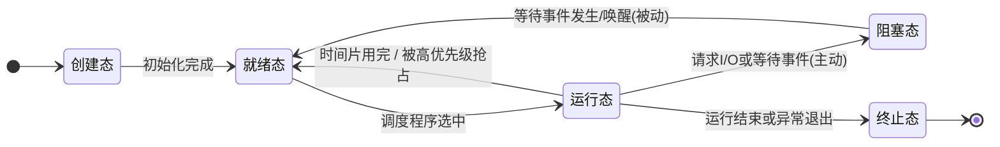

# 操作系统速通

### **一、 操作系统概述与运行机制**

#### **1. 操作系统的概念、功能与接口**
操作系统（Operating System, OS）是控制和管理计算机硬件与软件资源、合理组织和调度计算机工作，并为用户提供方便接口的**最基本的系统软件**。如果把硬件比作餐厅的厨房和餐桌，应用程序比作一桌桌客人，操作系统就是餐厅经理，向下管理 CPU、内存、磁盘等硬件资源，向上为用户和应用程序提供接口。

整门课程围绕操作系统的**四大核心管理功能**展开：**处理机管理**（进程与调度）、**存储器管理**（内存分配与虚拟内存）、**文件管理**以及**设备管理**（I/O 管理）。

操作系统向上提供两类接口：
- **命令接口**：允许用户直接通过命令进行操作，例如在终端（命令行）中输入指令。
- **程序接口**：由一组**系统调用（System Call）**组成，专门供应用程序请求操作系统内核服务时使用。

#### **2. 操作系统的四个基本特征**
操作系统的四大基本特征是**并发、共享、虚拟和异步**。
- **并发（Concurrency）**：指两个或多个事件在**同一时间间隔**内发生（宏观上同时进行，微观上交替进行）。需严格区分**并行（Parallelism）**：并行是指在**同一时刻**真正同时发生。单核 CPU 上程序 A 和 B 轮流执行属于并发；多核 CPU 让两个程序在同一时刻同时运行才属于并行。
- **共享（Sharing）**：系统中的资源可供多个并发执行的进程共同使用。分为两种方式：一是**互斥共享**，规定在一段时间内只允许一个进程访问该资源（如打印机）；二是**同时共享**，允许在一段时间内由多个进程“同时”（微观上交替）访问（如磁盘上的文件）。
- **虚拟（Virtualization）**：把一个物理上的实体变为若干个逻辑上的对应物。例如分时使用 CPU 让每个程序觉得自己独占了 CPU，称为**时分复用**；利用虚拟内存技术让程序以为内存空间比实际物理内存更大，称为**空分复用**。
- **异步（Asynchronism）**：在多道程序环境下，允许多个程序并发执行，但由于资源有限，进程的执行并不是一气呵成的，而是走走停停，以不可预知的速度向前推进。

**高频考点与易错点**：**并发和共享是操作系统最基本的两个特征，二者互为存在条件**。没有并发执行，就无需共享资源；若不能有效管理资源共享，并发也无法实现。同时，没有并发也就谈不上虚拟和异步。

#### **3. 操作系统的发展与分类**
操作系统经历了从手工操作阶段、单道批处理系统到现代操作系统的演进。在多道批处理系统中，当某个程序等待 I/O 时，CPU 可以立即切换去运行其他程序，从而大幅提高了资源利用率，但缺点是用户无法与作业进行交互。随后出现的分时系统将 CPU 时间切分成极短的时间片轮流分配给各个用户，顺利实现了人机交互；而实时系统则强调在严格的时间限制内完成关键任务（如导弹制导、工业控制）。

| 系统类型 | 核心运行机制 | 核心追求目标 | 典型特点/缺点 |
| :--- | :--- | :--- | :--- |
| **多道批处理系统** | 多道程序驻留内存，宏观并行、微观串行交替运行 | **资源利用率和系统吞吐量** | 资源利用率高，但**无交互能力**，周转时间长 |
| **分时系统** | 把 CPU 时间切成很短的**时间片**，轮流分给各用户 | **交互性和响应时间** | 实现人机交互，各用户感觉独占计算机 |
| **实时系统** | 在严格的时间限制内响应并完成外部请求 | **及时性和可靠性** | 用于导弹制导、工业控制等强时间约束场景 |

#### **4. CPU 运行状态、中断与系统调用**
为了保证系统安全，CPU 执行的指令被划分为两类：**特权指令**（如 I/O 指令、关中断、设置内存保护寄存器等，只允许操作系统内核使用）和**非特权指令**（如普通的加减运算，任何程序都能使用）。相应地，CPU 具有两种运行状态：
- **核心态（管态 / 内核态）**：可执行包括特权指令在内的所有指令。
- **用户态（目态）**：只能执行非特权指令。

CPU 依靠**程序状态字寄存器（PSW）**中的一个标志位来区分当前处于哪种状态。从核心态回到用户态非常容易，只需执行一条修改 PSW 的特权指令即可；但**从用户态进入核心态的唯一途径是通过中断或异常**。

中断分为两大类：
- **外中断（中断）**：来自 CPU 外部，与当前执行的指令无关，如时钟中断、I/O 完成中断。
- **内中断（异常 / Exception）**：来自 CPU 内部，与当前正在执行的指令直接相关。内中断又细分为三种：
  1. **陷入（Trap / 访管）**：由程序故意引发，如执行系统调用。
  2. **故障（Fault）**：由错误条件引起，但可能被内核修复，修复后可重新执行原指令，如**缺页中断**、除法出错（x86 体系将其归入故障，处理程序通常无法修复，默认动作是终止进程）。
  3. **终止（Abort）**：无法恢复的致命错误，直接终止进程，如硬件故障。

**系统调用的执行流程**：用户程序先把参数放进寄存器 $\rightarrow$ 执行**陷入指令（trap 指令）** $\rightarrow$ 引发一个内中断 $\rightarrow$ CPU 切换到核心态 $\rightarrow$ 由操作系统内核完成相应服务 $\rightarrow$ 返回用户态继续执行。

**高频考点与易错点**：
1. **陷入指令本身是在用户态下执行的，它不是特权指令**。执行完陷入指令之后，CPU 才会进入核心态。
2. 凡是与资源有关的操作（如申请内存、读写文件、创建进程、操作 I/O 设备），都必须通过系统调用由操作系统代为完成。**系统调用是应用程序请求内核服务的唯一方式**。

#### **5. 操作系统内核架构**
内核的组织方式主要分为两种：**大内核（宏内核）**将进程管理、内存管理、文件系统等主要功能全部放进内核（如 Linux），优点是性能高，缺点是内部结构复杂、维护难度大；**微内核**只把最基本的功能（如中断处理、进程通信、低级调度）留在内核里，其余服务移至用户态，优点是结构清晰、可靠性与扩展性好，缺点是需要频繁在用户态和核心态之间切换状态，导致性能较低。

---

### **二、 处理机管理：进程、线程与通信**

#### **1. 进程的概念、组成与五状态模型**
为了让多个程序并发执行，操作系统引入了**进程（Process）**。**进程是程序的一次执行过程**。如果把存放在磁盘上的代码（程序）比作静态的“菜谱”，那么进程就是照着菜谱“做菜的过程”，它是动态的、有生有灭的。同一个程序连续运行两次，在系统中就会对应两个不同的进程。

一个进程由三部分组成：**程序段**、**数据段**以及**进程控制块（PCB）**。其中 PCB 记录了进程标识符（PID）、优先级、寄存器的值、占用的内存和打开的文件等关键管理信息。

**高频考点与易错点**：**PCB 是进程存在的唯一标志**。创建进程的实质就是创建 PCB，撤销进程的实质就是回收 PCB。

进程在其生命周期中会处于不同的状态，最核心的五状态模型包括：
- **运行态（Running）**：进程正在 CPU 上执行。
- **就绪态（Ready）**：进程已具备运行所需的一切资源，万事俱备，**只差 CPU**。
- **阻塞态（Blocked / 等待态）**：进程正在等待某个事件发生（如等待 I/O 完成），此时就算把 CPU 分给它也无法运行。
- **创建态（New）**：进程正在被创建，尚未转入就绪态。
- **终止态（Terminated）**：进程运行结束，正等待系统回收资源。

**高频考点与易错点**：
1. **阻塞态不能直接变成运行态**（事件完成后被唤醒，只能先回到**就绪态**排队，等待调度器选中）；**就绪态也不能直接变成阻塞态**（不在 CPU 上运行，根本无法发起等待请求）。
2. **运行态 $\rightarrow$ 阻塞态是进程自身的主动行为**；**阻塞态 $\rightarrow$ 就绪态是被动行为**，必须由其他进程或中断来唤醒它。

#### **2. 进程控制与上下文切换**
进程的创建、终止、阻塞、唤醒和切换，都由内核通过**原语（Primitive）**来完成。原语是一段利用关中断/开中断实现的、**不可被中断的程序**，其执行具有原子性——要么一口气全部执行完，要么一点都不做。

当发生进程切换时，内核需要把当前进程的运行现场（如程序计数器 PC、通用寄存器的值等）保存到该进程的 PCB 中，再从下一个将要运行的进程的 PCB 中恢复运行现场。这一过程称为**上下文切换（Context Switch）**，它会带来一定的系统时间开销。

#### **3. 线程与多线程模型**
在一个软件（如聊天工具）中，往往需要同时执行接收消息、发送消息、刷新界面等多个任务。如果开三个独立进程，不仅共享数据麻烦，上下文切换开销也很大。因此引入了**线程（Thread）**，也称“轻量级进程”。

一个进程可以包含多个线程。同一进程内的所有线程**共享进程的代码段、数据段和打开的文件等资源**，但每个线程各自拥有独立的**程序计数器（PC）、寄存器和栈**。

**高频考点与易错点**：引入线程后，**进程是资源分配的基本单位，线程是 CPU 调度的基本单位**。同一进程内的线程切换不会引起进程切换（无需切换地址空间），因此系统开销小得多。

线程的实现方式分为两类：
- **用户级线程（ULT）**：由应用程序中的线程库管理，操作系统内核根本不知道它们的存在。优点是线程切换无需进入核心态，速度极快；缺点是**只要其中一个线程被阻塞，整个进程都会被阻塞**，且无法利用多核 CPU 并行加速。
- **内核级线程（KLT）**：由操作系统内核直接管理。优点是一个线程阻塞后，同一进程内的其他线程仍能继续运行，且可以在多个 CPU 核心上真正并行；代价是线程切换必须进入核心态，开销较大。

将用户级线程与内核级线程组合映射，形成了三种多线程模型：**多对一模型**（多个用户级线程映射到一个内核级线程）、**一对一模型**（每个用户级线程映射到一个内核级线程）和**多对多模型**（$m$ 个用户级线程映射到 $n$ 个内核级线程，$m \ge n$）。

**高频考点与易错点**：**内核级线程才是处理机（CPU 核心）分配的单位**。在多对一模型中，由于内核只看得到一个内核级线程，所以即使进程内创建了再多用户级线程，也只能在一个核上运行，且“一个阻塞，全部阻塞”。

#### **4. 进程通信（IPC）**
由于各个进程拥有独立的地址空间，彼此相互隔离，进程间交换数据必须通过操作系统提供的**进程通信（Inter-Process Communication, IPC）**机制，主要有三种方式：
1. **共享存储（Shared Memory）**：在内存中划出一块双方都能访问的共享区域。这种方式**速度最快**，但进程间必须自行使用同步互斥工具（如信号量）来保证读写不冲突。
2. **消息传递（Message Passing）**：进程之间通过“发送（send）”和“接收（receive）”两个原语传递格式化的消息。分为直接通信方式（直接发给目标进程）和间接通信方式（先把消息放进中间实体“信箱”，再由对方去取）。
3. **管道通信（Pipe）**：在内存中开辟一个固定大小的缓冲区，像一根水管一样，一个进程往管道里写，另一个进程从管道里读，数据遵循**先进先出（FIFO）**。**普通管道只能实现半双工通信**（同一时刻只能单向传输），若要实现同时双向（全双工）通信，则需要建立两根管道。

---

### **三、 处理机管理：处理机调度与算法**

#### **1. 调度的三个层次与两种方式**
处理机调度按粒度从粗到细分为三个层次：
- **高级调度（作业调度）**：按一定原则从外存后备队列中挑选作业调入内存，并为其创建进程（分配 PCB 等资源）。每个作业只调入一次、调出一次，**发生频率最低**。
- **中级调度（内存调度）**：为了提高内存利用率和系统吞吐量，将内存中暂时不能运行的进程调出到外存等待，此时进程状态变为**挂起态**（分为**就绪挂起**和**阻塞挂起**）；当具备运行条件且内存空闲时再重新调入内存。
- **低级调度（进程调度）**：从就绪队列中选取一个进程，将 CPU 分配给它。这是最基本的调度，**发生频率最高**。

调度方式分为两类：**非抢占式（非剥夺式）**指一旦把 CPU 分给某个进程，就让它一直运行下去，直到该进程完成或因等待事件而主动阻塞；**抢占式（剥夺式）**则允许系统按照某种规则（如优先级更高、剩余时间更短或时间片用完）中途暂停正在运行的进程，将 CPU 强行分配给更紧急的进程。

#### **2. 调度算法评价指标与核心计算公式**
评价调度算法优劣最核心的指标是周转时间，考试计算大题必考以下三个公式：

$$
\text{周转时间} = \text{完成时间} - \text{到达时间}
$$

$$
\text{带权周转时间} = \frac{\text{周转时间}}{\text{实际运行时间}} \quad (\text{恒有 } \text{带权周转时间} \ge 1)
$$

$$
\text{等待时间} = \text{周转时间} - \text{运行时间} \quad (\text{纯CPU计算场景})
$$

#### **3. 六大经典调度算法原理与实例精析**
视频中采用了一组标准算例贯穿讲解：假设有 4 个进程 $P_1, P_2, P_3, P_4$，其参数如下表所示：

| 进程 | 到达时间 | 运行时间（服务时间） |
| :--- | :--- | :--- |
| $P_1$ | $0$ | $8$ |
| $P_2$ | $1$ | $4$ |
| $P_3$ | $2$ | $9$ |
| $P_4$ | $3$ | $5$ |

##### **（1）先来先服务（FCFS, First-Come First-Served）**
- **原理**：按照进程到达就绪队列的先后顺序依次服务，属于**非抢占式**算法。
- **算例推演**：执行顺序为 $P_1 (0 \sim 8) \rightarrow P_2 (8 \sim 12) \rightarrow P_3 (12 \sim 21) \rightarrow P_4 (21 \sim 26)$。
  - 完成时间分别为：$P_1 = 8,\ P_2 = 12,\ P_3 = 21,\ P_4 = 26$。
  - 周转时间分别为：$P_1 = 8 - 0 = 8$；$P_2 = 12 - 1 = 11$；$P_3 = 21 - 2 = 19$；$P_4 = 26 - 3 = 23$。
  - 平均周转时间 $= \frac{8 + 11 + 19 + 23}{4} = 15.25$。
- **特点**：简单公平，但**对长作业有利，对短作业极其不利**（排在长作业后面的短作业需要经历漫长的等待）。**不会发生饥饿**。

##### **（2）短作业优先（SJF）与最短剩余时间优先（SRTN）**
- **原理**：每次调度时，从**已经到达**的进程中挑选运行时间最短的一个执行。
  - **非抢占式（SJF）**：$0$ 时刻只有 $P_1$ 到达，故 $P_1$ 先运行至时刻 $8$ 完成；此时 $P_2, P_3, P_4$ 均已到达，运行时间分别为 $4, 9, 5$，按从短到长依次运行 $P_2 (8 \sim 12) \rightarrow P_4 (12 \sim 17) \rightarrow P_3 (17 \sim 26)$。各进程周转时间分别为 $P_1 = 8,\ P_2 = 11,\ P_4 = 14,\ P_3 = 24$，平均周转时间降至 $14.25$。
  - **抢占式（SRTN，最短剩余时间优先）**：每当有新进程到达就绪队列，就比较新进程的运行时间与当前正在运行进程的**剩余时间**，谁更短就运行谁。
    - 算例推演：$0 \sim 1$ 运行 $P_1$（剩余 $7$）；时刻 $1$ 时 $P_2$ 到达（需 $4 < 7$），抢占 CPU，运行 $P_2 (1 \sim 5)$ 完成；时刻 $5$ 时在已到达的 $P_1$（剩 $7$）、$P_3$（需 $9$）、$P_4$（需 $5$）中选最短的 $P_4 (5 \sim 10)$ 完成；接着运行 $P_1 (10 \sim 17)$ 完成；最后运行 $P_3 (17 \sim 26)$ 完成。
    - 周转时间分别为：$P_1 = 17 - 0 = 17$；$P_2 = 5 - 1 = 4$；$P_3 = 26 - 2 = 24$；$P_4 = 10 - 3 = 7$。平均周转时间进一步降至 $\frac{17 + 4 + 24 + 7}{4} = 13$。
- **高频考点**：在所有进程同时可运行（或所有作业同时到达）的情况下，**SJF 算法的平均等待时间和平均周转时间最少**。但它的致命缺点是**对长作业不利，如果短作业源源不断地到来，长作业可能永远得不到运行，从而产生“饥饿（Starvation）”现象**。

##### **（3）高响应比优先（HRRN, Highest Response Ratio Next）**
- **原理**：为了兼顾长短作业，在每次调度时计算所有已到达进程的**响应比（$R_p$）**，选择响应比最高的进程运行（非抢占式）。其计算公式为：

$$
\text{响应比 } R_p = \frac{\text{等待时间} + \text{要求服务时间}}{\text{要求服务时间}} = 1 + \frac{\text{等待时间}}{\text{要求服务时间}}
$$

- **算例推演**：$0$ 时刻 $P_1$ 先运行，至时刻 $8$ 结束。此时计算 $P_2, P_3, P_4$ 的响应比：
  - $P_2$（等待了 $8 - 1 = 7$，服务时间 $4$）：$R_p = \frac{7 + 4}{4} = 2.75$
  - $P_3$（等待了 $8 - 2 = 6$，服务时间 $9$）：$R_p = \frac{6 + 9}{9} \approx 1.67$
  - $P_4$（等待了 $8 - 3 = 5$，服务时间 $5$）：$R_p = \frac{5 + 5}{5} = 2.0$
  - 因此优先选中响应比最高的 $P_2$ 运行。
- **特点**：短作业的分母小，响应比天生高，会被优先照顾；长作业随着等待时间增加，分子越来越大，响应比也会随之升高，最终总能被选中，因此**综合了 FCFS 和 SJF 的优点，不会产生饥饿**。

##### **（4）时间片轮转（RR, Round-Robin）**
- **原理**：分时系统的经典抢占式算法。所有就绪进程按 FCFS 排成一个队列，每次把 CPU 分配给队首进程运行一个**时间片（Time Slice）**。若时间片用完进程仍未结束，则剥夺 CPU 并将该进程排到就绪队列队尾。
- **高频考点**：时间片大小的选择至关重要——若**时间片太大**，以至于每个进程都能在一个时间片内运行完，RR 算法就会**退化为先来先服务（FCFS）**，失去交互响应快的优势；若**时间片太小**，会导致进程上下文切换过于频繁，**系统开销大幅增加**。RR 算法**不会产生饥饿**。

##### **（5）优先级调度（Priority Scheduling）**
- **原理**：为每个进程设置优先级，每次总是选择优先级最高的进程运行，分为抢占式和非抢占式。优先级分为**静态优先级**（创建时确定，运行期间不变）和**动态优先级**（可随等待时间增长而动态提高）。
- **特点**：若低优先级进程长期得不到运行（尤其在静态优先级下），**可能会发生饥饿**。

##### **（6）多级反馈队列（Multilevel Feedback Queue）**
- **原理**：公认的集大成者算法。具体规则如下：
  1. 设置多个就绪队列，**从上到下优先级从高到低，而分配的时间片从小到大**。
  2. 新进程到达时，先进入第一级（最高优先级）队列队尾，按 FCFS 等待运行。若在一个时间片内未能完成，则降入下一级队列的队尾。
  3. **只有当高优先级队列全部为空时，才会调度下一级队列中的进程运行**；若在运行下层队列进程时有新进程进入上层队列，则会发生抢占。
- **特点**：短作业和交互式进程能在高优先级队列中迅速完成，长作业则逐渐下沉并获得更长的时间片运行。但如果上层队列源源不断有新进程到来，下层的长作业**依然可能会产生饥饿**。

#### **4. 调度算法总结对比与解题规范**

| 调度算法 | 是否可抢占 | 是否会导致饥饿 | 适用场景与核心特点总结 |
| :--- | :--- | :--- | :--- |
| **先来先服务 (FCFS)** | 非抢占 | **不会** | 简单公平，对长作业有利，对短作业不利 |
| **短作业优先 (SJF / SRTN)** | 非抢占 / 抢占 | **会**（长作业饥饿） | 平均周转/等待时间最短，对短作业极有利 |
| **高响应比优先 (HRRN)** | 非抢占 | **不会** | 兼顾长短作业，每次计算响应比开销略大 |
| **时间片轮转 (RR)** | 抢占 | **不会** | 分时系统经典算法，公平响应快，不区分紧急程度 |
| **优先级调度** | 非抢占 / 抢占 | **会**（低优先级饥饿） | 适用于实时系统，灵活区分任务紧急程度 |
| **多级反馈队列** | 抢占 | **会**（长作业可能饥饿） | 集大成者，兼顾短作业快速响应与长作业执行 |

**大题解题规范**：遇到计算平均周转时间与带权周转时间的大题，最稳妥的步骤是：**第一步先在草稿纸或卷面上画出甘特图（Gantt Chart，时间轴执行图）**，标清每个进程切入和完成的时间刻度；**第二步列表逐一计算每个进程的完成时间、周转时间和带权周转时间**，最后求平均值，切忌跳步心算。

---

### **四、 处理机管理：进程同步、互斥与死锁**

#### **1. 竞争条件、临界区与同步互斥准则**
当多个并发进程共享数据时，若不加控制就会出错。例如共享变量 `count` 初值为 $5$，进程 $P_0$ 和 $P_1$ 都执行 `count++`。在机器指令层面，`count++` 实际上包含三条指令：① 将 `count` 读入寄存器；② 寄存器值加 $1$；③ 将结果写回内存。若 $P_0$ 刚读到 $5$ 还没写回就被切换到 $P_1$，$P_1$ 也读到 $5$ 并加 $1$ 写回 $6$，随后切回 $P_0$ 也把 $6$ 写回内存——两个进程各加了一次，最终结果却是 $6$ 而不是 $7$。这种**最终执行结果取决于进程执行的先后顺序（交错次序）的现象，称为竞争条件（Race Condition）**。

- **临界资源**：一次只允许一个进程使用的资源（如打印机、共享变量）。
- **临界区（Critical Section）**：进程中访问临界资源的那段代码。访问临界资源的代码结构分为四部分：
  1. **进入区**：检查能否进入临界区，若能进入则设置标志（上锁）。
  2. **临界区**：访问临界资源的核心代码。
  3. **退出区**：解除正在访问的标志（解锁）。
  4. **剩余区**：做其他无关工作的代码。
- **进程的两种制约关系**：
  - **互斥（间接制约关系）**：多个进程因争用同一个临界资源而产生的制约（如抢占打印机）。
  - **同步（直接制约关系）**：多个进程为完成共同任务，在执行次序上有严格的先后顺序要求（如写进程必须先写入数据，读进程才能读取数据）。

实现临界区互斥必须遵循**四条基本准则**：
1. **空闲让进**：临界区空闲时，允许一个请求进入的进程立即进入。
2. **忙则等待**：当已有进程处于临界区时，其他试图进入的进程必须等待。
3. **有限等待**：对请求访问的进程，应保证能在有限时间内进入临界区，防止饥饿。
4. **让权等待**：当进程不能进入临界区时，应**立即释放处理机（CPU）**，防止进程处于“忙等（Busy Waiting）”状态白白消耗 CPU。

#### **2. 软件与硬件互斥实现方法**
- **软件方法——Peterson 算法**：设置布尔数组 `flag[i]` 表示“我想进入”，整型变量 `turn` 表示“谦让给谁进入”。进程在进入临界区前，先表明自己的意愿（`flag[i] = true`），再把机会礼貌地让给对方（`turn = j`）；只有当**对方不想进**或者**对方把机会让给了我**时，当前进程才能进入临界区。
- **硬件方法**：
  - **关中断**：进入临界区前执行关中断指令，进程就不会被切换走，出临界区后再开中断。缺点是**只适用于单处理机（多核下锁不住其他核）**，且若把关中断特权交给用户程序会非常危险。
  - **TestAndSet（TS 指令）与 Swap 指令**：由硬件保证“读出并测试/交换”的整个执行过程不可分割（原子操作）。

**高频考点与易错点**：无论是软件的 **Peterson 算法**，还是硬件的 **TestAndSet / Swap 指令**，都满足“空闲让进、忙则等待、有限等待”，但**统统不满足“让权等待”**！因为在进不去临界区时，它们都会在原地死循环检测，一直占着 CPU 处于“忙等”状态。

#### **3. 信号量（Semaphore）与 PV 操作**
1965 年，迪杰斯特拉（Dijkstra）提出了**信号量**机制。信号量只能通过两个不可中断的原语来操作：**P 操作（即 `wait(S)`，表示申请一个资源）**和 **V 操作（即 `signal(S)`，表示释放一个资源）**。
- **整型信号量**：就是一个普通整数 $S$。执行 P 操作时，只要 $S \le 0$ 就一直循环等待，直到 $S > 0$ 时才将 $S$ 减 $1$。缺点是依然会“忙等”，**不满足让权等待**。
- **记录型信号量（实际使用）**：除了一个整数 `value` 外，还附带一个进程等待队列 `L`。
  - **P 操作（`wait`）**：先把 `value` 减 $1$；如果减完后 `value < 0`，说明资源不够了，进程就主动调用 `block` 原语**把自己阻塞，并挂入等待队列**（遵循了让权等待！）。
  - **V 操作（`signal`）**：先把 `value` 加 $1$；如果加完后仍然满足 `value <= 0`，说明等待队列中还有进程在排队等待，就调用 `wakeup` 原语**从等待队列中唤醒一个进程**。

**形象类比与核心考点**：可以把记录型信号量想象成停车场，`value` 初值就是空车位数。每来一辆车就减 $1$，减成负数就在大门口排队，负几就有几辆车在排队。
- 当 `value > 0` 时，表示**当前可用资源的数量**；
- 当 `value < 0` 时，其**绝对值 $|\text{value}|$ 表示当前正在等待该资源的阻塞进程数**；
- 当 `value == 0` 时，表示可用资源刚好用完，且没有进程在排队等待。

**信号量的三大基础用途**：
1. **实现互斥**：设互斥信号量 `mutex = 1`。进入临界区前执行 `P(mutex)`，离开临界区后执行 `V(mutex)`。
2. **实现同步（保证先后顺序）**：口诀**“前 V 后 P”**。例如要求进程 $P_1$ 中的代码 $X$ 必须在进程 $P_2$ 中的代码 $Y$ 之前执行，则设同步信号量 `S = 0`；在 $P_1$ 执行完 $X$ 之后执行 `V(S)`，在 $P_2$ 执行 $Y$ 之前先执行 `P(S)`。
3. **实现前驱关系**：当多个进程按照一张前驱图（有向无环图）执行时，为图中的**每一条有向边**分别设置一个初值为 $0$ 的同步信号量，在边的**起点进程中执行 V 操作**，在边的**终点进程中执行 P 操作**。

**高频考点总结**：互斥信号量初值一般为 $1$（成对出现在**同一个进程**中）；同步信号量初值一般为 $0$（P、V 分别出现在**两个不同进程**中）；表示资源数量的信号量初值即为初始可用资源总数。

#### **4. 三大经典同步问题与 PV 大题通用步骤**

##### **（1）生产者—消费者问题**
生产者往一个大小为 $n$ 的缓冲区中放产品，消费者从里面取产品。存在三层关系：① 缓冲区满时生产者必须等待（同步）；② 缓冲区空时消费者必须等待（同步）；③ 缓冲区同一时刻只能被一个进程访问（互斥）。
- **信号量设置**：互斥信号量 `mutex = 1`；表示空位数量的同步信号量 `empty = n`；表示产品数量的同步信号量 `full = 0`。
- **代码逻辑对比**：

| 生产者进程（Producer） | 消费者进程（Consumer） |
| :--- | :--- |
| `P(empty)` // 1. 先申请一个空位（同步） | `P(full)` // 1. 先申请一个产品（同步） |
| `P(mutex)` // 2. 再申请缓冲区锁（互斥） | `P(mutex)` // 2. 再申请缓冲区锁（互斥） |
| 将产品放入缓冲区 | 从缓冲区取出产品 |
| `V(mutex)` // 3. 释放缓冲区锁 | `V(mutex)` // 3. 释放缓冲区锁 |
| `V(full)` // 4. 产品数加 1 | `V(empty)` // 4. 空位数加 1 |

- **必考铁律**：**两个相邻 P 操作的顺序绝对不能颠倒！实现互斥的 P 操作一定要放在实现同步的 P 操作之后**。如果生产者先执行 `P(mutex)` 再执行 `P(empty)`，当缓冲区恰好已满（`empty = 0`）时，生产者就会拿着互斥锁进入阻塞睡眠；此时消费者进不了缓冲区，无法取走产品腾出空位，导致双方永远等待，引发**死锁**。而两个 V 操作的顺序则可以任意交换。

##### **（2）读者—写者问题**
允许多个读者同时读同一个文件，但写者在写文件时不允许任何其他读者或写者访问（读—读共享，读—写互斥，写—写互斥）。
- **核心技巧（读者优先写法）**：引入一个整型计数器 `count`（初值为 $0$）记录当前正在读文件的读者人数。**第一个读者到来时（`count == 0`）负责执行 `P(rw)` 给文件加写锁，最后一个读者离开时（`count == 0`）负责执行 `V(rw)` 解锁**。因为 `count` 本身也是多个读者共享的变量，所以必须额外设置一个互斥信号量 `mutex = 1` 来保护对 `count` 的检查与修改。
- **读写公平改进**：上述基本写法属于“读者优先”，只要源源不断有读者到来，`count` 就永远不会降为 $0$，写者就可能被饿死。若要实现**读写公平（写者到后拦截新读者）**，只需再增加一个排队信号量 `w = 1`，让读者和写者在进入前都先经过 `P(w)` 和 `V(w)`，这样一旦写者到来阻塞在 `w` 上，后续新读者就会被挡在 `P(w)` 之外。

##### **（3）哲学家进餐问题**
$5$ 位哲学家围坐在圆桌旁，每两人之间放一根筷子（共 $5$ 根），哲学家必须同时拿到左右两根筷子才能进餐。若 $5$ 个人同时拿起左边的筷子，每个人都在等待右边的人放下筷子，就会全部卡死导致**死锁**。
- **三种经典破除死锁方案**：
  1. 最多只允许 **$4$ 位**哲学家同时去争抢筷子（保证至少有一人能拿到两根）。
  2. 规定**奇数号**哲学家先拿左边的筷子再拿右边，**偶数号**哲学家先拿右边的筷子再拿左边。
  3. 对拿筷子的动作加互斥锁（或使用 AND 型信号量），规定只有当某哲学家的**左右两根筷子都可用时**，才允许他一次性全部拿起。

**PV 操作大题通用三步法**：① 找出题目中有哪些进程，分析它们之间的同步（谁等谁）和互斥（争抢什么）关系；② 为每种关系设置信号量并准确确定初值；③ 按照“互斥成对同进程、同步前 V 后 P 跨进程、先同步 P 后互斥 P”的原则，在合适位置插入 PV 操作。

#### **5. 死锁（Deadlock）的概念、必要条件与处理策略**
**死锁**是指多个进程因争夺资源而造成的一种互相等待的僵局，若无外力作用，这些进程都将无法继续向前推进。

**易错点辨析（死锁 vs 饥饿）**：
- **死锁**：**至少涉及两个或两个以上进程**，且处于死锁的所有进程**一定都处于阻塞态**。
- **饥饿**：**可能只有一个进程**（如短作业优先中的长作业），它因长期得不到所需资源而无法推进，处于饥饿的进程**可能处于就绪态**（等 CPU），**也可能处于阻塞态**（等 I/O）。

**死锁产生的四个必要条件（缺一不可）**：
1. **互斥条件**：所争用的资源一次只能被一个进程使用。
2. **不剥夺条件**：进程已获得的资源在未使用完之前，不能被其他进程强行夺走，只能主动释放。
3. **请求并保持条件**：进程已经保持了至少一个资源，但又提出了新的资源请求，且在请求被阻塞等待时对已获得的资源保持不放。
4. **循环等待条件**：存在一种进程资源的循环等待链，链中每一个进程都在等待下一个进程所占有的资源。

**高频易错点**：发生死锁时一定有循环等待，但**有循环等待不一定会发生死锁**！如果同类资源有多个实例，处于循环等待链之外的进程在使用完同类资源后将其释放，就能够打破这个环，从而不发生死锁。

**处理死锁的三大策略**：
- **死锁预防（事前静态限制，破坏四个必要条件之一）**：
  - 互斥条件通常由设备固有属性决定，无法破坏（但可通过 SPOOLing 技术将独占设备改造为共享设备）。
  - 破坏**不剥夺条件**：当进程请求新资源得不到满足时，必须立即主动释放已保持的所有资源。
  - 破坏**请求并保持条件**：采用**静态分配（一次性分配）**，进程在运行前一次性申请它所需要的全部资源。
  - 破坏**循环等待条件**：采用**顺序资源分配法**，给系统中每类资源编号，规定进程只能按编号递增的顺序申请资源。
- **死锁避免（事前动态检查）**：不事先做严格限制，而是在每次分配资源之前，动态计算分配后系统是否会进入不安全状态，代表算法是**银行家算法**。
- **死锁检测与解除（事后处理）**：允许死锁发生，系统定期通过**资源分配图**进行检测。化简方法是：找出一个所有请求都能被当前剩余资源满足的进程（既不阻塞又非孤立），让它运行完并释放所有占有资源，消去与它相连的所有请求边和分配边；重复此过程，若**最后能消去图中所有的边，称为“可完全简化”，说明没有死锁；否则剩下的进程就发生了死锁（死锁定理）**。解除死锁的方法包括：资源剥夺法、撤销进程法、进程回退法。

**必考死锁资源计算公式**：若系统中有 $m$ 个同类资源，被 $n$ 个进程共享，每个进程最多需要申请 $k$ 个该类资源，则**保证系统绝对不会发生死锁的最小资源数条件**为：

$$
m \ge n \times (k - 1) + 1
$$

*原理解析*：最坏的情况是每个进程都恰好分到了 $k - 1$ 个资源（共消耗 $n(k-1)$ 个），此时大家都只差 $1$ 个资源就能运行完。只要系统再多出 $1$ 个资源，就能让其中一个进程顺利完成并释放其全部资源，进而像多米诺骨牌一样带动所有进程依次完成。例如：$3$ 个进程，每个进程最多需要 $4$ 台打印机，则至少需要 $3 \times (4 - 1) + 1 = 10$ 台打印机才绝对不会死锁。

#### **6. 银行家算法（Banker's Algorithm）**
银行家算法由迪杰斯特拉提出，核心思想是在分配资源前先判断系统是否处于**安全状态**。如果系统能找到一个进程推进序列 $\langle P_1, P_2, \dots, P_n \rangle$，按照这个顺序依次分配资源，每个进程的最大需求都能得到满足并顺利运行完成，则称该序列为**安全序列**，此时系统处于**安全状态**。

**高频考点与易错点**：
1. 系统处于**安全状态，一定不会发生死锁**；系统处于**不安全状态，不一定会发生死锁**，但存在发生死锁的可能（即不安全状态是死锁的必要非充分条件）。
2. 安全序列**可能不唯一**。

**银行家算法的四个核心数据结构**：
- `Max`：最大需求矩阵（每个进程对各类资源的最大需求量）。
- `Allocation`：分配矩阵（当前已经分配给每个进程的各类资源数）。
- `Need`：需求矩阵（每个进程最多还需要多少资源），核心恒等式为：

$$
\text{Need} = \text{Max} - \text{Allocation}
$$

- `Available`：可用资源向量（系统当前剩余的各类空闲资源数）。

**算法执行步骤与视频经典算例**：
假设系统有 A、B、C 三类资源，共 $5$ 个进程 $P_0 \sim P_4$。做题**第一步永远是先用 $\text{Max} - \text{Allocation}$ 算出 $\text{Need}$ 矩阵**！当前状态如下表所示，且已知当前系统剩余可用资源 $\text{Available} = (3, 3, 2)$：

| 进程 | $\text{Max}$ (A, B, C) | $\text{Allocation}$ (A, B, C) | $\text{Need} = \text{Max} - \text{Allocation}$ |
| :--- | :--- | :--- | :--- |
| $P_0$ | $(7, 5, 3)$ | $(0, 1, 0)$ | $(7, 4, 3)$ |
| $P_1$ | $(3, 2, 2)$ | $(2, 0, 0)$ | $(1, 2, 2)$ |
| $P_2$ | $(9, 0, 2)$ | $(3, 0, 2)$ | $(6, 0, 0)$ |
| $P_3$ | $(2, 2, 2)$ | $(2, 1, 1)$ | $(0, 1, 1)$ |
| $P_4$ | $(4, 3, 3)$ | $(0, 0, 2)$ | $(4, 3, 1)$ |

- **安全性检查过程**：用当前的 `Available` 依次与未完成进程的 `Need` 逐项比较（**注意：必须 A、B、C 每一项资源都不超过 `Available` 才算满足，有一项不够都不行！**）：
  1. 初始 $\text{Available} = (3, 3, 2)$，检查发现 $P_1$ 的 $\text{Need} = (1, 2, 2) \le (3, 3, 2)$，可满足！让 $P_1$ 运行完并归还其占有的 $\text{Allocation} = (2, 0, 0)$，可用资源变为 $\text{Available} = (3, 3, 2) + (2, 0, 0) = (5, 3, 2)$。
  2. 接着看 $P_3$，其 $\text{Need} = (0, 1, 1) \le (5, 3, 2)$，可满足！$P_3$ 完成后归还 $(2, 1, 1)$，$\text{Available}$ 变为 $(5, 3, 2) + (2, 1, 1) = (7, 4, 3)$。
  3. 此时 $\text{Available} = (7, 4, 3)$，接下来的 $P_4$（需 $4,3,1$）、$P_2$（需 $6,0,0$）、$P_0$（需 $7,4,3$）全部都能依次满足！
  4. 最终找到安全序列 $\langle P_1, P_3, P_4, P_2, P_0 \rangle$，判定当前系统处于**安全状态**。

- **资源请求（Request）处理三步法**：若此时进程 $P_1$ 发出资源请求 $\text{Request}_1 = (1, 0, 2)$，能否分配？
  1. **合法性检查**：检查 $\text{Request}_1 \le \text{Need}_1$ 是否成立？$(1, 0, 2) \le (1, 2, 2)$，成立（未超自身声明的最大需求）。
  2. **可用性检查**：检查 $\text{Request}_1 \le \text{Available}$ 是否成立？$(1, 0, 2) \le (3, 3, 2)$，成立（系统当前闲置资源够分）。
  3. **试探性分配与安全性检查**：先假定分配给 $P_1$，修改状态数据：
     - $\text{Available} = (3, 3, 2) - (1, 0, 2) = (2, 3, 0)$
     - $\text{Allocation}_1 = (2, 0, 0) + (1, 0, 2) = (3, 0, 2)$
     - $\text{Need}_1 = (1, 2, 2) - (1, 0, 2) = (0, 2, 0)$
     随后对这一新状态执行**安全性检查**。由于 $\text{Available} = (2, 3, 0)$ 依然能先满足 $P_1$ 的新 $\text{Need}_1 (0, 2, 0)$，运行完归还 $(3, 0, 2)$ 后 $\text{Available}$ 变为 $(5, 3, 2)$，后续同样能找到安全序列（如 $\langle P_1, P_3, P_4, P_0, P_2 \rangle$），故**可以真正分配**。反之，若检查发现新状态不安全，则必须撤销试探性分配，恢复原数据，让该进程阻塞等待。

---

### **五、 存储器管理：内存分配、分页与分段**

#### **1. 程序的编译、链接、装入与地址重定位**
一个程序从源代码到在内存中运行，需要经历三个阶段：**编译**（将源代码翻译成若干个目标模块） $\rightarrow$ **链接**（将多个目标模块和库函数组装成一个完整的装入模块） $\rightarrow$ **装入**（将装入模块放进物理内存）。

编译链接后形成的装入模块，其地址都是从 $0$ 开始编址的**逻辑地址（相对地址）**；而内存单元在硬件上的真实地址称为**物理地址（绝对地址）**。将逻辑地址转换为物理地址的过程称为**地址重定位（地址映射）**，对应三种装入方式：
1. **绝对装入**：在编译阶段就直接产生绝对物理地址，只适用于单道程序环境。
2. **静态重定位（可重定位装入）**：在程序**装入内存时**，一次性将所有的逻辑地址全部加上起始物理地址改写成物理地址；装入后运行期间**不能在内存中移动位置**。
3. **动态重定位（动态运行时装入）**：装入内存后依然保持逻辑地址不变，等到程序**真正执行指令访问内存时**，才由硬件的**重定位寄存器（基址寄存器）**动态地将逻辑地址加上进程起始物理地址得到物理地址。支持程序在内存中移动和动态分配。

**内存保护机制**：依靠两个硬件寄存器实现——**界地址寄存器（限长寄存器）**存放程序的最大逻辑地址，**重定位寄存器**存放起始物理地址。每次访存时，先检查逻辑地址是否超过界地址寄存器（是否越界），若未越界，再加上重定位寄存器的值送交内存。

#### **2. 连续分配管理方式与碎片问题**
连续分配是指为用户进程分配一整块连续的内存空间，包含三种方式：
- **单一连续分配**：内存中同一时刻只放一个用户程序，无并发。
- **固定分区分配**：将内存事先划分成若干个固定大小的分区，每个分区只能装入一个程序。若程序小于分区大小，分区内部剩余用不完的空间就被浪费了，产生**内部碎片**。
- **动态分区分配（可变分区分配）**：不预先划分内存，而是在进程装入时按照其实际需求大小动态地切割出一块刚好够用的空间。它**没有内部碎片**，但随着进程频繁装入和换出，内存中会残留许多夹在已分配区域之间的极小空闲块，单独哪一块都装不下新进程，产生**外部碎片**。外部碎片可以通过**紧凑（Compaction / 拼凑）技术**把各个进程往一端挪动集中，从而拼出大块连续空闲空间。

**高频考点（内部碎片 vs 外部碎片）**：
- **内部碎片**：**已经分配给了某个进程**，但该进程用不完而浪费的空间（如固定分区分配、分页存储的最后一页）。
- **外部碎片**：**还没有分配出去**，但由于过于零碎狭小而无法被新进程利用的空闲空间（如动态分区分配、分段存储、文件的连续分配）。

**动态分区分配的四种空闲区选择算法**：
- **首次适应（First Fit, FF）**：空闲分区按地址从低到高排列，每次从头查找，选择**第一个**能放得下的空闲分区。**综合性能最好，算法最简单**。
- **最佳适应（Best Fit, BF）**：空闲分区按容量从小到大排列，选择能放得下的**最小**空闲分区。看似合理，但每次切完都会留下极小的剩余块，**会产生大量难以利用的微小外部碎片**。
- **最坏适应（Worst Fit, WF / 最大适应）**：空闲分区按容量从大到小排列，每次总是挑**最大**的空闲分区切割。缺点是**会迅速把大分区拆散用完**，导致后续真正的大进程到来时无处安放。
- **邻近适应（Next Fit, NF / 循环首次适应）**：从**上一次查找结束的位置**继续往后循环查找第一个能放得下的分区。缺点是会让高地址处的大分区也被迅速拆散。

**经典算例**：假设内存空闲分区按地址依次为 $100\text{KB}, 500\text{KB}, 200\text{KB}, 300\text{KB}, 600\text{KB}$，现需分配 $212\text{KB}$ 的空间：
- **首次适应（FF）**按顺序遇到的第一个 $\ge 212\text{KB}$ 的块是 **$500\text{KB}$**；
- **最佳适应（BF）**在所有 $\ge 212\text{KB}$ 的块（$500, 300, 600$）中挑最小的 **$300\text{KB}$**；
- **最坏适应（WF）**挑最大的 **$600\text{KB}$**。

#### **3. 非连续分配：分页、分段与段页式存储管理**

##### **（1）基本分页存储管理**
为了彻底消灭外部碎片，将进程拆散后分散装入内存，提出了**分页存储管理**：
- **页框（Page Frame，也称物理块、内存块）**：将物理内存划分成大小相等的小块。
- **页（Page，也称页面）**：将进程的逻辑地址空间也划分成与页框完全相同大小的块。进程的每一页可以放入内存中任意一个空闲页框中，无需连续。
- **页表（Page Table）**：存放在**内存**中，记录逻辑**页号（$P$）**到物理**块号（$b$ / 页框号）**的映射关系。页表在内存中的起始地址和长度存放在 CPU 的**页表寄存器（PTR）**中。

**地址结构与转换计算**：分页的逻辑地址是一维的，由系统自动拆分为高位**页号 $P$** 和低位**页内偏移量 $W$**。
- **二进制拆分法**：若页面大小为 $2^k$ 字节，则逻辑地址的**低 $k$ 位即为页内偏移量 $W$**，剩余高位即为页号 $P$；转换时只需把页号 $P$ 查页表替换为对应的物理块号 $b$，再拼接上原本的低 $k$ 位页内偏移量 $W$，即可直接得到物理地址。
- **十进制公式法**（设页面大小为 $L$，逻辑地址为 $A$）：

$$
\text{页号 } P = \lfloor A / L \rfloor \quad (\text{整除取整}), \qquad \text{页内偏移量 } W = A \bmod L \quad (\text{取余})
$$

$$
\text{物理地址} = \text{物理块号 } b \times L + W
$$

- **视频算例**：设页面大小 $L = 1\text{KB} = 1024\text{B}$，逻辑地址 $A = 2500$。
  1. 计算页号与偏移：$P = \lfloor 2500 / 1024 \rfloor = 2$；$W = 2500 - 2 \times 1024 = 2500 - 2048 = 452$。
  2. 查页表得知：$2$ 号页存放在第 $8$ 号物理块（$b = 8$）。
  3. 计算物理地址：$\text{物理地址} = 8 \times 1024 + 452 = 8192 + 452 = 8644$。

**高频考点**：分页存储管理**没有外部碎片**，只有在每个进程的**最后一页**可能装不满而产生一点**内部碎片**（平均每个进程产生半个页面的内部碎片）。分页完全由系统硬件完成，对用户是透明的，**地址空间是一维的**。

##### **（2）快表（TLB）与有效访问时间（EAT）计算**
由于页表存放在内存中，在基本分页下，CPU 每次读写一个数据都要**访问两次内存**（第一次查内存中的页表得到块号，第二次根据物理地址去内存取数据），导致访存速度慢了一倍。

为此引入了**快表（TLB, Translation Lookaside Buffer）**，它是一种高速的**相联存储器（Cache）**，用于缓存最近访问过的页表项。
- **访存流程**：先查快表，若**命中**则直接拿到物理块号，随后只需访问 **$1$ 次内存**即可取到数据；若**未命中**，再去内存中查慢表（页表），查到后同步更新进快表，再访问内存取数据（共访问 **$2$ 次内存**）。
- **有效访问时间（EAT）计算公式与算例**：设查快表耗时 $t$，访问一次内存耗时 $T$，快表命中率为 $\alpha$（注意区分题目中“先查快表未命中再查内存”与“同时查找”的表述，视频采用最常考的顺序查找模型）：

$$
\text{EAT} = \alpha \times (t + T) + (1 - \alpha) \times (t + T + T)
$$

  *视频算例*：访问一次内存 $T = 100\text{ns}$，查快表 $t = 20\text{ns}$，命中率 $\alpha = 90\%$。
  - 命中耗时：$20 + 100 = 120\text{ns}$；
  - 未命中耗时：$20 + 100\text{（查页表）} + 100\text{（取数据）} = 220\text{ns}$；
  - 平均有效访问时间 $\text{EAT} = 0.9 \times 120 + 0.1 \times 220 = 108 + 22 = 130\text{ns}$。

##### **（3）两级与多级页表**
现代计算机逻辑地址空间巨大，导致单级页表体积过大。例如：$32$ 位逻辑地址，页面大小 $4\text{KB}$（即 $2^{12}\text{B}$，页内偏移占 $12$ 位），则一个进程最多有 $2^{32-12} = 2^{20}$ 个页表项；若每个页表项占 $4\text{B}$，则仅一张页表就需要 $2^{20} \times 4\text{B} = 4\text{MB}$ 的**连续内存空间**，且实际上进程运行往往只用到其中极小一部分。

解决方案是**给页表再建一张页表（两级/多级页表）**：将长页表切分成一个个页面大小的二级页表分散存放，只让**顶级页表（一级页表 / 页目录表）常驻内存**，而二级页表可以在需要时按需调入内存。

**高频考点**：**多级页表的每一级页表大小，原则上不能超过一个页面（最好恰好装进一个页面里）**。例如页面大小 $4\text{KB}$，页表项大小 $4\text{B}$，则一个页面刚好能装下 $\frac{4\text{KB}}{4\text{B}} = 1024 = 2^{10}$ 个页表项，因此**每一级页号恰好占 $10$ 位**（如 $32$ 位地址可拆分为：$10$ 位一级页号 + $10$ 位二级页号 + $12$ 位页内偏移）。在无快表情况下，$k$ 级页表访问一次数据需要访问 **$k + 1$ 次内存**。

##### **（4）分段存储管理与段页式存储管理**
- **基本分段存储管理**：按照程序的自然逻辑结构将其划分为代码段、数据段、栈段等，每段从 $0$ 开始独立编址，各段长度不相同。逻辑地址由**段号 $S$** 和**段内偏移量 $W$** 两部分显式给出（二维地址）。用段表进行地址转换时，因为段长不固定，**必须先检查段内偏移量 $W$ 是否超过段表中的“段长”，若越界则引发中断**。
- **段页式存储管理**：结合分段与分页的优点，先将用户程序按逻辑模块**分段**，再把每一段内部**分页**。逻辑地址由**段号、段内页号、页内偏移量**三部分组成（对程序员而言仍是二维地址）。**在没有快表（TLB）的情况下，段页式每访问一次数据需要访问 $3$ 次内存**：第一次查内存中的段表得到页表地址 $\rightarrow$ 第二次查内存中的页表得到物理块号 $\rightarrow$ 第三次访问物理内存取出目标数据。

| 对比维度 | 分页存储管理 | 分段存储管理 | 段页式存储管理 |
| :--- | :--- | :--- | :--- |
| **基本单位属性** | **页是信息的物理单位**，系统为管理内存而划分 | **段是信息的逻辑单位**，由用户编程决定 | 先按逻辑分段，段内再按物理分页 |
| **大小与用户可见性** | 大小固定，对用户完全不可见（透明） | 长度不固定，对用户可见 | 结合二者特征 |
| **地址空间维数** | **一维地址空间** | **二维地址空间** | 二维地址空间 |
| **碎片情况** | **有内部碎片，无外部碎片** | **无内部碎片，有外部碎片** | **有内部碎片，无外部碎片** |
| **共享与保护** | 不易实现按逻辑模块共享与保护 | **极易实现信息共享和保护**（按段分配权限） | 兼具易于共享保护与高内存利用率 |
| **无快表访存次数** | **$2$ 次**（查页表 + 取数据） | **$2$ 次**（查段表 + 取数据） | **$3$ 次**（查段表 + 查页表 + 取数据） |

---

### **六、 存储器管理：虚拟内存与页面置换**

#### **1. 局部性原理与虚拟内存的特征、容量限制**
当一个程序比实际物理内存还大，或者需要同时运行大量程序导致内存不够时，操作系统利用**虚拟内存（Virtual Memory）**技术来解决。

虚拟内存的理论基石是**局部性原理（Principle of Locality）**：
- **时间局部性**：如果程序中的某条指令一旦执行，或某个数据一旦被访问，那么不久之后该指令或数据很可能再次被访问（典型原因：**程序中存在大量循环**）。
- **空间局部性**：一旦程序访问了某个存储单元，在不久之后，其附近的存储单元也很可能被访问（典型原因：**指令顺序存放执行、数组顺序访问**）。

基于局部性原理，程序运行时不必全部装入内存，只需先将当前马上要用的那部分页面装入内存即可开始运行；当访问的页面不在内存时，再由操作系统从外存动态调入；当内存满时，再将暂时不用的页面换出到外存。虚拟内存具有三大特征：
1. **多次性**：无需在作业运行时一次性全部装入内存，而是允许分成多次调入内存（最本质特征）。
2. **对换性**：作业运行期间无需常驻内存，允许将暂不使用的部分换出到外存，需要时再换入。
3. **虚拟性**：从逻辑上扩充了内存容量，使用户看到的内存远大于实际物理内存。

**必考容量考点**：虚拟内存的**最大容量**由**计算机的地址结构（CPU 寻址范围）**决定（例如 $32$ 位地址体系下，最大容量不超过 $2^{32}\text{B} = 4\text{GB}$）；而虚拟内存的**实际容量**则受限于内存和外存的大小，即：

$$
\text{虚拟内存实际容量} = \min(\text{内存容量} + \text{外存容量},\ 2^N\text{（CPU地址位数寻址上限）})
$$

#### **2. 请求分页管理方式与缺页中断**
请求分页是实现虚拟内存最常用的方式。为了支持换入换出，**请求页表项**比基本分页的页表项增加了四个关键字段：
- **状态位（存在位）**：标识该页当前是否已经在内存中。
- **访问字段**：记录该页在最近一段时间内被访问的次数或时间，供页面置换算法参考。
- **修改位（脏位 / Dirty Bit）**：标识该页调入内存后**是否被修改过**。若被修改过，换出时必须写回外存；若未被修改过，换出时可直接覆盖丢弃，无需写盘。
- **外存地址**：记录该页在外存（磁盘对换区/文件区）上的存放位置。

**缺页中断的处理流程**：当要访问的页面状态位显示不在内存中时，硬件立即触发**缺页中断** $\rightarrow$ 若内存中还有空闲物理块，直接从外存调入该页；若内存已满，则调用**页面置换算法**选出一页换出（若该页**修改位为 $1$**，必须先将其写回外存；若为 $0$ 则无需写回） $\rightarrow$ 将目标新页面调入内存，修改页表及快表（状态位置 $1$） $\rightarrow$ 唤醒进程，返回后**重新执行刚才被中断的那条指令**。

**高频考点与易错点**：
1. **缺页中断属于内中断（异常）中的“故障（Fault）”**。
2. 它与一般的外中断截然不同：一般中断在一条指令执行完毕后才检查响应，而**缺页中断是在指令执行期间产生并进行处理的**；并且由于一条指令可能涉及多个操作数或跨页指令本身，**一条指令在执行期间可能会产生多次缺页中断**。

**驻留集分配与置换策略组合**：给每个进程分配多少个物理页框，分为**固定分配**（页框数固定不变）和**可变分配**（运行期可动态增减页框）；置换时只在本进程自己的页框中挑选叫**局部置换**，在整个系统的空闲页框或其他进程页框中挑选叫**全局置换**。它们两两组合只有三种合法策略：**固定分配局部置换、可变分配局部置换、可变分配全局置换**。**注意：绝对不存在“固定分配全局置换”这种组合**（因为一旦全局置换拿了别人的块，自己的块数就变了，与“固定分配”自相矛盾）。

调入页面的时机分为两种：**预调页策略**（运行前根据空间局部性提前调入若干相邻页，主要用于进程的**首次调入**）和**请求调页策略**（运行期间等到发生缺页时才调入，每次调入一页，I/O 开销较大）。

#### **3. 四大页面置换算法与算例精析**
视频中使用了经典的 $20$ 次页面访问序列进行统一对比，假设系统为该进程分配了 **$3$ 个物理页框**，访问序列为：
`7, 0, 1, 2, 0, 3, 0, 4, 2, 3, 0, 3, 2, 1, 2, 0, 1, 7, 0, 1`

**高频易错点**：**最开始物理页框全空时，装入最初几个页面也会触发缺页中断，必须计入总缺页次数！** 缺页率计算公式为：

$$
\text{缺页率} = \frac{\text{缺页次数}}{\text{页面总访问次数}} \times 100\%
$$

##### **（1）最佳置换算法（OPT, Optimal）**
- **原理**：每次选择淘汰**以后永远不再使用**，或者在**最长时间内（往后看最晚）才会被访问**的页面。
- **算例推演**：前三次访问 `7, 0, 1` 均缺页，装入页框 `[7, 0, 1]`；第 $4$ 次访问 `2` 时发生缺页，从当前位置**向后看**，`0` 马上有用，`1` 也较快用到，而 `7` 要到第 $18$ 次访问才会被用到（最晚），因此换出 `7`，页框变为 `[2, 0, 1]`……以此类推，整个序列共发生 **$9$ 次缺页**（其中页面置换 $6$ 次），缺页率 $= \frac{9}{20} = 45\%$。
- **特点**：能保证获得**最低的缺页率**，但由于操作系统无法预知进程未来的访问序列，**实际上无法实现**，只能作为衡量其他置换算法优劣的理论基准。

##### **（2）先进先出置换算法（FIFO, First-In First-Out）**
- **原理**：每次选择淘汰**最早进入内存（在内存中驻留时间最长）**的页面，用一个队列即可轻松实现。
- **算例推演**：不管页面访问有多频繁，只按进驻内存的先后次序排队淘汰。同一序列下 FIFO 共发生 **$15$ 次缺页**。
- **核心考点——Belady 异常（贝拉迪异常）**：在采用 FIFO 算法时，可能会出现**为进程分配的物理页框数增加，缺页次数反而增多**的反常现象。例如对访问序列 `1, 2, 3, 4, 1, 2, 5, 1, 2, 3, 4, 5`，分配 $3$ 个页框时缺页 $9$ 次，而分配 $4$ 个页框时反而缺页 $10$ 次！**在所有常见置换算法中，只有 FIFO 算法会出现 Belady 异常**（因为 FIFO 不属于栈类算法，而 OPT 和 LRU 属于栈算法，绝不会出现 Belady 异常）。

##### **（3）最近最久未使用置换算法（LRU, Least Recently Used）**
- **原理**：每次选择淘汰**最近最久没有被访问过**的页面，即“用过去的历史预测未来”。做题技巧：遇到缺页需要置换时，从当前访问位置**逆向往前数**，内存中的页面谁最晚出现（离现在最远），就淘汰谁。
- **算例推演**：例如在访问到序列第 $8$ 个元素 `4` 时，当前内存中的页面是 `[2, 0, 3]`；从 `4` 往前看，刚访问过的是 `0`，再往前是 `3`，离当前最远（最久未访问）的是 `2`，因此淘汰 `2` 换入 `4`。同一序列下 LRU 共发生 **$12$ 次缺页**。
- **特点**：性能最接近 OPT，不会出现 Belady 异常；但为了精确记录访问先后顺序，需要硬件（如移位寄存器或栈）支持，**实现开销很大**。

##### **（4）时钟置换算法（CLOCK / 最近未用算法 NRU）及其改进型**
为了用较小的开销近似实现 LRU，提出了 **CLOCK 算法**：
- **简单 CLOCK 算法原理**：为每个页框设置一个**访问位（$A$）**，当页面被访问时硬件将其置为 $1$。将内存中所有页框连成一个循环队列，由一个替换指针循环扫描：
  - 当需要淘汰一页时，指针开始扫描：若遇到访问位 $A = 1$ 的页面，将其**清零（$A \leftarrow 0$）**并跳过，相当于**给它第二次驻留机会**；
  - 若遇到访问位 $A = 0$ 的页面，则直接选中将其换出，指针推向下一位置。最多扫描两轮必能找到淘汰页。
- **改进型 CLOCK 算法原理**：除了考虑访问位 $A$，还综合考虑**修改位 $M$**（记为二元组 $(A, M)$）。因为修改过的页面（$M = 1$）换出时必须写回磁盘，I/O 代价大；未修改的页面（$M = 0$）换出时不用写盘，代价最小。因此将页面按淘汰优先级从高到低分为四类，**最多扫描四轮**：
  1. **第一轮扫描**：找 $(A=0, M=0)$ —— 最近既未被访问，也未被修改（**最佳淘汰页**，扫描期间不改变访问位）。
  2. **第二轮扫描**：若第一轮没找到，找 $(A=0, M=1)$ —— 最近未被访问，但被修改过（**本轮扫描途中，将所有扫过的页面访问位 $A$ 置为 $0$**）。
  3. **第三轮扫描**：若第二轮没找到，将所有 $A$ 清零后重新找 $(A=0, M=0)$（即原本的 $(1, 0)$ 页）。
  4. **第四轮扫描**：若第三轮仍没找到，找 $(A=0, M=1)$（即原本的 $(1, 1)$ 页），此时必定能找到。

#### **4. 抖动（颠簸）与工作集（Working Set）**
如果分配给进程的物理页框太少，会导致刚被换出去的页面马上又要被访问，换进来后又把别的常用页挤出去。系统把绝大部分时间都花在了频繁的页面换入换出（磁盘 I/O）上，导致 CPU 利用率急剧下降，这种现象称为**抖动（Thrashing，也称颠簸）**。

为了防止抖动，操作系统引入了**工作集（Working Set）**模型：工作集是指在某段时间间隔（窗口大小 $\Delta$）内，**进程实际访问过的页面集合**（注意去重）。操作系统的核心原则是：**分配给进程的物理页框数（驻留集大小）必须不少于其工作集大小**；若小于工作集大小，就会发生抖动，此时应主动挂起部分进程以腾出页框。

---

### **七、 文件管理**

#### **1. 文件属性、FCB 与目录结构**
**文件（File）**是以硬盘等外存为载体、存储在计算机上的一组有名字的相关信息集合。每个文件都拥有文件名、类型、大小、存放物理位置、访问权限、创建时间等属性，操作系统将这些属性集中存放在一个数据结构中，称为**文件控制块（FCB, File Control Block）**。

**高频考点**：**FCB 与文件一一对应，就像进程的 PCB 一样，FCB 是文件存在的唯一标志**。多个 FCB 的有序集合就构成了**文件目录**，一个 FCB 就是一个**目录项**。

**打开文件（`open`）的底层机制**：在使用文件前必须先“打开”文件。操作系统根据用户提供的文件名在外存目录中查找到对应的 FCB，将其**复制到内存的“系统打开文件表”和进程的“用户打开文件表”中**，并向用户程序返回一个整数索引——**文件描述符（File Descriptor, fd / 文件句柄）**。此后进程读写该文件时，直接通过该文件描述符操作内存表项即可，**无需每次读写都去外存重新检索目录**，从而大幅提升了文件访问速度。

**四种目录结构演进**：
1. **单级目录结构**：整个系统只有一张目录表，实现了“按名存取”，但**不允许文件重名**，不适用于多用户。
2. **两级目录结构**：分为主文件目录（MFD）和用户文件目录（UFD），解决了**不同用户之间的文件重名问题**，但用户无法对自己的文件分类。
3. **树形目录结构（多级目录）**：现代操作系统普遍采用的结构，通过路径名访问文件。从根目录出发的路径叫**绝对路径**；从当前工作目录出发的路径叫**相对路径**。**使用相对路径可以减少查找目录时读取磁盘的次数**。
4. **无环图目录结构**：在树形目录基础上，允许不同用户的目录项指向并**共享同一个文件（或子目录）**。

**索引节点（inode）对目录检索的优化**：在传统目录中，查找一个文件名要把包含庞大属性信息的完整 FCB 读入内存，导致一个磁盘块装不下几个目录项，读盘次数极多。为此，UNIX/Linux 系统将**文件名与其他文件描述信息分开**，目录项中**只保留“文件名”和“索引节点号（inode 号）”**，而文件大小、权限、物理块地址等其余所有信息全部存放在**索引节点（inode）**中。这样每个目录项体积骤减，一个磁盘块能装下大量目录项，**检索目录时的读盘次数显著减少**。

*经典算例对比*：假设一个磁盘块大小为 $4\text{KB}$，完整 FCB 占 $64\text{B}$，若目录共有 $640$ 个文件，传统方式下一块只能放 $64$ 个目录项，占 $10$ 个磁盘块，查找成功平均需读盘 $\frac{1+2+\cdots+10}{10} = 5.5$ 次；若改用 inode 后，目录项仅含文件名（$14\text{B}$）和 inode 号（$2\text{B}$）共 $16\text{B}$，则一个磁盘块能装 $256$ 个目录项，$640$ 个目录项只需 $\lceil 640/256 \rceil = 3$ 个磁盘块，读盘次数大大降低。

#### **2. 文件共享（硬链接 vs 软链接）与文件保护**
文件共享主要有两种实现方式：

| 对比维度 | 硬链接（Hard Link，基于索引节点） | 软链接（Soft Link / 符号链接） |
| :--- | :--- | :--- |
| **实现原理** | 多个目录项直接指向**同一个索引节点（inode）**，inode 中维护链接计数 `count` | 新建一个 `LINK` 类型的特殊文件，里面只存放**被共享文件的路径名**（类似 Windows 快捷方式） |
| **删除原文件影响** | 仅使 `count` 减 $1$；只要 `count > 0`，文件数据仍在，**其余硬链接依然有效**（减到 $0$ 才真正删文件） | 原文件一旦被删除，软链接因找不到目标路径而**立即失效（悬空）** |
| **访问速度与开销** | **访问速度快**（直接通过 inode 找数据块），无需额外读盘解析路径 | **访问速度慢**（需按路径名一级级重新查找目录，需要多次读盘） |
| **跨文件系统能力** | **不能**跨越不同文件系统（inode 号仅在同一文件系统内唯一） | **可以跨越不同文件系统**，甚至可以链接网络上的远程文件 |

**文件保护**：通常采用访问控制列表（ACL）或口令/密码机制，规定不同用户对文件的读（`r`）、写（`w`）、执行（`x`）权限。例如在 Linux 中将用户分为文件主（Owner）、同组用户（Group）和其他用户（Others），用 9 位二进制权限码（如 `rwxr-xr--` 对应八进制 `754`）加以控制。

#### **3. 文件的物理结构（文件分配方式）**
磁盘被划分为一个个大小相等的磁盘块（物理块），文件数据如何在这些块中存放，称为**文件的物理结构（文件分配方式）**，共有三大类：

##### **（1）连续分配**
- **原理**：要求每个文件在磁盘上占有一组**连续的块**，目录项（FCB）中只需记录**起始块号**和**文件长度（块数）**。
- **优缺点**：既支持顺序访问也**支持随机访问（直接访问）**，且在顺序读写时磁头移动距离最短，**文件访问速度最快**；缺点是**文件不便动态扩展**（若末尾无空闲块则需整体搬迁），且会产生**外部碎片**。

##### **（2）链接分配**
允许文件的盘块离散地分布在磁盘各处，通过指针串联，分为两种形式：
- **隐式链接**：目录项记录文件的**首块号和末块号**，每个磁盘块的末尾留出一个指针存放下一个盘块的块号。优点是无外部碎片、扩展极方便；缺点是**只能顺序访问，不支持随机访问**（想读第 $i$ 块必须从第 $0$ 块开始顺着指针依次读盘 $i+1$ 次），且指针占用数据空间，一旦中间某个指针损坏，后续数据全部丢失。
- **显式链接**：把用于链接文件各物理块的指针全部显式提取出来，集中存放在一张表里，称为**文件分配表（FAT, File Allocation Table）**。整个磁盘仅设置一张 FAT，且在**开机时就常驻内存**。因此查找某块的位置只需在内存的 FAT 中顺着链查找，无需读盘，从而**不仅没有外部碎片，还支持高效的随机访问**（缺点是 FAT 表会占用较大的内存空间）。

##### **（3）索引分配与混合索引（必考计算）**
- **原理**：为每个文件建立一张**索引表（存放在索引块中）**，把该文件所有离散数据块的物理块号集中记录在索引块里，目录项中只需记录该索引块的块号。**既支持随机访问，又没有外部碎片**，代价是索引块本身要占用额外的存储空间。
- **超大文件的索引扩展方案**：当文件太大导致一个索引块装不下所有块号时，有三种解决办法：① **链接方案**（将多个索引块用指针串起来，但随机访问慢）；② **多层索引**（类似多级页表，第一层索引块指向第二层索引块）；③ **混合索引（UNIX inode 采用的经典结构）**。

**UNIX 混合索引结构与高频计算精讲**：
混合索引在 inode 中同时设置：**多个直接地址项**（直接存放数据块的块号，使小文件访问极快）、**一个一次间接地址项**（指向一个一级索引块）、**一个二次间接地址项**（指向两层索引块）和**一个三次间接地址项**（指向三层索引块）。

- **考点一：计算单个文件的最大长度**
  *视频经典算例*：设磁盘块大小为 $1\text{KB}$，每个盘块号（地址项）占 $4\text{B}$，inode 中有 $10$ 个直接地址项、$1$ 个一次间接、$1$ 个二次间接和 $1$ 个三次间接地址项。
  1. 先算**一个索引块能存放多少个盘块号**：$N = \frac{1\text{KB}}{4\text{B}} = \frac{1024}{4} = 256$ 个。
  2. 分别计算各级索引能寻址的数据量：
     - $10$ 个直接地址项：$10 \times 1\text{KB} = 10\text{KB}$
     - $1$ 个一次间接地址项：$256 \times 1\text{KB} = 256\text{KB}$
     - $1$ 个二次间接地址项：$256 \times 256 \times 1\text{KB} = 65536\text{KB} = 64\text{MB}$
     - $1$ 个三次间接地址项：$256^3 \times 1\text{KB} = 16\text{GB}$
  3. **单个文件最大长度** $= 10\text{KB} + 256\text{KB} + 64\text{MB} + 16\text{GB}$。

- **考点二：读取文件某逻辑块需要读几次磁盘？**
  假设文件的 **inode 已经读入内存**：
  - 若目标块在**直接地址**范围内（如上例的第 $0 \sim 9$ 块）：直接从内存 inode 拿到块号，只需读数据块 **$1$ 次磁盘**。
  - 若目标块在**一次间接**范围内（第 $10 \sim 265$ 块）：先读一次间接索引块，再读目标数据块，共需读 **$2$ 次磁盘**。
  - 若目标块在**二次间接**范围内：先读一级索引块 $\rightarrow$ 再读二级索引块 $\rightarrow$ 最后读数据块，共需读 **$3$ 次磁盘**。
  - 若目标块在**三次间接**范围内：共需读 **$4$ 次磁盘**。（*易错提醒：若题目说明 inode 尚未在内存中，则以上所有读盘次数均需再加 $1$ 次！*）

#### **4. 磁盘外存空闲空间管理**
管理磁盘上空闲块的方法主要有四种：
1. **空闲表法**：为所有连续空闲区建立一张表，记录起始空闲块号和空闲块数，适合连续分配。
2. **空闲链表法**：将所有空闲盘块用指针串成一条空闲链（分为按盘块链和按空闲区链）。
3. **位示图法（BitMap，必考换算）**：利用二进制的一位（bit）来代表一个磁盘块，通常 `0` 表示空闲，`1` 表示已分配。所有二进制位排成一个二维矩阵（每行对应一个字，设字长为 $n$ 位）。
   - **当行号 $i$、列号 $j$ 和盘块号 $b$ 均从 $0$ 开始编号时**：

$$
\text{盘块号 } b = n \times i + j
$$

$$
\text{行号 } i = \lfloor b / n \rfloor \quad (\text{整除取整}), \qquad \text{列号 } j = b \bmod n \quad (\text{取余})
$$

   - **易错点警示**：做位示图换算题时，**务必第一时间看清题目中的行号、列号、盘块号是从 $0$ 开始还是从 $1$ 开始编号**！若全部从 $1$ 开始编号，则公式应调整为 $b = n \times (i - 1) + j$，反推时先算 $b - 1$ 再整除和取余（即 $i = \lfloor (b-1)/n \rfloor + 1,\ j = (b-1) \bmod n + 1$）。
4. **成组链接法**：UNIX 系统采用的方法，将空闲块分成若干组（如每 $100$ 块一组），把**下一组的所有空闲块号和块数记录在前一组的第一个空闲块中**，第一组的信息则常驻内存的超级块（Superblock）里。它兼具空闲表和空闲链表的优点，极其适合大型文件系统。

---

### **八、 设备管理（I/O 管理）与磁盘调度**

#### **1. I/O 设备分类与四种 I/O 控制方式**
按信息交换的单位，I/O 设备可分为**块设备**（传输以数据块为单位，传输速率高、可寻址，如磁盘）和**字符设备**（传输以字符为单位，速率低、不可寻址，常采用中断驱动，如键盘、鼠标、打印机）。

CPU 控制 I/O 设备的数据传输经历了从低级到高级的四种方式，核心演进趋势是**将 CPU 从繁琐的 I/O 等待与搬运中一步步解放出来**：

| I/O 控制方式 | 工作原理 | CPU 介入频率（中断时机） | 数据传输单位与流向 |
| :--- | :--- | :--- | :--- |
| **1. 程序直接控制（轮询）** | CPU 发出 I/O 命令后，不停循环轮询设备状态直到完成 | 全程“忙等”，CPU 与外设串行工作 | 每次读写 **1 个字**，数据经过 CPU |
| **2. 中断驱动方式** | CPU 发出命令后去运行其他进程；设备准备好数据后发中断通知 CPU | **每传输 1 个字（或字节）中断一次** | 每次读写 **1 个字**，数据经过 CPU |
| **3. DMA 方式（直接存储器存取）** | 在外设与内存间开辟直接数据通路，由 DMA 控制器接管传输 | 仅在**一整块数据开始前和传输完成后中断一次 CPU** | 以**数据块（Block）**为单位，**数据直接进内存，不经过 CPU** |
| **4. 通道控制方式** | 通道是独立执行“通道程序”的专用 I/O 处理机（小 CPU） | 仅在**一组数据块**全部传输完后才向 CPU 发一次中断 | 一次可控制多台设备完成**一组数据块**的传输，CPU 干预最少 |

#### **2. I/O 软件层次结构与假脱机技术（SPOOLing）**
I/O 软件从上到下分为四层：
1. **用户层 I/O 软件**：实现与用户交互的接口（如库函数 `printf`），运行在用户态。
2. **设备独立性软件（与设备无关的操作系统软件）**：实现系统调用处理、缓冲区管理、设备分配回收，以及将用户程序使用的**逻辑设备名映射为物理设备名**。所谓**设备独立性（设备无关性）**，就是指用户编程时只使用逻辑设备名，而不依赖于具体的物理设备。
3. **设备驱动程序**：直接与硬件寄存器（设备控制器）打交道，将上层抽象命令翻译成具体硬件指令，**与具体硬件设备强相关**。
4. **中断处理程序**：位于最底层，直接响应硬件发出的 I/O 完成中断，进行保护现场、唤醒阻塞进程等工作。

**SPOOLing 技术（假脱机技术）**：在多道程序环境下，利用高速磁盘上的两块存储区域——**输入井**和**输出井**，配合内存中的输入缓冲区和输出缓冲区，由预输入程序和缓输出程序来模拟脱机输入输出。
- **典型应用（共享打印机）**：打印机原本是独占设备，引入 SPOOLing 后，当多个用户进程请求打印时，系统并不是直接把打印机分给它，而是把打印数据快速写到磁盘的**输出井**中排队，再由后台假脱机打印进程依次送往打印机打印。这样每个用户进程都感觉自己瞬间完成了打印、独占了一台打印机。
- **高频考点**：**SPOOLing 技术的核心作用是将一台物理上的“独占设备”改造为逻辑上的多台“共享设备”**，实现了虚拟设备的空分/时分复用（需以多道程序技术为基础）。

#### **3. 磁盘结构与磁盘读写时间计算**
磁盘盘面上有一圈圈同心圆称为**磁道（Track）**，每个磁道又被划分为若干个弧段称为**扇区（Sector，磁盘读写的最小物理单位）**；不同盘面上相同半径的磁道组成的圆柱面称为**柱面（Cylinder）**。

磁盘完成一次读写操作的时间由三部分相加组成：
1. **寻道时间（$T_s$）**：将磁头臂移动到目标磁道所需的时间（机械移动，**往往耗时最长，是影响磁盘性能的最主要因素**）。
2. **旋转延迟时间（$T_r$）**：等待目标扇区随盘片旋转到磁头正下方所需的时间。若磁盘转速为 $r$（转/秒 或 转/分），转一圈的时间为 $\frac{1}{r}$，则**平均旋转延迟时间为转半圈的时间**：

$$
T_r = \frac{1}{2r}
$$

3. **传输时间（$T_t$）**：实际从磁盘读出或写入数据所花费的时间（等于待读写字节数除以每秒传输字节数，若读一个磁道大小为 $N$ 字节中的 $b$ 字节，则 $T_t = \frac{b}{rN}$）。

$$
\text{磁盘总存取时间 } T_a = \text{寻道时间 } T_s + \text{平均旋转延迟 } \frac{1}{2r} + \text{传输时间 } T_t
$$

#### **4. 磁盘调度算法与算例精析**
为了尽量缩短寻道时间，操作系统采用磁盘调度算法来决定响应磁道请求的先后次序。视频中采用的经典算例参数为：
- **初始状态**：磁头当前位于 **$100$ 号磁道**，且**正在向磁道号增大的方向移动**（假设磁道号范围为 $0 \sim 199$）。
- **请求磁道队列**（共 $9$ 个请求）：`55, 58, 39, 18, 90, 160, 150, 38, 184`。

##### **（1）先来先服务（FCFS）**
- **原理**：完全按照请求到达的先后顺序依次移动磁头访问。
- **算例推演**：磁头移动轨迹为 $100 \rightarrow 55 \rightarrow 58 \rightarrow 39 \rightarrow 18 \rightarrow 90 \rightarrow 160 \rightarrow 150 \rightarrow 38 \rightarrow 184$。磁头在盘面两边频繁来回跳跃，总移动磁道数 $= 45 + 3 + 19 + 21 + 72 + 70 + 10 + 112 + 146 = 498$ 个磁道，平均寻道长度 $= 498 / 9 \approx 55.3$。

##### **（2）最短寻道时间优先（SSTF, Shortest Seek Time First）**
- **原理**：贪心策略，每次总是选择**离当前磁头位置最近**的请求磁道优先访问。
- **算例推演**：从 $100$ 出发，离 $100$ 最近的是 $90$（距离 $10$，比去 $150$ 的距离 $50$ 近得多），故先往小号方向一路扫完：$100 \rightarrow 90 \rightarrow 58 \rightarrow 55 \rightarrow 39 \rightarrow 38 \rightarrow 18$（共移动 $100 - 18 = 82$）；随后掉头往大号方向依次访问：$18 \rightarrow 150 \rightarrow 160 \rightarrow 184$（共移动 $184 - 18 = 166$）。
- **计算结果**：总移动磁道数 $= 82 + 166 = 248$ 个磁道，平均寻道长度 $= 248 / 9 \approx 27.6$。
- **优缺点与考点**：SSTF 平均寻道距离短、性能好，但若磁头附近源源不断有新请求到来，远处的磁道请求可能长期得不到响应，**会产生“饥饿”现象**。

##### **（3）扫描算法（SCAN / 电梯算法）与 LOOK 调度算法**
- **原理**：为了克服 SSTF 的饥饿问题，规定磁头必须像电梯一样**沿着当前移动方向一路前进**，沿途顺路服务所有请求；直到到达磁盘尽头（**SCAN 算法**，必须撞到最大/最小边界磁道才掉头）或者到达**该方向上的最后一个请求磁道（LOOK 算法）**后，才改变移动方向掉头服务。
- **算例推演（按 LOOK 算法计算）**：当前在 $100$ 且向磁道号增大方向移动，故先正向依次访问：$100 \rightarrow 150 \rightarrow 160 \rightarrow 184$（到达该方向最后一个请求 $184$，共移动 $184 - 100 = 84$）；随后立即掉头向小号方向依次访问：$184 \rightarrow 90 \rightarrow 58 \rightarrow 55 \rightarrow 39 \rightarrow 38 \rightarrow 18$（共移动 $184 - 18 = 166$）。
- **计算结果**：总移动磁道数 $= 84 + 166 = 250$ 个磁道（平均约 $27.8$）。
- **优缺点**：**不会产生饥饿**，但对两端磁道不够公平（磁头刚从一端掉头回来时，这一端刚被访问过，而另一端已经等了很久）。

##### **（4）循环扫描算法（C-SCAN）与 C-LOOK 算法**
- **原理**：规定磁头**只在单向移动时提供服务**（例如只从低磁道向高磁道移动时响应请求），到达尽头（C-SCAN）或该方向最后一个请求（C-LOOK）后，**立即快速拉回起点（最小磁道或最小请求磁道），且返回途中不响应任何请求**，构成一个单向循环。
- **算例推演（按 C-LOOK 计算）**：正向服务 $100 \rightarrow 150 \rightarrow 160 \rightarrow 184$（移动 $84$） $\rightarrow$ 空跑快速返回最小请求磁道 $18$（移动 $184 - 18 = 166$） $\rightarrow$ 再次正向服务 $18 \rightarrow 38 \rightarrow 39 \rightarrow 55 \rightarrow 58 \rightarrow 90$（移动 $90 - 18 = 72$），总移动距离 $= 84 + 166 + 72 = 322$。
- **特点与考点**：消除了对两端磁道的不公平，**使各个位置磁道请求的等待时间更加均匀**。**做题易错提醒**：审题时务必看清题目要求的是标准 **SCAN / C-SCAN**（若给出了盘面总磁道范围如 $0 \sim 199$ 且未说明是 LOOK，通常需移到端点 $199$ 或 $0$）还是 **LOOK / C-LOOK**（到达最远请求即折返；在许多国内教材中，若未给盘面最大磁道号，默认所说的 SCAN/电梯算法即按 LOOK 折返计算）。

---

### **九、 全课核心脉络与必背公式、易错点总表**

#### **1. 贯穿操作系统的两大核心思想**
整门《操作系统》课程的底层哲学可以浓缩为两个词：**虚拟（Virtualization）**与**权衡（Trade-off）**。
- **虚拟**：通过**时分复用**（进程调度与时间片轮转）让一个物理 CPU 变成逻辑上的多个 CPU；通过**空分复用**（请求分页与虚拟内存）让有限的小物理内存装下庞大的程序；通过 **SPOOLing 假脱机技术**让一台独占打印机变成多台共享打印机。
- **权衡**：操作系统中的每一个算法设计，本质上都是在**效率、公平与系统开销**之间寻找最佳平衡点（例如：短作业优先追求极致效率却牺牲了长作业的公平，高响应比优先则在二者间取了折中；LRU 置换追求高命中率却带来高昂硬件开销，CLOCK 算法则用微小开销换取了近似的性能；时间片太小响应快但切换开销大，太大则开销小但失去交互性）。

#### **2. 考前必背核心计算公式速查**
1. **处理机调度指标**：
   - $\text{周转时间} = \text{完成时间} - \text{到达时间}$
   - $\text{带权周转时间} = \frac{\text{周转时间}}{\text{运行时间}} \ge 1$
   - $\text{等待时间} = \text{周转时间} - \text{运行时间}$
   - $\text{高响应比优先 (HRRN) 响应比 } R_p = \frac{\text{等待时间} + \text{要求服务时间}}{\text{要求服务时间}}$
2. **死锁与银行家算法**：
   - 不发生死锁的最小同类资源数：$m \ge n \times (k - 1) + 1$（$n$ 个进程，每个最多需 $k$ 个资源）
   - 银行家算法核心矩阵关系：$\text{Need} = \text{Max} - \text{Allocation}$
3. **内存分页与快表（TLB）**：
   - 页号 $P = \lfloor A / L \rfloor$，页内偏移量 $W = A \bmod L$，$\text{物理地址} = b \times L + W$
   - 有效访问时间 $\text{EAT} = \alpha(t + T) + (1 - \alpha)(t + 2T)$（顺序先查快表耗时 $t$，访存耗时 $T$，命中率 $\alpha$）
4. **文件系统计算**：
   - 位示图换算（编号均从 $0$ 开始，字长 $n$）：$\text{块号 } b = n \times i + j$；$i = \lfloor b / n \rfloor$，$j = b \bmod n$
   - 混合索引最大文件长度 $= \text{直接地址块数} \times L + N \times L + N^2 \times L + N^3 \times L$（块大小 $L$，每块存 $N = L / \text{地址项字节数}$ 个块号）
5. **磁盘读写时间**：
   - $\text{总读写时间} = \text{寻道时间 } T_s + \text{平均旋转延迟 } \frac{1}{2r} + \text{传输时间 } T_t$

#### **3. 高频易混易错点终极清点**
- **唯一标志类**：**PCB** 是进程存在的唯一标志；**FCB** 是文件存在的唯一标志。
- **基本单位类**：引入线程后，**进程**是资源分配的基本单位，**线程（特指内核级线程）**是 CPU 调度和分派的基本单位。
- **特权与状态切换类**：从用户态进入核心态的**唯一途径是中断或异常**；应用程序请求内核服务的**唯一方式是系统调用**；执行系统调用的**陷入指令（trap）本身不是特权指令，在用户态执行**。
- **会不会饥饿类**：
  - 处理机调度中**会饥饿**的算法：短作业优先（SJF/SRTN）、优先级调度、多级反馈队列；**不会饥饿**的算法：先来先服务（FCFS）、时间片轮转（RR）、高响应比优先（HRRN）。
  - 磁盘调度中**会饥饿**的算法：最短寻道时间优先（SSTF）；**不会饥饿**的算法：FCFS、SCAN（电梯算法）、LOOK、C-SCAN、C-LOOK。
- **让权等待类**：软件的 Peterson 算法、硬件的关中断 / TestAndSet / Swap 指令、以及整型信号量，**统统不满足“让权等待”**（都会原地忙等）；只有带等待队列的**记录型信号量满足“让权等待”**。
- **PV 操作顺序类**：生产者—消费者等模型中，**互斥的 P 操作必须放在同步的 P 操作之后**（颠倒会导致死锁），而两个 V 操作的顺序可以互换。
- **安全与死锁关系类**：安全状态 $\Rightarrow$ 一定无死锁；死锁 $\Rightarrow$ 一定处于不安全状态且一定有循环等待；但**不安全状态不一定死锁，有循环等待也不一定死锁**（多实例资源下）。
- **碎片与异常类**：固定分区和分页只有**内部碎片**；动态分区和分段只有**外部碎片**。在页面置换算法中，**只有 FIFO 算法会出现 Belady 异常**。
