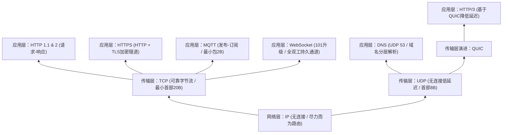

### **网络协议体系全局骨架**

---

### **一、 网络层基石：IP（互联网协议，Internet Protocol）**

#### **1. 核心定义**
* **定位**：互联网最底层基石（RFC 791，1981年由 DARPA 制定）。
* **IP 地址**：标识网络设备的唯一数字标签。
* **数据包（Packet）**：IP 将上层数据切分为独立传输的小数据块，每个数据包包含**首部（Header）**与**载荷**。

#### **2. 推导逻辑**
* **去中心化设计**：初衷为抵御单点故障的军事通信网 $\rightarrow$ 无中心控制节点 $\rightarrow$ 奠定现代互联网去中心化路由架构。
* **首部关键字段**：
  * **源 IP / 目的 IP**：标识发送端与接收端寻址方向。
  * **TTL（Time to Live，生存时间）**：限制数据包可经过的最大路由器跳数，归零即丢弃，防止路由环路死锁。
  * **校验和（Checksum）**：检测传输过程中的数据损坏。
* **地址耗尽与扩容演进**：
  * **IPv4**：32 位地址长度 $\rightarrow$ 最多约 43 亿（$2^{32}$）个地址 $\rightarrow$ 2011 年由 IANA（互联网号码分配局）分配殆尽。
  * **IPv6**：128 位地址长度 $\rightarrow$ 约 $3.4 \times 10^{38}$（340 涧 / Undecillion）个地址，彻底解决地址枯竭。

#### **3. 关键结论**
* **本质属性**：**无连接（Connectionless）**、**不可靠（Unreliable）**。
* **职责边界**：仅负责“尽力而为”地将数据包从源端路由至目的端；不保证送达、不保证顺序、不避免重复。一切可靠性均由上层协议（如 TCP）构建。

---

### **二、 传输层双核：TCP 与 UDP 的设计博弈**

#### **1. TCP（传输控制协议，Transmission Control Protocol）**
* **核心定义**：构建于 IP 之上的**面向连接、可靠、有序的字节流（Byte Stream）**传输协议（RFC 793）。
* **推导逻辑**：
  * **问题驱动**：IP 存在丢包、乱序、重复问题 $\rightarrow$ 金融交易、固件更新等场景要求零字节丢失 $\rightarrow$ 必须在 IP 之上引入可靠性控制。
  * **三大核心修补机制**：
    1. **连接握手（Handshake）**：数据传输前双方建立连接，确认就绪状态。
    2. **序列号（Sequencing）**：为字节流中的每个字节编号，接收端据此重组顺序并识别缺失。
    3. **确认与重传（ACK & Retransmission）**：接收端对每个报文段（Segment）发送确认；发送端超过**重传超时（RTO）**未收到确认则自动重发。
  * **两大流量治理机制**：
    1. **滑动窗口（Sliding Window）**：实现**流量控制（Flow Control）**，防止高速发送端淹没低速接收端。
    2. **拥塞控制算法（Congestion Control）**：检测到网络丢包时主动退避降速，缓解网络拥塞。
* **关键结论**：提供端到端绝对可靠、有序的字节流保障，代价是首部开销较大（**最小 20 字节**）且引入握手与重传延迟；是 HTTP、HTTPS、MQTT、WebSocket 等零容错协议的底层基石。

#### **2. UDP（用户数据报协议，User Datagram Protocol）**
* **核心定义**：构建于 IP 之上的**无连接、极简、低开销**数据报传输协议（RFC 768，1980年由 Jon Postel 制定）。
* **推导逻辑**：
  * **问题驱动**：TCP 的握手、确认、超时重传机制会引入显著延迟 $\rightarrow$ 实时交互场景中，等待旧数据重传会导致画面/语音严重卡顿，实时性优先级高于完整性。
  * **机制裁剪**：彻底剔除连接握手、序列号、ACK 确认、超时重传、流量控制与拥塞控制。
  * **极简封装**：仅包裹 **8 字节首部**（包含：**源端口、目的端口、长度、校验和**），直接发送且无需确认。
* **关键结论**：设计哲学为**“以容忍轻微缺陷换取极致速度（Accept imperfection for speed）”**；高并发下开销极低（如单次 DNS 查询用 UDP 仅需 2 个包，用 TCP 至少需 7 个包），主宰实时音视频、在线游戏及 DNS 查询场景。

#### **3. TCP 与 UDP 核心参数对比**

| 维度 | TCP（传输控制协议） | UDP（用户数据报协议） |
| :--- | :--- | :--- |
| **连接方式** | 面向连接（需握手） | 无连接（直接发送） |
| **可靠性机制** | 序列号排序、ACK确认、超时重传 | 无重传、无确认、不保序 |
| **流控与拥塞** | 滑动窗口流控 + 拥塞控制退避 | 无流量控制、无拥塞控制 |
| **最小首部开销** | **20 字节（Bytes）** | **8 字节（Bytes）** |
| **核心设计取向** | 数据绝对完整性优先 | 极低延迟与高吞吐优先 |

---

### **三、 域名寻址：DNS（域名系统，Domain Name System）**

#### **1. 核心定义**
* **定位**：将人类可读的**域名（Domain Name）**映射转换为机器可读的 **IP 地址**的分布式目录系统（互联网电话簿）。

#### **2. 推导逻辑**
* **分层递归/迭代解析链路**（全流程通常 $< 50\text{ ms}$）：
  $$\text{终端发起查询} \rightarrow \text{DNS 解析器（检查本地缓存）} \xrightarrow{\text{未命中}} \text{根域名服务器（Root Server）} \rightarrow \text{顶级域服务器（TLD Server）} \rightarrow \text{权威域名服务器（Authoritative Name Server，返回目标 IP）}$$
* **传输协议选择**：查询报文体积小、要求毫秒级响应 $\rightarrow$ 默认运行于 **UDP 端口 53**。
* **安全缺陷与演进**：传统 DNS 默认**明文传输** $\rightarrow$ 网络服务商（ISP）可嗅探用户访问的所有域名 $\rightarrow$ 催生 **DoH（DNS over HTTPS）**，将 DNS 查询封装进常规加密 Web 流量中以实现隐私保护。

#### **3. 关键结论**
* DNS 是互联网寻址的前置入口，以 UDP 53 端口实现超低延迟解析，现代安全演进方向为 DoH 加密化。

---

### **四、 应用层通信：从 Web 交互到物联网与实时全双工**

#### **1. HTTP（超文本传输协议，Hypertext Transfer Protocol）**
* **核心定义**：浏览器（客户端）与 Web 服务器之间通信的应用层标准语言（1989年由 Tim Berners-Lee 于 CERN 发明）。
* **推导逻辑**：
  * **请求-响应模型（Request-Response）**：客户端发送带动作语义的请求，服务端返回三位数状态码与资源。
  * **核心请求方法**：`GET`（获取资源）、`POST`（处理/提交数据）、`PUT`（更新资源）、`DELETE`（删除资源）。
  * **核心状态码分类**：`200`（成功）、`404`（资源未找到）、`500`（服务器内部错误）。
  * **性能瓶颈与代际演进**：
    * **HTTP/1.1**：单连接串行阻塞。
    * **HTTP/2（2015）**：引入**多路复用（Multiplexing）**，允许在单个 TCP 连接上并发传输多个请求。
    * **HTTP/3（2022）**：弃用 TCP，底层改用基于 UDP 的 **QUIC 协议**，大幅降低握手与弱网重传延迟（尤其优化移动网络）。
* **关键结论**：无状态、被动响应式协议；代际演进核心在于消除队头阻塞与降低传输层握手延迟。

#### **2. HTTPS（安全超文本传输协议，HTTP Secure）**
* **核心定义**：运行在由 **TLS（传输层安全协议）** 构建的加密隧道内的 HTTP 协议。
* **推导逻辑**：
  * **问题驱动**：原生 HTTP 全程明文传输 $\rightarrow$ 密码、支付信息等极易被中间人截获监听。
  * **TLS 握手三部曲（TLS Handshake）**：
    1. **身份认证**：通过数字证书（Digital Certificate）验证服务器真实身份，防伪冒。
    2. **密钥协商**：在不将密钥本身发送至网络的前提下，客户端与服务端安全协商出共享会话密钥（Shared Encryption Key）。
    3. **对称加密传输**：使用 **AES-256** 等高强度算法加密后续所有通信字节。
* **关键结论**：解决了明文窃听、篡改与伪装问题，目前已覆盖全球 85% 以上的 Web 流量，是处理用户数据的强制安全基线。

#### **3. MQTT（消息队列遥测传输，Message Queuing Telemetry Transport）**
* **核心定义**：专为高延迟、低带宽、不稳定网络及算力受限设备设计的极轻量级物联网（IoT）通信协议（1999年由 Andy Stanford-Clark 与 Arlen Nipper 创建）。
* **推导逻辑**：
  * **问题驱动**：HTTP 报头高达数百字节且要求点对点直接连接 $\rightarrow$ 无法适应极端弱网与微型传感器环境。
  * **发布-订阅模型（Publish-Subscribe）**：彻底解耦通信双方，设备之间**不直接通信**，全部通过中心节点 **代理服务器（Broker）** 中转：
    * **发布者（Publisher）**：将消息发送至 Broker 的特定主题。
    * **订阅者（Subscriber）**：向 Broker 订阅所需主题，仅接收关心的消息。
* **关键结论**：**最小数据包仅 2 字节（2 Bytes）**，凭借极低协议开销与发布-订阅解耦架构，成为物联网（IoT）与工业遥测领域的绝对标准。

#### **4. WebSocket（全双工实时通信协议）**
* **核心定义**：在单个 TCP 连接上提供**持久化、全双工（Full-Duplex）**双向实时通信通道的应用层协议（RFC 6455，2011年标准化）。
* **推导逻辑**：
  * **问题驱动**：HTTP 仅支持“客户端问、服务端答”，服务端无法主动推送数据 $\rightarrow$ 传统方案采用**轮询（Polling）**（客户端每秒定时发 HTTP 请求询问更新）$\rightarrow$ 造成极高延迟与大量无效请求浪费。
  * **协议升级机制（Protocol Upgrade）**：
    1. 借道标准 HTTP 请求发起连接，附带升级请求头（Upgrade）。
    2. 服务端返回状态码 **`101 Switching Protocols`（切换协议）**。
    3. 握手完成，底层连接转化为持久化的全双工双向通道，双方可随时主动收发数据。
* **关键结论**：彻底终结低效轮询，实现服务端**零延迟主动推送（Server Push）**，是实时聊天、行情交易、多人在线游戏与实时协同文档的核心底层协议。

---

### **参考来源**
- Techs Explained, *Every Network Protocol Explained in 12 minutes*（YouTube, 2026-03-31）：<https://www.youtube.com/watch?v=lCjhvtRngMs>
