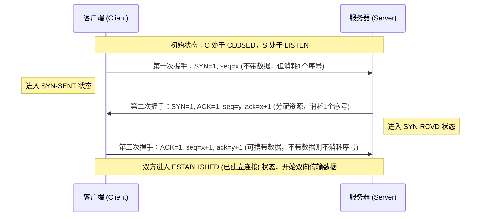
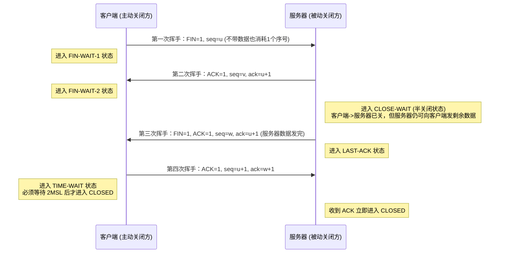
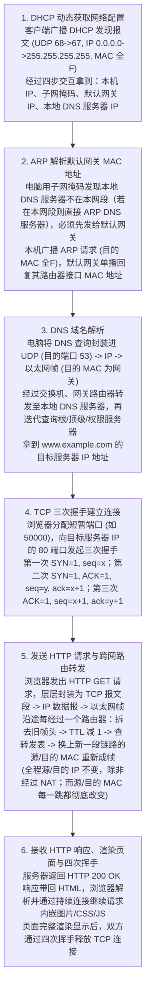

# 计算机网络速通

### **一、 计算机网络概述与交换技术**

#### **1. 基本概念与互联网结构**
计算机网络是用通信设备和线路将分布在不同地点、功能独立的多台计算机连接起来，从而实现**数据通信**和**资源共享**的系统，这两项也是计算机网络最基本的功能。我们日常使用的互联网是“网络的网络”（Network of Networks），即由许许多多的网络通过路由器互相连接而成的覆盖全球的大网。在术语区分上，小写的 `internet`（互连网）泛指由多个计算机网络互连而成的通用网络，而大写的 `Internet`（互联网/因特网）则专指当今全球最大、采用 TCP/IP 协议族的特定互联网。

从工作方式上看，互联网可以划分为两大块：**边缘部分**由所有连接在互联网上的主机（如手机、电脑、服务器）组成，由用户直接使用，用于进行通信和共享资源；**核心部分**则由大量的网络和连接这些网络的路由器组成，专门为边缘部分提供连通和交换服务。

边缘部分的主机之间主要有两种通信方式。第一种是**客户-服务器方式（C/S，Client/Server）**，客户是服务请求方，服务器是服务提供方，客户发请求、服务器给响应。第二种是**对等方式（P2P，Peer-to-Peer）**，通信双方没有固定的客户与服务器之分，每台主机既是客户也是服务器，典型应用如 BT 下载。

#### **2. 三种数据交换方式与原理**
网络核心部分最关键的功能是数据交换，主要分为电路交换、报文交换和分组交换三种方式：
1. **电路交换（Circuit Switching）**：工作原理类似传统打电话，通信前必须先建立一条专用的物理通路，整个通话期间一直独占该线路（哪怕双方不说话也不释放），通话结束后再拆除连接。它严格分为三个阶段：**建立连接 $\rightarrow$ 通话（通信） $\rightarrow$ 释放连接**。由于计算机数据具有突发性，采用电路交换会导致信道利用率极低。
2. **报文交换（Message Switching）**：基于存储转发原理，将整个要发送的报文完整地存下来，查表后再整体转发到下一个节点。它不需要建立专用连接，但单个报文往往很大，会长时间占用链路并在节点产生较大的存储转发时延。
3. **分组交换（Packet Switching）**：这是现代互联网所采用的核心交换方式。它将较长的报文切分成一个个较小的块，在每个数据块前面加上包含控制信息（如源地址、目的地址）的首部，构成分组（Packet）。各个分组采用**存储转发**机制，独立选择路由，各走各的路，到达目的主机后再去掉首部、重新组装还原成原来的报文。分组交换的优势是不独占线路、信道利用率高，且由于分组较小，多段链路上可以像流水线一样同时并行传送，总时延显著缩短；其代价则是每个分组都要额外携带首部造成开销，且分组在路由器中可能遇到排队等待，到达顺序也可能乱序。

#### **3. 关键例子与计算：分组交换时延公式**
当没有差错且忽略传播时延与首部开销时，若将一个大报文切分为 $n$ 个分组，经过 $k$ 段速率相同的链路（即经过 $k-1$ 个路由器），设单个分组在一段链路上的发送时延为 $t$，则总时延计算方法如下：
1. 第一个分组走完 $k$ 段链路全程需要 $k \times t$ 的时间；
2. 紧随其后的其余 $n-1$ 个分组由于流水线并行传输，每多一个分组只需在最后一段链路上多花一个发送时延 $t$；
3. **分组交换总时延通用公式**：

$$
T_{\text{总}} = (n + k - 1) \times t
$$

**视频典型例题**：要传送一个 $3\text{ Mb}$ 的报文，经过 $2$ 段链路（$k=2$），每段链路的数据率均为 $1\text{ Mb/s}$，忽略传播时延和首部开销。
- **若采用报文交换**：每段链路都需要把完整的 $3\text{ Mb}$ 全部发完才能转发下一段，每段耗时 $3\text{ s}$，两段总时延为 $3 + 3 = 6\text{ s}$。
- **若采用分组交换**：将报文切成 $3$ 个大小为 $1\text{ Mb}$ 的分组（$n=3$），每个分组的发送时延 $t = 1\text{ s}$。第 $1$ 个分组经过两段链路耗时 $2\text{ s}$ 到达终点，随后第 $2$、第 $3$ 个分组每隔 $1\text{ s}$ 到达一个，总时延为 $(3 + 2 - 1) \times 1\text{ s} = 4\text{ s}$。

#### **4. 网络的分类**
按覆盖范围可将网络分为四类：**广域网（WAN）**覆盖国家甚至全球，是互联网的核心主干；**城域网（MAN）**覆盖一座城市；**局域网（LAN）**覆盖一栋楼或一个校园；**个人区域网（PAN）**覆盖个人周边的极小范围，如手机与蓝牙耳机之间的连接。按拓扑结构则可分为总线型、星型、环形和网状结构。

---

### **二、 计算机网络的性能指标**

#### **1. 速率、带宽与吞吐量**
- **速率（数据率/比特率）**：每秒传送多少个比特，基本单位是 $\text{bit/s}$（或写作 $\text{bps}$）。
- **带宽（Bandwidth）**：在模拟信号系统中原本指信号具有的频率宽度，单位是赫兹（$\text{Hz}$）；而在计算机网络中，带宽用来表示一条链路在单位时间内所能达到的**最高数据率**，单位同样是 $\text{bit/s}$。
- **吞吐量（Throughput）**：单位时间内实际通过某个网络（或信道、接口）的数据量。吞吐量受网络带宽或网络额定速率的限制，往往远小于带宽。

#### **2. 四大时延与时延带宽积**
**时延（Delay）**是指数据从网络的一端传到另一端所需的总时间，由以下四部分相加组成：

$$
\text{总时延} = \text{发送时延} + \text{传播时延} + \text{处理时延} + \text{排队时延}
$$

1. **发送时延（传输时延）**：主机或路由器把一个分组的所有比特从头到尾全部推向通信链路所需的时间。计算公式为：

$$
\text{发送时延} = \frac{\text{数据帧长度（bit）}}{\text{发送速率（bit/s）}}
$$

2. **传播时延**：电磁波在信道介质中传播一定距离所花费的时间。计算公式为：

$$
\text{传播时延} = \frac{\text{信道长度（m）}}{\text{电磁波在信道上的传播速率（m/s）}}
$$

3. **处理时延**：主机或路由器收到分组后进行分析首部、提取数据、差错检验或查找转发表所花费的时间。
4. **排队时延**：分组在进入路由器后先在输入队列中排队等待处理，确定转发接口后又在输出队列中排队等待转发所经历的时间。

打个形象的比方，数据传送就像一支车队过高速收费站再开往下一个城市：收费站一辆接一辆放行完整个车队的时间就是**发送时延**，车在高速公路上行驶的时间就是**传播时延**。**提高链路带宽只是让收费站放行得更快（减小发送时延），并不会让车在高速路上跑得更快（不能减小传播时延）。**

- **时延带宽积**：把链路想象成一根圆柱形管道，传播时延是管道的长度，带宽是管道的粗细（横截面积），那么时延带宽积就是管道的容积，表示**链路上此刻正在路上跑的最大比特数**：

$$
\text{时延带宽积} = \text{传播时延} \times \text{带宽}
$$

- **往返时间（RTT，Round-Trip Time）**：从发送方发出数据开始，到发送方收到来自接收方的确认报文为止所经历的总时间。
- **利用率与时延的关系**：信道利用率并非越高越好，因为利用率越高，分组在路由器中遇到的排队时延就会急剧增大。设网络空闲时的时延为 $D_0$，当前网络利用率为 $U$（$0 \le U < 1$），则当前网络时延 $D$ 满足：

$$
D = \frac{D_0}{1 - U}
$$

当利用率 $U$ 接近 $1$ 时，网络时延 $D$ 会趋向无穷大。

#### **3. 关键例子与易错点**
**视频典型例题（主导时延对比）**：链路长 $1000\text{ km}$（即 $10^6\text{ m}$），电磁波在光纤中的传播速率为 $2 \times 10^8\text{ m/s}$。
- **场景一**：发送 $10^7\text{ bit}$ 的数据，链路数据率为 $100\text{ kb/s}$（即 $10^5\text{ bit/s}$）。此时发送时延 $= \frac{10^7}{10^5} = 100\text{ s}$，传播时延 $= \frac{10^6}{2 \times 10^8} = 0.005\text{ s} = 5\text{ ms}$，**发送时延占主导**。
- **场景二**：只发送 $1000\text{ bit}$ 的数据，速率提升到 $1\text{ Gb/s}$（即 $10^9\text{ bit/s}$）。此时发送时延 $= \frac{10^3}{10^9} = 1\ \mu\text{s}$，而传播时延依然是 $5\text{ ms}$，**传播时延占主导**。因此绝不能笼统地说哪种时延更大，必须结合具体数据量和带宽判断。

**高频易错点**：
- **单位进制换算陷阱**：在表示**网络速率/带宽**时，千（$\text{k}$）、兆（$\text{M}$）、吉（$\text{G}$）严格采用十进制，即 $1\text{ k} = 10^3$、$1\text{ M} = 10^6$、$1\text{ G} = 10^9$；而在表示**文件大小/存储容量**时，$\text{KB}$、$\text{MB}$、$\text{GB}$ 通常采用二进制，即 $1\text{ K} = 2^{10} = 1024$、$1\text{ M} = 2^{20}$、$1\text{ G} = 2^{30}$。此外注意区分大小写：$1\text{ Byte（字节，B）} = 8\text{ bit（比特，b）}$。
- **光纤传播常识**：电磁波在真空/自由空间的传播速度是 $3 \times 10^8\text{ m/s}$，而在铜线或光纤中的传播速度约为 $2 \times 10^8\text{ m/s}$（相当于在光纤里每传播 $1\text{ km}$ 耗时约 $5\ \mu\text{s}$）。

---

### **三、 计算机网络体系结构**

#### **1. 分层思想、协议与服务**
由于网络通信极为复杂，人们采用**分层（Layering）**的方法将庞大的通信问题拆解为若干局部问题。每一层只专注实现一部分功能，它通过使用下层所提供的服务，经过本层功能的增值后，再向上层提供更高级的服务。

- **网络协议（Protocol）**：为进行网络中的数据交换而建立的规则、标准或约定，即**同一层（对等层）**的通信双方必须共同遵守的通话规则。网络协议由三个核心要素组成：
  1. **语法（Syntax）**：数据与控制信息的结构或格式（例如首部占几个字节、每个字段占几位）。
  2. **语义（Semantics）**：需要发出何种控制信息，完成何种动作以及做出何种响应。
  3. **同步（Timing/Synchronization）**：事件实现顺序的详细说明（即先发什么、后发什么）。
- **协议与服务的区别（高频考点）**：**协议是“水平的”**，是控制两个对等实体进行通信的规则；**服务是“垂直的”**，是由下层向上层通过层间接口——即**服务访问点（SAP，Service Access Point）**提供的功能调用。下层的协议对于上层而言是完全透明的（不可见的），上层只能看见下层提供的服务，并不关心下层用什么协议实现了该服务。

#### **2. 三种分层体系模型与各层职能**
1. **OSI 七层参考模型**：由国际标准化组织（ISO）提出，自下而上依次为：**物理层、数据链路层、网络层、传输层、会话层、表示层、应用层**。它理论完整但过于庞大复杂，最终未在商业市场上流行起来（所谓法律上的国际标准）。
2. **TCP/IP 四层体系结构**：实际广泛应用的事实上的国际标准，只有四层：**网络接口层、网际层（IP 层）、传输层（运输层）、应用层**。TCP/IP 体系呈现经典的**“沙漏型（Hourglass）”结构**：最顶层可以有各种各样的应用协议，最底层可以兼容各种各样的物理网络技术，而中间腰部全都汇聚通过唯一的 **IP 协议**。网络层向上只提供简单灵活、无连接、尽最大努力交付的数据报服务，而复杂的端到端可靠性则交由端系统的传输层（TCP）去保证。
3. **五层教学模型**：综合了 OSI 和 TCP/IP 的优点，自下而上各层的核心职能、协议数据单元（PDU）及工作设备总结如下表：

| 层次名称 | 核心职能 | 协议数据单元（PDU） | 典型协议 | 最高实现到该层的设备 |
| :--- | :--- | :--- | :--- | :--- |
| **应用层** | 直接为用户的应用进程提供服务 | **报文**（Message） | HTTP、DNS、FTP、SMTP | 端系统（主机、服务器） |
| **传输层** | 负责两台主机中**进程与进程**之间的端到端逻辑通信 | TCP 叫**报文段**（Segment）；UDP 叫**用户数据报** | TCP、UDP | 端系统（主机、服务器） |
| **网络层** | 把分组从源主机跨越多个网络和路由器送到目的主机（**主机到主机**） | **IP 数据报**（Datagram）或**分组**（Packet） | IP、ICMP、ARP、OSPF、BGP | **路由器**（Router） |
| **数据链路层** | 在相邻节点的**一段链路**上传送帧（提供差错检测；可靠传输仅为可选功能，见数据链路层章节） | **帧**（Frame） | PPP、Ethernet（以太网）、CSMA/CD | **交换机**（Switch）、网桥 |
| **物理层** | 在物理传输介质上透明地传送原始比特流 | **比特**（Bit） | 曼彻斯特编码、RJ-45 接口标准 | **集线器**（Hub）、**中继器** |

#### **3. 封装与解封装过程**
当发送方从上往下发送数据时，每经过一层，该层就会在数据前面加上本层的控制信息——**首部（Header）**；特别地，**数据链路层不仅要加首部，还要在末尾加上一个尾部（Trailer，即帧检验序列 FCS）**，这一层层套信封的过程称为**封装（Encapsulation）**。接收方收到物理层的比特流后，自下而上一层层剥去对应的首部（和尾部），还原数据并向上递交，这一过程称为**解封装（Decapsulation）**。

---

### **四、 物理层**

#### **1. 物理层特性、传输介质与交互方式**
物理层的任务是解决如何在各种传输介质上传输原始比特流，并向上层屏蔽具体传输介质和通信手段的差异。为此，物理层规定了与传输介质接口的**四大特性**：
1. **机械特性**：指明接口所用接线器的形状和尺寸、引脚数目和排列、固定和锁定装置等。
2. **电气特性**：指明在接口电缆的各条线上出现的电压的范围、高低电平的定义。
3. **功能特性**：指明某条线上出现的某一电平的电压表示何种意义。
4. **过程特性**：指明对于不同功能的各种可能事件的出现顺序。

**传输介质**分为两大类：
- **导引型传输介质**：电磁波沿着固体媒体传播，包括**双绞线**（绞合以抵消电磁干扰，分屏蔽 STP 和非屏蔽 UTP）、**同轴电缆**以及**光纤**。光纤具有带宽极大、损耗极小、抗电磁干扰极强的优点，按传输模式又分为**多模光纤**（多条光线反射前进，易色散，适合近距离）和**单模光纤**（纤芯极细，光线直线前进无反射，适合长距离高速传输）。
- **非导引型传输介质**：指自由空间，包括无线电波、微波、红外线和可见光等。

**通信双方的交互方式**分为三种：
1. **单工通信（Simplex）**：只能有一个方向的通信而没有反方向的交互，如无线电广播、电视广播。
2. **半双工通信（Half-Duplex）**：通信的双方都可以发送和接收信息，但任何一方都不能同时发送和接收，如对讲机。
3. **全双工通信（Full-Duplex）**：通信的双方可以同时发送和接收信息，如打电话、交换式全双工以太网。

#### **2. 码元、波特率与信道极限容量两大定理**
- **码元（Symbol）**：在使用时间域的波形表示数字信号时，代表不同离散数值的基本波形（一个固定时长的信号波形）称为码元。
- **波特率（Baud Rate / 码元传输速率）**：每秒钟通过信道传送的码元个数，单位是**波特（Baud）**。
- **波特率与比特率的关系**：如果一个码元有 $V$ 种不同的离散状态（电平/相位组合），那么每一个码元就能携带 $\log_2 V$ 个比特的信息量。设波特率为 $M$ Baud，则比特率（信息传输速率）为：

$$
\text{比特率（bit/s）} = M \times \log_2 V
$$

**信道极限数据率两大核心定理**：
1. **奈奎斯特定理（奈氏准则，针对理想无噪声信道）**：在假定的理想低通（没有噪声、带宽受限）信道中，为了避免**码间串扰**，极限码元传输速率为 $2W\text{ Baud}$，其中 $W$ 是信道的频率带宽（单位为 $\text{Hz}$）。若一个码元携带 $\log_2 V$ 比特，则无噪声信道的极限数据传输速率为：

$$
C_{\text{Nyquist}} = 2W \log_2 V \quad (\text{单位：bit/s})
$$

2. **香农定理（针对有高斯白噪声的信道）**：在受随机热噪声干扰的信道中，信道的极限信息传输速率 $C$ 为：

$$
C_{\text{Shannon}} = W \log_2 \left(1 + \frac{S}{N}\right) \quad (\text{单位：bit/s})
$$

其中 $W$ 为信道带宽（$\text{Hz}$），$\frac{S}{N}$ 为信道内所传信号的平均功率与高斯噪声功率之比，即**信噪比（无量纲比值）**。在实际题目中，信噪比常以**分贝（$\text{dB}$）**形式给出，换算公式为：

$$
\text{信噪比（dB）} = 10 \log_{10}\left(\frac{S}{N}\right)
$$

例如，当题目给出信噪比为 $30\text{ dB}$ 时，必须先还原为无量纲比值：$\frac{S}{N} = 10^{30/10} = 10^3 = 1000$，再代入香农公式计算。

**视频典型例题与易错点**：
- **例题**：带宽 $W = 3000\text{ Hz}$ 的电话信道，信噪比为 $30\text{ dB}$（即 $\frac{S}{N} = 1000$）。按香农定理，其极限数据率 $C = 3000 \times \log_2(1 + 1000) \approx 3000 \times 10 = 30\text{ kb/s}$。若它是无噪声信道，且每个码元有 $V = 16$ 种状态，则按奈奎斯特定理，极限数据率为 $2 \times 3000 \times \log_2 16 = 6000 \times 4 = 24\text{ kb/s}$。
- **高频考点与易错点**：如果一道题中**同时给出了码元状态数 $V$ 和信噪比 $\text{dB}$**，要求信道的最大实际数据率，必须分别用奈奎斯特定理和香农定理算出两个值，**最终结果取两者中较小的那一个**（$\min(C_{\text{Nyquist}}, C_{\text{Shannon}})$）。奈奎斯特定理限制的是码元速率上限，通过多元编码让每个码元携带更多比特可以提高速率；但香农定理给出了信息论上的绝对物理上限，无论采用多么高级的编码手段都绝对无法突破香农极限。

#### **3. 编码与调制技术**
将数字数据转换为数字信号称为**编码（基带传输）**，常见编码方式包括：
- **不归零制编码（NRZ）**：正电平代表 $1$，负电平（或低电平）代表 $0$。原理最简单，但因为没有检错和同步机制，当出现一长串连续的 $1$ 或连续的 $0$ 时，信号没有电平跳变，接收方无法从中提取同步时钟信号。
- **曼彻斯特编码（Manchester Encoding）**：**每一位的周期正中间都有一次电平跳变**。位中间的跳变既作为时钟信号（可用于同步），又作为数据信号（例如约定中间向下跳变表示 $1$，向上跳变表示 $0$，或者相反）。**传统 $10\text{ Mb/s}$ 以太网采用的就是曼彻斯特编码。**
- **差分曼彻斯特编码**：每一位中心处始终都有一次跳变，但该中心跳变仅用来提供时钟同步；真正代表数据 $0$ 或 $1$ 的是**每一位开始边界处是否有跳变**：位开始边界**有跳变表示 $0$，没有跳变表示 $1$**。
- **高频易错点**：曼彻斯特编码和差分曼彻斯特编码虽然自带时钟同步能力，但因为每传送 $1\text{ bit}$ 的数据都必须在中间发生跳变（相当于要用两个相反电平的码元来表示一个比特），所以它们的**码元传输速率（波特率）是数据比特率的 $2$ 倍，编码效率只有 $50\%$**。例如，在 $10\text{ Mb/s}$ 的传统以太网中，比特率是 $10\text{ Mbit/s}$，而信道的波特率高达 $20\text{ MBaud}$。

将数字数据转换为模拟信号称为**调制（频带传输）**，基本调制方法有：
- **调幅（ASK）**：用载波的不同振幅表示 $0$ 和 $1$。
- **调频（FSK）**：用载波的不同频率表示 $0$ 和 $1$。
- **调相（PSK）**：用载波的不同初始相位表示 $0$ 和 $1$。
- **正交振幅调制（QAM）**：将振幅（ASK）和相位（PSK）结合起来同时调制，形成星座图。例如 **16-QAM** 共有 $16$ 种振幅与相位的组合状态，每个码元可携带 $\log_2 16 = 4\text{ bit}$ 数据。

#### **4. 物理层设备**
物理层有两种核心设备：**中继器（Repeater，转发器）**的作用是将衰减变形的信号进行再生整形和放大，从而延长网络传输距离；**集线器（Hub）**本质上就是一个多端口的中继器。它们只认识比特流，不认识数据帧和 MAC 地址，收到信号后只是无脑向其他所有端口广播放大。因此，**用集线器连接起来的所有主机全都处于同一个冲突域（碰撞域）内**，且同一时刻只能有一台主机发送数据，共享集线器的总带宽。

---

### **五、 数据链路层：成帧、差错检测与可靠传输**

#### **1. 基本概念与三个基本问题**
- **链路（Link）**是一条无源的点到点的物理线路段，中间没有任何其他的交换节点；**数据链路（Data Link）**则是物理链路再加上实现通信协议所必需的硬件（如网络适配器/网卡）和软件。数据链路层的协议数据单元是**帧（Frame）**。
- 数据链路层需要解决三个最基本的问题：**封装成帧、透明传输、差错检测**。

##### **（1）封装成帧与透明传输**
**封装成帧**就是在一段网络层传下来的数据前后分别添加首部和尾部，构成一个完整的帧，其核心作用是**帧定界**（让接收方能从一连串比特流中准确识别出一帧的开始和结束）。同时，每一种链路层协议都规定了帧的数据部分的长度上限——即**最大传送单元（MTU，Maximum Transfer Unit）**，例如标准以太网的 $\text{MTU} = 1500\text{ 字节}$。

**透明传输**是指无论所传数据是什么样的比特组合，都应当能够在链路上传输，不会因为数据中恰好出现了与帧定界符相同的二进制代码而导致接收方误判帧提前结束。根据链路类型不同，实现透明传输有两种填充方法：
1. **字节填充法（字符填充法，面向字节的异步链路，如异步 PPP）**：用特定控制字符 `SOH`（Start Of Header）标记帧开始，用 `EOT`（End Of Transmission）标记帧结束。如果数据部分恰好出现了 `EOT` 或 `SOH`，发送方就在该控制字符前插入一个转义字符 `ESC`；如果数据中本来就有 `ESC`，也在其前面再插入一个 `ESC`。接收方收到后删掉人为插入的 `ESC` 即可还原原始数据。
2. **零比特填充法（面向比特的同步链路，如 HDLC 和同步 PPP）**：使用固定的比特模式 `01111110`（即十六进制的 `0x7E`，中间有连续 $6$ 个 $1$）作为帧的开始和结束定界符。为了防止数据内部出现 `01111110`，**发送方在扫描数据部分时，每遇到连续 $5$ 个 $1$，就无条件立即在其后插入一个 $0$**；**接收方在收到帧后，每遇到连续 $5$ 个 $1$，就把紧跟其后的那个 $0$ 删除**。这样就绝对保证了数据部分不会出现连续 $6$ 个 $1$。

##### **（2）差错检测：奇偶校验、CRC 循环冗余检验与海明码**
比特在传输过程中可能产生比特差错（$1$ 变成 $0$，或 $0$ 变成 $1$）。
- **奇偶校验码**：在数据后面添加 $1$ 位奇偶校验位，使整个码字（含数据位和校验位）中 $1$ 的总个数为奇数（奇校验）或偶数（偶校验）。**局限性**：只能检测出奇数个比特的错误，如果同时有偶数个比特发生翻转，奇偶性不变，无法检测出错误。
- **循环冗余检验（CRC，Cyclic Redundancy Check）**：数据链路层最广泛采用的检错技术。
  - **计算步骤**：
    1. 收发双方事先约定一个生成多项式 $P(x)$（对应二进制除数 $P$），设该生成多项式的**最高次幂为 $r$**（则对应的二进制除数共有 $r+1$ 位）。
    2. 发送方在待发送的 $k$ 位原始数据后面**补上 $r$ 个 $0$**，使其变为 $k+r$ 位。
    3. 用这个补零后的数除以二进制除数 $P$，进行**模 2 除法**（即每一步做异或 $\oplus$ 运算，不进位也不借位，最高位为 $1$ 则商 $1$，最高位为 $0$ 则商 $0$）。
    4. 除法最终得到的 **$r$ 位余数**就是**帧检验序列（FCS，Frame Check Sequence）**（注意余数必须固定为 $r$ 位，前面的 $0$ 不能省略）。
    5. 将这 $r$ 位余数 FCS 替换掉刚才补的 $r$ 个 $0$，附在原始数据后面一起发送出去。
    6. 接收方把收到的整串带 FCS 的数据除以同一个生成多项式 $P$ 进行模 2 除法：若**余数为 $0$**，则判定该帧没出错，予以接收；若**余数不为 $0$**，则判定该帧出错，直接丢弃。
  - **视频典型例题**：要发送的数据 $M = 101001$，生成多项式为 $P(x) = x^3 + x^2 + 1$。
    - 第一步：将多项式转化为二进制串，$x^3 + x^2 + 0 \cdot x^1 + 1 \cdot x^0 \rightarrow P = 1101$，最高次幂 $r = 3$。
    - 第二步：在数据 $101001$ 后面补 $3$ 个 $0$，得到被除数 `101001000`。
    - 第三步：将 `101001000` 与 `1101` 进行模 2 除法（异或运算），算出 $3$ 位余数（FCS）为 `001`。
    - 第四步：实际发送的帧数据为 `101001001`。
- **海明码（Hamming Code）**：CRC 只能检错不能纠错，若要实现前向纠错（FEC），可使用海明码。设数据位有 $k$ 位，校验位有 $r$ 位，要能纠正一位比特错，校验位数 $r$ 必须满足海明不等式：

$$
2^r \ge k + r + 1
$$

例如，$4$ 位数据（$k=4$）代入公式得 $2^r \ge 4 + r + 1$，解得至少需要 $r = 3$ 位校验位。不过在现代计算机网络中，光纤等介质误码率很低，纠错编码开销太大，因此数据链路层通常**只做 CRC 检错，发现出错直接丢弃，依靠上层或确认重传机制恢复**。

**高频易错点**：CRC 循环冗余检验只能做到**“无差错接受”**（即凡是被数据链路层接收的帧，我们以极高概率认为它在传输中没有产生差错），但它**不等于“可靠传输”**，因为出错的帧被直接丢弃了，CRC 本身既不负责纠错，也不包含编号、确认和重传机制。同样，点对点链路常用的 **PPP 协议**（以 `0x7E` 开头和结尾，异步链路用字节填充，同步链路用零比特填充）也只做 CRC 检错、不纠错、无序号和确认，**不提供可靠传输**。

---

#### **2. 可靠传输机制与滑动窗口协议（ARQ）**
为了在丢弃出错帧后依然保证数据不丢不乱，必须引入**确认（ACK）+ 超时重传**机制，这类协议统称为**自动重传请求（ARQ，Automatic Repeat reQuest）**。

##### **（1）停止-等待协议（Stop-and-Wait）**
- **工作原理**：发送方每发送完一帧就立刻停下来，启动超时计时器，等待接收方发回确认帧（ACK），只有收到确认后才发送下一帧（发送窗口 $W_T = 1$，接收窗口 $W_R = 1$）。
- **异常情况处理**：
  1. **数据帧出错或丢失**：接收方丢弃错帧且不发回确认，发送方超时计时器到期后自动重传该帧。为此，发送方必须保留已发送帧的副本，且超时时间应设置得略大于一个往返时间 RTT。
  2. **确认帧（ACK）丢失或迟到**：发送方因未按时收到 ACK 而超时重传，导致接收方收到两份相同的帧。为了识别重复帧，必须给每个帧加上**序号**（由于停等协议一次只发一帧，只需用 **$1$ 位二进制数**即 `0` 和 `1` 交替编号即可）。接收方发现收到重复帧时，**将其丢弃，但必须再次向发送方回送一次确认 ACK**。
- **信道利用率计算**：设发送方发送一帧数据的发送时延为 $T_D$，信号往返传播时延为 $\text{RTT}$，接收方发送确认帧的发送时延为 $T_A$（若确认帧极短常可忽略 $T_A$），则停止-等待协议的信道利用率 $U$ 为：

$$
U = \frac{T_D}{T_D + \text{RTT} + T_A}
$$

- **视频典型例题**：帧长 $1000\text{ bit}$，链路数据率 $1\text{ Mb/s}$，单程传播时延 $10\text{ ms}$，忽略确认帧发送时间和处理时间。则发送时延 $T_D = \frac{1000\text{ bit}}{10^6\text{ bit/s}} = 1\text{ ms}$，往返时间 $\text{RTT} = 2 \times 10\text{ ms} = 20\text{ ms}$。信道利用率 $U = \frac{1}{1 + 20} = \frac{1}{21} \approx 4.76\% < 5\%$，绝大部分时间信道都在空等。

##### **（2）后退 N 帧协议（GBN，Go-Back-N）**
为了提高信道利用率，采用流水线传输，允许发送方在未收到确认前连续发送落在发送窗口内的多个帧。
- **核心特征**：发送窗口 $W_T > 1$，**接收窗口 $W_R = 1$**。因为接收窗口只有 $1$，**接收方只能严格按序接收数据帧**。
- **累计确认机制**：接收方不必对收到的每一帧都逐个发确认，而是可以对按序到达的最后一个帧发送累计确认。例如接收方回复 `ACK 2`，代表 **$2$ 号帧及以前的所有帧都已经正确按序收到**。（注：这是链路层滑动窗口协议常用的约定；TCP 的确认号含义与此不同——TCP 的 `ack = n` 表示“期望收到序号为 $n$ 的字节”。）
- **重传策略（为什么叫后退 N 帧）**：一旦中间某一帧（如 $3$ 号帧）丢失或出错，即使它后面紧跟着发来的 $4$、$5$、$6$ 号帧全都完好无损地到达了接收方，由于接收方接收窗口为 $1$ 且当前只期待 $3$ 号帧，接收方也会**把失序到达的 $4$、$5$、$6$ 号帧全部直接丢弃**，并重复发送对已按序收到的最后一帧的确认（如 `ACK 2`）。发送方超时后，必须回退到丢失的 $3$ 号帧，**从 $3$ 号帧开始把后面已发送过的帧全部重传一遍**。
- **窗口大小上限**：若采用 $n$ 比特对帧进行编号（序号范围 $0 \sim 2^n - 1$），则 GBN 的发送窗口大小必须满足：

$$
1 \le W_T \le 2^n - 1, \quad W_R = 1
$$

例如用 $3$ 位二进制编号（序号 $0 \sim 7$），发送窗口最大只能是 $2^3 - 1 = 7$。如果把发送窗口设为 $8$，当发出的 $0 \sim 7$ 号共 $8$ 个帧的确认全部在路上丢失时，发送方超时重传旧的 $0$ 号帧，而此时接收方的接收窗口已经滑动到了期待下一轮新的 $0$ 号帧，接收方将无法区分收到的 $0$ 号帧究竟是重传的旧帧还是下一轮的新帧。

##### **（3）选择重传协议（SR，Selective Repeat）**
为了克服 GBN 因一帧丢失而连带重传后面一大批正确帧的浪费，选择重传协议（SR）扩大了接收窗口。
- **核心特征**：发送窗口 $W_T > 1$，**接收窗口 $W_R > 1$**。
- **逐帧确认与失序缓存**：当中间某一帧丢失时，后面紧跟着到达的序号落在接收窗口内的失序正确帧**不会被丢弃，而是先缓存在接收方缓存中**。接收方采用**逐帧单独确认**（收到哪一帧就单独确认哪一帧），发送方超时后**只单独重传真正丢失的那一帧**。待丢失帧补齐后，接收方将连成一片的按序帧一并交付上层，并向前滑动接收窗口。
- **窗口大小上限**：若用 $n$ 比特对帧编号，为了避免新旧序号重叠混淆，SR 协议的发送窗口与接收窗口之和不能超过总序号空间，且通常令两者相等：

$$
W_T + W_R \le 2^n \quad \text{（通常取 } W_T = W_R = 2^{n-1} \text{）}
$$

##### **（4）三种滑动窗口协议对比与例题**

| 协议名称 | 发送窗口 $W_T$（$n$ 位序号） | 接收窗口 $W_R$ | 确认方式 | 失序帧处理与重传策略 |
| :--- | :--- | :--- | :--- | :--- |
| **停止-等待（SW）** | $W_T = 1$ | $W_R = 1$ | 逐帧确认 | 发一帧等一帧，超时重传当前帧 |
| **后退 N 帧（GBN）** | $1 < W_T \le 2^n - 1$ | $W_R = 1$ | **累计确认** | 丢弃所有失序帧，超时后从丢失帧起**全部重传** |
| **选择重传（SR）** | $W_T \le 2^{n-1}$（且 $W_T + W_R \le 2^n$） | $W_R \le 2^{n-1}$ | **逐帧单独确认** | **缓存**窗口内失序帧，只单独重传丢失帧 |

- **视频典型例题**：用 $4$ 位序号（$0 \sim 15$）编号，发送方连续发送了 $0 \sim 6$ 号共 $7$ 个帧，其中 $3$ 号帧丢失，其余帧均正确到达。
  - **若采用 GBN**：接收方按序接收 $0, 1, 2$ 号帧，当 $4, 5, 6$ 号帧到达时因失序被全部丢弃，只确认到 $2$ 号帧；发送方超时后需要重传 **$3, 4, 5, 6$ 号共 $4$ 个帧**。
  - **若采用 SR**：接收方接收 $0, 1, 2$ 号帧并向上交付，同时将失序到达的 $4, 5, 6$ 号帧缓存在接收窗口内并分别发送单独确认；发送方只需重传 **$3$ 号这 $1$ 个帧**。
- **流水线协议信道利用率通用公式**：若一个发送周期（$T_D + \text{RTT} + T_A$）内发送方可以连续发出 $N$ 个帧（受窗口大小 $W_T$ 限制），则信道利用率为：

$$
U = \frac{N \times T_D}{T_D + \text{RTT} + T_A} \quad (\text{若计算结果} > 1 \text{，则取 } U = 100\%)
$$

---

### **六、 介质访问控制（MAC）、以太网与交换机**

#### **1. 介质访问控制（MAC）三大类方法**
在局域网等广播信道中，多台主机共享同一条公共信道，若两台主机同时发送信号就会在信道上叠加产生碰撞（冲突）。介质访问控制（Medium Access Control，MAC）就是要解决“谁在什么时候能够使用信道发送数据”的问题，主要分为三类方案：

##### **（1）信道划分介质访问控制（静态复用）**
将共享信道的频率、时间、波长或码片空间预先划分给不同用户，从根本上避免冲突：
- **频分复用（FDM）**：将信道总频带划分为多个互不重叠的子频带，每个用户在全部时间内独占一个子频带。
- **时分复用（TDM）**：将时间划分为一段段等长的时分复用帧（TDM 帧），每个用户在每个 TDM 帧中固定占用某一个时隙。**缺点**：当某个用户暂时没有数据要发时，分配给他的固定时隙只能空置，其它用户也无法使用，导致信道利用率低。**统计时分复用（STDM）**对此进行了改进，不再固定分配时隙，而是按需动态分配时隙，显著提高了利用率。
- **波分复用（WDM）**：本质上就是光信号的频分复用（在一根光纤中同时传输多种不同波长的光载波）。
- **码分多址（CDMA，Code Division Multiple Access）**：允许所有站点在**同一时间、使用同一频带**同时进行通信。
  - **CDMA 原理与计算步骤（高频必考）**：
    1. 系统给每个站点指派一个唯一的、长度为 $m$ 位（通常为 $8$ 位）的**码片序列（Chip Sequence）**，码片中的 $0$ 改写为 $-1$，$1$ 写为 $+1$。不同站点的码片序列必须满足**两两正交**，即任意两个不同站点的码片向量 $S$ 和 $T$ 的**规格化内积（对应位元素相乘再求和，最后除以位数 $m$）严格等于 $0$**，而任何一个码片向量与自身的规格化内积等于 $+1$，与自身反码的规格化内积等于 $-1$。
    2. **发送规则**：站点如果要发送比特 `1`，就发送自己的原码片序列 $S$；如果要发送比特 `0`，就发送该码片序列的反码 $-S$（即将 $+1$ 与 $-1$ 全部取反）；如果不发送数据，则不发信号（全 $0$）。
    3. **信道叠加与接收解码**：当多个站点同时发送时，信号在公共信道上按位线性相加得到叠加信号向量 $X$。接收方若想判断某个站点 $S$ 发送了什么比特，只需计算**站点 $S$ 的码片序列与收到的总叠加信号 $X$ 的规格化内积**：

$$
S \cdot X = \frac{1}{m} \sum_{i=1}^{m} S_i X_i = \begin{cases} +1, & \text{表示该站发送了比特 } 1 \\ -1, & \text{表示该站发送了比特 } 0 \\ 0, & \text{表示该站没有发送数据} \end{cases}
$$

##### **（2）随机访问介质访问控制（动态争用）**
所有站点都可以根据自己的意愿随时随机发送数据，若发生冲突再按规则解决：
- **ALOHA 协议**：纯 ALOHA 协议是“想发就发”，发生冲突后再超时重传（最大吞吐量约 $18.4\%$）；时隙 ALOHA 则把时间分成时隙，只能在每个时隙开始处发送，易受冲突期缩短一半，最大吞吐量提高一倍（约 $36.8\%$）。
- **CSMA（载波监听多路访问）**：发送前先监听信道，信道空闲才发送。
- **CSMA/CD（带碰撞检测的载波监听多路访问，传统总线以太网核心协议）**：
  - **16 字核心口诀**：**先听后发，边发边听，冲突停发，随机重发**。
  - **为什么“先听后发”依然会发生碰撞？** 因为电磁波在信道上传播需要时间（传播时延 $\tau$）。假设主机 A 监听到信道空闲并开始发帧，在信号还没有传到远端主机 B 的这段时间里，B 去监听信道也会误以为信道空闲从而开始发帧，结果两股信号就会在半路相撞。
  - **争用期（碰撞窗口）与最短帧长推导**：设局域网两端的单程端到端传播时延为 $\tau$。极端情况下，A 发出的信号快要到达 B 的前一瞬间 B 刚开始发送，碰撞产生的叠加干扰信号再传回 A，A 最多需要经过 **$2\tau$（两倍单程端到端传播时延）** 才能检测到自己发送的数据发生了碰撞。这段 $2\tau$ 的时间就称为**争用期（Contention Period）**或**碰撞窗口**。如果 A 发送的帧太短，在 $2\tau$ 之内就已经把整帧全部发送完毕了，那么当碰撞信号在 $2\tau$ 时刻传回 A 时，A 已经停止发送并停止监听了，就会漏检这次碰撞。因此，为了确保发送方在帧发送完毕前一定能检测到可能发生的碰撞，**每一帧的发送时延必须大于等于争用期 $2\tau$**，由此得出**最短帧长计算公式**：

$$
\text{最短帧长（bit）} = 2\tau \times \text{数据传输速率（bit/s）} = 2 \times \frac{\text{链路长度}}{\text{传播速率}} \times \text{数据率}
$$

  - **传统以太网规定**：$10\text{ Mb/s}$ 以太网将争用期 $2\tau$ 规定为 $51.2\ \mu\text{s}$，代入公式可得最短帧长为 $51.2\ \mu\text{s} \times 10\text{ Mbit/s} = 512\text{ bit} = 64\text{ 字节}$。凡是长度小于 $64\text{ 字节}$ 的帧都是由于冲突而异常中止的无效碎片帧。
  - **视频典型例题**：一段长 $1000\text{ m}$（$1\text{ km}$）的电缆，数据率为 $1\text{ Gb/s}$（$10^9\text{ bit/s}$），信号传播速率为 $2 \times 10^5\text{ km/s}$。求最短帧长。
    - 解：单程传播时延 $\tau = \frac{1\text{ km}}{2 \times 10^5\text{ km/s}} = 5\ \mu\text{s}$；争用期 $2\tau = 10\ \mu\text{s} = 10^{-5}\text{ s}$；最短帧长 $= 10^{-5}\text{ s} \times 10^9\text{ bit/s} = 10000\text{ bit}$。
  - **截断二进制指数退避算法**：一旦检测到冲突，站点立即停止发送并发送人为拥塞信号，随后推迟一个随机时间再重传。设当前是第 $k$ 次重传，令 $k = \min(\text{重传次数}, 10)$（即 $k$ 最大只取到 $10$），从离散整数集合 $\{0, 1, 2, \dots, 2^k - 1\}$ 中随机取出一个数记为 $r$，则站点需要等待 **$r \times 2\tau$（$r$ 倍的争用期）** 后再重新监听发送。如果连续重传达到 **$16$ 次** 仍不成功，则直接丢弃该帧并向上层报告出错。
- **CSMA/CA（带碰撞避免的载波监听多路访问，用于 802.11 无线局域网 Wi-Fi）**：
  - **为什么无线网不用 CSMA/CD？** 一是因为无线信号衰减极快，本地发射信号强度远大于远端碰撞信号，很难做到“边发边检测碰撞”；二是因为无线网存在**隐蔽站（隐藏终端）问题**（A 和 C 都在 AP 的覆盖范围内但彼此听不到对方）。
  - **工作原理**：采用帧间间隔（IFS）和随机退避来尽量避免碰撞。即使监听到信道空闲，发送方也要先等待一个较长的**分布式协调帧间间隔（DIFS）**，然后再进入随机退避倒计时，倒计时归零才发送数据帧。接收方正确收到数据帧后，只需等待一个极短的**短帧间间隔（SIFS，优先级最高）** 就必须立即回复 **`ACK` 确认帧**（无线局域网要求**逐帧确认**）。此外，为了解决隐蔽站问题，发送方还可以在发数据前先广播极短的 **`RTS`（请求发送）帧**，AP 收到后广播 **`CTS`（允许发送）帧** 来预约信道，其他主机收到后在指定时间内保持静默（网络分配向量 NAV）。

##### **（3）轮询访问介质访问控制**
典型代表是**令牌环网（Token Ring）**，一个特殊的“令牌（Token）”帧沿着环形网络依次传递，只有拿到令牌的站点才有权发送一帧数据，发完后释放令牌传给下一站，因此在高负载下也绝不会发生碰撞。

---

#### **2. 以太网、MAC 地址与以太网交换机**

##### **（1）MAC 地址与以太网 V2 帧格式**
- **MAC 地址（物理地址/硬件地址）**：固化在每块网卡 ROM 中的全球唯一标识符，长度为 **$48$ 位（$6$ 字节）**，通常表示为 $6$ 组两位十六进制数（如 `00-1A-2B-3C-4D-5E`）。前 $24$ 位是向 IEEE 注册的组织唯一标识符（厂商代码 OUI），后 $24$ 位由厂商自行指派。**全 $1$ 的 MAC 地址（`FF-FF-FF-FF-FF-FF`）是链路层广播地址**。
- **以太网 V2 的 MAC 帧格式**：
  1. **目的地址（6 字节）**：放在最前面，以便网卡一收到前 $6$ 个字节就能立刻判断该帧是不是发给自己的，不是就马上丢弃，节省处理开销。
  2. **源地址（6 字节）**：发送方网卡的 MAC 地址。
  3. **类型（2 字节）**：标志上一层使用的是什么协议，以便将剥去帧头的数据上交（例如 `0x0800` 表示上层是 IP 数据报，`0x0806` 表示 ARP 报文）。
  4. **数据字段（46 \~ 1500 字节）**：网络层传下来的 IP 数据报。
  5. **帧检验序列 FCS（4 字节）**：采用 CRC 校验的余数。
  - *注：物理层在发送以太网帧时，还会在帧的最前面额外插入 $8$ 字节（$7$ 字节前同步码 + $1$ 字节帧开始定界符），用于接收方时钟同步，但这 $8$ 字节不属于 MAC 帧本身的长度。*
- **高频考点（以太网帧长计算）**：以太网规定最短帧长为 **$64$ 字节**，最长帧长为 **$1518$ 字节**。由于 MAC 帧首部（目的 $6$ + 源 $6$ + 类型 $2 = 14$ 字节）加上尾部 FCS（$4$ 字节）一共固定占 **$18$ 字节**，因此数据字段最短为 $64 - 18 = \mathbf{46\text{ 字节}}$（若上层交下来的 IP 数据报不足 $46$ 字节，数据链路层必须在后面填充整数字节补足到 $46$ 字节），最长为 $1518 - 18 = \mathbf{1500\text{ 字节}}$（即以太网的 $\text{MTU} = 1500\text{ 字节}$）。

##### **（2）以太网交换机与自学习算法**
早期的同轴电缆总线以太网和集线器（Hub）星型以太网在逻辑上都是共享总线，处于同一个冲突域，必须使用半双工的 CSMA/CD。后来集线器被工作在**数据链路层**的**以太网交换机（Switch，本质是多端口网桥）**取代。交换机能识别帧中的 MAC 地址，根据内部的**交换表（MAC 地址表，记录 `MAC 地址 <-> 端口号` 的映射）**只把帧精准转发到目的主机所在的端口，支持多对主机同时通信。在全双工工作方式下，交换式以太网完全不会发生碰撞，因此**现代高速全双工交换式以太网不再使用 CSMA/CD**。

- **交换机自学习（Self-Learning）与转发步骤（高频考点）**：
  1. 交换机刚上电时，内部的交换表是空的。
  2. **登记源地址（自学习）**：当主机 A 从接口 $1$ 向主机 B 发送一帧时，交换机收到帧后，首先查看帧的**源 MAC 地址（A）**，将 `（A 的 MAC 地址，接口 1，当前时间戳）` 写入交换表中。
  3. **查找目的地址并转发**：接着交换机查看帧的**目的 MAC 地址（B）** 并在交换表中查找：
     - **若查不到 B**：交换机就把该帧从**除进入接口 $1$ 以外的所有其他接口**广播转发出去，这一操作称为**泛洪（Flooding）**。
     - **若查到了 B（例如在接口 2）**：交换机就直接把该帧只从接口 $2$ **明确转发**出去，其它接口收不到该帧。
     - **若查到目的地址就在进入的接口 1 上**：说明 A 和 B 在同一网段已直接收到，交换机直接丢弃该帧（过滤）。
  4. **老化机制**：交换表中的每一个表项都设有有效生存时间（老化时间），过期自动删除，以确保当主机更换交换机端口或更换网卡时，交换表能够自动动态更新。

##### **（3）冲突域、广播域与 VLAN、802.11 帧格式**
- **冲突域（碰撞域）与广播域的划分（必考题型）**：

| 网络设备 | 工作层次 | 能否隔离冲突域（碰撞域） | 能否隔离广播域 |
| :--- | :--- | :--- | :--- |
| **中继器 / 集线器（Hub）** | 物理层 | **不能**（所有端口同属 1 个冲突域） | **不能**（所有端口同属 1 个广播域） |
| **网桥 / 交换机（Switch）** | 数据链路层 | **能**（**每个端口都是 1 个独立的冲突域**） | **不能**（广播帧仍泛洪到所有端口，同属 1 个广播域） |
| **路由器（Router）** | 网络层 | **能**（每个接口都是独立的冲突域） | **能**（**每个接口都是 1 个独立的广播域**） |

- **视频典型例题**：一台路由器左边接口连一台交换机（交换机下挂 3 台主机），右边接口连一台集线器（集线器下挂 3 台主机）。问图中共有几个冲突域、几个广播域？
  - **冲突域计算**：左边交换机有 $3$ 个连接主机的端口 + $1$ 个连接路由器的端口，共 **$4$ 个冲突域**；右边集线器把路由器接口和 $3$ 台主机连成一片，整体合并为 **$1$ 个冲突域**。因此全网共有 $4 + 1 = \mathbf{5\text{ 个冲突域}}$。
  - **广播域计算**：只有路由器能隔离广播域，路由器左右两个接口将网络一分为二，因此共有 **$2$ 个广播域**。
- **虚拟局域网（VLAN，IEEE 802.1Q）**：可以将一台或多台物理交换机上的主机按逻辑需求划分成若干个彼此隔离的逻辑局域网，**每一个 VLAN 就是一个独立的广播域**。802.1Q 帧在标准以太网帧的源 MAC 地址和类型字段之间插入了 **$4$ 字节的 VLAN 标记（Tag）**，其中包含 **$12$ 位的 VLAN 标识符（VID）**，最多可标识 $4096$ 个 VLAN（其中 $0$ 和 $4095$ 为保留值，实际可用 $4094$ 个），且使带标记的最大帧长从 $1518$ 字节增加到 $1522$ 字节。
- **802.11 无线局域网 MAC 帧的四个地址字段**：Wi-Fi 主机通过无线接入点（AP，Access Point）接入网络。802.11 帧首部有 $4$ 个 MAC 地址字段，平时最常用前三个：
  - **地址 1（RA，接收端地址）**：**当前这一跳直接接收该无线帧的设备 MAC 地址**（若主机发给 AP，地址 1 就是 AP 的 MAC；若 AP 发给主机，地址 1 就是主机的 MAC）。
  - **地址 2（TA，发送端地址）**：**当前这一跳直接发出该无线帧的设备 MAC 地址**。
  - **地址 3**：通信另一端的最终目的 MAC 地址或最初源 MAC 地址（在有线网与无线网通过 AP 转换时用于填写网关或对端主机的 MAC 地址）。

---

### **七、 网络层：IP 数据报、子网划分、辅助协议与路由算法**

#### **1. 网络层设计思路与 SDN**
网络层的任务是把分组从源主机跨越无数网络和路由器送到目的主机。在网络层服务设计上曾存在两种截然不同的争论：
- **虚电路服务（Virtual Circuit，面向连接）**：电信网的思路，通信前先在网络中建立一条逻辑上的虚电路连接，所有分组都沿着同一条预定路径按序到达，由网络负责保证可靠交付。
- **数据报服务（Datagram，无连接）**：互联网（TCP/IP）最终采纳的设计思路。网络层向上**只提供简单灵活、无连接的、尽最大努力交付（Best-Effort）的数据报服务**。每个分组独立携带完整的目的地址，独立选路，可能出错、可能丢失、可能重复、也可能乱序到达。网络核心保持极简，把差错恢复和按序可靠交付的复杂任务全部推给端系统的传输层（TCP）去完成。

网络层的核心工作可以概括为两件事：**转发（Forwarding，数据平面）**和**路由选择（Routing，控制平面）**。转发是指单台路由器收到一个分组后，根据目的地址查找自己的本地转发表，将其从合适的输出端口送出去，这是微观、本地、硬件高速执行的动作；路由选择则是全网许多路由器通过运行路由选择协议互相交换信息、协同计算最佳路径并生成路由表的过程，这是宏观、全网范围的软件控制过程。**软件定义网络（SDN）**的核心思想就是将**控制层面与数据转发层面彻底分离**：把路由计算集中到远程的**SDN 集中控制器**上，由控制器统一计算路径并向路由器下发“流表”，而路由器（转发设备）内部不再运行复杂的路由协议，只需单纯按照流表查表转发。

#### **2. IPv4 数据报首部与分片计算**

##### **（1）IPv4 首部格式与三个关键单位**
IPv4 数据报首部由 **$20$ 字节的固定部分** 和最长 $40$ 字节的可选部分组成（首部总长 $20 \sim 60$ 字节）。核心字段包括：
- **版本（4 位）**：IPv4 中固定为 $4$。
- **首部长度（4 位）**：表示整个 IP 首部的长度，**以 $4\text{ 字节（32 位字）}$ 为单位**。因为固定首部是 $20$ 字节，所以该字段最小值为 $5$（$5 \times 4 = 20\text{ B}$），最大值为 $15$（二进制 `1111`，$15 \times 4 = 60\text{ B}$）。
- **总长度（16 位）**：指首部加上数据部分之和的整包长度，**以 $1\text{ 字节}$ 为单位**，因此一个 IP 数据报的最大理论长度为 $2^{16} - 1 = 65535\text{ 字节}$。
- **标识（16 位）、标志（3 位）、片偏移（13 位）**：这三个字段专门用于 IP 数据报的分片与重组。其中**片偏移以 $8\text{ 字节}$ 为单位**。
- **生存时间（TTL，8 位）**：指示数据报在网络中可通过的路由器数量上限。**数据报每经过一个路由器，路由器就将 TTL 的值减 $1$**；当 TTL 减到 $0$ 时，路由器必须丢弃该数据报并向源主机发送 ICMP 时间超过报文，以此防止数据报在路由环路中无限兜圈子。
- **协议（8 位）**：指明该数据报的数据部分应当上交给哪一个传输层协议处理。记住两个最常考的协议号：**$\text{TCP} = 6$**，**$\text{UDP} = 17$**（此外 $\text{ICMP} = 1$，$\text{OSPF} = 89$）。
- **首部检验和（16 位）**：**只检验 IP 数据报的首部，不包括数据部分**。因为每经过一个路由器，TTL 都会减 $1$，所以每个路由器都必须重新计算一遍首部检验和。
- **源地址（32 位）与目的地址（32 位）**：发送方和接收方的 IPv4 地址。

> **高频记忆口诀（三种长度单位极易混淆）**：“**一总八片四首部**”——**总长度**以 **$1$ 字节**为单位，**片偏移**以 **$8$ 字节**为单位，**首部长度**以 **$4$ 字节**为单位。

##### **（2）IP 数据报分片原理与计算步骤**
当一个 IP 数据报的总长度超过了下一段链路的 **MTU（最大传送单元）** 时，若标志字段中的 **`DF`（Don't Fragment，不分片）位等于 $0$**（允许分片），源主机或中途路由器就会把该数据报的数据部分切割成若干个较小的分片。
- **分片核心规则**：
  1. 切分出的每一个分片都拥有自己独立的 IP 首部（默认复制原首部 $20$ 字节，并修改总长度、标志和片偏移），因此**同一数据报拆出的所有分片具有完全相同的“标识（Identification）”字段**，以便目的主机认出它们属于同一个原始数据报。
  2. **标志字段中的 `MF`（More Fragments，还有分片）位**：除了**最后一片的 $\text{MF} = 0$**（表示后面没有分片了）以外，**前面所有分片的 $\text{MF}$ 均为 $1$**。
  3. **数据长度必须是 8 的整数倍**：由于片偏移字段是以 $8$ 字节为单位的整数，因此**除了最后一片之外，前面每一个分片所携带的数据部分长度（不含首部）必须小于等于 $(\text{MTU} - \text{首部长度})$，并且必须是 $8$ 字节的整数倍**。
  4. **片偏移计算公式**：

$$
\text{某分片的片偏移} = \frac{\text{该分片的数据部分在原始数据报数据中的起始字节编号}}{8}
$$

  5. **分片与重组的位置**：分片既可以在源主机进行，也可以在中途任何遇到小 MTU 的路由器上进行；但**所有分片的重组（Reassembly）只会在最终的目的主机上进行**，中途路由器绝不进行重组。

- **视频典型例题**：一个总长度为 $4000\text{ 字节}$ 的 IP 数据报（固定首部 $20\text{ 字节}$，故原始数据部分长 $3980\text{ 字节}$），要经过一段 $\text{MTU} = 1500\text{ 字节}$ 的以太网链路，求分片结果。
  - **解**：每片包含 $20\text{ 字节}$ 首部，故每片最多可装载的数据长度为 $1500 - 20 = 1480\text{ 字节}$。验证 $1480 \div 8 = 185$，恰好是 $8$ 的整数倍！因此将 $3980\text{ 字节}$ 数据切分为 $3$ 片，各片参数如下表：

| 分片序号 | 数据字节范围（从 0 起算） | 数据部分长度 | 分片总长度（含 20B 首部） | MF 标志位 | 片偏移（起始字节 $\div 8$） |
| :--- | :--- | :--- | :--- | :--- | :--- |
| **第 1 片** | 第 $0 \sim 1479$ 字节 | $1480\text{ B}$ | $1500\text{ B}$ | $\text{MF} = 1$ | $0 \div 8 = \mathbf{0}$ |
| **第 2 片** | 第 $1480 \sim 2959$ 字节 | $1480\text{ B}$ | $1500\text{ B}$ | $\text{MF} = 1$ | $1480 \div 8 = \mathbf{185}$ |
| **第 3 片** | 第 $2960 \sim 3979$ 字节 | $1020\text{ B}$ | $1040\text{ B}$ | $\text{MF} = 0$ | $2960 \div 8 = \mathbf{370}$ |

---

#### **3. IPv4 地址编址、子网划分与 CIDR 路由聚合**

##### **（1）分类编址与特殊 IP 地址**
IPv4 地址是分配给互联网上每台主机（或路由器）的**每一个网络接口**的 $32$ 位二进制标识符，通常采用**点分十进制**记法（每 $8$ 位一组转为十进制，如 `192.168.1.10`）。每个 IP 地址由 **`<网络号, 主机号>`** 两部分组成。
- **传统分类编址**：
  - **A 类地址**：以 `0` 开头，网络号占 $8$ 位（第 1 字节范围 $1 \sim 126$），主机号占 $24$ 位，默认掩码 `255.0.0.0`。
  - **B 类地址**：以 `10` 开头，网络号占 $16$ 位（第 1 字节范围 $128 \sim 191$），主机号占 $16$ 位，默认掩码 `255.255.0.0`。
  - **C 类地址**：以 `110` 开头，网络号占 $24$ 位（第 1 字节范围 $192 \sim 223$），主机号占 $8$ 位，默认掩码 `255.255.255.0`。
  - **D 类地址**：以 `1110` 开头（第 1 字节范围 $224 \sim 239$），专门用于 **IP 多播（组播）**，不分网络号和主机号。
  - **E 类地址**：以 `1111` 开头（$240 \sim 255$），保留为今后使用。
- **必须牢记的特殊 IP 地址与私有地址段**：
  1. **主机号全为 `0` 的地址**：代表**本网络本身（网络地址）**，不能分配给任何具体主机。
  2. **主机号全为 `1` 的地址**：代表**该网络的直接广播地址**，发往该地址的包会被网段内所有主机接收，不能分配给具体主机。
  3. **可用主机数公式（高频考点）**：若某网络或子网的**主机号位数为 $n$ 位**，由于必须扣除主机号全 `0`（网络地址）和主机号全 `1`（广播地址）这两个特殊地址，实际能分配给主机的最大可用地址数为：

$$
\text{最大可用主机数} = 2^n - 2
$$

  （例如一个标准 C 类网主机号占 $8$ 位，最多可容纳 $2^8 - 2 = 254$ 台主机）。
  4. **`127.x.x.x`（如 `127.0.0.1`）**：本地**环回地址（Loopback Address）**，用于本机进程间通信和网络软件测试，发往该地址的数据永远不会流向外部网络链路。
  5. **`0.0.0.0`**：表示本机当前还没有 IP 地址（如 DHCP 发现报文的源地址），或在路由表中代表默认路由。
  6. **`255.255.255.255`**：本网受限广播地址。
  7. **三大专用（私有/内网）IP 地址段**：只能在局域网内部使用，公网路由器对目的地址是私有地址的数据报一律不予转发：
     - A 类私有段：`10.0.0.0` \~ `10.255.255.255`（即 `10.0.0.0/8`）
     - B 类私有段：`172.16.0.0` \~ `172.31.255.255`（即 `172.16.0.0/12`，共 $16$ 个连续 B 类网）
     - C 类私有段：`192.168.0.0` \~ `192.168.255.255`（即 `192.168.0.0/16`，共 $256$ 个连续 C 类网）

##### **（2）子网划分、无分类编址（CIDR）与路由聚合**
为了解决传统分类编址地址空间浪费的问题，引入了**子网划分（Subnetting）**——从原来的主机号高位中借用若干位作为**子网号**，并配套使用 $32$ 位的**子网掩码（Subnet Mask，网络号和子网号对应位全为 `1`，主机号对应位全为 `0`）**。**将 IP 地址与子网掩码进行逐位逻辑“与（AND）”运算，即可得出该 IP 所在的网络地址（子网地址）**。

随后进一步演进为**无分类域间路由选择（CIDR）**：彻底消除了 A、B、C 类地址及子网的固定界限，将 IP 地址划分为 **`<网络前缀, 主机号>`** 两部分，并采用**斜线记法（`/`）**在 IP 地址后直接写明网络前缀的位数（例如 `192.168.1.0/24` 表示前 $24$ 位是网络前缀，后 $32 - 24 = 8$ 位是主机号）。

- **视频典型例题 1（子网划分与归属判断）**：将地址块 `192.168.10.0/24` 平均划分成 $4$ 个子网。
  1. **求新前缀与子网掩码**：要分成 $4 = 2^2$ 个子网，需向主机号借 $2$ 位，网络前缀从 `/24` 变为 **`/26`**，剩余主机号位数 $n = 32 - 26 = 6$ 位。子网掩码前 $26$ 位全 `1`、后 $6$ 位全 `0`，第 4 个字节二进制为 `11000000`（即十进制 $128 + 64 = 192$），故子网掩码为 **`255.255.255.192`**。
  2. **求各子网地址块**：每个子网拥有 $2^6 = 64$ 个总地址，可用主机数为 $2^6 - 2 = 62$ 台。四个子网的第 4 字节分别从 `.0`、`.64`、`.128`、`.192` 开始。
  3. **判断主机归属**：问 `192.168.10.150/26` 属于哪个子网？将其第 4 字节 $150$ 转为二进制 `10010110`，与掩码第 4 字节 $192$（`11000000`）按位做“与”运算，得到 `10000000`（即十进制 $128$）。因此：
     - **所在子网的网络地址**：`192.168.10.128`（主机位全 `0`）
     - **所在子网的广播地址**：`192.168.10.191`（主机位全 `1`，即 `10111111`）
     - **可分配给主机的地址范围**：`192.168.10.129` \~ `192.168.10.190`

- **视频典型例题 2（路由聚合 / 构成超网）**：CIDR 允许将多个网络前缀相同的连续小地址块合并为一个更大的地址块，从而在路由器路由表中只占一个表项，减少路由表规模，这称为**路由聚合（Route Aggregation）**或**构成超网（Supernetting）**。
  - **方法**：把所有待聚合的网络地址展开成二进制，从左往右找出它们**最长公共前缀的位数**，该公共前缀加上全 `0` 主机位及公共位数 `/k` 即为聚合后的超网地址。
  - **例**：将 `192.168.0.0/24`、`192.168.1.0/24`、`192.168.2.0/24`、`192.168.3.0/24` 四个地址块聚合。观察第 3 个字节：$0$（`00000000`）、$1$（`00000001`）、$2$（`00000010`）、$3$（`00000011`），可见第 3 字节的前 $6$ 位完全相同（都是 `000000`），只有最后 $2$ 位不同。因此前 $16 + 6 = 22$ 位完全相同，聚合后的超网地址为 **`192.168.0.0/22`**。

- **最长前缀匹配原则（Longest Prefix Match，高频考点）**：在使用 CIDR 后，路由表中的每个表项由“网络前缀”和“下一跳地址”组成。当路由器查找转发表时，一个目的 IP 地址可能同时与路由表中的多个表项匹配成功。此时**必须从所有匹配成功的表项中，挑出网络前缀最长（即斜线后面的数字最大、掩码中 `1` 最多）的那一项进行转发**。因为网络前缀越长，其代表的地址块就越小，说明该路由越具体、越精确。注意：**默认路由写作 `0.0.0.0/0`**，它的前缀长度为 $0$（最短），只有当目的地址与其它所有具体路由都不匹配时，才会兜底走默认路由。
  - **视频典型例题**：路由器有三条路由：① `192.168.0.0/16` 走接口 1；② `192.168.10.0/24` 走接口 2；③ 默认路由 `0.0.0.0/0` 走接口 3。
    - 若收到目的地址为 `192.168.10.5` 的分组：它与 ①、②、③ 三项全都匹配，按最长前缀匹配原则选择 `/24` 最长的第 ② 项，从**接口 2** 转发。
    - 若收到目的地址为 `10.1.1.1` 的分组：与 ①、② 均不匹配，只匹配默认路由 `/0`，从**接口 3** 转发。

---

#### **4. 网络层配套协议：ARP、DHCP、ICMP 与 NAT、IPv6**

##### **（1）地址解析协议（ARP）：已知 IP 找 MAC**
IP 地址是网络层的逻辑地址，但当数据帧真正在一段局域网物理链路上传送时，必须依靠硬件网卡的 **MAC 地址**。**ARP（Address Resolution Protocol）**的作用就是根据已知的 IP 地址解析出对应的 MAC 地址。
- **工作步骤**：
  1. 主机 A 要给同一局域网内的主机 B（`192.168.1.20`）发送 IP 数据报，先查询自己本地的 **ARP 高速缓存表**（记录本网段 IP 到 MAC 的映射）。
  2. 若缓存中查不到，主机 A 就组装一个 **ARP 请求分组**（内含自己的 IP、MAC 以及要询问的 B 的 IP），封装在以太网帧中以**广播方式（目的 MAC 为 `FF-FF-FF-FF-FF-FF`）** 发送到本局域网。
  3. 局域网内的所有主机都会收到该广播帧，但只有发现被询问 IP 是自己的主机 B 会收下处理，并向主机 A 发回一个 **ARP 响应分组**，注意 **ARP 响应是单播帧**（直接发给 A 的 MAC 地址），里面填入 B 的 MAC 地址。
  4. 主机 A 收到后将 B 的 `IP <-> MAC` 映射存入 ARP 高速缓存，随即封装以太网帧并发出。
- **高频易错点（跨网段通信时 ARP 解析谁？）**：**ARP 协议只能在同一个局域网（广播域）内部工作**。当主机 A 发现目的主机 B 的 IP 地址与自己**不在同一个网络**时，主机 A 绝对不能直接去 ARP 广播解析远端主机 B 的 MAC 地址，而是**通过 ARP 解析本网段“默认网关（即连接本局域网的路由器接口）”的 MAC 地址**，把数据帧先发给默认网关路由器，由路由器一跳一跳代为转发。因此，**在跨越多个路由器的整个传输旅途中，IP 数据报首部中的源 IP 地址和目的 IP 地址始终保持不变（除非经过 NAT），而数据链路层帧首部中的源 MAC 地址和目的 MAC 地址每经过一个路由器就会彻底更换一次！**

##### **（2）动态主机配置协议（DHCP）：新主机自动获取网络配置**
当一台电脑刚开机接入网络时，它通过应用层协议 **DHCP（基于 UDP，客户端端口 $68$，服务器端口 $67$）**自动获取四个关键配置信息：**本机 IP 地址、子网掩码、默认网关地址、本地域名服务器（DNS）地址**。
- **DHCP 四步交互过程（全广播/单播细节必考）**：
  1. **DHCP 发现（DISCOVER）**：客户端刚开机还没有 IP 地址，也不知道 DHCP 服务器在哪，于是**广播**发送发现报文（**源 IP 地址填 `0.0.0.0`，目的 IP 地址填广播地址 `255.255.255.255`**）。
  2. **DHCP 提供（OFFER）**：网络中的 DHCP 服务器收到后，从地址池中挑出一个待租用的 IP 地址，向客户端发送提供报文。
  3. **DHCP 请求（REQUEST）**：若网络中有多台 DHCP 服务器同时响应，客户端只挑选其中一个（通常是第一个到达的），并再次通过**广播**发送 DHCP 请求报文，正式请求租用该 IP（同时顺便通知其他没被选中的 DHCP 服务器收回它们刚才提供的 IP）。
  4. **DHCP 确认（ACK）**：被选中的 DHCP 服务器发回确认报文，客户端正式获得该 IP 地址的使用权（带有租期，租期过半时客户端会主动向服务器申请续租）。

##### **（3）网际控制报文协议（ICMP）与 Ping / Traceroute**
为了更有效地转发 IP 数据报和提高交付成功的机会，主机和路由器使用 **ICMP** 来相互报告差错情况和提供异常情况汇报。注意：**ICMP 是网络层协议，但它的报文是作为数据部分封装在 IP 数据报内部进行传输的**。
- **两类 ICMP 报文**：
  1. **ICMP 差错报告报文**：包括**终点不可达**（无法交付）、**时间超过**（TTL 减到 $0$，或分片重组超时）、**参数问题**（IP 首部字段有误）、**改变路由（重定向）**（让主机下次直接发给另一个更优的路由器）。
  2. **ICMP 询问报文**：最典型的是**回送请求和回答报文（Echo Request / Reply）**。
- **两大经典应用原理（必考）**：
  - **`ping` 命令**：用于测试两台主机之间的连通性，直接调用网络层的 **ICMP 回送请求和回送回答报文**（注意：`ping` 直接使用网络层 ICMP，**没有经过传输层的 TCP 或 UDP，也没有端口号**）。
  - **`traceroute`（Windows 下为 `tracert`）命令**：用于跟踪一个分组从源点到终点的完整路由路径。原理是源主机向目的主机连续发送一连串数据报，**故意将第 1 个数据报的 $\text{TTL}$ 设为 $1$，第 2 个设为 $2$，第 3 个设为 $3$……** 第 1 个数据报到达路径上的第 $1$ 台路由器时，TTL 减 $1$ 变为 $0$，该路由器便丢弃该包并向源主机发回一个 **ICMP 时间超过** 报文；第 2 个数据报在第 $2$ 台路由器处减为 $0$ 并同样发回 ICMP 时间超过报文……以此类推，源主机就能从这些发回的 ICMP 报文中提取出沿途每一跳路由器的 IP 地址和往返耗时。

##### **（4）NAT 网络地址转换、IPv6 与多播**
- **NAT（Network Address Translation，网络地址转换）**：为了缓解 IPv4 地址枯竭，NAT 允许专用网内部成百上千台使用私有 IP 的主机共享少量甚至 $1$ 个全球合法的公网 IP 地址访问互联网。支持端口号转换的 NAT（称为 **NAPT**）在转换表中记录 **`（内网私有 IP : 源端口） <-> （公网 IP : NAT 分配的新端口）`** 的对应关系：内网包发往公网时替换源 IP 和源端口，公网响应包返回时再查表换回内网 IP 和原端口。
- **IPv6 核心革新**：从根本上解决地址耗尽的方案是将地址长度从 IPv4 的 $32$ 位扩充了 $4$ 倍，达到 **$128$ 位（$16$ 字节）**。
  - **冒号十六进制记法与零压缩**：写成 $8$ 组 $4$ 位十六进制数，用冒号分隔。每一组前面的前导 `0` 可以省略，且如果出现一段或多段连续的全 `0` 组，可以用**双冒号 `::`** 缩写，但在一个 IPv6 地址中**双冒号 `::` 最多只能使用一次**（否则无法推算出到底压缩了几个全 `0` 组）。
  - **IPv6 首部与分片改动**：IPv6 基本首部长度**固定为 $40$ 字节**（IPv4 固定首部为 $20$ 字节）；为了加快路由器处理速度，IPv6 **彻底取消了首部检验和字段**；同时，**IPv6 的分片只能在源主机上进行，中途路由器一律不再进行分片**（若遇到包太大超过 MTU，路由器直接丢弃并发回 ICMPv6“分组太大”报文通知源主机）。
  - **IPv4 向 IPv6 过渡的两种技术**：① **双协议栈（Dual Stack）**：在一台设备上同时安装 IPv4 和 IPv6 两套协议栈；② **隧道技术（Tunneling）**：当 IPv6 数据报要穿越一段 IPv4 网络时，将该 IPv6 数据报整个当作数据部分封装进 IPv4 数据报的肚子里，走完 IPv4 路段后再拆封还原。
- **IP 多播（组播）与 IGMP**：一对多的组播使用 **D 类 IP 地址**。主机使用网络层的 **IGMP（网际组管理协议）** 告诉本地连接的路由器“自己希望加入或退出哪一个多播组”。

---

#### **5. 路由选择算法与三大路由协议（RIP、OSPF、BGP）**
互联网规模极其庞大，如果让所有路由器维护全球所有网络的路由是不现实的，因此互联网采用**分层次的路由选择协议**，将整个互联网划分为许多较小的**自治系统（AS，Autonomous System）**，每个 AS 由单一机构统一管理。
- **内部网关协议（IGP）**：在一个自治系统（AS）内部使用的路由协议，主要有 **RIP** 和 **OSPF**。
- **外部网关协议（EGP）**：在不同自治系统（AS）之间使用的路由协议，目前使用的是 **BGP（边界网关协议，如 BGP-4）**。

##### **（1）RIP 协议与距离-向量（Distance-Vector）算法**
- **基本原理**：RIP 是分布式的基于**距离向量算法**的协议。它使用**“跳数（Hop Count）”**作为距离度量（从路由器到直接连接的网络距离定义为 $1$，每多经过一个路由器跳数加 $1$）。RIP 规定一条路径最多只能包含 $15$ 个路由器，因此**最大有效距离为 $15$，距离等于 $16$ 即表示不可达**。这也决定了 RIP **只适用于小型互联网**。
- **信息交换三大特点**：① **仅和相邻路由器**交换信息；② 交换的信息是当前本路由器所知道的全部信息，即**自己当前的整张路由表**（“我到本自治系统中所有网络的最小距离以及下一跳是谁”）；③ **按固定的时间间隔**（如每隔 $30$ 秒）周期性交换。
- **RIP 距离向量路由表更新步骤（高频必考计算题）**：
  当路由器 $A$ 收到相邻路由器 $X$ 发来的 RIP 路由报文（内含 $X$ 的路由表）时，严格按以下两步更新 $A$ 自己的路由表：
  1. **第一步（先改写收到的表）**：将 $X$ 发来的路由表中的每一项，把**“下一跳路由器”字段全部改为 $X$**，并把所有的**“距离”字段的值都加上 $1$**（如果加 $1$ 后超过 $16$ 则记为 $16$）。
  2. **第二步（逐项与原表比对更新）**：将改写后的每一条项目（目的网络为 $N$，距离为 $d_{\text{新}}$，下一跳为 $X$）与 $A$ 原来的路由表进行比对：
     - **情况一（原表中没有目的网络 $N$）**：说明发现了新网络，**无条件直接将该项添加到 $A$ 的路由表中**。
     - **情况二（原表中有目的网络 $N$，且原表中的“下一跳”正好就是 $X$）**：因为这是来自原路径的最新消息，**无论新距离 $d_{\text{新}}$ 是变小了、变大了还是不变，都必须无条件用新项目替换原项目**！
     - **情况三（原表中有目的网络 $N$，但原表中的“下一跳”不是 $X$）**：此时比较距离大小，**只有当新距离 $d_{\text{新}}$ 严格小于原表中的距离时，才用新项目替换原项目**；若 $d_{\text{新}}$ 大于或等于原距离，则保持原表项不变。
- **视频典型例题**：路由器 $B$ 收到邻居 $C$ 发来的路由表，先将 $C$ 表中所有距离 $+1$ 且下一跳改为 $C$，再与 $B$ 原表比对：
  - 对网络 `N2`：$B$ 原表中下一跳就是 $C$（原距离 $2$），现 $C$ 表加 $1$ 后距离变为 $4+1=5$。因**下一跳相同（都是 $C$），必须更新为距离 $5$**。
  - 对网络 `N3`：$B$ 原表中没有 `N3`，**新网络直接添加**（距离 $8+1=9$，下一跳 $C$）。
  - 对网络 `N6`：$B$ 原表中经 $F$ 距离为 $8$，现经 $C$ 距离为 $4+1=5 < 8$，**距离更短，更新为经 $C$ 距离 $5$**。
  - 对网络 `N8`（距离相等）和 `N9`（新距离更长）：下一跳不同且未变短，均**保持原表不变**。
- **RIP 致命缺点**：“**好消息传得快，坏消息传得慢**”。当某个网络发生故障断开时，相邻路由器之间可能因为异步更新而互相误以为对方还能到达该网络，导致路由表中的距离每次加 $1$，来回兜圈子，一直慢慢累加到 $16$ 才最终判定不可达，这一现象称为**慢收敛**或**“计数到无穷（Count to Infinity）”**问题。

##### **（2）OSPF 协议与链路状态（Link-State）算法（Dijkstra 算法）**
- **基本原理**：OSPF（开放最短路径优先）是为了克服 RIP 的缺点而开发的基于**链路状态算法**的协议。
  1. **向谁发、发什么、何时发**：每个路由器通过**洪泛法（Flooding）**向本自治系统（或本区域）内的**所有路由器**发送信息；发送的不是整张路由表，而是与本路由器**相邻的所有路由器的链路状态**（即“我与哪些邻居相连，以及该链路的度量/费用/带宽/时延是多少”）；并且**只有当链路状态发生变化时**（以及每隔较长时间如 $30$ 分钟刷新一次），路由器才使用洪泛法向全网发送链路状态更新。
  2. **全网拓扑数据库与 Dijkstra 最短路径计算**：由于各路由器相互交换链路状态，最终**每一个路由器都能在本地建立一个完全相同的全网拓扑结构图（链路状态数据库 LSDB）**。随后，每台路由器以自己为根节点，独立运行 **迪杰斯特拉（Dijkstra）最短路径算法**，构造出到达所有其他网络的最短路径树，从而算出路由表。
- **Dijkstra 算法手工求解步骤**：
  1. 初始化已确定最短路径的节点集合 $S$ 只包含源点 $A$（距离为 $0$），算出源点到直接相邻节点的初始距离，不相邻的记为 $\infty$。
  2. 在尚未加入集合 $S$ 的节点中，**挑出当前距离源点 $A$ 最短的那个节点 $u$**，将其加入确定集合 $S$。
  3. 以新加入的节点 $u$ 作为中间跳板，去检查并更新 $u$ 的所有未确定邻居 $v$ 到源点 $A$ 的距离：若 $\text{dist}[u] + \text{weight}(u, v) < \text{dist}[v]$，则将 $\text{dist}[v]$ 更新为更小的新值。
  4. 重复步骤 2 和 3，直到所有节点都加入集合 $S$。
- **OSPF 的优势**：收敛速度极快，绝对不会出现“坏消息传得慢”和路由环路问题，适合大型网络。为了进一步适应超大规模网络，OSPF 还可以将一个自治系统划分为多个**区域（Area）**，用标识符为 `0.0.0.0` 的**主干区域（Backbone Area）**连接其余各个分区域，把洪泛交换链路状态的范围限制在单个区域内部。

##### **（3）BGP 协议（边界网关协议）**
- **基本原理**：在不同的自治系统（AS）之间交换路由信息。由于互联网规模太大，且各个 AS 属于不同国家、不同运营商，彼此有政治、安全或经济上的策略考量（例如“我的流量绝不经过某个特定 AS”），因此 **BGP 的目标并不是寻找一条几何意义上的“最短/最优路径”，而是力求寻找一条能够到达目的网络且符合策略的“比较好（可达）”的路由**。
- **路径向量协议**：每个 AS 选出至少一名 **BGP 发言人（往往就是边界路由器）**，与其他 AS 的 BGP 发言人建立 TCP 连接并交换路由信息。BGP 交换的路由信息是到达某个目的网络所要经过的一系列完整的自治系统序列（如 `AS1 -> AS2 -> AS5`），因此 BGP 被称为**路径向量（Path-Vector）协议**，通过检查路径列表中是否包含自身 AS 号即可轻松避免自治系统间的环路。

##### **（4）三大路由协议终极对比表（高频必考）**

| 对比维度 | RIP（路由信息协议） | OSPF（开放最短路径优先） | BGP（边界网关协议） |
| :--- | :--- | :--- | :--- |
| **所属类别** | 内部网关协议（IGP） | 内部网关协议（IGP） | 外部网关协议（EGP） |
| **核心算法** | **距离-向量算法**（Bellman-Ford） | **链路状态算法**（Dijkstra 最短路径） | **路径-向量协议**（策略路由，找较好路由） |
| **交换对象** | 仅和**相邻路由器** | 用**洪泛法**发给本区域内**所有路由器** | 相邻 AS 的边界路由器（BGP 发言人） |
| **交换内容** | 自己当前的**整张路由表**（到各网距离） | 与本路由器**相邻的所有路由器的链路状态** | 到达目的网络所经过的**完整 AS 路径序列** |
| **交换时机** | 周期性定时（如每 $30\text{ s}$） | **当链路状态发生变化时**（及每 $30\text{ min}$） | 初始连接交换整表，此后仅在**变化时更新** |
| **封装载体（必背）** | 封装在 **UDP** 报文中（端口 **$520$**），属应用层 | **直接用 IP 数据报封装**（协议号 $89$），属网络层 | 封装在 **TCP** 报文段中（端口 **$179$**），属应用层 |
| **主要优缺点** | 简单；但跳数上限 $15$，**坏消息传得慢** | 收敛快、无环路、支持区域划分；实现较复杂 | 支持跨 AS 策略控制、防环路；不保证路径最短 |

---

### **八、 传输层：UDP 与 TCP 协议精讲**

#### **1. 传输层概述、端口号与套接字**
- **网络层与传输层的本质区别**：网络层只负责把分组送到目的**主机**（主机到主机的逻辑通信），但一台主机上同时运行着浏览器、微信、游戏等多个进程，数据到了主机后究竟该交给哪个进程？这就是传输层的任务——**为运行在不同主机上的应用进程之间提供“端到端（进程到进程）”的逻辑通信**。形象地说，**IP 地址是一栋大楼的门牌号，而端口号（Port）就是大楼里的具体房间号**。
- **端口号分类（16 位整数，范围 $0 \sim 65535$）**：
  1. **熟知端口号（系统端口号，$0 \sim 1023$）**：指派给最重要、最常用的标准服务器程序（如 HTTP 为 $80$，HTTPS 为 $443$，DNS 为 $53$，FTP 为 $21/20$，SSH 为 $22$，Telnet 为 $23$，SMTP 为 $25$，POP3 为 $110$）。
  2. **登记端口号（$1024 \sim 49151$）**：供没有熟知端口的应用程序使用，需在 IANA 登记以防重复。
  3. **短暂端口号（客户端临时端口，$49152 \sim 65535$）**：留给客户端进程在发起通信时由操作系统动态临时分配，通信结束后立即收回。
- **套接字（Socket）**：把 IP 地址和端口号拼接在一起就构成了套接字：

$$
\text{Socket} = (\text{IP 地址} : \text{端口号}) \quad (\text{例如 } 192.168.1.10:80)
$$

每一条 **TCP 连接唯一地被通信两端的两个端点（即两个套接字）所确定**，即四元组 `{源 IP, 源端口, 目的 IP, 目的端口}`。
- **复用与分用**：**复用（Multiplexing）**是指在发送方，多个不同的应用进程都可以使用同一个传输层协议传送数据；**分用（Demultiplexing）**是指在接收方，传输层剥去报文首部后，根据首部中的目的端口号把数据正确交付给对应的目的应用进程。

---

#### **2. 用户数据报协议（UDP）**
- **核心特点**：
  1. **无连接**：发送数据前不需要建立连接，想发就发，减少了开销和时延。
  2. **尽最大努力交付**：不保证可靠交付，没有确认重传机制。
  3. **面向报文（Message-Oriented）**：对应用层交下来的报文，UDP **既不合并，也不拆分，而是完整保留这些报文的边界**，添加首部后直接完整向下交给网络层 IP。因此应用程序必须选择合适大小的报文（若太长导致 IP 层分片会降低效率，若太短则 IP 首部占比大）。
  4. **没有拥塞控制**：即使网络出现严重拥塞，UDP 的源主机也不会降低发送速率。这一特性使其非常适合**实时应用**（如 IP 电话、视频会议、直播、在线多人游戏），因为这类应用要求极低延迟，“宁可丢几个画面数据包，也绝不能停下来等待重传导致卡顿”。
  5. **支持一对一、一对多、多对一和多对多的交互通信**。
  6. **首部开销极小**：UDP 首部只有 **$8$ 个字节**，仅由 $4$ 个字段组成（每个字段各占 $2$ 字节）：**源端口（2B）、目的端口（2B）、UDP 长度（2B，首部+数据的总字节数）、UDP 检验和（2B）**。
- **伪首部（Pseudo-Header）**：UDP（以及 TCP）在计算检验和时，会在首部前面临时拼接上一个 **$12$ 字节的伪首部**（包含源 IP 地址 4B、目的 IP 地址 4B、全零 1B、协议号 1B、UDP 长度 2B）。**注意：伪首部既不向下传送给网络层，也不向上递交给应用层，它仅仅是为了计算一次检验和而临时构造的**，目的是既检查 UDP 数据报本身是否出错，又顺便检查 IP 层有没有把数据报投递错主机或投递错传输层协议。

---

#### **3. 传输控制协议（TCP）：报文段首部与连接管理**

##### **（1）TCP 的核心特点与首部格式**
- **五大特点**：① **面向连接**（通信前必须先三次握手建立连接，通信完必须四次挥手释放连接）；② **每一条 TCP 连接只能有两个端点（点对点）**，不支持广播或多播；③ **提供可靠交付的服务**（无差错、不丢失、不重复、并且按序到达）；④ **提供全双工通信**（两端均设有发送缓存和接收缓存，可同时双向收发）；⑤ **面向字节流（Byte-Stream Oriented）**：TCP 把应用程序交下来的数据仅仅看成是一连串**无结构的字节流**，它不保证接收方应用进程每次读出的数据块与发送方发出的数据块具有相同的大小关系，但保证接收方收到的字节流与发送方发出的字节流完全一致。
- **TCP 首部格式（固定部分 $20$ 字节，加上选项最长 $60$ 字节）**：
  - **源端口（2B）与目的端口（2B）**。
  - **序号（Sequence Number，$\text{seq}$，占 32 位 / 4B）**：TCP 连接中传送的字节流中的**每一个字节都按顺序编号**。首部中的**序号字段值指的是本报文段所发送的数据部分的第一个字节的编号**。
  - **确认号（Acknowledgment Number，$\text{ack}$，占 32 位 / 4B）**：是**期望收到对方下一个报文段的第一个数据字节的编号**。TCP 默认采用累计确认：若确认号 $\text{ack} = N$，则表明**到序号 $N-1$ 为止的所有数据字节都已经正确按序收到**。
    - *视频典型例题*：主机 A 发出的一个 TCP 报文段中，序号 $\text{seq} = 301$，携带了 $200\text{ 字节}$ 的数据，这意味着本报文段搭载的是第 $301 \sim 500$ 号字节。主机 B 正确收到该报文段后，向 A 回复的确认号应当是 **$\text{ack} = 301 + 200 = 501$**（表示 $500$ 号及以前的字节全收到了，下次请从第 $501$ 号字节开始发）。
  - **数据偏移（4 位）**：即 **TCP 首部长度**（表示数据部分距离报文段起始处有多远），同样**以 $4\text{ 字节}$ 为单位**，最小值为 $5$（$20$ 字节），最大值为 $15$（$60$ 字节）。
  - **6 个控制标志位（各占 1 位）**：
    1. **`ACK`（确认位）**：只有当 $\text{ACK} = 1$ 时确认号字段才有效；连接建立后所有传送的报文段都必须把 $\text{ACK}$ 置 $1$。
    2. **`SYN`（同步位）**：在连接建立时用来同步序号（$\text{SYN}=1, \text{ACK}=0$ 表示连接请求；$\text{SYN}=1, \text{ACK}=1$ 表示连接接受）。
    3. **`FIN`（终止位）**：用来释放一个连接，当 $\text{FIN} = 1$ 时表明此报文段的发送方的数据已发送完毕，要求释放单向连接。
    4. **`RST`（复位位）**：当 $\text{RST} = 1$ 时，表明 TCP 连接中出现严重差错，必须强制释放连接（或拒绝一个非法报文段/拒绝打开连接）。
    5. **`PSH`（推送位）**：接收方 TCP 收到 $\text{PSH} = 1$ 的报文段后，不等待接收缓存填满就尽快向上交付给应用进程。
    6. **`URG`（紧急位）**：当 $\text{URG} = 1$ 时，配合紧急指针字段使用，表明有紧急数据应插队优先发送。
  - **窗口字段（16 位 / 2B）**：指的是**发送本报文段的一方自己的接收窗口大小**（即从本报文段首部中的确认号算起，接收方目前允许对方再发送的字节数上限），这是实现**流量控制**的依据。

##### **（2）TCP 连接建立：三次握手（Three-Way Handshake）**

- **三次握手详细步骤与字段变化**：
  1. **第一次握手**：客户端向服务器发送连接请求报文段，首部中同步位 **`SYN = 1`**，同时随机选择一个初始序号 **`seq = x`**。**注意：规定 `SYN` 报文段不能携带数据，但必须消耗掉一个序号！**
  2. **第二次握手**：服务器收到连接请求后，如同意建立连接，则向客户端发回确认报文段。首部中 **`SYN = 1, ACK = 1`**，确认号为 **`ack = x + 1`**，同时服务器也为自己随机选择一个初始序号 **`seq = y`**。此报文段同样不能携带数据，但也要消耗掉一个序号。
  3. **第三次握手**：客户端收到服务器的确认后，还要向服务器给出确认。首部中 **`ACK = 1`**（注意此时 `SYN = 0`），序号为 **`seq = x + 1`**，确认号为 **`ack = y + 1`**。**规定第三次握手的 `ACK` 报文段可以携带数据；如果不携带数据，则不消耗序号**（在这种情况下，下一个数据报文段的序号依然是 `seq = x + 1`）。
- **高频问答：为什么建立连接一定要三次握手，两次握手不行吗？**
  - **核心原因**：**为了防止“已经失效的历史连接请求报文段”突然又传送到了服务器，因而产生错误和资源浪费。**
  - **具体过程解析**：假设客户端发出的第一个连接请求报文段并没有丢失，只是在某个网络节点长时间滞留了，以致延误到连接释放以后的某个时间才到达服务器。在这期间，客户端早就超时重传了一个新的连接请求，并且已经和服务器正常完成了通信并释放了连接。此时，那个迟到的“失效旧连接请求”终于到达了服务器，服务器误以为客户端又发起了一次新的连接请求。**如果只采用两次握手**，只要服务器发出确认，新的连接就正式建立了；但由于客户端现在根本没有发起连接的意愿，因此不会理睬服务器的确认，也不会发送任何数据，而服务器却以为连接已经建立，一直白白空等客户端发数据，造成服务器资源的严重浪费。**采用三次握手**，客户端收到服务器针对旧请求的确认后，不会向服务器发出第三次握手的确认，服务器收不到确认就知道客户端并没有要求建立连接，从而不会误建立连接。
- **安全考点（SYN 洪泛攻击）**：服务器在收到第一次握手并发送第二次握手（`SYN + ACK`）时，就必须为该半连接分配内核缓存资源。攻击者伪造大量不存在的源 IP 地址向服务器疯狂发送第一次握手 `SYN` 包，而不回复第三次握手，导致服务器的半连接队列被塞满而耗尽资源，正常用户无法连接，这就是 **SYN 洪泛攻击（SYN Flood）**（可通过 SYN Cookie 防御）。

##### **（3）TCP 连接释放：四次挥手（Four-Way Wavehand）**

- **四次挥手详细步骤**：
  1. **第一次挥手**：客户端的应用进程先向其 TCP 发出连接释放通知，主动关闭连接。客户端发送连接释放报文段，首部终止位 **`FIN = 1`**，序号 **`seq = u`**（等于前面已传送过的数据的最后一个字节的序号加 $1$）。规定 `FIN` 报文段即使不携带数据，也必须消耗掉一个序号。
  2. **第二次挥手**：服务器收到后立即发出确认，**`ACK = 1, seq = v, ack = u + 1`**。此时，从**客户端到服务器这个方向的连接就已经释放了**，TCP 连接处于**半关闭（Half-Close）状态**——即客户端已经没有数据要发送了，但如果服务器还有数据没有发完，服务器仍然可以继续向客户端发送数据，而客户端也仍要接收。
  3. **第三次挥手**：当服务器把剩余数据全部发送完毕后，服务器应用进程通知 TCP 释放连接，服务器向客户端发送 **`FIN = 1, ACK = 1`**，序号为 **`seq = w`**（半关闭期间可能又发了一些数据），确认号仍为 **`ack = u + 1`**。
  4. **第四次挥手**：客户端收到服务器的连接释放报文段后，必须发出确认，**`ACK = 1, seq = u + 1, ack = w + 1`**。
- **高频问答 1：为什么建立连接是三次握手，而释放连接却需要四次挥手？**
  - 因为 TCP 是**全双工通信**，两个方向的连接通道必须各自独立关闭。当被动关闭方（服务器）收到主动关闭方（客户端）发来的 `FIN` 报文时，仅仅代表客户端不再发数据了，但**服务器此时很可能还有未发送完的数据需要继续发给客户端**，因此服务器不能立刻关闭自己的发送通道，只能**先回送一个 `ACK` 报文**让客户端别超时重传，等自己把剩余数据全部发完之后，**再单独发送一个 `FIN` 报文**来关闭反方向的连接。由于服务器的 `ACK` 和 `FIN` 往往分开发送，所以总共需要四次交互。
- **高频问答 2：为什么主动关闭方（客户端）在发出第四次挥手的最后一个 `ACK` 后不立即关闭，而必须进入 `TIME-WAIT` 状态等待 $2\text{MSL}$（两倍最长报文段寿命）？**
  - **第一，为了保证客户端发送的最后一个 `ACK` 报文段能够可靠到达服务器。** 这个最后的 `ACK` 有可能在网络中丢失，使得处于 `LAST-ACK` 状态的服务器收不到确认而超时重传第三次挥手的 `FIN+ACK` 报文段；客户端在 $2\text{MSL}$ 时间内正好能够收到这个重传的 `FIN`，从而再次重传一次 `ACK` 并重启 $2\text{MSL}$ 计时器，确保双方都能正常进入 `CLOSED` 状态。
  - **第二，防止“已失效的连接请求报文段”或旧连接残留报文段出现在后续的新连接中。** 客户端在发送完最后一个 `ACK` 后，再经过 $2\text{MSL}$ 的时间，就足以使本连接持续的时间内所产生的所有报文段全都从网络中彻底自然消亡，这样下一个使用相同套接字的新连接中就绝对不会混入上一次旧连接的残留报文。

---

#### **4. TCP 可靠传输、流量控制与拥塞控制**

##### **（1）滑动窗口与超时重传时间 RTO 的计算**
- **以字节为单位的滑动窗口**：TCP 的可靠传输建立在以**字节**为单位的滑动窗口之上。发送方维持一个发送窗口，落在发送窗口内的字节可以连续发出而不必等待确认；接收方通常采用**累计确认**，只对按序到达的最后一个字节发出确认，收到确认后发送窗口向前滑动。
- **超时重传时间（RTO）的自适应计算与 Karn 算法**：互联网路径复杂多变，TCP 采用自适应算法动态计算超时重传时间 **$\text{RTO}$（Retransmission Time-Out）**。它记录每个报文段的往返时间样本，加权平均计算出**平滑往返时间 $\text{RTT}_S$** 以及**往返时间偏差的加权平均值 $\text{RTT}_D$**，然后按如下公式设置 $\text{RTO}$：

$$
\text{RTO} = \text{RTT}_S + 4 \times \text{RTT}_D
$$

  **Karn 算法**：如果某个报文段发生了超时重传，当收到确认时，发送方无法判断这个确认究竟是对最初发送报文的确认，还是对重传报文的确认。因此 **Karn 算法规定：只要报文段重传了，就不采用其往返时间样本来更新 $\text{RTT}_S$**，并且每次重传时将超时重传时间 $\text{RTO}$ 加倍（指数退避）。

##### **（2）TCP 流量控制（Flow Control）与持续计时器**
- **概念**：流量控制就是让发送方的发送速率不要太快，要让接收方来得及接收。
- **实现方法**：利用滑动窗口机制，接收方在发回给发送方的确认报文段首部的**“窗口”字段**中，明确填入自己当前接收缓存还能容纳多少字节——即**接收窗口 $\text{rwnd}$（Receiver Window）**。发送方的发送窗口不能超过接收方给出的 $\text{rwnd}$ 值。
- **零窗口死锁与持续计时器（必考细节）**：当接收方的接收缓存满了，它会向发送方发送一个**零窗口通知（$\text{rwnd} = 0$）**，发送方收到后便暂停发送数据。过了一段时间，接收方腾出了缓存空间，向发送方发去一个非零窗口的报文（如 $\text{rwnd} = 400$），**可万一这个更新窗口的报文在传输途中丢失了**，发送方会一直苦等接收方的非零窗口通知，而接收方则一直等待发送方发来新数据，双方陷入永久互相等待的**死锁局面**！
  - **解决方案**：TCP 为每个连接设有一个**持续计时器（Persistence Timer）**。只要 TCP 连接的一方收到对方的零窗口通知，就立即启动持续计时器；若计时器到期，就主动发送一个仅携带 $1$ 字节数据的**零窗口探测报文段**，而对方在确认这个探测报文段时就必须给出自己现在的最新窗口值（若仍为 $0$ 则重置持续计时器，若非 $0$ 则死锁打破，恢复正常传输）。

##### **（3）TCP 拥塞控制（Congestion Control）四大算法**
- **流量控制与拥塞控制的本质区别（高频考点）**：
  - **流量控制**是一个**点对点（端到端）**的局部问题，它只关心通信两端中**接收方**的接收缓存来不来得及收，抑制发送端速率以照顾接收端。
  - **拥塞控制**则是一个**全局性**的过程，涉及到网络中所有的主机、所有的路由器以及链路的转发能力，目的是**防止过多的数据注入到网络中，避免网络中的路由器或链路过载崩溃**，照顾的是整个公共网络。
- **实际发送窗口的决定公式（必背）**：在同时考虑流量控制和拥塞控制时，发送方自己维护一个动态变化的**拥塞窗口 $\text{cwnd}$（Congestion Window）**，而发送方真正的**发送窗口上限**取接收方通知窗口 $\text{rwnd}$ 和本机拥塞窗口 $\text{cwnd}$ 二者中的**较小值**：

$$
\text{发送窗口上限} = \min(\text{rwnd}, \text{cwnd})
$$

- **TCP 拥塞控制的四大核心算法**（在题目计算中，通常以最大报文段长度 $\text{MSS}$ 的个数作为拥塞窗口 $\text{cwnd}$ 的单位，以传输轮次即一个 $\text{RTT}$ 作为横轴时间单位，并维护一个状态变量**慢开始门限 $\text{ssthresh}$**）：
  1. **慢开始（Slow Start）**：连接刚建立开始发送数据时，由于不清楚网络负荷情况，先令拥塞窗口 **$\text{cwnd} = 1\text{ MSS}$**。每经过一个传输轮次（即每经过一个 $\text{RTT}$，收到一整批确认），拥塞窗口 $\text{cwnd}$ 就**翻倍（乘以 $2$）**，呈现 **$1 \rightarrow 2 \rightarrow 4 \rightarrow 8 \rightarrow \dots$ 的指数级增长**。注意：“慢开始”的“慢”并不是指 $\text{cwnd}$ 增长速度慢（指数增长其实非常快），而是指**初始发包的起点低（从 $\text{cwnd}=1$ 起步）**。
  2. **拥塞避免（Congestion Avoidance）**：当拥塞窗口 $\text{cwnd}$ 增长到等于**慢开始门限 $\text{ssthresh}$** 时（即 $\text{cwnd} = \text{ssthresh}$），立即停止慢开始，改用拥塞避免算法。此后**每经过一个往返时间 $\text{RTT}$，拥塞窗口 $\text{cwnd}$ 只按线性规律加 $1$**（加法增大，AI），使窗口缓慢增长，试探网络容量。
     - **一旦发生“超时重传（Timeout）”**：发送方判断网络已经出现了严重拥塞，立即执行两步操作：① **将慢开始门限 $\text{ssthresh}$ 设为当前发生拥塞时的拥塞窗口 $\text{cwnd}$ 的一半**（乘法减小，MD）；② **把拥塞窗口 $\text{cwnd}$ 直接打回 $1$**，重新进入**慢开始**阶段！
  3. **快重传（Fast Retransmit）**：有时候网络并没有发生严重拥塞，仅仅是个别报文段在传输中偶然丢失了（后面的报文段全都正常到达了接收方）。为了让发送方尽早知道个别报文段丢失而不必苦等超时计时器到期，**快重传要求接收方不要等待自己发数据时才捎带确认，而是每收到一个失序的报文段，就立即发出对已按序收到的最后一个字节的重复确认（Duplicate ACK）**。例如丢失了 $M_3$，当接收方收到后续的 $M_4, M_5, M_6$ 时，会连续发出三个对 $M_2$ 的重复确认。**发送方只要一连收到 $3$ 个重复确认（即总共收到 4 个相同的确认），就知道 $M_3$ 已经丢失，不等超时计时器到期就立即重传 $M_3$！**
  4. **快恢复（Fast Recovery）**：当发送方收到 **$3$ 个重复确认**触发快重传时，它知道现在还能一连收到三个失序包触发的确认，说明网络并没有陷入严重瘫痪，因此不应当把 $\text{cwnd}$ 打回 $1$ 重新慢开始，而是执行**快恢复算法**：① **将慢开始门限 $\text{ssthresh}$ 调整为当前拥塞窗口 $\text{cwnd}$ 的一半**；② **将拥塞窗口 $\text{cwnd}$ 直接设置为这个减半后的新门限值（$\text{cwnd} = \text{ssthresh}_{\text{新}}$）**，然后直接开始执行**拥塞避免**算法（每个 $\text{RTT}$ 线性加 $1$）！

| 触发事件 | 网络状态判断 | 慢开始门限 $\text{ssthresh}$ 更新 | 拥塞窗口 $\text{cwnd}$ 更新 | 随后进入的阶段 |
| :--- | :--- | :--- | :--- | :--- |
| **超时（Timeout）** | 网络严重拥塞 | $\text{ssthresh} = \frac{\text{当前 }\text{cwnd}}{2}$ | **$\text{cwnd} = 1$** | **慢开始**（指数翻倍至新门限，再线性 $+1$） |
| **收到 3 个重复确认** | 仅个别报文段丢失 | $\text{ssthresh} = \frac{\text{当前 }\text{cwnd}}{2}$ | **$\text{cwnd} = \text{新 }\text{ssthresh}$** | **拥塞避免**（直接从新门限起线性 $+1$） |

- **视频典型例题（拥塞窗口轨迹完整推演）**：设初始慢开始门限 $\text{ssthresh} = 16$，拥塞窗口从 $\text{cwnd} = 1$ 开始：
  1. **第 1 阶段（慢开始）**：$\text{cwnd}$ 按 $1 \rightarrow 2 \rightarrow 4 \rightarrow 8 \rightarrow 16$ 指数翻倍。
  2. **第 2 阶段（拥塞避免）**：达到门限 $16$ 后改为每个 $\text{RTT}$ 线性加 $1$（$16 \rightarrow 17 \rightarrow 18 \rightarrow \dots \rightarrow 24$）。
  3. **第 3 阶段（在 $\text{cwnd} = 24$ 时发生超时）**：门限减半变为 $\text{ssthresh} = \frac{24}{2} = 12$，拥塞窗口打回 **$\text{cwnd} = 1$**，重新慢开始：$1 \rightarrow 2 \rightarrow 4 \rightarrow 8$，下一轮翻倍会超过 $12$，故在 $\text{cwnd} = 12$ 处封顶并转入拥塞避免，线性加 $1$ 增长到 $12 \rightarrow 13 \rightarrow 14 \rightarrow 15 \rightarrow 16$。
  4. **第 4 阶段（在 $\text{cwnd} = 16$ 时收到 3 个重复确认）**：执行快重传与快恢复，门限减半变为 $\text{ssthresh} = \frac{16}{2} = 8$，拥塞窗口**直接降为新门限 $\text{cwnd} = 8$**，随后直接线性加 $1$（$8 \rightarrow 9 \rightarrow 10 \rightarrow \dots$）。

- **视频典型例题（窗口限制下的 TCP 最大吞吐量）**：由于发送方在每个往返时间 $\text{RTT}$ 内最多只能发送一个发送窗口 $W$ 大小的数据量，若窗口大小固定为 $W = 65535\text{ 字节}$，$\text{RTT} = 10\text{ ms} = 0.01\text{ s}$，则该 TCP 连接所能达到的最大吞吐量为：

$$
\text{最大吞吐量} = \frac{W}{\text{RTT}} = \frac{65535 \times 8\text{ bit}}{0.01\text{ s}} \approx 52.4\text{ Mb/s}
$$

---

### **九、 应用层核心协议与全流程综合串讲**

#### **1. 域名系统（DNS）：互联网的电话簿**
人类习惯记忆有意义的字符串域名（如 `www.example.com`），而网络中的路由器只认识 $32$ 位或 $128$ 位的 IP 地址。**DNS（Domain Name System）** 是一个联机分布式数据库系统，负责将域名解析成对应的 IP 地址。DNS 主要运行在 **UDP** 之上，使用熟知端口号 **$53$**。
- **层次域名空间**：域名采用层次树状结构，**从右往左级别越来越低**。例如在域名 `mail.tsinghua.edu.cn` 中，最右边的 `cn` 是**顶级域名（TLD，国家顶级域名）**，`edu` 是**二级域名**，`tsinghua` 是**三级域名**，最左边的 `mail` 是具体的四级域名（主机名）。顶级域名分为国家顶级域名（如 `.cn`、`.uk`）和通用顶级域名（如 `.com`、`.org`、`.net`）。
- **四类域名服务器**：
  1. **根域名服务器（Root Name Server）**：最高层次的域名服务器，全球共有 **$13$ 个不同 IP 地址的逻辑根域名服务器**（编号 `a` 到 `m`，背后通过任播技术部署了成百上千台物理镜像服务器），知道所有顶级域名服务器的地址。
  2. **顶级域名服务器（TLD Server）**：负责管理在该顶级域名服务器注册的所有二级域名。
  3. **权限域名服务器（Authoritative Name Server）**：负责一个特定“区（Zone）”的域名解析，能给出所管辖域名的最终权威 IP 映射。
  4. **本地域名服务器（Local DNS Server / 默认 DNS）**：离用户主机最近，当一台主机发出 DNS 查询请求时，这个查询请求报文**首先就是发给本地域名服务器的**。
- **两种查询方式：递归查询与迭代查询（高频必考）**：
  - **主机向本地域名服务器的查询**：一般采用**递归查询（Recursive Query）**，意思是“我只问你一次，如果你不知道，请你代替我一层层查到底，最后把最终的 IP 地址结果直接告诉我”。
  - **本地域名服务器向根、顶级、权限域名服务器的查询**：通常采用**迭代查询（Iterative Query）**，意思是“我去问根服务器，根服务器不替我往下问，而是直接回告诉我：‘我不知道最终 IP，但你下一步应该去问 `.com` 顶级域名服务器（并附上其 IP）’；然后本地域名服务器自己再去问顶级域名服务器，顶级再告诉它下一步去问哪个权限域名服务器，直到本地域名服务器从权限服务器拿到最终 IP 并返回给主机”。（若全程都采用递归查询，所有查询重担都会压在根域名服务器上，因此实际互联网默认采用“**主机到本地用递归，本地到各级服务器用迭代**”的组合模式）。
- **高速缓存与报文数量计算**：为了提高 DNS 解析效率并减轻根服务器负担，主机和各级域名服务器都广泛使用**高速缓存（带 TTL 生存时间）**存放最近查询过的域名映射。
  - **视频典型考点**：假设主机和各级域名服务器中**没有任何缓存**，当主机采用“本地递归 + 后续迭代”完整解析一个三级域名（如 `www.example.com`）时，总共需要发送多少个 DNS 报文？
    - **解**：① 主机 $\leftrightarrow$ 本地域名服务器（1 问 1 答）；② 本地域名服务器 $\leftrightarrow$ 根域名服务器（1 问 1 答）；③ 本地域名服务器 $\leftrightarrow$ `.com` 顶级域名服务器（1 问 1 答）；④ 本地域名服务器 $\leftrightarrow$ `example.com` 权限域名服务器（1 问 1 答）。一共发出 **$4$ 个查询报文 + $4$ 个回答报文 = 共 $8$ 个 DNS 报文**。如果本地域名服务器的高速缓存中已经存有该记录，则只需要主机与本地域名服务器之间的 **$1$ 问 $1$ 答（共 $2$ 个 DNS 报文）**。

---

#### **2. 文件传输协议（FTP）与电子邮件系统**

##### **（1）文件传输协议（FTP）**
FTP 用于在异构网络的两台计算机之间可靠地传送文件，底层基于 **TCP**。
- **最大特点——使用两条并行的 TCP 连接（带外控制）**：
  1. **控制连接（服务器熟知端口 $21$）**：在整个会话期间一直保持打开，专门用于传输客户端的 FTP 控制命令和服务器的应答，绝不传输文件数据。因为控制信息与文件数据分开走不同的连接，所以称 **FTP 的控制信息是“带外（Out-of-Band）”传送的**。
  2. **数据连接（按需临时建立，传完即关）**：每当需要实际传输一个文件（或目录列表）时才建立一次数据连接，文件传完后立即关闭。数据连接有两种建立模式：
     - **主动模式（PORT 模式）**：服务器使用熟知端口 **$20$** **主动**向客户端的临时数据端口发起 TCP 连接。
     - **被动模式（PASV 模式）**：服务器随机打开一个非熟知临时端口，被动等待客户端主动发起连接（为了穿越客户端防火墙，现代多用被动模式）。

##### **（2）电子邮件系统（SMTP、POP3、IMAP 与 MIME）**
电子邮件系统由三个核心构件组成：**用户代理（UA，即邮件客户端软件如 Outlook 或浏览器）**、**邮件服务器**、以及**电子邮件协议**。
- **完整收发流程与协议分工（高频考点）**：
  1. 发件人打开用户代理撰写邮件，使用 **SMTP（简单邮件传送协议）** 将邮件**“推（Push）”**送到**发送方邮件服务器**的发送缓存队列中；
  2. 发送方邮件服务器与接收方邮件服务器建立 TCP 连接，同样使用 **SMTP 协议** 将邮件跨越互联网转发投递到**接收方邮件服务器**的收件人邮箱中；
  3. 收件人打开自己的用户代理，使用 **POP3（邮局协议版本 3）** 或 **IMAP（网际报文存取协议）** 从接收方邮件服务器上把邮件**“拉（Pull）”**取到本地阅读。
- **核心对比与易错点**：
  - **推协议 vs 拉协议**：**SMTP 是“推（Push）”协议**（只能用于发邮件和邮件服务器之间的转发，端口号 **$25$**）；**POP3（端口号 $110$）和 IMAP（端口号 $143$）是“拉（Pull）”协议**（只能用于用户从邮件服务器读取邮件）。三者底层**全部基于 TCP**。
  - **POP3 与 IMAP 的区别**：POP3 协议非常简单，通常用户读取邮件时默认把邮件下载到本地电脑并从服务器上删除（不利于多端同步）；而 **IMAP** 的邮件始终保存在邮件服务器上，支持用户在本地直接操纵服务器上的邮箱文件夹，也能只先下载邮件标题或部分附件，实现手机、电脑等多台设备间的状态同步。
  - **MIME（通用互联网邮件扩充）**：传统的 SMTP 协议有一个严重缺陷——它**只能传送 $7$ 位 ASCII 码文本数据**，无法直接传输中文、非英语文字、图片、音频或可执行文件附件。**MIME** 并未改动或取代 SMTP，而是在邮件首部中增加了新的字段来定义各种非文本数据的媒体内容类型（Content-Type），并将二进制非 ASCII 数据编码转换成 $7$ 位 ASCII 码文本（如 Base64 编码），交给 SMTP 传送，接收方收到后再按 MIME 规则解码还原。
  - **基于万维网的电子邮件（Webmail，必考陷阱）**：当发件人和收件人平时直接使用**浏览器**登录网页邮箱（如网页版网易邮箱、QQ 邮箱）收发邮件时，**发件人浏览器 $\rightarrow$ 发送方邮件服务器**之间、以及**接收方邮件服务器 $\rightarrow$ 收件人浏览器**之间使用的全都是 **`HTTP`（或 `HTTPS`）协议**！唯有中间**发送方邮件服务器 $\rightarrow$ 接收方邮件服务器**这一段跨服务器投递仍然使用 **`SMTP` 协议**。

---

#### **3. 万维网（WWW）、HTTP 与 HTTPS**
- **URL（统一资源定位符）**：用来唯一标识万维网上的每一个文档资源，一般格式为：`协议://主机域名或IP:端口/路径`（协议方案与主机名部分不区分大小写，路径部分通常区分大小写，如 `https://www.example.com:443/index.html`）。
- **超文本传输协议（HTTP）基本特征**：基于 **TCP**，服务器默认端口号 **$80$**。**HTTP 是无状态（Stateless）协议**——服务器不记录任何客户过去的访问历史状态，同一个客户第二次访问同一网页时，服务器的响应与第一次完全相同。这简化了服务器设计，但为了在无状态的 HTTP 上实现“记住用户登录状态、购物车”等功能，网站引入了 **Cookie 机制**：用户首次访问时，服务器为其生成一个唯一识别码并在 HTTP 响应首部通过 `Set-Cookie` 发给浏览器；浏览器将其保存在本地，此后每次向该服务器发送 HTTP 请求时都在请求首部自动带上 `Cookie`，服务器据此识别用户身份。
- **HTTP/1.0 与 HTTP/1.1 连接方式及 RTT 耗时计算（高频必考）**：
  - 请求单个网页的基本耗时：首先客户端与服务器建立 TCP 连接需要三次握手。由于**第三次握手的 ACK 报文段可以顺便携带 HTTP 请求报文**，因此建立连接需要 **$1\text{ 个 RTT}$**，紧接着发出 HTTP 请求到收到服务器发回的响应需要 **$1\text{ 个 RTT}$**，再加上传输网页文档本身的发送时间。故在非持续连接下，**每请求一个文档对象需要花费 $2\text{ 个 RTT} + \text{文档传输时间}$**。
  - **HTTP/1.0（默认采用非持续连接 Non-Persistent）**：每请求一个网页元素对象（如 1 个 HTML 主文档、每 1 张内嵌图片），都必须重新建立一次全新的 TCP 连接，传完立即关闭，每个对象都要耗费 $2\text{ 个 RTT}$。
  - **HTTP/1.1（默认采用持续连接 Persistent）**：服务器在发送完响应后保持该 TCP 连接不关闭，后续对该服务器的请求继续复用这一条连接（省去了重复三次握手的开销）。持续连接又分为两种工作方式：
    1. **非流水线方式（Non-Pipelined）**：客户必须收到前一个请求的响应后，才能发出下一个请求（每请求一个对象耗时 $1\text{ 个 RTT}$）。
    2. **流水线方式（Pipelined）**：客户在收到响应之前，就可以一口气连续发出多个请求，服务器连续发回响应，所有并行的内嵌对象请求总共只需花费 **$1\text{ 个 RTT}$**！
  - **视频典型例题（HTTP 请求总 RTT 计算）**：一个网页包含 **$1$ 个基本 HTML 文件**和该 HTML 中引用的 **$10$ 张图片**（共 $11$ 个对象），忽略文档本身的传输时间，分别求以下三种方式获取完整网页所需的总 $\text{RTT}$ 数：
    1. **非持续连接（串行请求）**：共 $11$ 个对象，每个对象都要经历“$1\text{ RTT}$ 建连 + $1\text{ RTT}$ 请求响应 $= 2\text{ RTT}$”，总耗时 $= 11 \times 2 = \mathbf{22\text{ 个 RTT}}$。
    2. **持续连接（非流水线方式）**：最初建立 TCP 连接花 $1\text{ RTT}$，随后 $1$ 个 HTML + $10$ 张图片共 $11$ 个对象依次串行请求，每个花 $1\text{ RTT}$，总耗时 $= 1 + 1 + 10 = \mathbf{12\text{ 个 RTT}}$。
    3. **持续连接（流水线方式）**：最初建立 TCP 连接花 $1\text{ RTT}$ $\rightarrow$ 请求并拿到 HTML 主文档花 $1\text{ RTT}$ $\rightarrow$ 浏览器解析 HTML 发现里面有 $10$ 张图片，通过流水线一口气连续发出 $10$ 个图片请求并收回全部图片共花 $1\text{ RTT}$，总耗时 $= 1 + 1 + 1 = \mathbf{3\text{ 个 RTT}}$！
- **HTTP 报文结构与状态码**：
  - **请求报文**：第一行为请求行（`方法 URL 版本`，如 `GET /index.html HTTP/1.1`）。常用方法有 `GET`（请求读取资源）、`POST`（向服务器提交表单数据）、`HEAD`（只请求响应首部而不返回实体主体）。
  - **响应报文**：第一行为状态行（`版本 状态码 短语`）。三位数字的**状态码分为五大类**：
    - **`1xx`（通知信息）**：表示收到请求正在处理。
    - **`2xx`（成功）**：如 **`200 OK`**（请求成功）。
    - **`3xx`（重定向）**：如 **`301 Moved Permanently`**（永久移动）、`302`（临时重定向）、`304`（未修改，使用本地缓存）。
    - **`4xx`（客户端差错）**：如 **`404 Not Found`**（请求的资源不存在）、`400`（错误的请求）、`403`（禁止访问）。
    - **`5xx`（服务器差错）**：如 **`500 Internal Server Error`**（服务器内部错误）、`502`（网关错误）。
- **万维网高速缓存（Web 代理服务器）**：把最近用户请求过的网页对象缓存在局域网出口的代理服务器上，后续其他用户请求相同资源时直接由代理服务器返回，既显著缩短了响应时延，又大幅减少了校园网/企业网出口链路的通信量。
- **HTTPS（安全的超文本传输协议）**：在 HTTP 和 TCP 之间增加了一层 **TLS/SSL 安全协议层**，服务器默认端口号为 **$443$**。其加密通信原理分三步：① 利用**数字证书（CA 签发）**验证服务器的真实身份，防止中间人伪装；② 利用**非对称加密（公钥加密、私钥解密）**安全地协商出一个一次性的对称会话密钥；③ 在后续的实际网页数据传输中，双方改用运算速度极快的**对称加密**来加密传输所有 HTTP 报文。

---

#### **4. 常见应用层与网络协议端口号及传输层载体汇总表（必背考点）**

| 协议名称 | 中文全称与用途 | 熟知端口号 | 底层传输层协议 |
| :--- | :--- | :--- | :--- |
| **FTP** | 文件传输协议 | **$21$**（控制连接）、**$20$**（主动模式数据连接） | **TCP** |
| **SSH** | 安全外壳协议（加密远程登录） | **$22$** | **TCP** |
| **Telnet** | 远程终端协议（明文远程登录） | **$23$** | **TCP** |
| **SMTP** | 简单邮件传送协议（推邮件） | **$25$** | **TCP** |
| **DNS** | 域名系统（域名解析成 IP） | **$53$** | **UDP**（主）/ TCP（区域传送或超长响应） |
| **DHCP** | 动态主机配置协议（自动分配 IP） | 服务器 **$67$**、客户端 **$68$** | **UDP** |
| **TFTP** | 简单文件传送协议 | **$69$** | **UDP** |
| **HTTP** | 超文本传输协议（万维网明文） | **$80$** | **TCP** |
| **POP3** | 邮局协议版本 3（拉邮件下载） | **$110$** | **TCP** |
| **IMAP** | 网际报文存取协议（在线同步拉邮件） | **$143$** | **TCP** |
| **SNMP** | 简单网络管理协议 | **$161$**（查询/接收）、**$162$**（Trap 告警） | **UDP** |
| **BGP** | 边界网关协议（AS 之间交换路由） | **$179$** | **TCP** |
| **HTTPS** | 安全超文本传输协议（HTTP + TLS） | **$443$** | **TCP** |
| **RIP** | 路由信息协议（距离向量路由） | **$520$** | **UDP** |

---

#### **5. 终极串讲：在浏览器中输入网址按下回车后的一秒钟内发生了什么？**
假设一台刚开机的电脑接入校园网，用户在浏览器地址栏输入 `http://www.example.com` 并按下回车，五层协议栈按以下完整顺序协同工作：

---

### **十、 全课知识脉络总结与核心公式速查**

#### **1. 贯穿《计算机网络》全课的三大核心设计思想**
1. **分层与封装思想（Layering & Encapsulation）**：将庞大复杂的网络通信拆解为物理层（传比特）、数据链路层（一段链路上传帧）、网络层（跨网传分组到目的主机）、传输层（端到端传数据到具体进程）和应用层（直接服务用户应用）。每一层只做好自己的本职工作，通过层间接口向上层提供服务，依靠首部封装与解封装实现水平对等层之间的协议通信。
2. **端到端思想（End-to-End Principle）**：互联网的核心设计哲学是“**网络核心尽量简单，边缘端系统智能复杂**”。网络层（IP）只提供最简单的无连接、尽最大努力交付的数据报服务，从而让全球亿万台路由器能够以极高的速度专注查表转发（沙漏模型腰部）；而把复杂的差错恢复、按序排列、流量控制和拥塞控制全部交给通信两端的主机（TCP）去完成。
3. **闭环反馈控制思想（Feedback Control）**：无论是数据链路层和传输层的确认与超时重传（ARQ）、滑动窗口流量控制（根据接收方反馈的 $\text{rwnd}$ 调整发送速率），还是 TCP 的拥塞控制（根据是否按时收到 ACK 或是否收到 3 个重复确认来动态调整 $\text{cwnd}$ 试探网络容量），本质上都是发送方根据接收方和网络环境的反馈信号进行动态闭环调节的过程。

#### **2. 核心必考计算公式汇总速查表**

| 考点模块 | 公式名称 | 标准计算公式与关键参数说明 |
| :--- | :--- | :--- |
| **概论与性能** | 分组交换总时延 | $T_{\text{总}} = (n + k - 1) \times \frac{L_{\text{分组}}}{R}$（$n$ 个分组经过 $k$ 段速率为 $R$ 的链路，忽略传播时延） |
| **概论与性能** | 发送时延与传播时延 | $\text{发送时延} = \frac{\text{数据长度（bit）}}{\text{发送速率（bit/s）}}$，$\quad \text{传播时延} = \frac{\text{信道长度（m）}}{\text{传播速率（m/s）}}$ |
| **概论与性能** | 时延带宽积与利用率 | $\text{时延带宽积} = \text{传播时延} \times \text{带宽}$，$\quad \text{当前时延 } D = \frac{D_0}{1 - U}$ |
| **物理层** | 奈奎斯特定理（无噪） | $C_{\text{max}} = 2W \log_2 V \text{（bit/s）}$（极限码元速率为 $2W\text{ Baud}$，$V$ 为码元状态数） |
| **物理层** | 香农定理（有噪） | $C_{\text{max}} = W \log_2\left(1 + \frac{S}{N}\right)\text{（bit/s）}$，其中 $\text{信噪比（dB）} = 10\log_{10}\left(\frac{S}{N}\right)$ |
| **物理层** | 曼彻斯特编码效率 | $\text{波特率} = 2 \times \text{比特率}$，编码效率 $= 50\%$ |
| **数据链路层** | 海明码纠错不等式 | $2^r \ge k + r + 1$（$k$ 为数据位数，$r$ 为校验位数） |
| **数据链路层** | 滑动窗口大小限制 | 停等：$W_T=1, W_R=1$；GBN：$1 < W_T \le 2^n - 1, W_R=1$；SR：$W_T + W_R \le 2^n$（常取 $2^{n-1}$） |
| **数据链路层** | 协议信道利用率 | $U = \frac{N \times T_D}{T_D + \text{RTT} + T_A}$（$N$ 为一个周期内连续发送的帧数，停等协议 $N=1$） |
| **介质访问控制** | CDMA 规格化内积 | $S \cdot X = \frac{1}{m}\sum_{i=1}^m S_i X_i$（结果为 $+1$ 发了 $1$，为 $-1$ 发了 $0$，为 $0$ 未发送） |
| **介质访问控制** | CSMA/CD 最短帧长 | $\text{最短帧长（bit）} = 2\tau \times \text{数据率}$（$10\text{ Mb/s}$ 以太网争用期 $2\tau = 51.2\ \mu\text{s}$，最短帧 $64\text{ B}$） |
| **网络层** | IP 首部三个单位 | 总长度单位 $= 1\text{ B}$，首部长度单位 $= 4\text{ B}$，片偏移单位 $= 8\text{ B}$（$\text{片偏移} = \frac{\text{起始字节}}{8}$） |
| **网络层** | 子网可用主机数 | $\text{可用主机数} = 2^n - 2$（$n$ 为主机号位数，减去全 $0$ 网络地址和全 $1$ 广播地址） |
| **传输层** | TCP 超时重传与窗口 | $\text{RTO} = \text{RTT}_S + 4 \times \text{RTT}_D$，$\quad \text{发送窗口上限} = \min(\text{rwnd}, \text{cwnd})$ |
| **应用层** | HTTP 完整网页 RTT | 设含 $1$ 个 HTML 和 $n$ 张图：非持续 $= 2(n+1)$；持续非流水 $= n+2$；持续流水 $= 3\text{ RTT}$ |
